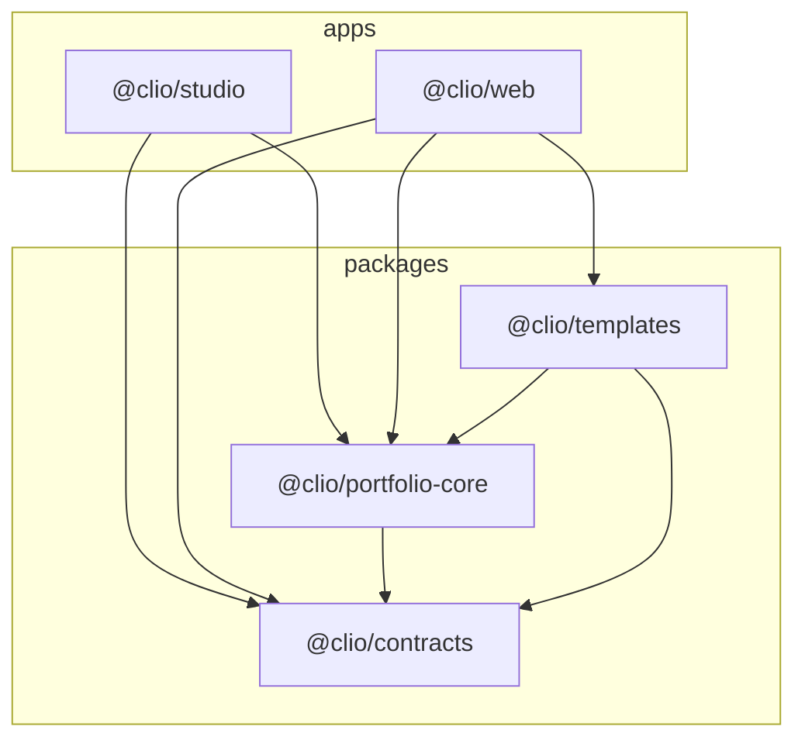

# pnpm workspaces

> Monorepo de JavaScript con pnpm: varias apps y paquetes en un solo repositorio, con dependencias compartidas e instaladas una sola vez.

## Qué es y qué problema resuelve
pnpm es un gestor de paquetes como npm, pero guarda cada versión de cada paquete una sola vez en un almacén global y la enlaza a cada proyecto. Un **workspace** es un repo con varios `package.json` (apps y librerías internas) que pnpm trata como un conjunto:
- Un solo `pnpm install` y un solo `pnpm-lock.yaml`.
- Los paquetes internos se referencian con `workspace:*` y se enlazan por symlink, sin publicarlos.
- Comandos para correr scripts en todos o en algunos paquetes (`-r`, `--filter`).

Resuelve el código compartido entre apps (tipos, utilidades, componentes) sin copiarlo ni publicarlo en un registro.

Versión usada en [[Itzamna.Clio]]: `pnpm@10.12.1` (campo `packageManager`), Node 22.

## Cómo funciona por dentro
- `pnpm-workspace.yaml` dice qué carpetas son paquetes.
- `node_modules` es **estricto**: cada paquete solo ve las dependencias que declaró (no hay "dependencias fantasma" por hoisting).
- `"@clio/contracts": "workspace:*"` → symlink a `packages/contracts`.
- `pnpm -r <script>` corre el script en cada paquete que lo tenga; `--filter` limita por nombre o carpeta; `--parallel` los corre a la vez.
- `pnpm.onlyBuiltDependencies`: lista blanca de paquetes que pueden ejecutar scripts de instalación (pnpm 10 los bloquea por defecto).



## Cuándo usarla y cuándo no
### Ventajas
- Código compartido real (tipos, formato, plantillas) entre Studio y sitio público.
- Instalación rápida y con poco disco.
- `node_modules` estricto: menos sorpresas entre local y CI.
- `--frozen-lockfile` en CI asegura instalaciones reproducibles.
### Desventajas
- Herramientas que esperan `node_modules` plano pueden fallar (se arregla con `.npmrc`, no fue necesario en Clio).
- Sin orquestador (Turborepo, Nx) no hay caché de tareas ni orden inteligente de builds.
- Más configuración que un solo `package.json`.

## Alternativas
| Alternativa | En qué se diferencia |
|---|---|
| npm workspaces | Integrado en npm; `node_modules` con hoisting, menos estricto. |
| Yarn workspaces (Berry) | Similar; Plug'n'Play opcional en vez de `node_modules`. |
| Turborepo / Nx | Se montan encima del workspace: caché de tareas, grafos, builds incrementales. |
| Repos separados + paquetes publicados | Cada app versiona sus dependencias internas; más fricción para cambios cruzados. |

## Cómo se usó en Itzamna
`Itzamna.Clio/pnpm-workspace.yaml`:
```yaml
packages:
  - "apps/*"
  - "packages/*"
```

| Paquete | Rol |
|---|---|
| `@clio/studio` | Creator Studio (puerto 5173) |
| `@clio/web` | Portfolio público + `/preview` (puerto 5174) |
| `@clio/contracts` | Tipos espejo de los DTOs de [[Itzamna.Dionisio]] (ver [[TypeScript]]) |
| `@clio/portfolio-core` | `formatMetric`/`formatCount` (misma regla que `MetricFormatter` en .NET, ver [[Redes sociales y métricas]]), helpers de imagen (ver [[Imágenes responsive]]) y secciones |
| `@clio/templates` | `templateRegistry`, `PortfolioRenderer` y la plantilla Editorial ([[Plantillas y diseño]]); `react` como `peerDependency` |

**Paquetes sin build propio**: los paquetes internos exponen el código fuente (`"main": "src/index.ts"`, `"types": "src/index.ts"`). [[Vite]] de cada app compila ese TypeScript directamente; no hay `dist/` por paquete.

Scripts raíz (`Itzamna.Clio/package.json`):
```json
"dev": "pnpm -r --parallel --filter \"./apps/*\" dev",
"dev:studio": "pnpm --filter @clio/studio dev",
"build": "pnpm -r --filter \"./apps/*\" build",
"typecheck": "pnpm -r typecheck",
"ci": "pnpm typecheck && pnpm build"
```

- `pnpm.onlyBuiltDependencies: ["esbuild"]`: solo esbuild (que usa Vite) puede correr su script de instalación.
- El pipeline instala la versión exacta de pnpm del `packageManager` y usa `pnpm install --frozen-lockfile`; luego `pnpm --filter @clio/studio build` y `pnpm --filter @clio/web build` por separado, cada uno con sus `VITE_*` ([[Azure Pipelines]]).
- `engines.node: ">=20"` en `package.json`, aunque el README y el pipeline piden Node 22.

> [!tip] Reutilizable
> La división `apps/*` + `packages/{contracts,core,templates}` con paquetes "fuente" (sin build) es un esqueleto simple para cualquier par "editor + sitio público" que comparta tipos y componentes.

> [!note] Pendiente de confirmar
> No hay orquestador (Turborepo/Nx) ni caché de tareas; con pocos paquetes no hace falta, pero se desconoce si está previsto.

## Errores comunes y buenas prácticas
- Importar un paquete que no declaraste en `package.json`: con pnpm falla (bien). Declara siempre `workspace:*`.
- Olvidar `--frozen-lockfile` en CI: el lockfile podría "arreglarse" solo y la build no ser reproducible.
- Poner `react` como dependencia normal en una librería compartida: puede haber dos copias de React. Usa `peerDependencies` (como `@clio/templates`).
- Fijar la versión de pnpm en `packageManager` y usarla igual en CI.

## Qué estudiar después
- [[Vite]] (cómo resuelve paquetes del workspace)
- Turborepo o Nx para monorepos grandes
- Corepack (`corepack enable`) para fijar el gestor de paquetes
- `pnpm deploy` / filtros avanzados (`...^`, `[origin/main]`)

## Documentación oficial
- https://pnpm.io/workspaces
- https://pnpm.io/filtering
- https://pnpm.io/package_json#pnpmonlybuiltdependencies

## Autoevaluación

Contesta primero en voz alta o en papel; luego despliega la respuesta.

> [!question]- ¿Qué es un workspace de pnpm?
> Un monorepo con varios paquetes declarados en `pnpm-workspace.yaml`; pnpm instala todo con un solo lockfile y enlaza los paquetes internos entre sí.

> [!question]- ¿Cómo referencias un paquete interno y cómo corres un script en uno solo?
> En `package.json`: `"@mi/ui": "workspace:*"`. Para ejecutar: `pnpm --filter @mi/ui build` (o `pnpm -r build` para todos).

> [!question]- ¿Por qué pnpm es estricto con dependencias no declaradas?
> Su `node_modules` no es plano: un paquete solo ve lo que declaró. Evita depender por accidente de algo que llegó como dependencia de otro.

