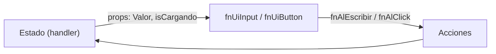

---
proyecto:
  - Ocelotl.Iris
  - Itzamna.Clio
proyectos:
  - "[[Ocelotl.Iris]]"
  - "[[Itzamna.Clio]]"
tipo: patron
nivel: basico
estado: completo
tags:
  - conocimiento
  - patron
  - componentes
progreso: pendiente
area: React
---
# Componentes controlados

> Componentes de UI sin estado propio: el valor llega por props desde el estado de la pantalla y cada cambio sale por un callback.

> [!tip] Reutilizable
> Los componentes de `shared/components` (botón, input, select, modal, pestañas, paginación) no saben nada de Ocelotl: son funciones `Props ⇒ plantilla` que se pueden copiar a cualquier proyecto con [[lit-html]], y sus reglas son las mismas que en React.

## Qué es y qué problema resuelve
Un componente es **controlado** cuando no guarda su valor: lo recibe (`Valor`, `isAbierto`, `Activa`, `Pagina`) y avisa los cambios (`fnAlEscribir`, `fnAlCambiar`, `fnAlCerrar`). La "fuente de verdad" es una sola: el estado de la pantalla. Resuelve los desajustes típicos de un componente con estado oculto (el input dice una cosa y el estado otra; el modal se cerró solo y la pantalla cree que está abierto).

## Cómo funciona por dentro
1. El handler tiene el estado (`Estado.Conexion.Ip`).
2. La vista llama al componente con el valor y una acción: `fnUiInput({ Valor: Ip, fnAlEscribir: Acciones.fnEscribirIp })`.
3. El operador teclea → el componente llama `fnAlEscribir(valor)` → el handler actualiza el estado → se vuelve a pintar con el valor nuevo.



Componentes **no controlados** (lo contrario): el DOM guarda el valor y se lee cuando hace falta (`input.value` al enviar).

## Cuándo usarla y cuándo no
Úsalo cuando el valor influye en otras partes (validación en vivo, botones que se deshabilitan, ejemplos calculados) o cuando debe poder resetearse desde el estado. Un no controlado basta para un campo aislado que solo se lee al enviar (p. ej. un `<input type="file">`).

### Ventajas
- Una sola fuente de verdad; la UI siempre refleja el estado.
- Componentes puros, fáciles de probar y de reutilizar.
- Traducción directa a React (`value` + `onChange`).

### Desventajas
- Un repintado por cada tecla (barato con lit-html, pero existe).
- Más "cableado": cada campo necesita su acción `fnEscribirX`.
- Elementos imperativos del navegador (`<dialog>`, foco) requieren sincronizar a mano.

## Alternativas
| Alternativa | En qué se diferencia |
|---|---|
| No controlados | El DOM guarda el valor; se lee con `FormData` o refs al enviar. |
| Web Components con estado interno | El componente gestiona su valor y emite eventos; dos fuentes de verdad. |
| React controlado | Mismo patrón: `<input value={ip} onChange={e => setIp(e.target.value)} />`. |

## Cómo se usó en Ocelotl
En [[Ocelotl.Iris]], `src/shared/components/` exporta (vía `index.js`) `fnUiButton`, `fnUiInput`, `fnUiSelect`, `fnUiModal` / `fnUiConfirmacion`, `fnUiTabs`, `fnUiPaginacion` + `fnPaginar` y `fnUiPendiente`. Siguientes según el README: `fnUiCheckbox`, `fnUiFileUpload`.

Reglas (`Ocelotl.Iris/src/shared/components/index.js`):

```js
 *   1. Un archivo ui-<nombre>.js con `export function fnUi<Nombre>(Props)` y su ui-<nombre>.css.
 *   2. Props en PascalCase y en español; booleanos con is.
 *   3. Eventos como props con prefijo fnAl: fnAlClick, fnAlEscribir, fnAlCambiar (como onClick en React).
 *   4. Sin estado interno: el valor llega por props (componente "controlado", como en React).
 *   5. Clases con prefijo ui-<nombre> (BEM: ui-input__label, ui-button--danger).
 *   6. Importar el .css en styles/main.css y exportarlo aquí.
```

| Componente | Valor controlado | Callback |
|---|---|---|
| `fnUiButton` | `isCargando`, `isDeshabilitado` | `fnAlClick` |
| `fnUiInput` | `Valor`, `MensajeError` | `fnAlEscribir(Valor, e)` |
| `fnUiSelect` | `Valor`, `Opciones` | `fnAlCambiar(Valor, e)` |
| `fnUiModal` / `fnUiConfirmacion` | `isAbierto` | `fnAlCerrar` / `fnAlConfirmar`, `fnAlCancelar` |
| `fnUiTabs` | `Activa`, `Pestanas` | `fnAlCambiar(Id)` |
| `fnUiPaginacion` | `Pagina`, `TotalRegistros`, `PorPagina` | `fnAlCambiar(Pagina)` |

El input fuerza el valor del estado con la directiva `live` (`Ocelotl.Iris/src/shared/components/ui-input.js`):

```js
.value=${live(String(Valor ?? ''))}
// ...
@input=${(e) => fnAlEscribir?.(e.target.value, e)}
```

El modal, sobre el [[Elemento dialog]], no se cierra solo: Escape y el clic fuera llaman a `fnAlCerrar` (salvo `isPersistente`) y una función con `ref` abre o cierra el `<dialog>` para que coincida con `isAbierto` (`Dialogo.showModal()` / `Dialogo.close()`). `fnUiConfirmacion` sustituye a `confirm()`. `fnUiTabs` solo pinta la barra: "la pantalla decide qué panel mostrar según Activa".

Uso en una vista (README de Iris):

```js
fnUiInput({ Id: 'ConfiguracionIp', Etiqueta: 'Dirección IP', Valor: Estado.Ip, MensajeError: Estado.Errores.Ip, fnAlEscribir: Acciones.fnEscribirIp })
fnUiButton({ Texto: 'Conectar', Tipo: 'submit', isCargando: Estado.isEnviando })
```

**Comparación con React**: `fnUiButton({ Texto, fnAlClick })` ≈ `<UiButton Texto onClick />`; `Valor` + `fnAlEscribir` ≈ `value` + `onChange`; `isAbierto` + `fnAlCerrar` ≈ `open` + `onClose`. Al migrar, cada `fnUiX` pasa a `<UiX ... />` (ver [[Molde Service-View-Handlers-Events]]).

Funcionalidades: todas las pantallas, p. ej. [[Conexión de robots]] (formulario de IP), [[Dispensar]], [[Ingresos]], [[Historial de salidas]] (paginación, pestañas, select de robot), [[Sesión y roles]] (confirmación de cierre de sesión).


## Cómo se usó en Itzamna
En [[Itzamna.Clio]] el patrón es el nativo de [[React]]: `value` + `onChange`. Es la versión "destino" de lo que Iris hace con `Valor` + `fnAlEscribir`.

**Componentes** (`apps/studio/src/components/ui.tsx`), todos sin estado propio del valor:

| Componente | Valor | Callback | Detalle |
|---|---|---|---|
| `TextField` / `TextArea` | `value: string \| null` | `onChange(v)` | Texto vacío → `null` (salvo `required`); contador `count/max` |
| `NumberField` | `value: number \| null` | `onChange(v)` | Filtra a dígitos; vacío → `null` ("desconocido", nunca 0) |
| `Select<T>` | `value: T \| null` | `onChange(v)` | Genérico sobre la unión de opciones |
| `Toggle` | `checked` | `onChange(bool)` | `role="switch"` |
| `Segmented<T>` / `Tabs<T>` | `value` | `onChange(v)` | `role="radiogroup"` / `role="tablist"` |
| `Dialog` | `open` | `onClose` | Escape, clic fuera y foco inicial/retorno; se pinta con `createPortal` |
| `MediaField` | `MediaReference \| null` | `onChange(v)` | Imagen + alt + encuadre ([[react-easy-crop]]) |
| `SortableList` | `items` | `onReorder(ids)` | Orden controlado por la página ([[dnd-kit]]) |

`Field` liga `label` e `input` con `useId()` y muestra `error` con `role="alert"` y `aria-invalid` (`Itzamna.Clio/apps/studio/src/components/ui.tsx`):
```tsx
<input id={id} type={type} value={str(value)} placeholder={placeholder} aria-invalid={!!error || undefined}
  onChange={(e) => onChange(required ? e.target.value : orNull(e.target.value))} />
```

**Quién tiene el estado**: el hook `useDraftForm` (`apps/studio/src/lib/useDraftForm.ts`) es el equivalente al handler de Iris. Guarda una copia local editable del DTO (`value`), la compara con la del servidor para saber si está `dirty`, publica los cambios sin guardar en la vista previa (store [[zustand]]), convierte los errores de FluentValidation en `errors` por campo y guarda con Ctrl/⌘+S. Para diálogos de colección se usa `useEntityForm`. Uso típico (`Itzamna.Clio/apps/studio/src/pages/Hero.tsx`):
```tsx
const f = useDraftForm<HeroDto>({ form: 'hero', initial: p?.hero, previewKey: 'hero', mutation: useSaveHero(), successMessage: 'Hero guardado' });
// ...
<TextField label="Título" value={v.title} onChange={(title) => f.update({ title })} max={160} error={e.title} />
```
`update(patch)` mezcla el cambio y borra el error de ese campo. Funcionalidades: [[Módulos del portfolio - Front]], [[Perfil del creador]], [[Redes sociales y métricas]], [[Contenido y categorías]].

Diferencia con Iris: el `Dialog` de Clio **no** usa el [[Elemento dialog]] nativo, sino un `div role="dialog" aria-modal="true"` en un portal; `confirmDialog()` sigue usando `window.confirm`.

> [!note] Pendiente de confirmar
> El `Dialog` no atrapa el foco con Tab (solo enfoca el primer control y lo devuelve al cerrar); no se encontró un *focus trap*.

## Errores comunes y buenas prácticas
- **Leer `input.value` del DOM** en el handler: rompe la fuente única; usar el estado.
- **Asignar `value=` como atributo** en vez de propiedad: el input puede quedar desincronizado; Iris usa `.value=${live(...)}`.
- **Cerrar el modal desde el navegador** (Escape nativo) sin avisar al estado: Iris hace `preventDefault()` en `cancel` y delega en `fnAlCerrar`.
- **Props con lógica de negocio** (que el botón llame a Hermes): el componente solo avisa; el handler decide.
- Booleanos con `is` y callbacks con `fnAl` para que la firma sea autoexplicativa.
- `Id` obligatorio en inputs para ligar `label` y `aria-describedby` (accesibilidad).

## Qué estudiar después
- [[Molde Service-View-Handlers-Events]]
- [[lit-html]] (directivas `live`, `ref`, `classMap`)
- [[Elemento dialog]]
- Componentes controlados y no controlados en React
- "Lifting state up" (subir el estado al padre)

## Documentación oficial
- https://react.dev/learn/sharing-state-between-components#controlled-and-uncontrolled-components
- https://lit.dev/docs/templates/directives/#live

## Autoevaluación

Contesta primero en voz alta o en papel; luego despliega la respuesta.

> [!question]- ¿Qué es un input controlado y uno no controlado?
> Controlado: su valor viene del estado (`value={v}` + `onChange`), React es la fuente de verdad. No controlado: el DOM guarda el valor y lo lees con un `ref` o `FormData` al enviar (`defaultValue`).

> [!question]- Error común: `value={v}` sin `onChange`. ¿Qué pasa?
> El campo queda de solo lectura (React avisa en consola). Agrega `onChange` o usa `defaultValue`/`readOnly`.

> [!question]- ¿Por qué aparece el aviso "changing an uncontrolled input to be controlled"?
> El `value` empezó como `undefined` y luego pasó a string. Inicializa el estado con `''`.

## Práctica

- [[Lab 3 - Formulario controlado con validación]]

