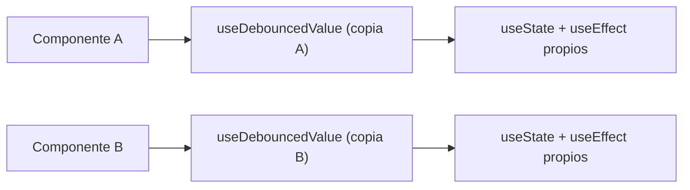

# Custom hooks

Parte de: [[05-React/_Índice React|React]]

> [!info] Cómo avanzar
> `progreso`: **pendiente** → **viendo** (estudiando) → **visto** (contestaste la autoevaluación sin abrir las respuestas) → **dominado** (hiciste el laboratorio o lo aplicaste de verdad).

## Contenido

### Qué es
Un custom hook es **una función de JavaScript cuyo nombre empieza con `use` y que llama a otros hooks** (`useState`, `useEffect`, `useRef`, `useContext`, o a otros custom hooks). Sirve para **reutilizar lógica con estado** entre componentes: "escuchar el tamaño de la ventana", "retrasar un valor mientras el usuario escribe", "manejar un borrador de formulario". Lo que se comparte es la **lógica**, no el estado: cada componente que llama al hook obtiene su propia copia independiente del estado, igual que si hubiera escrito esos `useState` en su cuerpo.

### Cómo funciona
React no tiene un mecanismo especial para custom hooks: son funciones normales. Cuando `ComponenteA` llama `useContador()`, los hooks de dentro se registran **como si fueran de ComponenteA**, en el orden en que se llaman. Por eso:

- Siguen las **reglas de hooks**: se llaman en el nivel superior del componente o de otro hook, nunca dentro de `if`, ciclos o callbacks, para que el orden sea siempre el mismo.
- El prefijo `use` es una **convención con consecuencias**: le dice al linter (`eslint-plugin-react-hooks`) y al React Compiler que esa función es un hook. Así pueden verificar que no la llames condicionalmente y que las dependencias de los efectos que contiene estén completas.
- Pueden recibir parámetros y devolver lo que quieras: un valor, una tupla `[valor, setValor]` o un objeto `{ datos, cargando, guardar }`.



### Ejemplos
#### `useDebouncedValue`: esperar a que el usuario deje de escribir
```tsx
import { useEffect, useState } from 'react';

export function useDebouncedValue<T>(valor: T, ms = 300): T {
  const [retrasado, setRetrasado] = useState(valor);

  useEffect(() => {
    const t = setTimeout(() => setRetrasado(valor), ms);
    return () => clearTimeout(t); // si valor cambia antes de ms, se cancela
  }, [valor, ms]);

  return retrasado;
}
```

Uso con [[TanStack Query]] en un buscador de clientes: la consulta solo se dispara cuando el texto lleva 300 ms sin cambiar.

```tsx
function BuscadorClientes() {
  const [texto, setTexto] = useState('');
  const q = useDebouncedValue(texto, 300);
  const { data = [] } = useQuery({
    queryKey: ['clientes', q],
    queryFn: () => api.buscarClientes(q),
    enabled: q.length >= 2,
  });
  return (
    <>
      <input value={texto} onChange={e => setTexto(e.target.value)} />
      <ul>{data.map(c => <li key={c.id}>{c.nombre}</li>)}</ul>
    </>
  );
}
```

#### `useMediaQuery`: suscripción a una API del navegador
```tsx
export function useMediaQuery(consulta: string): boolean {
  const [coincide, setCoincide] = useState(() => window.matchMedia(consulta).matches);
  useEffect(() => {
    const mql = window.matchMedia(consulta);
    const onCambio = () => setCoincide(mql.matches);
    mql.addEventListener('change', onCambio);
    onCambio();
    return () => mql.removeEventListener('change', onCambio);
  }, [consulta]);
  return coincide;
}
// const esMovil = useMediaQuery('(max-width: 640px)');
```

#### Hooks que se leen por su intención
En un formulario de edición puedes agrupar estado del borrador, validación y guardado en `useEntityForm(id)`, y el componente queda casi solo con JSX. El hook es también una buena frontera para pruebas (`renderHook` de Testing Library) y para esconder detalles como `AbortController`.

### Cuándo extraer un custom hook
- La **misma combinación** de estado + efectos aparece en dos o más componentes (debounce, suscripción a `localStorage`, conexión a SignalR).
- Un componente se volvió largo y mezclar lógica con JSX dificulta leerlo: extraer `useFiltrosPedido()` permite que el componente "diga qué hace".
- Quieres **encapsular una dependencia externa** (cliente HTTP, WebSocket, librería imperativa) detrás de una API pequeña.

Cuándo **no**: si la función no llama a ningún hook, es una función utilitaria normal y no debe llevar `use` (por ejemplo `formatearMoneda`). Tampoco extraigas hooks "genéricos" que solo envuelven un `useEffect` sin dar una abstracción clara (`useMount`): ocultan la intención y las dependencias. Si lo que se repite es **marcado**, lo que necesitas es un componente (ver [[Componentes]]).

### Errores comunes
- **No empezar con `use`**: pierdes la verificación del linter (reglas de hooks y dependencias exhaustivas) y el compilador no lo trata como hook; los errores aparecen en tiempo de ejecución.
- **Creer que comparte estado**: dos componentes con `useCarrito()` tienen dos carritos. Para estado compartido usa [[Context]] o [[zustand]].
- **Devolver objetos o funciones nuevas en cada render**: quien los use como dependencia tendrá efectos que corren siempre. Estabiliza con `useCallback`/`useMemo` o con el React Compiler (ver [[useMemo y useCallback]]).
- **Efectos sin limpieza** dentro del hook: se multiplican por cada componente que lo usa.
- **Llamar al hook condicionalmente** (`if (activo) useAlgo()`): pasa el flag como parámetro y decide adentro.

### Para profundizar
- [Reutilizar lógica con custom hooks (react.dev)](https://react.dev/learn/reusing-logic-with-custom-hooks)
- [Reglas de los hooks (react.dev)](https://react.dev/reference/rules/rules-of-hooks)
- [eslint-plugin-react-hooks (react.dev)](https://react.dev/reference/eslint-plugin-react-hooks)

## Ejercicios

Resuélvelos en papel o en la herramienta; la solución está plegada.

> [!question]- Escribe `useDebouncedValue(valor, ms)`.
> ```js
> function useDebouncedValue(valor, ms = 300) {
>   const [v, setV] = useState(valor);
>   useEffect(() => {
>     const t = setTimeout(() => setV(valor), ms);
>     return () => clearTimeout(t);
>   }, [valor, ms]);
>   return v;
> }
> ```

## Autoevaluación

Contesta primero en voz alta o en papel; luego despliega la respuesta.

> [!question]- ¿Qué es un custom hook?
> Una función que empieza con `use` y llama a otros hooks para reutilizar **lógica con estado** (no el estado en sí: cada componente que la usa tiene su propia copia).

> [!question]- ¿Cuándo extraer un custom hook?
> Cuando la misma combinación de estado + efectos aparece en varios componentes, o para que un componente se lea por su intención (`useDraftForm`, `useEntityForm`, `useDebouncedValue`).

> [!question]- Error común: un hook que no empieza con `use`. ¿Qué pierdes?
> El linter (`eslint-plugin-react-hooks`) no puede verificar las reglas de hooks ni sus dependencias.

## Práctica

- [[Lab 1 - App de notas con estado y efectos]]
- [[Lab 2 - TanStack Query con caché e invalidación]]

