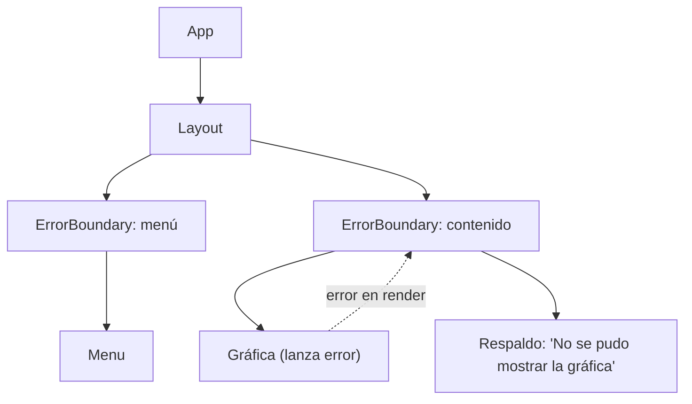

# Error boundaries

Parte de: [[05-React/_Índice React|React]]

> [!info] Cómo avanzar
> `progreso`: **pendiente** → **viendo** (estudiando) → **visto** (contestaste la autoevaluación sin abrir las respuestas) → **dominado** (hiciste el laboratorio o lo aplicaste de verdad).

## Contenido

### Qué es
Un error boundary ("frontera de errores") es un componente que **atrapa los errores que lanzan sus hijos durante el render** (y en métodos de ciclo de vida y constructores) y, en lugar de dejar que toda la aplicación se desmonte, muestra una **interfaz de respaldo**: "Algo salió mal en esta sección. Reintentar". Sin boundaries, un error no capturado en cualquier componente desmonta el árbol completo y el usuario ve una pantalla en blanco.

Es parecido a un middleware de manejo de excepciones de ASP.NET Core que convierte una excepción en ProblemDetails: aísla el fallo y responde algo útil en vez de tirar todo.

### Cómo funciona
Cuando un componente lanza un error al renderizarse, React sube por el árbol buscando el boundary más cercano. Ese boundary cambia a modo "error" y renderiza su respaldo; todo lo que está **fuera** de él sigue funcionando.



#### Qué errores atrapa y cuáles no
Atrapa errores **síncronos durante el render** de sus descendientes, en sus constructores y métodos de ciclo de vida. **No atrapa**:

- Errores en **manejadores de eventos** (`onClick`): ocurren fuera del render. Usa `try/catch` en el handler y guarda el error en estado si quieres mostrarlo.
- Código **asíncrono**: `setTimeout`, promesas, `fetch` que falla. Tampoco ocurre durante el render. Con [[TanStack Query]] usa `isError`/`error` o la opción `throwOnError` para relanzarlo durante el render y que lo capture el boundary.
- Errores en el **propio boundary** (solo los de sus hijos).
- Errores en el render del servidor (SSR).

#### Cómo se crea
No existe un hook equivalente: un boundary es un **componente de clase** con al menos uno de estos métodos:

- `static getDerivedStateFromError(error)`: devuelve el estado nuevo para mostrar el respaldo (se llama durante el render).
- `componentDidCatch(error, info)`: para efectos secundarios, como registrar el error en un servicio de monitoreo (Application Insights, Sentry). `info.componentStack` indica dónde ocurrió.

### Ejemplo
```tsx
import { Component, type ErrorInfo, type ReactNode } from 'react';

type Props = { respaldo: ReactNode; children: ReactNode };
type Estado = { error: Error | null };

export class ErrorBoundary extends Component<Props, Estado> {
  state: Estado = { error: null };

  static getDerivedStateFromError(error: Error): Estado {
    return { error };
  }

  componentDidCatch(error: Error, info: ErrorInfo) {
    // Aquí mandarías el error a tu telemetría
    console.error('Error en UI', error, info.componentStack);
  }

  render() {
    return this.state.error ? this.props.respaldo : this.props.children;
  }
}

// Uso: un boundary por zona independiente
<ErrorBoundary respaldo={<p>No se pudo cargar el reporte.</p>}>
  <GraficaVentas />
</ErrorBoundary>
```

En la práctica casi todos usan la librería `react-error-boundary`, que ya trae `FallbackComponent`, `resetKeys` y la función `resetErrorBoundary` para reintentar:

```tsx
import { ErrorBoundary } from 'react-error-boundary';

<ErrorBoundary
  fallbackRender={({ error, resetErrorBoundary }) => (
    <div role="alert">
      <p>Algo salió mal: {error.message}</p>
      <button onClick={resetErrorBoundary}>Reintentar</button>
    </div>
  )}
  resetKeys={[reporteId]} // se reinicia solo si cambia el reporte
>
  <Reporte id={reporteId} />
</ErrorBoundary>
```

Con el data router de [[React Router]], cada ruta puede definir un `ErrorBoundary` (o `errorElement`, la forma que verás en código más antiguo) que captura errores de su render, de su `loader` y de su `action`; dentro, `useRouteError()` devuelve el error. Es la forma natural de manejar errores por pantalla.

### Dónde ponerlos
- **Uno en la raíz** como última red: mensaje genérico y botón para recargar.
- **Uno por zona independiente**: widgets de un tablero, el panel lateral, una gráfica, un editor. Si falla uno, los demás siguen vivos.
- **Junto a [[Suspense y lazy loading]]**: si un chunk lazy no se puede descargar (deploy nuevo, red caída), el error lo atrapa el boundary; envolver `Suspense` con un boundary da estados de "cargando" y "falló" coherentes.

### Cuándo usarlo y cuándo no
Úsalo para fallas **inesperadas** de render. Los errores **esperados** (validación, 404, 403 de la API con su `codigo` en ProblemDetails) se manejan como estado normal y se muestran con mensajes específicos; no conviene lanzarlos para que los atrape un boundary genérico.

### Errores comunes
- **Esperar que atrape errores de `onClick` o de `fetch`**: no lo hace; usa `try/catch` o el estado de error de la consulta.
- **Un solo boundary en la raíz**: un widget roto tira toda la pantalla.
- **No ofrecer forma de recuperarse**: incluye "Reintentar" que reinicie el boundary (`resetKeys` o cambiar su `key`).
- **No registrar el error**: sin `componentDidCatch`/`onError` no te enteras de fallas en producción.
- **Mostrar el stack al usuario**: solo un mensaje amable; el detalle va a la telemetría.

### Para profundizar
- [Capturar errores de render con un error boundary (react.dev)](https://react.dev/reference/react/Component#catching-rendering-errors-with-an-error-boundary)
- [react-error-boundary (GitHub)](https://github.com/bvaughn/react-error-boundary)
- [Modos de React Router y manejo de datos](https://reactrouter.com/start/modes)

## Autoevaluación

Contesta primero en voz alta o en papel; luego despliega la respuesta.

> [!question]- ¿Qué es un error boundary?
> Un componente que atrapa errores lanzados **durante el render** (y en ciclos de vida) de sus hijos y muestra una UI de respaldo en lugar de dejar la pantalla en blanco.

> [!question]- ¿Qué errores NO atrapa?
> Errores en handlers de eventos, en código asíncrono (`setTimeout`, promesas) y en el propio boundary. Esos se manejan con `try/catch` o con el estado de error de TanStack Query.

> [!question]- ¿Cómo se crea uno?
> Con una clase con `static getDerivedStateFromError` y/o `componentDidCatch` (no hay hook equivalente), o con la librería `react-error-boundary`. En data router, el `errorElement` de la ruta cumple ese papel.

## Práctica

- [[Lab 2 - TanStack Query con caché e invalidación]]
- [[Lab 4 - Rutas protegidas con React Router (data router)]]

