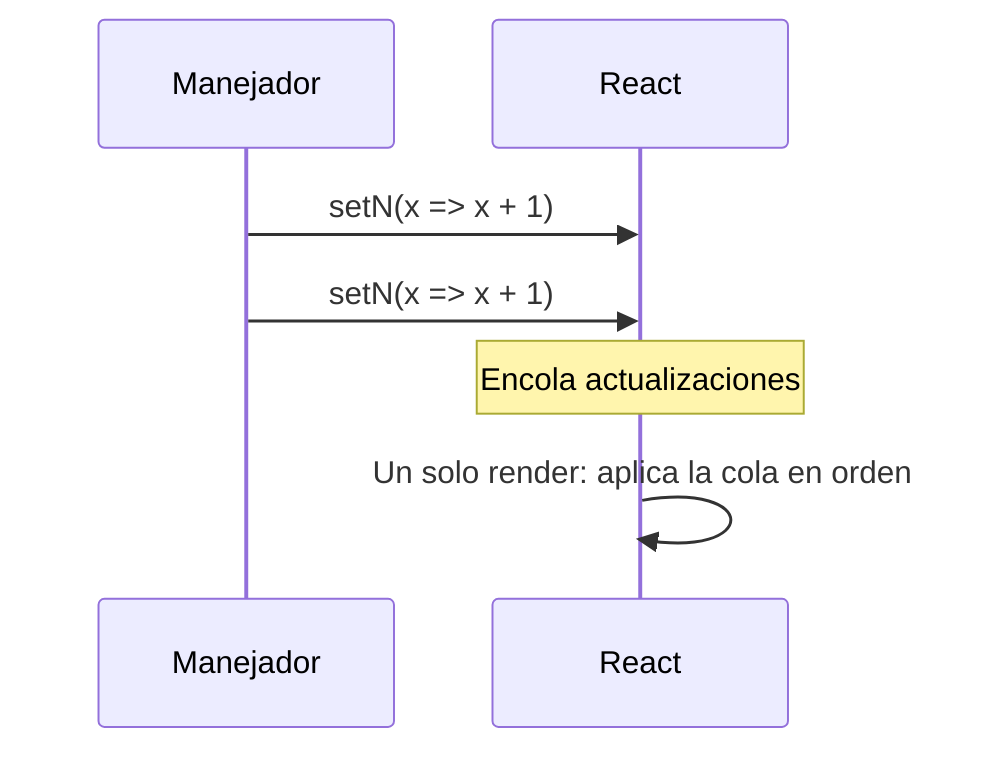

# Estado con useState

Parte de: [[05-React/_Índice React|React]]

> [!info] Cómo avanzar
> `progreso`: **pendiente** → **viendo** (estudiando) → **visto** (contestaste la autoevaluación sin abrir las respuestas) → **dominado** (hiciste el laboratorio o lo aplicaste de verdad).

## Contenido

### Qué es
`useState` es el hook que da **memoria** a un componente: un valor que React guarda entre renders y que, al cambiar, provoca que el componente se vuelva a dibujar. Se llama así: `const [valor, setValor] = useState(inicial)`. Devuelve un arreglo de dos elementos: el **valor actual** para este render y una **función setter** para pedir un valor nuevo. Una variable local normal (`let n = 0`) no sirve, porque se reinicia cada vez que React llama a la función y cambiarla no avisa a React.

### Cómo funciona
1. En el primer render, React guarda `inicial` asociado a la posición de ese hook en el componente.
2. En renders siguientes, `useState` devuelve el valor guardado (ignora `inicial`).
3. Al llamar `setValor(nuevo)`, React **no cambia la variable** que tienes en la mano: programa un nuevo render. En ese render siguiente, `useState` devolverá `nuevo`.
4. React compara el valor nuevo con el anterior usando `Object.is`. Si son iguales (misma referencia en objetos y arreglos), puede saltarse el render.

#### El estado es una foto
Cada render tiene sus propias constantes. Dentro de un manejador, `n` vale lo que valía cuando se pintó ese render:

```tsx
function click() {
  setN(n + 1);
  console.log(n); // sigue mostrando el valor viejo
}
```

Por eso, si llamas `setN(n + 1)` tres veces seguidas, las tres usan el mismo `n` y el resultado es solo `+1`.

#### Agrupación (batching) y forma funcional
React agrupa todas las actualizaciones de un mismo evento y hace **un solo render** al final. Si en vez de un valor pasas una **función actualizadora**, React la pone en una cola y cada una recibe el resultado de la anterior:

```tsx
setN(x => x + 1);
setN(x => x + 1);
setN(x => x + 1); // al final: +3
```

Usa la forma funcional siempre que el valor nuevo dependa del anterior, sobre todo en callbacks asíncronos o intervalos, donde la variable capturada puede estar vieja.



#### Inmutabilidad
React detecta el cambio por referencia, así que el estado se trata como **inmutable**: en lugar de modificar un objeto o arreglo, creas uno nuevo.

| Quiero… | Mal (muta) | Bien (copia) |
|---|---|---|
| Agregar | `lista.push(x)` | `[...lista, x]` |
| Quitar | `lista.splice(i, 1)` | `lista.filter(e => e.id !== id)` |
| Editar uno | `lista[i].hecho = true` | `lista.map(e => e.id === id ? { ...e, hecho: true } : e)` |
| Ordenar | `lista.sort()` | `lista.toSorted()` o `[...lista].sort()` |
| Campo anidado | `u.direccion.ciudad = 'X'` | copiar cada nivel con *spread* |

Si haces `lista.push(x); setLista(lista)`, la referencia es la misma, `Object.is` dice "igual" y no hay render.

### Ejemplo
Lista de tareas para practicar todo lo anterior:

```tsx
import { useState } from 'react';

type Tarea = { id: string; texto: string; hecha: boolean };

export function Tareas() {
  const [tareas, setTareas] = useState<Tarea[]>([]);
  const [texto, setTexto] = useState('');

  function agregar() {
    if (!texto.trim()) return;
    setTareas(t => [...t, { id: crypto.randomUUID(), texto, hecha: false }]);
    setTexto('');
  }

  function alternar(id: string) {
    setTareas(t => t.map(x => (x.id === id ? { ...x, hecha: !x.hecha } : x)));
  }

  const pendientes = tareas.filter(t => !t.hecha).length; // derivado, no es estado

  return (
    <div>
      <input value={texto} onChange={e => setTexto(e.target.value)} />
      <button onClick={agregar}>Agregar</button>
      <p>Pendientes: {pendientes}</p>
      <ul>
        {tareas.map(t => (
          <li key={t.id} onClick={() => alternar(t.id)}>
            {t.hecha ? <s>{t.texto}</s> : t.texto}
          </li>
        ))}
      </ul>
    </div>
  );
}
```

Observa que `pendientes` **no** es estado: se calcula a partir de `tareas`. Guardar en estado algo que se puede derivar genera datos duplicados que se desincronizan.

### Cuándo usarlo y cuándo no
- Úsalo para valores que cambian por interacción y afectan lo que se ve: texto de un input, pestaña activa, modal abierto.
- Si varios valores cambian juntos con reglas (carrito, asistente de varios pasos), considera [[useReducer]].
- Si el valor no afecta el render (id de un intervalo, valor previo), usa [[useRef]].
- Si son datos del servidor, usa [[TanStack Query]] en vez de `useState` + `useEffect`.
- Si varios componentes lejanos lo comparten, súbelo al ancestro común o usa [[Context]] o [[zustand]].
- Si el estado inicial es costoso de calcular, pasa una función: `useState(() => leerDeLocalStorage())`, así solo se ejecuta una vez.

### Errores comunes
- **Esperar el valor nuevo justo después del setter**: el cambio se ve en el siguiente render.
- **Mutar y volver a pasar la misma referencia**: no hay render.
- **Varios `setN(n + 1)` seguidos**: solo suma uno; usa la forma funcional.
- **Estado derivado** (`total`, `filtrados`) guardado aparte: calcúlalo en el render.
- **Llamar hooks dentro de `if` o ciclos**: React identifica cada hook por su orden; debe ser siempre el mismo.

### Para profundizar
- [useState (react.dev)](https://react.dev/reference/react/useState)
- [El estado como una instantánea (react.dev)](https://react.dev/learn/state-as-a-snapshot)
- [Actualizar objetos en el estado (react.dev)](https://react.dev/learn/updating-objects-in-state)
- [Actualizar arreglos en el estado (react.dev)](https://react.dev/learn/updating-arrays-in-state)

## Ejercicios

Resuélvelos en papel o en la herramienta; la solución está plegada.

> [!question]- Tras un clic, ¿cuánto vale `n`?
> ```jsx
> const [n, setN] = useState(0);
> function click() { setN(n + 1); setN(n + 1); setN(n + 1); }
> ```
>
> > [!success]- Respuesta
> > `1`: las tres llamadas usan el `n` de ese render (0).

> [!question]- Lo mismo con `setN(x => x + 1)` tres veces.
> `3`: cada actualizador recibe el resultado del anterior.

> [!question]- Con `n = 0`, ¿qué imprime?
> ```jsx
> function click() { setN(n + 1); console.log(n); }
> ```
>
> > [!success]- Respuesta
> > `0`: el estado se actualiza en el siguiente render.

> [!question]- Actualiza `usuario.direccion.ciudad` a `'Puebla'` sin mutar.
> ```js
> setUsuario(u => ({ ...u, direccion: { ...u.direccion, ciudad: 'Puebla' } }));
> ```

## Autoevaluación

Contesta primero en voz alta o en papel; luego despliega la respuesta.

> [!question]- ¿Qué devuelve `useState` y qué pasa al llamar el setter?
> `[valor, setValor]`. Llamar `setValor` programa un nuevo render con el valor nuevo; la variable `valor` de **este** render no cambia.

> [!question]- ¿Cuándo usar la forma funcional `setN(n => n + 1)`?
> Cuando el nuevo valor depende del anterior, sobre todo si llamas varias veces seguidas o desde callbacks asíncronos: siempre recibe el valor más reciente.

> [!question]- Error común: `lista.push(x); setLista(lista)`. ¿Por qué no re-renderiza?
> Mutaste el mismo arreglo; React compara con `Object.is` y ve la misma referencia. Crea uno nuevo: `setLista([...lista, x])`.

## Práctica

- [[Lab 1 - App de notas con estado y efectos]]

