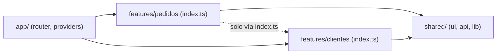

# Estructura de carpetas por feature

Parte de: [[05-React/_Índice React|React]]

> [!info] Cómo avanzar
> `progreso`: **pendiente** → **viendo** (estudiando) → **visto** (contestaste la autoevaluación sin abrir las respuestas) → **dominado** (hiciste el laboratorio o lo aplicaste de verdad).

## Contenido

### Qué es
Organizar por feature (funcionalidad) es agrupar el código según **lo que hace para el usuario** —pedidos, clientes, autenticación, reportes— en lugar de según **qué tipo de archivo es**. Cada feature tiene su carpeta con sus componentes, hooks, llamadas a la API, tipos, estilos y pruebas juntos. Es la misma idea que el *vertical slice* que ya aplicas en el backend .NET: cada caso de uso con su endpoint, validador, consulta SQL e interfaz en la misma carpeta, en vez de capas horizontales `Controllers/`, `Services/`, `Repositories/`.

### Cómo funciona
#### Por tipo (lo que se evita)
```text
src/
  components/   (80 archivos de todas las pantallas)
  hooks/
  services/
  types/
  pages/
```
Para cambiar "pedidos" tocas cinco carpetas, no sabes qué componente usa quién y borrar una funcionalidad completa es arqueología.

#### Por feature
```text
src/
  app/                    # arranque: router, providers, layout raíz
    router.tsx
    providers.tsx
  features/
    pedidos/
      api/                # funciones fetch + claves de TanStack Query
        pedidosApi.ts
        usePedidos.ts
      components/
        TablaPedidos.tsx
        FiltroPedidos.tsx
      routes/
        PedidosPage.tsx
      types.ts
      index.ts            # API pública de la feature
    clientes/
      ...
    auth/
      SesionContext.tsx
      RutaProtegida.tsx
      index.ts
  shared/                 # solo lo que usan varias features
    ui/                   # Boton, Modal, Tabla genérica, Campo
    api/httpClient.ts     # fetch con token, manejo de ProblemDetails
    lib/formato.ts        # fechas, moneda
    hooks/useDebouncedValue.ts
```



#### Qué va en `shared/` (o `lib/`)
Únicamente lo que **usan varias features** y no pertenece a ninguna: componentes de UI genéricos (botones, modales, campos), el cliente HTTP que agrega el token y traduce ProblemDetails (con su `codigo`) a errores tipados, utilidades de formato, hooks genéricos como `useDebouncedValue`. **Si algo lo usa una sola feature, vive en esa feature**, aunque "parezca reutilizable". Cuando una segunda feature lo necesite, entonces lo promueves a `shared/`. Esto evita un `shared/` gigante que se vuelve la nueva carpeta `components/`.

#### La regla que evita el enredo: API pública
Cada feature expone lo que otras pueden usar a través de un **`index.ts`** (un *barrel*) y las demás importan **solo de ahí**:

```ts
// features/clientes/index.ts
export { SelectorCliente } from './components/SelectorCliente';
export { useCliente } from './api/useCliente';
export type { Cliente } from './types';
```

```ts
// En pedidos: bien
import { SelectorCliente, type Cliente } from '@/features/clientes';
// Mal: depende de un archivo interno que clientes puede mover o borrar
import { SelectorCliente } from '@/features/clientes/components/SelectorCliente';
```

Así cada feature puede reorganizar su interior sin romper a las demás, igual que una clase con miembros `internal` en .NET. Reglas complementarias:

- `shared/` **nunca** importa de `features/`.
- Evita dependencias circulares entre features (A importa de B y B de A). Si pasa, lo común suele pertenecer a `shared/` o a una feature nueva.
- Puedes **hacer cumplir** las reglas con ESLint: `no-restricted-imports` o el plugin `eslint-plugin-boundaries`.
- Configura un alias (`@/` → `src/`) en `vite.config.ts` y `tsconfig.json` para rutas de importación cortas.

### Ejemplo de flujo dentro de una feature
`PedidosPage.tsx` (ruta) usa `usePedidos()` (TanStack Query, en `api/`), que llama a `pedidosApi.listar()`, que usa `httpClient` de `shared/`. La página pinta `TablaPedidos` y `FiltroPedidos` (componentes de la feature) y un `Boton` de `shared/ui`. Todo lo de pedidos está en una carpeta: si mañana se elimina la funcionalidad, borras la carpeta y su línea en el router.

### Cuándo usarlo y cuándo no
Úsalo en cuanto la app tenga varias pantallas con dominio propio; es lo que hace manejable un front como Itzamna.Clio. En un prototipo de tres componentes, una estructura plana basta; no crees la jerarquía completa "por si acaso". Next.js con App Router tiene su propia convención de carpetas para rutas (`app/`), pero puedes mantener `features/` para la lógica y que `app/` solo contenga las páginas delgadas (ver [[App Router de Next.js]]).

### Errores comunes
- **Promover a `shared/` demasiado pronto**: se llena de cosas que usa una sola feature.
- **Importar archivos internos de otra feature**: acoplamiento oculto. Usa el `index.ts`.
- **Barrels enormes en `shared/`** que reexportan todo: pueden dificultar el *tree shaking* y generar ciclos; mantenlos pequeños.
- **Features demasiado granulares** (una carpeta por componente): la feature debe ser una capacidad del negocio.
- **Mezclar criterios**: unas cosas por tipo y otras por feature sin regla escrita.

### Para profundizar
- [Bulletproof React: estructura del proyecto (GitHub)](https://github.com/alan2207/bulletproof-react/blob/master/docs/project-structure.md)
- [Alias de resolución en Vite](https://vite.dev/config/shared-options#resolve-alias)
- [Regla no-restricted-imports de ESLint](https://eslint.org/docs/latest/rules/no-restricted-imports)

## Autoevaluación

Contesta primero en voz alta o en papel; luego despliega la respuesta.

> [!question]- ¿Qué es organizar por feature?
> Agrupar por funcionalidad (`features/portfolio/`, `features/auth/`) con sus componentes, hooks, API y tipos juntos, en vez de carpetas globales por tipo (`components/`, `hooks/`).

> [!question]- ¿Qué va en una carpeta compartida (`shared/` o `lib/`)?
> Solo lo que usan varias features: componentes de UI genéricos, cliente HTTP, utilidades. Si algo lo usa una sola feature, vive en ella.

> [!question]- ¿Qué regla evita que las features se enreden?
> Que cada feature exponga una API pública (un `index.ts`) y las demás importen solo de ahí; evitar importaciones cruzadas a archivos internos.

