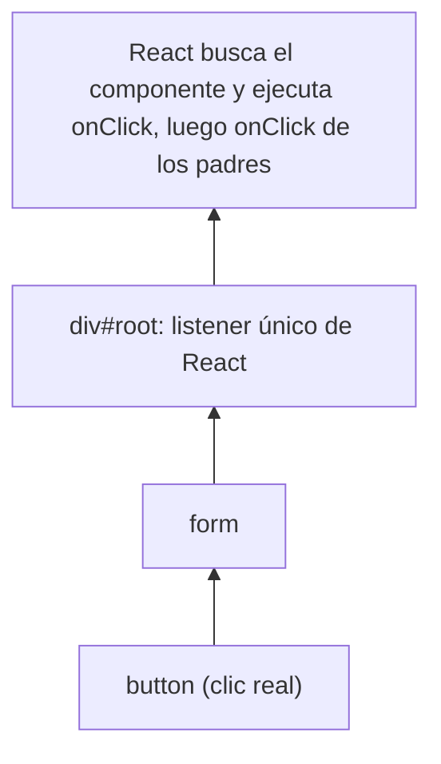

# Eventos en React

Parte de: [[05-React/_Índice React|React]]

> [!info] Cómo avanzar
> `progreso`: **pendiente** → **viendo** (estudiando) → **visto** (contestaste la autoevaluación sin abrir las respuestas) → **dominado** (hiciste el laboratorio o lo aplicaste de verdad).

## Contenido

### Qué es
Los eventos en React son la forma de responder a lo que hace el usuario (clics, teclas, cambios en inputs, envío de formularios). Se declaran como props en camelCase sobre los elementos del DOM, `onClick`, `onChange`, `onSubmit`, `onKeyDown`, y reciben **una función** que React llamará cuando ocurra el evento. Esa función recibe un **evento sintético**: un objeto de React que envuelve al evento nativo del navegador con la misma interfaz (`target`, `preventDefault()`, `stopPropagation()`), igual en todos los navegadores.

### Cómo funciona
#### Pasar la función, no llamarla
La diferencia más importante para empezar:

```tsx
<button onClick={guardar}>Guardar</button>     // pasa la referencia: se ejecuta al hacer clic
<button onClick={guardar()}>Guardar</button>   // la LLAMA durante el render
```

En el segundo caso `guardar()` se ejecuta cada vez que el componente se renderiza, y lo que se asigna a `onClick` es su **valor de retorno** (normalmente `undefined`). Si `guardar` cambia estado, provocas un bucle de renders ("Too many re-renders"). Cuando necesitas pasar argumentos, envuelve en una función flecha: `onClick={() => eliminar(p.id)}`.

#### Delegación de eventos
React **sí usa delegación**: no registra un listener en cada botón. Desde React 17 coloca sus listeners en el **contenedor raíz** donde montaste la app (el nodo que pasaste a `createRoot`), no en `document`. Cuando un evento nativo burbujea hasta esa raíz, React determina qué componente lo originó y ejecuta los handlers correspondientes simulando la fase de burbujeo por el árbol de componentes. Consecuencias:

- Agregar o quitar elementos no requiere registrar o limpiar listeners: React lo hace por ti (adiós a los listeners duplicados del DOM a mano).
- `e.stopPropagation()` detiene la propagación entre handlers de React.
- Si necesitas escuchar algo **fuera** de tu árbol (`window`, `document`, `resize`, `keydown` global), eso sí se registra a mano en un [[useEffect]] con su limpieza.



#### Fase de captura
Además de `onClick` existe `onClickCapture`, que corre en la fase de captura (de arriba hacia abajo) antes que los handlers normales. Se usa poco, por ejemplo para registrar analíticas antes de que un hijo detenga la propagación.

### Ejemplo: formulario sin recarga
Un `<form>` nativo, al enviarse, hace una petición y **recarga la página**. En una SPA eso borra el estado. Se evita con `e.preventDefault()` en `onSubmit`:

```tsx
import { useState, type FormEvent, type ChangeEvent } from 'react';

export function FormBusqueda({ onBuscar }: { onBuscar: (q: string) => void }) {
  const [q, setQ] = useState('');

  function manejarCambio(e: ChangeEvent<HTMLInputElement>) {
    setQ(e.target.value);
  }

  function manejarEnvio(e: FormEvent<HTMLFormElement>) {
    e.preventDefault();          // evita la recarga
    onBuscar(q.trim());
  }

  function manejarTecla(e: React.KeyboardEvent<HTMLInputElement>) {
    if (e.key === 'Escape') setQ('');
  }

  return (
    <form onSubmit={manejarEnvio}>
      <input value={q} onChange={manejarCambio} onKeyDown={manejarTecla} placeholder="Folio o cliente" />
      <button type="submit">Buscar</button>
    </form>
  );
}
```

Usar `onSubmit` en el formulario (y no `onClick` en el botón) tiene ventajas: también responde a Enter dentro del input y respeta la validación nativa (`required`, `pattern`). Ver [[Componentes controlados]] para el patrón `value` + `onChange`.

Fíjate en las convenciones: el componente **padre** recibe props llamadas `onAlgo` (`onBuscar`) y internamente se nombran `manejarAlgo` o `handleAlgo`. Así se distingue "el evento que expongo" de "la función que lo maneja".

### Tipado de eventos en TypeScript
- `ChangeEvent<HTMLInputElement>` para `onChange` de inputs (`HTMLSelectElement`, `HTMLTextAreaElement` según el caso).
- `FormEvent<HTMLFormElement>` para `onSubmit`.
- `MouseEvent<HTMLButtonElement>` y `KeyboardEvent<...>` importados de `react`, no los globales del DOM.
- Si declaras el handler en línea, TypeScript infiere el tipo y no necesitas anotarlo.

### Cuándo usarlo y cuándo no
Los handlers son el lugar correcto para los **efectos causados por el usuario**: enviar una petición al guardar, navegar, mostrar un toast. No pongas esa lógica en un `useEffect` que "observa" un estado para reaccionar: si algo pasa porque el usuario hizo clic, va en el handler del clic. `useEffect` es para sincronizar con sistemas externos, no para responder a eventos.

### Errores comunes
- **`onClick={fn()}`**: se ejecuta en el render. Pasa `fn` o `() => fn(arg)`.
- **Olvidar `preventDefault` en `onSubmit`**: la página se recarga y pierdes el estado.
- **Botones sin `type` dentro de un form**: por defecto son `type="submit"`; un botón "Cancelar" enviará el formulario. Pon `type="button"`.
- **Leer `e.target.value` dentro de un callback asíncrono** sin guardarlo antes: guarda el valor en una constante al inicio del handler.
- **Registrar listeners globales sin limpieza** en un efecto: se acumulan en cada montaje.

### Para profundizar
- [Responder a eventos (react.dev)](https://react.dev/learn/responding-to-events)
- [Objeto de evento de React (react.dev)](https://react.dev/reference/react-dom/components/common#react-event-object)
- [Cambios de delegación en React 17 (react.dev)](https://legacy.reactjs.org/blog/2020/08/10/react-v17-rc.html#changes-to-event-delegation)

## Autoevaluación

Contesta primero en voz alta o en papel; luego despliega la respuesta.

> [!question]- ¿Qué diferencia hay entre `onClick={guardar}` y `onClick={guardar()}`?
> El primero pasa la función para que React la llame al hacer clic. El segundo la **ejecuta durante el render** y pasa su resultado. Para pasar argumentos: `onClick={() => guardar(id)}`.

> [!question]- ¿Cómo evitas que un formulario recargue la página?
> `<form onSubmit={e => { e.preventDefault(); ... }}>`.

> [!question]- ¿React usa delegación de eventos?
> Sí: registra los listeners en la raíz de la app y despacha a tus handlers con un evento sintético. Para ti se comporta como un listener normal (con `stopPropagation`, `currentTarget`, etc.).

## Práctica

- [[Lab 1 - App de notas con estado y efectos]]
- [[Lab 3 - Formulario controlado con validación]]

