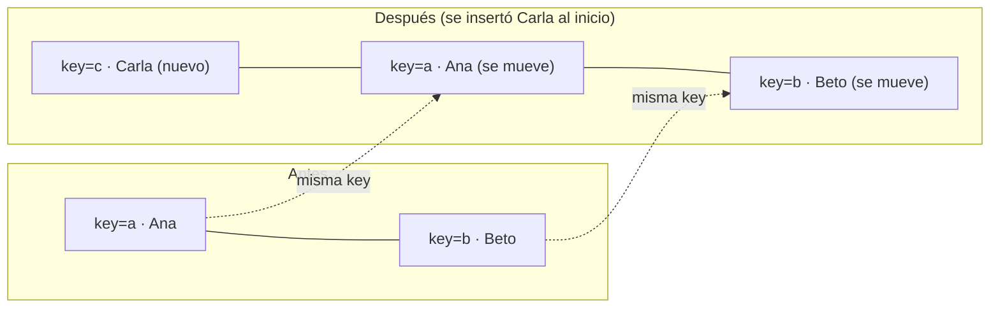

# Listas y keys

Parte de: [[05-React/_Índice React|React]]

> [!info] Cómo avanzar
> `progreso`: **pendiente** → **viendo** (estudiando) → **visto** (contestaste la autoevaluación sin abrir las respuestas) → **dominado** (hiciste el laboratorio o lo aplicaste de verdad).

## Contenido

### Qué es
En React una lista se pinta transformando un arreglo de datos en un arreglo de elementos, normalmente con `map`. Cada elemento de esa lista necesita una prop especial, **`key`**, que lo identifica de forma única y **estable** entre sus hermanos. La `key` no llega al componente como prop (no puedes leer `props.key`); es información que React usa internamente durante la reconciliación para saber qué elemento del render anterior corresponde a cuál del render nuevo.

### Cómo funciona
Sin `key`, React compara los hijos por **posición**: el primero con el primero, el segundo con el segundo. Con `key`, los compara por **identidad**: el elemento con `key="42"` antes es el mismo que el elemento con `key="42"` ahora, aunque haya cambiado de lugar.

Esto importa porque cada elemento puede tener **estado asociado** (el texto escrito en un input, si un acordeón está abierto, el estado interno de un componente hijo, el foco). React conserva ese estado junto a la `key`.



#### Por qué el índice es mala idea cuando la lista cambia
Si usas `key={i}` y luego insertas un elemento al principio, todos los índices se recorren: el que antes era `0` (Ana) ahora es Carla, pero React ve `key=0` en ambos renders y concluye que es **el mismo elemento**. Reutiliza el nodo y el estado de Ana para Carla: el input que tenía texto escrito para Ana ahora aparece en la fila de Carla, los checkboxes quedan desfasados y se hacen más actualizaciones del DOM de las necesarias. Lo mismo pasa al ordenar, filtrar o eliminar elementos de en medio.

El índice solo es aceptable cuando la lista es **estática**: nunca se reordena, no se filtra y no se insertan ni eliminan elementos (por ejemplo, las opciones fijas de un menú), y los elementos no tienen estado.

#### De dónde sacar una buena key
- El **id de la base de datos** (`p.id`, `pedido.folio`). Es la mejor opción.
- Un id generado **al crear** el dato en el cliente (`crypto.randomUUID()` al agregar la tarea), guardado junto al dato.
- Nunca `Math.random()` o `crypto.randomUUID()` **en el render**: cambia cada vez y React desmonta y monta todo en cada render.
- La key solo debe ser única entre **hermanos**, no globalmente.

### Ejemplo
```tsx
type Contacto = { id: number; nombre: string };

export function ListaContactos({ contactos }: { contactos: Contacto[] }) {
  return (
    <ul>
      {contactos.map(c => (
        // key en el elemento que devuelve el map, no dentro del componente
        <FilaContacto key={c.id} contacto={c} />
      ))}
    </ul>
  );
}

function FilaContacto({ contacto }: { contacto: Contacto }) {
  // Este estado queda ligado a la key del contacto
  const [nota, setNota] = useState('');
  return (
    <li>
      {contacto.nombre} <input value={nota} onChange={e => setNota(e.target.value)} />
    </li>
  );
}
```

Si el `map` devuelve varios elementos por dato (por ejemplo `<dt>` y `<dd>`), envuélvelos en `<Fragment key={c.id}>`; la forma corta `<>` no acepta key.

### Otro uso: reiniciar un componente con `key`
Como React asocia el estado a la key, **cambiar la key** de un componente lo obliga a desmontarlo y montarlo de nuevo con estado limpio. Es la forma idiomática de "resetear" un formulario cuando cambia la entidad que edita:

```tsx
// Al cambiar de cliente, el formulario empieza de cero (sin copiar props a estado ni efectos)
<FormCliente key={clienteId} clienteId={clienteId} />
```

Sin la key, al pasar de editar el cliente 5 al cliente 8, los inputs conservarían lo escrito para el 5. Esto evita el antipatrón de un `useEffect` que "reinicia" estado cuando cambia una prop.

### Cuándo usarlo y cuándo no
Siempre que pintes una colección dinámica necesitas una key estable. Si la lista es muy larga (miles de filas), la key correcta no basta para el rendimiento: considera paginación o virtualización (ver [[Rendimiento en React]]). Si arrastras y reordenas elementos, como con [[dnd-kit]], las keys estables son obligatorias para que la animación y el estado sigan al elemento correcto.

### Errores comunes
- **Olvidar la key**: React advierte en consola y usa el índice implícitamente.
- **Key en el lugar equivocado**: dentro del componente hijo en vez de en el elemento que devuelve el `map`.
- **Keys generadas en cada render** (`Math.random()`): todo se desmonta y se pierden foco y estado.
- **Usar el índice en listas editables**: estado desfasado al insertar, borrar u ordenar.
- **Keys duplicadas** (dos productos con el mismo id por un error de datos): React advierte y el comportamiento es impredecible.

### Para profundizar
- [Renderizar listas (react.dev)](https://react.dev/learn/rendering-lists)
- [Preservar y reiniciar el estado (react.dev)](https://react.dev/learn/preserving-and-resetting-state)
- [Quizás no necesites un efecto: reiniciar estado (react.dev)](https://react.dev/learn/you-might-not-need-an-effect#resetting-all-state-when-a-prop-changes)

## Autoevaluación

Contesta primero en voz alta o en papel; luego despliega la respuesta.

> [!question]- ¿Para qué sirve la prop `key`?
> Identifica cada elemento de una lista entre renders para que React sepa cuál se movió, agregó o quitó, y conserve su estado y su DOM.

> [!question]- ¿Por qué usar el índice como `key` es mala idea si la lista cambia de orden o se insertan elementos?
> Al reordenar o insertar al inicio, el índice ya no corresponde al mismo elemento: React reutiliza el estado/DOM equivocado (inputs con texto de otra fila). Usa un id estable de los datos.

> [!question]- ¿Para qué más sirve cambiar la `key` de un componente?
> Para forzar que se reinicie: `<Formulario key={usuarioId} />` desmonta y monta uno nuevo con estado limpio al cambiar de usuario.

## Práctica

- [[Lab 1 - App de notas con estado y efectos]]

