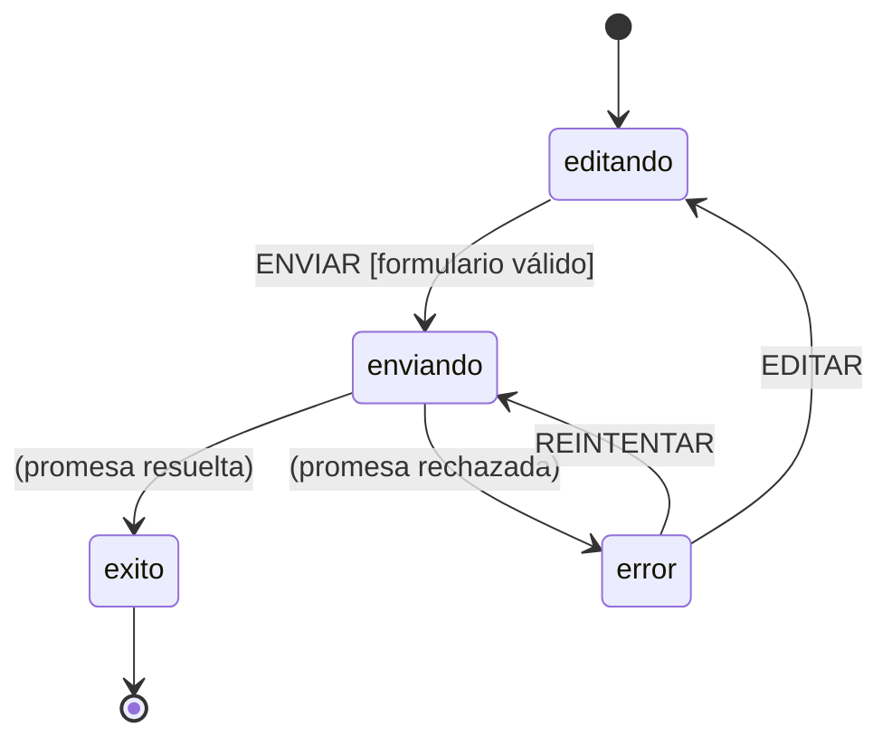

# Máquinas de estado en UI (XState)

Parte de: [[05-React/_Índice React|React]]

> [!info] Cómo avanzar
> `progreso`: **pendiente** → **viendo** (estudiando) → **visto** (contestaste la autoevaluación sin abrir las respuestas) → **dominado** (hiciste el laboratorio o lo aplicaste de verdad).

## Contenido

### Qué es
Una **máquina de estados finita** modela un sistema como un conjunto **cerrado** de estados con nombre (`inactivo`, `cargando`, `exito`, `error`) y **transiciones** explícitas: "estando en `cargando`, si llega el evento `RESUELTO`, pasa a `exito`". En cada momento la máquina está en **exactamente un** estado (o en una combinación bien definida, si hay estados paralelos), y un evento que no tiene transición definida en el estado actual simplemente se ignora. Aplicado a UI, sustituye la maraña de booleanos (`cargando`, `error`, `enviado`, `editando`) por un modelo donde las combinaciones imposibles no se pueden representar.

**XState** es la biblioteca más usada para esto en JavaScript/TypeScript. Implementa máquinas y *statecharts* (máquinas con jerarquía, paralelismo e historia), con un modelo de *actores* y herramientas visuales de Stately. La versión estable es la 5; la 6 está en desarrollo (Pendiente de confirmar cuándo sale estable), así que el código de abajo usa la API de v5 (`setup`, `createMachine`, `useMachine`).

### Cómo funciona
#### El problema de los booleanos
```tsx
const [cargando, setCargando] = useState(false);
const [error, setError] = useState<string | null>(null);
const [exito, setExito] = useState(false);
```
Con tres booleanos hay 8 combinaciones, pero solo 4 tienen sentido. Nada impide `cargando && error`, o que un doble clic envíe dos veces porque olvidaste revisar `cargando`. Cada handler tiene que recordar apagar y prender las banderas correctas.

#### El modelo de máquina


Conceptos de XState:

- **Estados** y **eventos** (`{ type: 'ENVIAR' }`).
- **Contexto**: datos extendidos de la máquina (el formulario, el número de reintentos).
- **Guardas** (`guard`): condiciones para permitir una transición ("solo si el formulario es válido").
- **Acciones**: efectos instantáneos al transicionar, entrar o salir de un estado (`assign` para actualizar el contexto, registrar telemetría).
- **Actores invocados** (`invoke`): promesas, callbacks u otras máquinas que viven mientras la máquina está en un estado; si sales del estado, se cancelan.
- **Transiciones con retraso** (`after: { 5000: 'expirado' }`), **estados jerárquicos** (subestados dentro de `pago`) y **paralelos** (reproducción y volumen a la vez).

### Ejemplo: envío con reintentos
```tsx
import { assign, fromPromise, setup } from 'xstate';
import { useMachine } from '@xstate/react';

type Datos = { correo: string };

const envioMachine = setup({
  types: {
    context: {} as { datos: Datos; intentos: number; error: string | null },
    events: {} as { type: 'ENVIAR'; datos: Datos } | { type: 'REINTENTAR' } | { type: 'EDITAR' },
  },
  actors: {
    guardar: fromPromise(async ({ input }: { input: Datos }) => {
      const r = await fetch('/api/contactos', { method: 'POST', body: JSON.stringify(input),
        headers: { 'Content-Type': 'application/json' } });
      if (!r.ok) throw new Error((await r.json()).codigo ?? 'ERROR');
    }),
  },
  guards: {
    datosValidos: ({ event }) => event.type === 'ENVIAR' && event.datos.correo.includes('@'),
    puedeReintentar: ({ context }) => context.intentos < 3,
  },
}).createMachine({
  id: 'envio',
  initial: 'editando',
  context: { datos: { correo: '' }, intentos: 0, error: null },
  states: {
    editando: {
      on: { ENVIAR: { guard: 'datosValidos', target: 'enviando',
        actions: assign({ datos: ({ event }) => (event.type === 'ENVIAR' ? event.datos : { correo: '' }) }) } },
    },
    enviando: {
      entry: assign({ intentos: ({ context }) => context.intentos + 1 }),
      invoke: {
        src: 'guardar',
        input: ({ context }) => context.datos,
        onDone: 'exito',
        onError: { target: 'error', actions: assign({ error: ({ event }) => String(event.error) }) },
      },
    },
    error: { on: { REINTENTAR: { guard: 'puedeReintentar', target: 'enviando' }, EDITAR: 'editando' } },
    exito: { type: 'final' },
  },
});

export function FormEnvio() {
  const [estado, send] = useMachine(envioMachine);
  if (estado.matches('exito')) return <p>Guardado</p>;
  return (
    <form onSubmit={e => { e.preventDefault();
      send({ type: 'ENVIAR', datos: { correo: new FormData(e.currentTarget).get('correo') as string } }); }}>
      <input name="correo" disabled={estado.matches('enviando')} />
      <button disabled={estado.matches('enviando')}>Enviar</button>
      {estado.matches('error') && (
        <p role="alert">{estado.context.error} <button type="button" onClick={() => send({ type: 'REINTENTAR' })}>Reintentar</button></p>
      )}
    </form>
  );
}
```

Un doble clic en "Enviar" no envía dos veces: en el estado `enviando` no existe transición para `ENVIAR`, así que el evento se ignora.

### Qué aporta XState sobre useReducer
Un [[useReducer]] con un campo `estado: 'editando' | 'enviando' | ...` ya te da gran parte del beneficio y es suficiente para flujos simples. XState agrega lo que con un reducer harías a mano: **guardas** declarativas, **acciones de entrada y salida**, **actores invocados** que se cancelan solos al salir del estado (adiós a efectos con banderas), **retrasos**, **jerarquía y paralelismo**, tipado fuerte de eventos, y la posibilidad de **visualizar** y simular la máquina en el editor de Stately. Además, la máquina es independiente de React: se prueba como lógica pura y se puede reutilizar en otro front.

### Cuándo usarlo y cuándo no
Conviene en flujos con muchos estados y reglas: asistentes de varios pasos con validación y "regresar", flujos de pago o de autenticación (login → MFA → cambio de contraseña), subida de archivos con progreso, reintentos y cancelación, reproductores de medios, conexiones en tiempo real con reconexión. No lo uses para un toggle o un formulario de dos campos: el costo de aprender y mantener la máquina supera el beneficio. Para datos del servidor sigue usando [[TanStack Query]]; para estado global simple, [[zustand]].

### Errores comunes
- **Modelar todo con máquinas**: complejidad innecesaria en casos triviales.
- **Seguir usando booleanos al lado de la máquina**: duplica la fuente de verdad.
- **Efectos en el componente** (`useEffect` que observa el estado para llamar a la API) en vez de `invoke` o acciones en la máquina.
- **Estados con nombres de acciones** (`enviar`) en vez de situaciones (`enviando`).
- **Mezclar la API de v4 y v5**: muchos tutoriales viejos usan `interpret` y `services`; en v5 son `createActor` y `actors`.

### Para profundizar
- [Documentación de XState (Stately)](https://stately.ai/docs/xstate)
- [setup en XState v5](https://stately.ai/docs/setup)
- [XState con React (@xstate/react)](https://stately.ai/docs/xstate-react)

## Autoevaluación

Contesta primero en voz alta o en papel; luego despliega la respuesta.

> [!question]- ¿Qué es una máquina de estados finita aplicada a UI?
> Modelar la UI como un conjunto de estados explícitos (`inactivo`, `cargando`, `exito`, `error`) y transiciones permitidas por eventos. Evita combinaciones imposibles como `cargando && error` con booleanos sueltos.

> [!question]- ¿Qué aporta XState sobre un `useReducer`?
> Estados jerárquicos y paralelos, guardas, acciones de entrada/salida, servicios invocados (promesas, callbacks), retrasos y un visualizador. Para flujos simples, un reducer con un campo `estado` basta.

> [!question]- Da un ejemplo donde conviene una máquina de estados.
> Un asistente de varios pasos con validación y regreso, un reproductor de medios, un flujo de pago o una subida de archivos con reintentos y cancelación.

