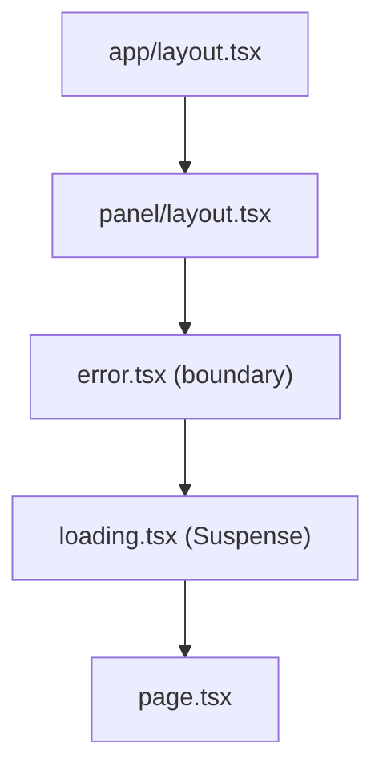

# App Router de Next.js

Parte de: [[Next.js (SSR, SSG y App Router)]]

> [!info] Cómo avanzar
> `progreso`: **pendiente** → **viendo** (estudiando) → **visto** (contestaste la autoevaluación sin abrir las respuestas) → **dominado** (hiciste el laboratorio o lo aplicaste de verdad).

## Contenido

### Qué es
El **App Router** es el sistema de enrutamiento moderno de Next.js, basado en la carpeta `app/`. Cada **carpeta** es un segmento de la URL y dentro de ella hay **archivos con nombres especiales** que definen qué se muestra en esa ruta: la página, el layout que la envuelve, el estado de carga, la pantalla de error. Está construido sobre [[Server Components]] (los componentes son de servidor por defecto), soporta layouts anidados que se conservan al navegar, streaming con Suspense y **Server Actions** para mutaciones. Es el router recomendado para proyectos nuevos; el anterior, `pages/`, se describe en [[Next.js (SSR, SSG y App Router)]].

### Cómo funciona
#### Carpetas = rutas
```text
app/
  layout.tsx                 # layout raíz (obligatorio): <html> y <body>
  page.tsx                   # "/"
  (tienda)/                  # grupo de rutas: organiza sin afectar la URL
    productos/
      page.tsx               # "/productos"
      loading.tsx            # esqueleto mientras carga
      error.tsx              # error de este segmento
      [slug]/
        page.tsx             # "/productos/:slug"
        not-found.tsx        # cuando se llama notFound()
  panel/
    layout.tsx               # layout compartido por /panel/*
    page.tsx                 # "/panel"
  api/
    salud/route.ts           # Route Handler: GET /api/salud
```

#### Archivos especiales por segmento
| Archivo | Para qué |
|---|---|
| `page.tsx` | La UI de la ruta; sin `page`, la carpeta no es pública |
| `layout.tsx` | Envoltura compartida que **persiste** entre navegaciones (no se vuelve a montar) |
| `template.tsx` | Como layout, pero se **vuelve a montar** en cada navegación |
| `loading.tsx` | Fallback de carga: Next.js envuelve la página en `<Suspense>` con este componente |
| `error.tsx` | Error boundary del segmento (debe ser Client Component); recibe `error` y una función para reintentar |
| `not-found.tsx` | UI cuando se llama `notFound()` o no existe la ruta |
| `route.ts` | Endpoint HTTP (`export async function GET/POST`), sin UI |
| `default.tsx` | Respaldo para rutas paralelas |

Convenciones de nombres: `[slug]` es un segmento dinámico, `[...partes]` captura varios segmentos, `(grupo)` agrupa sin afectar la URL, `@slot` define rutas paralelas y `_carpeta` es privada (no genera ruta). En Next.js 16, el antiguo `middleware.ts` se renombró a `proxy.ts`.



Así se anidan: el layout raíz envuelve al layout del panel, que envuelve al boundary de error, que envuelve al Suspense de carga, que envuelve a la página.

#### Carga de datos
En el App Router **no hay funciones especiales** como `getServerSideProps`. Un Server Component puede ser **`async`** y obtener datos directamente: con `fetch`, con un cliente de base de datos o con un SDK. El código corre en el servidor, así que puedes usar secretos y no se envía al navegador.

```tsx
// app/panel/clientes/[id]/page.tsx
import { notFound } from 'next/navigation';

async function obtenerCliente(id: string) {
  const r = await fetch(`${process.env.API_URL}/clientes/${id}`, { next: { tags: [`cliente-${id}`] } });
  if (r.status === 404) return null;
  if (!r.ok) throw new Error('Error al consultar cliente');
  return (await r.json()) as { id: string; nombre: string; rfc: string };
}

export default async function Cliente({ params }: { params: Promise<{ id: string }> }) {
  const { id } = await params;              // params es asíncrono en Next.js 15+
  const cliente = await obtenerCliente(id);
  if (!cliente) notFound();                 // muestra not-found.tsx
  return <h1>{cliente.nombre} ({cliente.rfc})</h1>;
}
```

Si tienes varias consultas independientes, lánzalas en paralelo con `Promise.all` o sepáralas en componentes con su propio `<Suspense>` para que la página llegue por partes (streaming). Si un Client Component necesita datos que cambian por interacción, sigue siendo válido usar [[TanStack Query]] en el cliente.

#### Server Actions
Una **Server Action** es una función asíncrona marcada con `'use server'` que se ejecuta en el servidor pero se puede **llamar desde el cliente**: Next.js genera un endpoint POST y la referencia para invocarlo. Se usan para mutaciones (crear, actualizar, borrar), típicamente como `action` de un formulario, y funcionan incluso antes de que cargue el JavaScript (mejora progresiva).

```tsx
// app/panel/clientes/acciones.ts
'use server';
import { revalidatePath } from 'next/cache';
import { redirect } from 'next/navigation';

export async function crearCliente(formData: FormData) {
  const nombre = String(formData.get('nombre') ?? '').trim();
  if (!nombre) return { error: 'El nombre es obligatorio' };
  // Verifica sesión y permisos: la acción es invocable por cualquiera que conozca el endpoint
  await fetch(`${process.env.API_URL}/clientes`, {
    method: 'POST', headers: { 'Content-Type': 'application/json' }, body: JSON.stringify({ nombre }),
  });
  revalidatePath('/panel/clientes'); // la lista se vuelve a generar con el nuevo cliente
  redirect('/panel/clientes');
}
```

```tsx
// app/panel/clientes/nuevo/page.tsx
import { crearCliente } from '../acciones';
export default function Nuevo() {
  return (
    <form action={crearCliente}>
      <input name="nombre" required />
      <button>Guardar</button>
    </form>
  );
}
```

Para mostrar errores de validación y el estado "enviando" en el cliente se combinan con `useActionState` y `useFormStatus` de React 19. Tras la mutación, `revalidatePath` o `revalidateTag` refrescan los datos cacheados (ver [[SSG e ISR en Next.js]]).

### Cuándo usarlo y cuándo no
Úsalo en proyectos Next.js nuevos: layouts anidados, streaming y Server Components dan mejor primera carga con menos JavaScript. Si tu equipo tiene una app grande en `pages/` que funciona, la migración puede ser incremental (ambos routers conviven). Si tu caso es una SPA interna frente a una API .NET, quizá no necesitas Next.js en absoluto (React + Vite con [[React Router]]).

### Errores comunes
- **Olvidar `page.tsx`**: la carpeta existe pero la ruta da 404.
- **`error.tsx` sin `'use client'`**: debe ser Client Component.
- **Poner estado en el layout esperando que se reinicie** al navegar: los layouts persisten; usa `template.tsx` o una `key`.
- **No validar en Server Actions**: son endpoints públicos; valida datos (por ejemplo con Zod) y permisos.
- **Seguir tutoriales viejos** con `params` síncronos o `middleware.ts`: revisa la versión.

### Para profundizar
- [Layouts y páginas (Next.js)](https://nextjs.org/docs/app/getting-started/layouts-and-pages)
- [Estructura del proyecto (Next.js)](https://nextjs.org/docs/app/getting-started/project-structure)
- [Obtener datos (Next.js)](https://nextjs.org/docs/app/getting-started/fetching-data)
- [Mutar datos con Server Actions (Next.js)](https://nextjs.org/docs/app/getting-started/mutating-data)

## Autoevaluación

Contesta primero en voz alta o en papel; luego despliega la respuesta.

> [!question]- ¿Qué archivos especiales usa el App Router en cada carpeta de ruta?
> `page.tsx` (la página), `layout.tsx` (envoltura persistente), `loading.tsx` (fallback de Suspense), `error.tsx` (error boundary, debe ser cliente) y `not-found.tsx`.

> [!question]- ¿Cómo se carga data en un componente del App Router?
> El componente de servidor puede ser `async` y hacer `await fetch(...)` o consultar la BD directamente; no hace falta `useEffect`.

> [!question]- ¿Qué son las Server Actions?
> Funciones marcadas con `'use server'` que se ejecutan en el servidor y se pueden llamar desde formularios o componentes cliente para mutar datos, sin escribir una ruta de API.

