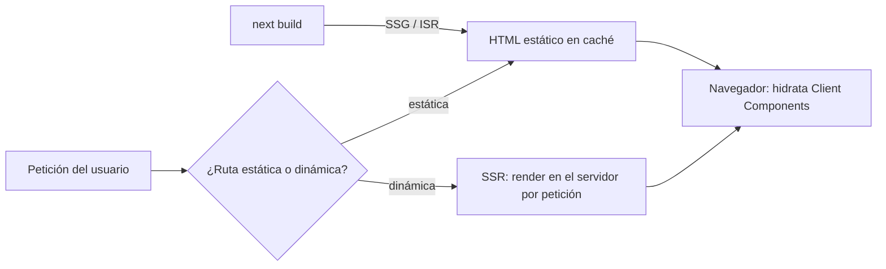

# Next.js (SSR, SSG y App Router)

Parte de: [[05-React/_Índice React|React]]

> [!info] Cómo avanzar
> `progreso`: **pendiente** → **viendo** (estudiando) → **visto** (contestaste la autoevaluación sin abrir las respuestas) → **dominado** (hiciste el laboratorio o lo aplicaste de verdad).

## Contenido

### Qué es
Next.js es un **framework de React** creado por Vercel que agrega todo lo que React por sí solo no trae para construir un sitio o aplicación completa: **enrutamiento basado en archivos**, **renderizado en el servidor** (SSR), **generación estática** (SSG) y regeneración incremental (ISR), **Server Components** y **Server Actions**, endpoints de API (*Route Handlers*), optimización de imágenes, fuentes y scripts, y un compilador/bundler integrado (Turbopack es el predeterminado desde Next.js 16). Mientras React + Vite produce una SPA que se arma en el navegador, Next.js decide **dónde y cuándo** se genera cada página: en el build, en cada petición o en el cliente.

### Cómo funciona: el panorama
Next.js combina varias estrategias de renderizado, y puedes elegir por ruta o incluso por partes de una página:



- **[[SSR en Next.js]]**: el HTML se genera en el servidor **en cada petición**, con datos frescos y personalizados (sesión, cookies, parámetros).
- **[[SSG e ISR en Next.js]]**: el HTML se genera **en el build** y se sirve desde caché; ISR permite **regenerarlo** cada cierto tiempo o bajo demanda sin reconstruir todo el sitio.
- **[[App Router de Next.js]]**: el sistema de rutas moderno (carpeta `app/`), basado en [[Server Components]], layouts anidados, streaming con Suspense y Server Actions. Es el que decide, según lo que use cada ruta, si se renderiza estática o dinámicamente.

La relación: el App Router es la **estructura**; SSR, SSG e ISR son **estrategias de renderizado** que el App Router aplica a cada ruta según sus datos y configuración. En el App Router no eliges con funciones especiales como antes; Next.js infiere: si una ruta usa datos dinámicos (cookies, headers, `searchParams`) se renderiza por petición; si no, se prerenderiza en el build. Además, Next.js 16 introdujo **Cache Components** (opción `cacheComponents` y la directiva `'use cache'`), un modelo más explícito para decidir qué se cachea; vale la pena revisarlo en la documentación de tu versión.

### `app/` contra `pages/`
Next.js tiene dos routers que pueden convivir en un mismo proyecto:

| | `pages/` (Pages Router) | `app/` (App Router) |
|---|---|---|
| Época | El original | Introducido en Next.js 13, recomendado hoy |
| Componentes | Todos son de cliente (con SSR) | Server Components por defecto, `'use client'` para interactividad |
| Datos | `getServerSideProps`, `getStaticProps`, `getStaticPaths` | `async` en el componente + `fetch`/consultas; `generateStaticParams` |
| Layouts | `_app.tsx` y `_document.tsx` globales | `layout.tsx` anidados por carpeta |
| Carga y errores | Manual | `loading.tsx`, `error.tsx`, `not-found.tsx` |
| Mutaciones | API Routes (`pages/api`) | Server Actions y Route Handlers (`route.ts`) |

Para proyectos nuevos se usa `app/`. `pages/` sigue soportado y lo encontrarás en código existente y en tutoriales viejos; si ves `getServerSideProps`, es Pages Router.

### Ejemplo mínimo
```text
app/
  layout.tsx          # layout raíz: <html>, <body>, navegación
  page.tsx            # ruta "/"
  productos/
    page.tsx          # "/productos" (lista)
    [slug]/
      page.tsx        # "/productos/teclado-mecanico" (detalle)
```

```tsx
// app/productos/page.tsx — Server Component asíncrono
export default async function Productos() {
  const res = await fetch('https://api.ejemplo.mx/productos', { next: { revalidate: 3600 } });
  const productos: { slug: string; nombre: string }[] = await res.json();
  return (
    <ul>
      {productos.map(p => <li key={p.slug}><a href={`/productos/${p.slug}`}>{p.nombre}</a></li>)}
    </ul>
  );
}
```

Se crea con `npx create-next-app@latest`, se desarrolla con `next dev` y se publica con `next build` + `next start` (servidor Node.js), en contenedor Docker (por ejemplo en Azure App Service o Azure Container Apps) o en Vercel. Una exportación estática (`output: 'export'`) también es posible, pero sin SSR ni ISR.

### Cuándo usar Next.js en vez de React + Vite
**Next.js** conviene cuando:
- Necesitas **SEO** y buena primera carga en páginas públicas: catálogo, landing, blog, documentación.
- Quieres **contenido visible antes** de que cargue el JavaScript (redes lentas, móviles).
- Te sirve tener backend ligero junto al front (Server Actions, Route Handlers, acceso a datos en el servidor).

**React + Vite** conviene cuando:
- Es una **aplicación interna** detrás de login (paneles, back-office, como Itzamna.Clio): el SEO no importa y la SPA es más simple.
- Ya tienes una **API separada** (ASP.NET Core con Dapper) y quieres que el front sea solo estáticos en un CDN o Azure Static Web Apps.
- No quieres operar un servidor Node.js en producción.

### Errores comunes
- **Mezclar conceptos de `pages/` y `app/`** (usar `getServerSideProps` dentro de `app/`): no funciona.
- **`'use client'` en todo**: pierdes Server Components y envías más JS.
- **No entender la caché**: una ruta que esperabas dinámica sale estática (o al revés). Revisa la salida de `next build`, que indica cómo se generó cada ruta.
- **Elegir Next.js para una app interna** solo "porque es lo moderno": agrega un servidor que operar sin beneficio claro.
- **Seguir tutoriales de versiones viejas**: el modelo de caché cambió varias veces; usa la documentación de tu versión.

### Para profundizar
- [Documentación de Next.js (App Router)](https://nextjs.org/docs/app)
- [Next.js 16 (blog oficial)](https://nextjs.org/blog/next-16)
- [Frameworks recomendados para React (react.dev)](https://react.dev/learn/creating-a-react-app)

## Subtemas

- [[SSR en Next.js]]
- [[SSG e ISR en Next.js]]
- [[App Router de Next.js]]

## Autoevaluación

Contesta primero en voz alta o en papel; luego despliega la respuesta.

> [!question]- ¿Qué agrega Next.js sobre React?
> Un framework completo: rutas por archivos, renderizado en servidor (SSR), generación estática (SSG), Server Components, rutas de API, optimización de imágenes y fuentes, y despliegue integrado.

> [!question]- ¿Cuándo usarías Next.js en vez de React + Vite?
> Cuando importan SEO y la primera carga (sitios públicos, portfolios, e-commerce) o quieres backend y front en el mismo proyecto. Para un panel privado detrás de login, una SPA con Vite suele bastar.

> [!question]- ¿Qué diferencia hay entre `app/` y `pages/`?
> `pages/` es el Pages Router clásico (`getServerSideProps`, `getStaticProps`). `app/` es el App Router: layouts anidados, Server Components por defecto, *streaming* y carga de datos con `async` en el componente.

## Progreso de los subtemas

```base
filters:
  and:
    - file.inFolder("05-React/Next.js (SSR, SSG y App Router)")
    - file.name != "Next.js (SSR, SSG y App Router)"
views:
  - type: table
    name: Progreso
    order:
      - file.name
      - progreso
      - nivel
```
