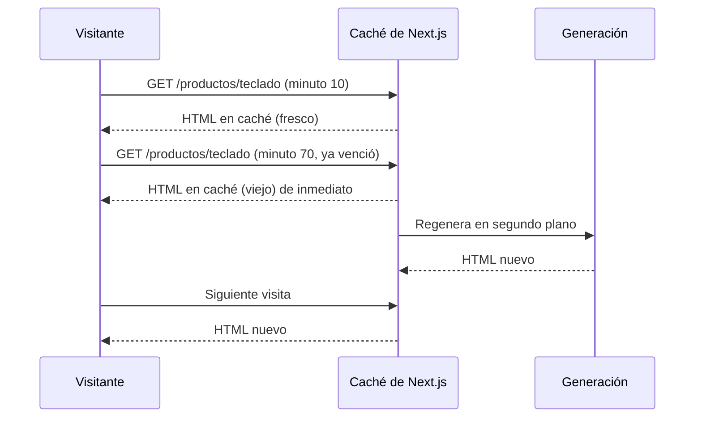

# SSG e ISR en Next.js

Parte de: [[Next.js (SSR, SSG y App Router)]]

> [!info] Cómo avanzar
> `progreso`: **pendiente** → **viendo** (estudiando) → **visto** (contestaste la autoevaluación sin abrir las respuestas) → **dominado** (hiciste el laboratorio o lo aplicaste de verdad).

## Contenido

### Qué es
- **SSG** (*Static Site Generation*, generación estática): el HTML de una página se genera **una sola vez, durante `next build`**, y luego se sirve tal cual a todos los visitantes, normalmente desde caché o un CDN. Es la opción más rápida y barata: no hay trabajo del servidor por petición.
- **ISR** (*Incremental Static Regeneration*, regeneración estática incremental): extiende SSG para que las páginas estáticas **se puedan actualizar sin reconstruir todo el sitio**. Una página puede regenerarse cada cierto tiempo (por ejemplo, cada hora) o **bajo demanda** cuando cambian los datos (por ejemplo, al editar un producto en el back-office).

En el [[App Router de Next.js]], SSG es el comportamiento **por defecto**: si una ruta no usa APIs dinámicas (cookies, headers, `searchParams`), Next.js la prerenderiza en el build.

### Cómo funciona
#### Rutas con parámetros: `generateStaticParams`
Para una ruta dinámica como `app/productos/[slug]/page.tsx`, Next.js necesita saber **qué valores** de `slug` prerenderizar. La función `generateStaticParams` los devuelve durante el build:

```tsx
// app/productos/[slug]/page.tsx
type Producto = { slug: string; nombre: string; descripcion: string; precio: number };

export const revalidate = 3600; // ISR: como máximo, regenerar cada hora

export async function generateStaticParams() {
  const productos: Producto[] = await fetch(`${process.env.API_URL}/productos`).then(r => r.json());
  return productos.map(p => ({ slug: p.slug }));
}

export default async function DetalleProducto({ params }: { params: Promise<{ slug: string }> }) {
  const { slug } = await params;
  const p: Producto = await fetch(`${process.env.API_URL}/productos/${slug}`).then(r => r.json());
  return (
    <article>
      <h1>{p.nombre}</h1>
      <p>{p.descripcion}</p>
      <strong>{p.precio.toLocaleString('es-MX', { style: 'currency', currency: 'MXN' })}</strong>
    </article>
  );
}
```

Si llega una petición a un `slug` que no se generó en el build, Next.js lo genera **bajo demanda** la primera vez y lo cachea (si existe; si no, 404). Con `export const dynamicParams = false` puedes hacer que cualquier valor no listado devuelva 404.

#### Revalidación por tiempo (*stale-while-revalidate*)
Con `export const revalidate = 3600`:



El visitante que llega después del vencimiento todavía recibe la versión vieja (rápido), y eso dispara la regeneración en segundo plano. Si la regeneración falla, se sigue sirviendo la última versión buena. La documentación recomienda tiempos altos (una hora mejor que un segundo) y usar revalidación bajo demanda si necesitas más precisión.

#### Revalidación bajo demanda
Desde una Server Action o un Route Handler, invalidas lo que cambió:

```ts
'use server';
import { revalidatePath, revalidateTag } from 'next/cache';

export async function actualizarProducto(slug: string) {
  // ... guardar en la API
  revalidatePath(`/productos/${slug}`);   // invalida esa ruta
  revalidateTag('productos', 'max');      // invalida los datos etiquetados con 'productos'
}
```

Para usar etiquetas, marca las consultas: `fetch(url, { next: { tags: ['productos'] } })`. En Next.js 16 `revalidateTag` recibe un segundo argumento con el perfil de caché (la documentación usa `'max'`). Un Route Handler protegido por un secreto permite que un sistema externo (por ejemplo, tu API en .NET tras actualizar un producto con Dapper) avise a Next.js para revalidar.

Si tu proyecto activa **Cache Components** (`cacheComponents` en `next.config`), el modelo cambia a la directiva `'use cache'` con `cacheLife` y `cacheTag`; la documentación oficial tiene una guía de ISR específica para ese modo.

### Qué contenido es buen candidato
- **Igual para todos los visitantes**: no depende de la sesión ni de cookies.
- **Cambia poco o de forma predecible**: blog, documentación, páginas de marketing, catálogo de productos, fichas de sucursales, preguntas frecuentes.
- **Se lee mucho más de lo que se escribe**: miles de visitas por cada edición.
- **Tolera unos minutos de desfase** (ISR por tiempo) o puede avisar cuando cambia (bajo demanda).

Malos candidatos: "mis pedidos", carrito, resultados de búsqueda con filtros libres, inventario o precios que deben estar al segundo. Para eso, [[SSR en Next.js]] o datos del lado del cliente.

### Cuándo usarlo y cuándo no
Úsalo por defecto en páginas públicas: es lo más rápido y barato de operar. Combínalo: una ficha de producto estática con ISR y, dentro, un componente cliente que consulta el inventario en vivo. Ten en cuenta las limitaciones que marca la documentación: ISR requiere el runtime de Node.js (no funciona con exportación estática, `output: 'export'`), y si corres **varias instancias** (por ejemplo varias réplicas en Azure Container Apps), la caché por defecto es de archivos **por instancia**: la revalidación bajo demanda solo invalida la instancia que recibe la llamada, a menos que configures un *cache handler* compartido.

### Errores comunes
- **`revalidate` muy bajo** (1 segundo): casi SSR, con más complejidad.
- **Usar `cookies()` o `headers()` sin querer**: la ruta deja de ser estática. Revisa la salida de `next build`.
- **Olvidar invalidar** tras editar: los usuarios ven datos viejos hasta que venza el tiempo.
- **Probar ISR con `next dev`**: en desarrollo todo se renderiza por petición; prueba con `next build` y `next start`.
- **Varias instancias sin caché compartida**: contenido distinto según la réplica que responda.

### Para profundizar
- [Guía de ISR (Next.js)](https://nextjs.org/docs/app/guides/incremental-static-regeneration)
- [ISR con Cache Components (Next.js)](https://nextjs.org/docs/app/guides/incremental-static-regeneration-cache-components)
- [generateStaticParams (Next.js)](https://nextjs.org/docs/app/api-reference/functions/generate-static-params)
- [revalidateTag (Next.js)](https://nextjs.org/docs/app/api-reference/functions/revalidateTag)

## Autoevaluación

Contesta primero en voz alta o en papel; luego despliega la respuesta.

> [!question]- ¿Qué es SSG?
> Generar el HTML en el **build** y servirlo como archivo estático desde CDN: muy rápido y barato.

> [!question]- ¿Qué es ISR?
> Regeneración estática incremental: las páginas estáticas se regeneran en segundo plano después de un tiempo (`revalidate`) o bajo demanda, sin reconstruir todo el sitio.

> [!question]- ¿Qué contenido es buen candidato a SSG/ISR?
> Blogs, documentación, páginas de marketing, catálogos y portfolios: el mismo contenido para todos, que cambia de vez en cuando.

