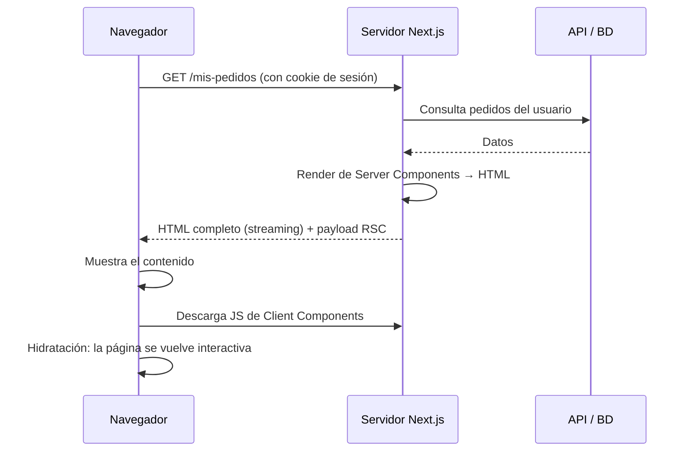

# SSR en Next.js

Parte de: [[Next.js (SSR, SSG y App Router)]]

> [!info] Cómo avanzar
> `progreso`: **pendiente** → **viendo** (estudiando) → **visto** (contestaste la autoevaluación sin abrir las respuestas) → **dominado** (hiciste el laboratorio o lo aplicaste de verdad).

## Contenido

### Qué es
**SSR** (*Server-Side Rendering*, renderizado en el servidor) significa que el HTML de una página se genera **en el servidor en cada petición**, con los datos de ese momento, y se envía al navegador ya armado. El usuario ve contenido de inmediato (sin esperar a que descargue y ejecute el JavaScript), y luego React **hidrata** la página: conecta eventos y estado a ese HTML para que sea interactivo. Es lo contrario de una SPA pura (*Client-Side Rendering*), donde el servidor manda un `<div id="root">` vacío y todo se construye en el navegador.

En el [[App Router de Next.js]] se le llama **renderizado dinámico**: Next.js renderiza la ruta por petición cuando detecta que depende de información que solo existe en ese momento.

### Cómo funciona


#### Qué vuelve dinámica una ruta
En el App Router no hay `getServerSideProps`. Una ruta se renderiza por petición cuando usa **APIs dinámicas**:

- `cookies()` o `headers()` de `next/headers` (sesión, idioma del usuario).
- `searchParams` de la página (filtros en la URL).
- `connection()` para indicar explícitamente que se espere a la petición.
- `fetch` con `cache: 'no-store'` o datos marcados como no cacheables.
- Configuración de segmento `export const dynamic = 'force-dynamic'`.

En Next.js 15 y 16, `params`, `searchParams`, `cookies()` y `headers()` son **asíncronos**: se usan con `await`.

#### Streaming
SSR no tiene que esperar a que **todos** los datos estén listos. Con `<Suspense>` (o un archivo `loading.tsx`), Next.js envía primero el esqueleto de la página y va **transmitiendo** las partes lentas conforme se resuelven. Así el tiempo hasta el primer contenido no queda atado a la consulta más lenta.

### Ejemplo
```tsx
// app/mis-pedidos/page.tsx
import { cookies } from 'next/headers';
import { Suspense } from 'react';

async function ListaPedidos({ estado }: { estado?: string }) {
  const token = (await cookies()).get('sesion')?.value;
  const res = await fetch(`${process.env.API_URL}/pedidos?estado=${estado ?? ''}`, {
    headers: { Authorization: `Bearer ${token}` },
    cache: 'no-store', // datos personales: no se cachean
  });
  if (!res.ok) throw new Error('No se pudieron cargar los pedidos'); // lo atrapa error.tsx
  const pedidos: { id: number; folio: string; total: number }[] = await res.json();
  return <ul>{pedidos.map(p => <li key={p.id}>{p.folio}: ${p.total.toFixed(2)}</li>)}</ul>;
}

export default async function MisPedidos({ searchParams }: { searchParams: Promise<{ estado?: string }> }) {
  const { estado } = await searchParams;
  return (
    <main>
      <h1>Mis pedidos</h1>
      <Suspense fallback={<p>Cargando pedidos…</p>}>
        <ListaPedidos estado={estado} />
      </Suspense>
    </main>
  );
}
```

El encabezado se envía de inmediato y la lista llega por streaming. La API (por ejemplo una ASP.NET Core) sigue validando el token: el SSR no cambia dónde vive la seguridad.

### SSR frente a SSG
| Criterio | SSR (por petición) | SSG/ISR (en build o regenerado) |
|---|---|---|
| Datos personalizados por usuario | Sí | No (es el mismo HTML para todos) |
| Frescura | Siempre actual | Tan fresca como la última regeneración |
| Costo por petición | Render en cada visita | Casi nulo (sirve desde caché/CDN) |
| Tiempo de respuesta | Depende de las consultas | Muy rápido |
| Ejemplos | Carrito, "mis pedidos", resultados de búsqueda, precios en tiempo real | Blog, catálogo, documentación, landing |

Regla práctica: usa **SSG/ISR por defecto** y pasa a SSR solo cuando el contenido depende de quién lo pide o debe estar al segundo. Ver [[SSG e ISR en Next.js]].

### Errores de hidratación
Durante la hidratación, React espera que el árbol que genera en el navegador **coincida** con el HTML que llegó del servidor. Si difiere, aparece un error de hidratación ("Hydration failed because the server rendered HTML didn't match the client") y React tiene que volver a renderizar esa parte en el cliente, con parpadeo y costo extra. Causas típicas:

- Usar en el render valores que cambian entre servidor y cliente: `Date.now()`, `new Date().toLocaleString()` (zona horaria distinta: el servidor en UTC y el usuario en Ciudad de México), `Math.random()`.
- Leer `window`, `localStorage` o `navigator` durante el render (en el servidor no existen; en el cliente sí).
- HTML inválido: un `<div>` dentro de un `<p>`, o `<a>` dentro de `<a>`; el navegador lo "corrige" y ya no coincide.
- Extensiones del navegador que modifican el DOM antes de hidratar.

Soluciones: calcular esos valores en un `useEffect` (corre solo en el cliente, después de hidratar), formatear fechas con una zona horaria explícita, pasar el valor ya calculado desde el servidor, o, para casos inevitables como una marca de tiempo, `suppressHydrationWarning` en ese elemento puntual.

### Cuándo usarlo y cuándo no
Úsalo para páginas públicas con datos por usuario o muy cambiantes donde importa la primera carga y el SEO. Evítalo para todo lo que pueda ser estático (pagas render en cada visita) y para apps internas detrás de login, donde una SPA con React + Vite suele ser más simple.

### Errores comunes
- **Volver dinámica toda la app** sin querer por leer `cookies()` en el layout raíz.
- **Cachear datos personales** (olvidar `no-store` o compartir respuestas entre usuarios).
- **Consultas en cascada** (`await` una tras otra): lánzalas en paralelo con `Promise.all` o separa con Suspense.
- **Valores no deterministas en el render**: errores de hidratación.
- **Asumir que SSR protege datos**: la API debe autorizar cada petición.

### Para profundizar
- [Server y Client Components en Next.js](https://nextjs.org/docs/app/getting-started/server-and-client-components)
- [Obtener datos en el App Router (Next.js)](https://nextjs.org/docs/app/getting-started/fetching-data)
- [Errores de hidratación en Next.js](https://nextjs.org/docs/messages/react-hydration-error)
- [hydrateRoot (react.dev)](https://react.dev/reference/react-dom/client/hydrateRoot)

## Autoevaluación

Contesta primero en voz alta o en papel; luego despliega la respuesta.

> [!question]- ¿Qué es SSR?
> Generar el HTML en el servidor **en cada petición** con datos actuales; el navegador lo muestra rápido y luego se *hidrata* para ser interactivo.

> [!question]- ¿Cuándo conviene SSR frente a SSG?
> Cuando el contenido depende de la petición (usuario, cookies, búsqueda) o cambia constantemente. Si es igual para todos y cambia poco, SSG es más barato y rápido.

> [!question]- ¿Qué es un error de hidratación?
> Que el HTML del servidor no coincida con el primer render del cliente (fechas, `Math.random`, `window` usado en render). React avisa y puede rehacer esa parte en el cliente.

