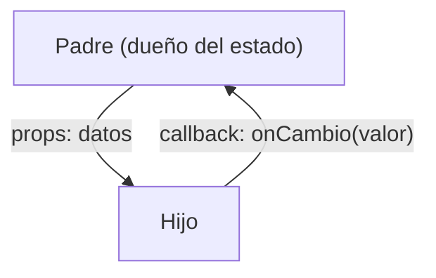

# Props

Parte de: [[05-React/_Índice React|React]]

> [!info] Cómo avanzar
> `progreso`: **pendiente** → **viendo** (estudiando) → **visto** (contestaste la autoevaluación sin abrir las respuestas) → **dominado** (hiciste el laboratorio o lo aplicaste de verdad).

## Contenido

### Qué es
Las **props** (propiedades) son los datos que un componente padre le pasa a un hijo, igual que los atributos de una etiqueta HTML. En el hijo llegan como **un solo objeto** que es el primer parámetro de la función. Son de **solo lectura**: el hijo nunca las modifica; si algo debe cambiar, el padre cambia su estado y vuelve a renderizar al hijo con props nuevas. Es el mecanismo básico de comunicación de arriba hacia abajo en React.

### Cómo funciona
- El padre escribe `<Tarjeta titulo="Ventas" total={1200} />`; React llama a `Tarjeta({ titulo: 'Ventas', total: 1200 })`.
- Cadenas literales van entre comillas; cualquier otro valor (números, objetos, funciones, JSX) entre llaves.
- Se desestructuran en la firma y se les puede dar valor por defecto: `function Tarjeta({ titulo, total = 0 })`.
- Pueden ser **funciones** (callbacks): así el hijo "avisa" al padre de algo (`onGuardar`, `onCambio`). Los datos bajan por props y los eventos suben por callbacks.
- Cuando las props cambian, el hijo se vuelve a renderizar con los valores nuevos.



#### `children`
`children` es una prop especial: contiene lo que escribes **entre** la etiqueta de apertura y la de cierre. Sirve para componentes "contenedor" que envuelven contenido arbitrario (tarjetas, modales, layouts):

```tsx
import type { ReactNode } from 'react';

function Panel({ titulo, children }: { titulo: string; children: ReactNode }) {
  return (
    <section className="panel">
      <h2>{titulo}</h2>
      <div className="panel__cuerpo">{children}</div>
    </section>
  );
}

// Uso: lo de en medio llega como children
<Panel titulo="Resumen">
  <p>Pedidos de hoy: 18</p>
  <BotonExportar />
</Panel>
```

### Ejemplo con TypeScript
En tu stack conviene tipar las props con un `type` (o `interface`). TypeScript avisa si falta una prop obligatoria o si pasas un tipo incorrecto:

```tsx
type EstadoPedido = 'pendiente' | 'pagado' | 'cancelado';

type Props = {
  folio: string;
  estado: EstadoPedido;
  monto: number;
  compacto?: boolean;              // opcional
  onCancelar?: (folio: string) => void;
};

export function FilaPedido({ folio, estado, monto, compacto = false, onCancelar }: Props) {
  return (
    <tr className={compacto ? 'fila fila--compacta' : 'fila'}>
      <td>{folio}</td>
      <td>{estado}</td>
      <td>{monto.toFixed(2)}</td>
      <td>
        {estado === 'pendiente' && onCancelar && (
          <button onClick={() => onCancelar(folio)}>Cancelar</button>
        )}
      </td>
    </tr>
  );
}
```

Si necesitas aceptar todas las props nativas de un elemento (por ejemplo, un `Boton` que reenvía `disabled`, `type`, `aria-*`), extiende `ComponentProps<'button'>` y usa *spread*: `function Boton({ variante, ...resto }: Props) { return <button {...resto} /> }`.

### Prop drilling y cómo evitarlo
*Prop drilling* es pasar una prop por varios niveles de componentes que no la usan, solo para que llegue a un nieto lejano: `App → Layout → Barra → Menu → Avatar` reciben `usuario` aunque solo `Avatar` lo lea. Es tedioso y acopla componentes intermedios a datos que no les importan. Opciones, de la más simple a la más pesada:

1. **Composición con `children`**: en vez de que `Layout` reciba `usuario` para pasarlo, el padre arma `<Layout barra={<Avatar usuario={usuario} />}>`. Los intermedios solo colocan lo que reciben.
2. **[[Context]]**: para datos "globales" de un subárbol que cambian poco (sesión, tema, idioma).
3. **Un store** como [[zustand]] para estado de cliente compartido que cambia seguido.
4. **[[TanStack Query]]** para datos del servidor: cualquier componente pide la misma consulta y comparte la caché, sin pasar nada por props.

Unos cuantos niveles de props no son un problema: son explícitos y fáciles de seguir. Recurre a lo demás cuando el paso de props ya estorba.

### Cuándo usarlas y cuándo no
Usa props para todo lo que el hijo necesita saber y que decide el padre. No uses props para copiar datos al estado del hijo (`useState(props.valor)`) esperando que se sincronicen: el estado solo toma el valor inicial. Si el hijo debe reflejar siempre la prop, léela directamente; si debe reiniciarse cuando cambia una entidad, cambia su `key` (ver [[Listas y keys]]).

### Errores comunes
- **Mutar props** (`props.lista.sort()`): `sort` muta el arreglo del padre. Usa `[...lista].sort()` o `toSorted()`.
- **Copiar props en estado** y luego sorprenderse de que no se actualiza.
- **Pasar objetos o funciones nuevas en cada render** a hijos con `React.memo`: rompe la memoización. Ver [[useMemo y useCallback]].
- **Olvidar que `children` puede ser cualquier cosa**: texto, arreglo o `undefined`; tipa con `ReactNode`.

### Para profundizar
- [Pasar props a un componente (react.dev)](https://react.dev/learn/passing-props-to-a-component)
- [Pasar datos en profundidad con contexto (react.dev)](https://react.dev/learn/passing-data-deeply-with-context)
- [React y TypeScript (react.dev)](https://react.dev/learn/typescript)

## Autoevaluación

Contesta primero en voz alta o en papel; luego despliega la respuesta.

> [!question]- ¿Qué son las props?
> Los argumentos de un componente: un objeto de solo lectura que el padre le pasa. El hijo no debe modificarlas; si algo cambia, se pide al padre (callback) o se usa estado.

> [!question]- ¿Qué es `children`?
> La prop con lo que va entre las etiquetas del componente: `<Tarjeta><p>Hola</p></Tarjeta>`. Sirve para componentes contenedores (layouts, modales).

> [!question]- ¿Qué es *prop drilling* y cómo se evita?
> Pasar una prop por muchos niveles que no la usan. Se reduce con composición (pasar componentes como `children`), Context o un store (zustand).

## Práctica

- [[Lab 1 - App de notas con estado y efectos]]

