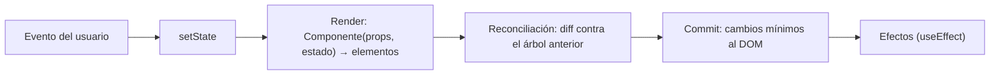

# Qué es React y por qué existe

Parte de: [[05-React/_Índice React|React]]

> [!info] Cómo avanzar
> `progreso`: **pendiente** → **viendo** (estudiando) → **visto** (contestaste la autoevaluación sin abrir las respuestas) → **dominado** (hiciste el laboratorio o lo aplicaste de verdad).

## Contenido

### Qué es
React es una biblioteca de JavaScript para construir interfaces a partir de **componentes**: funciones que reciben datos (props), tienen su propio estado y devuelven una descripción de la UI en JSX. Su idea central es que **la UI es una función del estado**: tú describes cómo debe verse la pantalla para un estado dado y React se encarga de llevar el DOM real a esa forma. No es un framework completo: no trae router, ni caché de datos, ni formularios; eso lo agregan bibliotecas como [[React Router]] o [[TanStack Query]].

### Por qué existe: el problema del DOM a mano
Antes de React, la forma común de hacer páginas interactivas era manipular el DOM directamente (o con jQuery): escuchar un clic, buscar nodos con selectores, cambiar su texto, agregar clases, insertar filas. Con pocas interacciones funciona, pero conforme crece la pantalla aparecen problemas típicos:

- **Vistas desactualizadas**: el mismo dato (por ejemplo, el número de elementos en un carrito) se muestra en tres lugares y olvidas actualizar uno.
- **Listeners duplicados o huérfanos**: vuelves a pintar un bloque con `innerHTML` y pierdes los eventos, o los registras dos veces.
- **Orden de operaciones frágil**: cada handler tiene que saber qué partes de la pantalla tocar; el código de "qué cambia" se esparce por todos lados.

React invierte el enfoque: en vez de escribir las **transiciones** del DOM (imperativo), escribes el **resultado** (declarativo). Cuando el estado cambia, React vuelve a ejecutar el componente, obtiene la nueva descripción y calcula él mismo qué nodos hay que modificar.

### Cómo funciona: render, reconciliación y commit
1. **Render**: React llama a tu componente. El componente devuelve elementos (objetos ligeros que describen etiquetas, props e hijos). No toca el DOM.
2. **Reconciliación**: React compara el árbol nuevo con el anterior. Si en la misma posición hay el mismo tipo de elemento (mismo `div`, mismo componente), lo reutiliza y solo actualiza props; si el tipo cambió, desmonta el viejo y monta uno nuevo. En listas usa la prop `key` para saber qué elemento es cuál (ver [[Listas y keys]]).
3. **Commit**: aplica al DOM únicamente las diferencias encontradas.
4. **Efectos**: después de pintar, corren los efectos (`useEffect`) para sincronizarse con el exterior.



Al "árbol de elementos en memoria" se le suele llamar DOM virtual; lo importante no es el nombre sino que comparar objetos de JavaScript es barato y tocar el DOM es caro, así que React minimiza lo segundo.

### Ejemplo: de imperativo a declarativo
Imperativo (lo que harías a mano):

```js
// Cada handler debe recordar qué partes de la pantalla actualizar
boton.addEventListener('click', () => {
  total += 1;
  contador.textContent = total;
  badge.textContent = total;
  vacio.hidden = total > 0;
});
```

Declarativo con React + TypeScript:

```tsx
import { useState } from 'react';

export function Carrito() {
  const [total, setTotal] = useState(0);
  // La UI se deriva del estado; React decide qué nodos cambiar
  return (
    <section>
      <span className="badge">{total}</span>
      {total === 0 && <p>Tu carrito está vacío</p>}
      <button onClick={() => setTotal(t => t + 1)}>Agregar ({total})</button>
    </section>
  );
}
```

El handler solo cambia el estado; ya no sabe nada del DOM.

### Relación con tu molde Service-View-Handlers-Events
En el front sin bundler usas el [[Molde Service-View-Handlers-Events]]: el *Service* habla con la API, la *View* pinta a partir de un estado, los *Handlers* cambian el estado y vuelven a pintar, y los *Events* conectan el DOM con los handlers. React automatiza exactamente la parte de "volver a pintar": la View pasa a ser el componente, los Handlers son funciones que llaman a `setState`, y React decide qué repintar. Además agrega cosas que en el molde haces a mano: estado **local por componente**, composición (componentes dentro de componentes) y efectos con **función de limpieza**. El Service sigue existiendo, normalmente envuelto por TanStack Query.

### Cuándo usarlo y cuándo no
Úsalo cuando la pantalla tiene mucho estado que cambia (formularios complejos, tableros, editores, apps internas como Itzamna.Clio) y quieres un ecosistema maduro y tipado con TypeScript. No es la mejor opción para una página casi estática con un par de interacciones: ahí [[lit-html]] o JavaScript plano con tu molde pesan menos y no requieren compilar JSX. Si necesitas SEO fuerte o render en servidor, considera [[Next.js (SSR, SSG y App Router)]] en lugar de React + Vite puro.

### Errores comunes
- **Pensar que React es "rápido por magia"**: re-renderizar es barato, pero un componente que hace trabajo pesado en cada render sigue siendo lento. Ver [[Rendimiento en React]].
- **Seguir pensando imperativo**: buscar nodos con `document.querySelector` dentro de componentes. Si necesitas un nodo, usa [[useRef]].
- **Mutar el estado**: React detecta cambios por referencia; mutar un objeto no dispara render. Ver [[Estado con useState]].
- **Meter lógica con efectos secundarios en el render** (fetch, timers): el render debe ser puro; eso va en [[useEffect]] o en una biblioteca de datos.

### Para profundizar
- [Pensar en React (react.dev)](https://react.dev/learn/thinking-in-react)
- [Render y commit (react.dev)](https://react.dev/learn/render-and-commit)
- [Preservar y reiniciar el estado (react.dev)](https://react.dev/learn/preserving-and-resetting-state)

## Autoevaluación

Contesta primero en voz alta o en papel; luego despliega la respuesta.

> [!question]- ¿Qué problema resolvía React frente a manipular el DOM a mano (o jQuery)?
> Sincronizar muchos cambios de estado con el DOM a mano produce bugs (vistas desactualizadas, listeners duplicados). React propone describir la UI de forma declarativa y dejar que él calcule qué cambiar.

> [!question]- ¿Qué es la reconciliación?
> El proceso en el que React compara el nuevo árbol de elementos con el anterior y aplica al DOM solo las diferencias. Usa el tipo de elemento y las `key` para decidir si reutiliza o recrea nodos.

> [!question]- ¿En qué se parece tu molde Service-View-Handlers-Events a React?
> La View es una función del estado y los Handlers cambian el estado y repintan; React automatiza ese repintado, agrega estado local por componente y efectos con limpieza.


## Bitácora
- 2026-11-28 · viendo · Entiende la UI como función del estado y cómo los eventos cambian el estado (onClick, onChange, onBlur). Falta repasar la reconciliación y la comparación con el molde Service-View-Handlers-Events.
