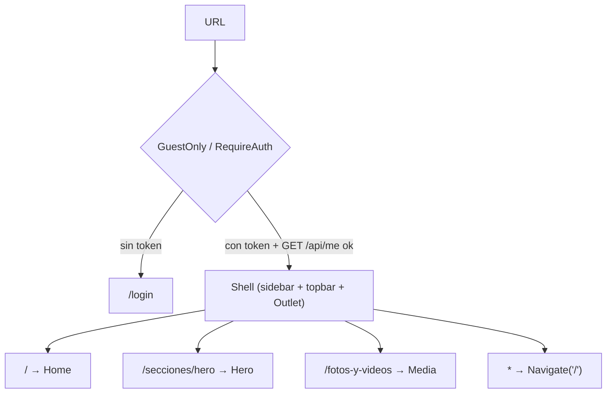

# React Router

> Router para apps de [[React]]: asocia rutas de la URL a componentes, con layouts anidados, parámetros y navegación sin recargar la página.

## Qué es y qué problema resuelve
En una SPA el servidor siempre entrega el mismo `index.html`; el router lee la URL y decide qué componente pintar. React Router añade rutas anidadas con `<Outlet />`, parámetros (`/:slug`), query string (`useSearchParams`), redirecciones (`<Navigate>`) y, con el **data router** (`createBrowserRouter`), funciones extra como bloquear la navegación si hay cambios sin guardar (`useBlocker`).

Versión usada en [[Itzamna.Clio]]: `react-router-dom ^6.30`.

## Cómo funciona por dentro
- **`BrowserRouter`** (declarativo): rutas como JSX con `<Routes>`/`<Route>`. Usa la History API.
- **`createBrowserRouter` + `RouterProvider`** (data router): rutas como objetos. Habilita `loader`/`action`, `useBlocker`, `errorElement`.
- **Rutas sin `path`** (*layout routes*): envuelven a sus hijos y pintan `<Outlet />`. Sirven para guardas (auth) y layouts.
- **`index: true`**: la ruta por defecto dentro de un layout.
- `*` atrapa todo lo demás.



## Cuándo usarla y cuándo no
### Ventajas
- Layouts y guardas como rutas anidadas: sin repetir sidebar ni chequeos de sesión.
- `useBlocker` para avisar cambios sin guardar en navegación interna.
- URL como estado (pestañas con `?tab=`), compartible y con historial.
### Desventajas
- Dos APIs (declarativa y data router) con capacidades distintas; hay que elegir.
- El hosting debe reescribir rutas desconocidas a `index.html` (*navigation fallback*).
- Cambios grandes entre versiones mayores (v6 → v7).

## Alternativas
| Alternativa | En qué se diferencia |
|---|---|
| Router por hash propio (como [[Ocelotl.Iris]], ver [[SPA y router por hash]]) | `#/ruta`, sin configurar el servidor; hecho a mano. |
| TanStack Router | Rutas tipadas de punta a punta y caché de loaders. |
| React Router v7 / Remix | Modo framework con SSR y rutas por archivo. |
| wouter | Router mínimo para apps pequeñas. |

## Cómo se usó en Itzamna
**Studio** (`apps/studio/src/main.tsx`): data router con dos guardas como *layout routes*.
- `GuestOnly`: si ya hay token, redirige a `/`.
- `RequireAuth`: sin token → `/login`; con token espera `useMe()` (GET `/api/me`, que crea creador y portfolio la primera vez) y muestra pantalla de error con "Reintentar" si falla. Ver [[Autenticación y acceso]] y [[Perfil del creador]].
- `Shell` es el layout con `NavLink` y `<Outlet />`. Rutas en español (`/secciones/hero`, `/fotos-y-videos`, `/diseno`, `/ajustes`), regla de `.ai/02_CONVENTIONS.md`; el checklist de publicación de la API devuelve esas mismas rutas ([[Publicación y versiones]]).
- `/auth/callback` recibe el token de [[Hecate]].

Guarda de sesión (`Itzamna.Clio/apps/studio/src/main.tsx`):
```tsx
function RequireAuth() {
  const token = useAuth((s) => s.token);
  const me = useMe();
  if (!token) return <Navigate to="/login" replace />;
  if (me.isLoading) return <div className="boot"><span className="logo-mark">c</span></div>;
  // ... error con botón Reintentar
  return <Outlet />;
}
```

Aviso de cambios sin guardar (`Itzamna.Clio/apps/studio/src/layout/Shell.tsx`), motivo por el que el Studio usa data router (`.ai/01_ARCHITECTURE.md`):
```tsx
const blocker = useBlocker(({ currentLocation, nextLocation }) => dirty && currentLocation.pathname !== nextLocation.pathname);
```
`dirty` sale del store de [[zustand]]; si `blocker.state === 'blocked'` se abre un `Dialog` con "Salir sin guardar" (`blocker.proceed()`) o "Seguir editando" (`blocker.reset()`). Para cerrar la pestaña se usa `beforeunload` aparte.

Otros usos: pestañas en la URL con `useSearchParams` (`Content.tsx`: `?tab=categorias|casos`, con `replace: true`), y `useNavigate` desde la vista previa para abrir el editor de la sección clicada ([[Vista previa en vivo]]).

**Sitio público** (`apps/web/src/main.tsx`): `BrowserRouter` declarativo con `/preview`, `/demo`, `/:slug` y `*`. `PortfolioPage` lee `useParams().slug` y, si la API devolvió otro slug (redirección por slug viejo), hace `navigate('/' + data.slug, { replace: true })` ([[Slug y dirección pública]], [[Portfolio público]]).

**Hosting**: ambas apps tienen `navigationFallback` → `/index.html` en `public/staticwebapp.config.json` ([[Azure Static Web Apps]]), para que `/secciones/hero` o `/jatz` funcionen al recargar.

> [!note] Pendiente de confirmar
> El Studio no usa `loader`/`action` ni `errorElement` del data router; los datos se cargan con [[TanStack Query]]. No se encontró un motivo documentado para no usar `errorElement`.

## Errores comunes y buenas prácticas
- `useBlocker` solo funciona dentro de un data router (`createBrowserRouter`), no con `BrowserRouter`.
- Usar `replace` en redirecciones (`<Navigate replace>`) para no ensuciar el historial.
- Sin *navigation fallback* en el hosting, recargar una ruta interna da 404.
- Al cambiar de usuario, limpiar cachés: Clio hace `queryClient.clear()` cuando el token pasa a `null`.

## Qué estudiar después
- Loaders y actions del data router
- [[TanStack Query]] (datos) vs loaders (navegación)
- React Router v7 y TanStack Router
- [[SPA y router por hash]] (el enfoque de Iris)

## Documentación oficial

- https://reactrouter.com/ (elige la versión 6.x en el selector de la documentación)
- https://github.com/remix-run/react-router

## Autoevaluación

Contesta primero en voz alta o en papel; luego despliega la respuesta.

> [!question]- ¿Qué es el *data router* (`createBrowserRouter`)?
> Configurar las rutas como objetos con `loader` (carga datos antes de pintar la ruta), `action` (procesa envíos de `<Form>`), `errorElement` y rutas anidadas con `<Outlet />`; se monta con `<RouterProvider router={router} />`.

> [!question]- ¿Qué diferencia hay entre `<Link>`, `<NavLink>` y `useNavigate`?
> `<Link>` navega sin recargar. `<NavLink>` además sabe si está activo (para estilos). `useNavigate()` navega por código (tras guardar, por ejemplo).

> [!question]- ¿Cómo lees parámetros y query string?
> `useParams()` para `/clientes/:id` y `useSearchParams()` para `?pagina=2`.

## Práctica

- [[Lab 4 - Rutas protegidas con React Router (data router)]]

