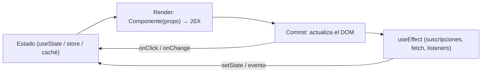

# React

> Librería de UI declarativa: describes la pantalla como función del estado (JSX) y React actualiza el DOM cuando el estado cambia.

## Qué es y qué problema resuelve
React organiza la interfaz en **componentes**: funciones que reciben *props* y devuelven JSX. El estado local vive en *hooks* (`useState`, `useRef`, `useEffect`…) y cuando cambia, React vuelve a ejecutar el componente, compara el resultado con el anterior (reconciliación) y solo toca el DOM que cambió.

Resuelve lo mismo que [[lit-html]] (no pintar a mano con `innerHTML`) pero agrega ciclo de vida, composición de componentes, contexto, carga diferida (`lazy` + `Suspense`) y un ecosistema enorme (router, caché de datos, stores, drag & drop).

Versión usada en [[Itzamna.Clio]]: `react` y `react-dom` `^19.1`, compilado con [[Vite]] + `@vitejs/plugin-react` y tipado con [[TypeScript]] (`jsx: react-jsx`).

## Cómo funciona por dentro
- **Render**: el componente es una función pura del estado y las props. Nada de efectos durante el render.
- **Commit**: React aplica los cambios al DOM.
- **Efectos** (`useEffect`): corren después del commit; su función de limpieza corre antes del siguiente efecto o al desmontar. `useLayoutEffect` corre antes de que el navegador pinte (para medir).
- **Claves** (`key`): identifican elementos de una lista entre renders.
- **`StrictMode`** (solo desarrollo): monta, desmonta y vuelve a montar para detectar efectos sin limpieza.
- **`lazy(() => import(...))` + `<Suspense>`**: el componente se descarga cuando se necesita; mientras, se muestra el `fallback`.
- **`createPortal`**: pinta un hijo en otro nodo del DOM (p. ej. `document.body` para un diálogo).



## Cuándo usarla y cuándo no
### Ventajas
- Composición: componentes pequeños y reutilizables con tipado de props.
- Ecosistema maduro: [[React Router]], [[TanStack Query]], [[zustand]], [[dnd-kit]], [[react-easy-crop]].
- `lazy`/`Suspense` para dividir el código por plantilla o pantalla.
- Mismo modelo mental que [[Componentes controlados]] (`value` + `onChange`).
### Desventajas
- Requiere compilación (JSX) y un bundler.
- Reglas de hooks y arreglos de dependencias: fáciles de equivocar (closures viejos, efectos que se disparan de más).
- Para páginas públicas, sin SSR el contenido se arma en el navegador (impacto en SEO).

## Alternativas
| Alternativa | En qué se diferencia |
|---|---|
| [[lit-html]] (lo que usa [[Ocelotl.Iris]]) | Plantillas con template literals, sin compilador ni ciclo de vida; el estado se organiza a mano. |
| Preact | API casi igual, mucho más ligera. |
| Vue / Svelte | Reactividad propia y compilador; plantillas en vez de JSX. |
| Next.js / Remix | React con SSR/SSG y router de archivos. |

## Cómo se usó en Itzamna
[[Itzamna.Clio]] tiene dos apps React y un paquete de componentes compartido:

| Pieza | Qué hace con React |
|---|---|
| `apps/studio` (Creator Studio) | `createRoot` + `StrictMode` + `QueryClientProvider` + `RouterProvider`. Páginas por sección en `pages/`, layout en `layout/Shell.tsx`, UI común en `components/ui.tsx`. |
| `apps/web` (portfolio público) | `BrowserRouter` con `/preview`, `/demo` y `/:slug`; pinta con `PortfolioRenderer`. |
| `packages/templates` | Plantillas como componentes (`EditorialTemplate` y sus secciones) cargadas con `lazy`; `react` es `peerDependency`. |

Patrones que aparecen:
- **Hooks propios** para la lógica de formularios: `useDraftForm` (módulos 1:1 con vista previa en vivo) y `useEntityForm` (diálogos de colección). Ver [[Módulos del portfolio - Front]].
- **Render props**: `Field` recibe `children: (id) => ReactNode` para ligar `label` e `input` con `useId`; `SortableList` recibe `render(item, handle, index)`.
- **Portales**: `Dialog` en `components/ui.tsx` se pinta en `document.body` con `createPortal`.
- **Carga diferida de plantillas** con `Suspense` ([[Plantillas y diseño]]).
- **Efectos con limpieza** y [[AbortController]] para cancelar peticiones (`PreviewPane`, `PortfolioPage`).

Plantillas bajo demanda (`Itzamna.Clio/packages/templates/src/PortfolioRenderer.tsx`):
```tsx
export function PortfolioRenderer(props: TemplateProps) {
  const { component: Template } = resolveTemplate(props.data.templateId);
  return (
    <Suspense fallback={<div style={{ minHeight: '100vh' }} aria-busy="true" />}>
      <Template {...props} />
    </Suspense>
  );
}
```

Estado de carga como unión discriminada en el sitio público (`Itzamna.Clio/apps/web/src/PortfolioPage.tsx`):
```tsx
type State = { status: 'loading' } | { status: 'ready'; data: PublicPortfolio } | { status: 'missing' } | { status: 'error' };
```

**Comparación con Ocelotl**: en [[Ocelotl.Iris]] cada pantalla se parte en service/view/handlers/events ([[Molde Service-View-Handlers-Events]]); en Clio una página es un componente que usa hooks (`usePortfolio`, `useDraftForm`) y las llamadas viven en `api/hooks.ts`. Es justo el "camino a React" que describe ese molde.

> [!tip] Reutilizable
> `components/ui.tsx` (Button, Field, TextField, Select, Toggle, Segmented, Tabs, Dialog, SaveBar, Skeleton) no depende de Itzamna y sirve como kit base de formularios accesibles.

> [!note] Pendiente de confirmar
> Hay comentarios `eslint-disable-line react-hooks/exhaustive-deps` en el código, pero el repo no tiene configuración de ESLint ni dependencia de `eslint`. No hay pruebas de componentes en Clio.

## Errores comunes y buenas prácticas
- **Efectos sin limpieza**: listeners de `window`, timers y `fetch` deben quitarse/cancelarse en el `return` del efecto (StrictMode lo hace evidente en desarrollo).
- **Closures viejos**: si un listener necesita el estado más reciente, guárdalo en un `useRef` (como `toPreviewRef` en `useDraftForm`) o vuelve a registrarlo.
- **`key` con índice** en listas que se reordenan: usa un id estable (Clio usa `item.id`).
- **Hooks antes de los `return` tempranos**: en `Hero.tsx` el `useDraftForm` se llama antes de `if (!p) return <Skeleton />`.
- No guardes en estado lo que puedes derivar (p. ej. `dirty` se calcula con `useMemo`).

## Qué estudiar después
- [[TypeScript]], [[Vite]], [[React Router]], [[TanStack Query]], [[zustand]]
- [[Componentes controlados]] y "lifting state up"
- React Server Components y SSR (ver [[Secciones pendientes]]: SSR/prerender)

## Documentación oficial
- https://react.dev/learn
- https://react.dev/reference/react
- https://react.dev/reference/react/lazy
- https://react.dev/reference/react-dom/createPortal

## Autoevaluación

Contesta primero en voz alta o en papel; luego despliega la respuesta.

> [!question]- ¿Qué es React en una frase y qué no incluye?
> Una librería para construir interfaces con componentes que describen la UI en función del estado; React se encarga de actualizar el DOM. No trae router, manejo de datos del servidor ni build: eso lo aportan React Router, TanStack Query, Vite, etc.

> [!question]- ¿Qué significa que la UI sea "función del estado"?
> Cada render es `UI = f(props, estado)`: no modificas el DOM a mano; cambias el estado y React vuelve a llamar al componente y aplica solo las diferencias.

> [!question]- ¿Cuáles son las reglas de los hooks?
> Llamarlos solo en el nivel superior de un componente o de un custom hook (no dentro de `if`, bucles ni callbacks) y solo desde funciones de React. React identifica cada hook por su orden de llamada.

