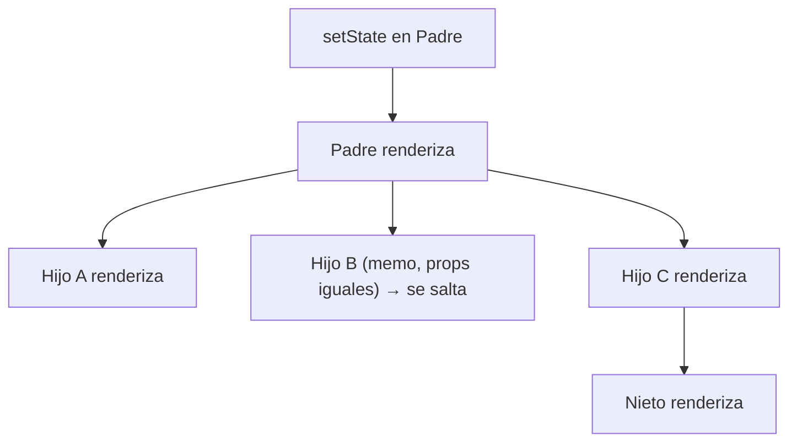

# Rendimiento en React

Parte de: [[05-React/_Índice React|React]]

> [!info] Cómo avanzar
> `progreso`: **pendiente** → **viendo** (estudiando) → **visto** (contestaste la autoevaluación sin abrir las respuestas) → **dominado** (hiciste el laboratorio o lo aplicaste de verdad).

## Contenido

### Qué es
Optimizar el rendimiento en React es lograr que la interfaz responda rápido (escribir, hacer clic, navegar) sin trabajo innecesario. La mayoría de los problemas vienen de tres fuentes: **renders de más** (componentes que se vuelven a ejecutar sin necesidad), **renders caros** (cálculos o listas enormes en cada render) y **bundles grandes** (demasiado JavaScript al inicio). La regla de oro es **medir primero**: React es rápido por defecto y la optimización prematura llena el código de memos que nadie necesita.

### Cómo funciona: qué provoca un re-render
Un componente se vuelve a renderizar cuando:

1. **Cambia su estado** (`setState` con un valor distinto).
2. **Se re-renderiza su padre**: por defecto, todos los hijos se renderizan también, aunque sus props sean iguales.
3. **Cambia un [[Context]] que consume**.
4. (Con stores externos como [[zustand]]) cambia la parte del store que selecciona.

Las props **no** provocan render por sí mismas: lo que lo provoca es que el padre se renderice. Y un render **no significa tocar el DOM**: React ejecuta la función, compara y solo aplica diferencias. Un render barato no es un problema; lo es cuando son muchos, cuando cada uno es costoso o cuando bloquean la escritura del usuario.



### Cómo encontrar el problema
- **React DevTools → Profiler**: graba una interacción y muestra qué componentes se renderizaron, cuánto tardó cada uno (flamegraph) y, si activas *"Record why each component rendered while profiling"* en la configuración, **por qué** se renderizó (cambió el estado, cambió una prop, se renderizó el padre, cambió un hook).
- **"Highlight updates when components render"** en DevTools: resalta en pantalla lo que se re-renderiza al interactuar.
- **Pestaña Performance del navegador**: para ver tareas largas (más de 50 ms) y si el problema es JavaScript, layout o pintado.
- Mide con el **build de producción** (`vite build && vite preview`); el modo desarrollo es más lento y StrictMode duplica renders.

### Técnicas, en orden de preferencia
1. **Bajar el estado y componer con `children`**. Si el estado de un input vive en la página entera, cada tecla re-renderiza toda la página. Muévelo al componente que lo usa. Y si un componente con estado envuelve contenido pesado, recibe ese contenido como `children`: los elementos de `children` los creó el padre, así que no se re-renderizan cuando cambia el estado del envoltorio.
2. **`React.memo` + referencias estables**. Envuelve hijos costosos con `memo` y estabiliza las props objeto/función con `useMemo`/`useCallback` (ver [[useMemo y useCallback]]). Con el React Compiler activo, esto se hace automáticamente en gran parte.
3. **Virtualizar listas largas**. Pintar 5,000 filas en el DOM es lento sin importar los memos. Con TanStack Virtual (o similar) solo se renderizan las filas visibles más un margen.
4. **`useTransition` y `useDeferredValue`**. Marcan actualizaciones como **no urgentes** para que la escritura siga fluida: el input se actualiza al instante y la lista filtrada se recalcula "cuando haya tiempo", pudiendo interrumpirse si el usuario sigue tecleando.
5. **Dividir código con `lazy`** para reducir el JavaScript inicial (ver [[Suspense y lazy loading]]).

Otras palancas: [[Listas y keys|keys estables]], evitar estado derivado con efectos, usar [[TanStack Query]] para no repetir peticiones y seleccionar solo lo necesario de un store.

### Ejemplo: búsqueda que no bloquea la escritura
```tsx
import { memo, useDeferredValue, useMemo, useState } from 'react';

const Resultados = memo(function Resultados({ q, productos }: { q: string; productos: Producto[] }) {
  const filtrados = useMemo(
    () => productos.filter(p => p.nombre.toLowerCase().includes(q.toLowerCase())),
    [q, productos]
  );
  return <ul>{filtrados.slice(0, 200).map(p => <li key={p.id}>{p.nombre}</li>)}</ul>;
});

export function Buscador({ productos }: { productos: Producto[] }) {
  const [q, setQ] = useState('');
  const qDiferido = useDeferredValue(q); // va "detrás" de q cuando hay trabajo pesado
  return (
    <>
      <input value={q} onChange={e => setQ(e.target.value)} />
      <div style={{ opacity: q !== qDiferido ? 0.6 : 1 }}>
        <Resultados q={qDiferido} productos={productos} />
      </div>
    </>
  );
}
```

El input usa `q` (urgente) y la lista usa `qDiferido` (no urgente); `memo` permite que `Resultados` no se renderice mientras `qDiferido` no cambie.

### Cuándo usarlo y cuándo no
Optimiza cuando **mides** un problema: interacciones de más de ~100 ms, escritura con retraso, listas que tardan en aparecer. No optimices por intuición: cada `memo` es código extra que mantener y puede ocultar bugs de dependencias. En apps internas con tablas grandes (reportes como Wee.Reporteria, listas de pedidos), lo que más rinde suele ser paginar o virtualizar y no traer datos de más desde la API.

### Errores comunes
- **Memoizar todo** sin medir: más complejidad, poca ganancia.
- **Medir en desarrollo**: StrictMode y las herramientas de desarrollo distorsionan los tiempos.
- **Estado global para todo**: un cambio re-renderiza media app. Mantén el estado lo más local posible.
- **Objetos nuevos como valor de Context**: re-render de todos los consumidores.
- **Pintar miles de nodos** en vez de virtualizar o paginar.

### Para profundizar
- [React Developer Tools (react.dev)](https://react.dev/learn/react-developer-tools)
- [Componente Profiler para medir por código (react.dev)](https://react.dev/reference/react/Profiler)
- [useDeferredValue (react.dev)](https://react.dev/reference/react/useDeferredValue)
- [TanStack Virtual](https://tanstack.com/virtual/latest)

## Autoevaluación

Contesta primero en voz alta o en papel; luego despliega la respuesta.

> [!question]- ¿Qué provoca que un componente se re-renderice?
> Cambia su estado, se re-renderiza su padre, o cambia un Context que consume. Un render no implica tocar el DOM; React solo aplica diferencias.

> [!question]- ¿Qué herramienta usas para encontrar renders innecesarios?
> React DevTools → Profiler: graba, ve qué componentes se renderizaron, cuánto tardaron y por qué (opción *Record why each component rendered*).

> [!question]- Menciona técnicas de optimización en orden de preferencia.
> 1) Bajar el estado al componente que lo usa y componer con `children`. 2) `React.memo` + referencias estables. 3) Virtualizar listas largas (TanStack Virtual). 4) `useTransition`/`useDeferredValue` para no bloquear la escritura. 5) Dividir código con `lazy`.

