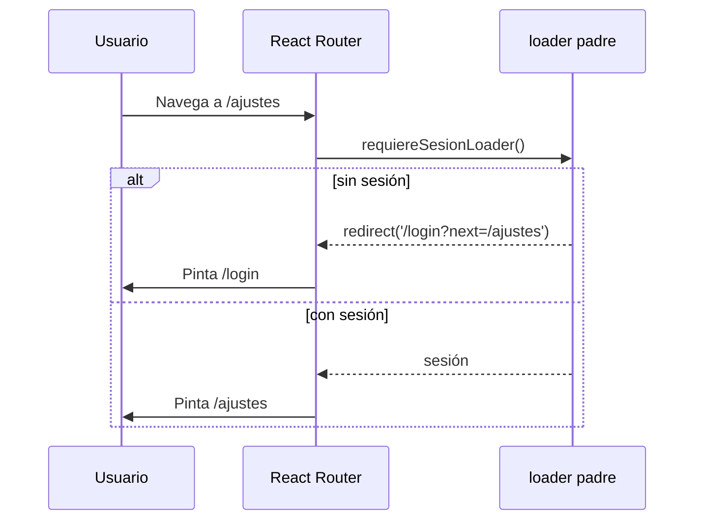

# Rutas protegidas

Parte de: [[05-React/_Índice React|React]]

> [!info] Cómo avanzar
> `progreso`: **pendiente** → **viendo** (estudiando) → **visto** (contestaste la autoevaluación sin abrir las respuestas) → **dominado** (hiciste el laboratorio o lo aplicaste de verdad).

## Contenido

### Qué es
Una ruta protegida es una pantalla de la SPA que solo debe mostrarse si el usuario cumple una condición: tener sesión iniciada, tener un rol (`admin`) o un permiso concreto. Si no la cumple, la app lo **redirige** (normalmente al login) en vez de pintar la pantalla. En [[React Router]] hay dos formas de hacerlo: con un **componente guardia** que envuelve las rutas hijas, o, con el *data router*, en el **`loader`** de una ruta padre, antes de renderizar nada.

Importante desde el inicio: proteger rutas en el front es una medida de **experiencia de usuario**, no de seguridad.

### Cómo funciona
#### Opción 1: componente guardia con `<Navigate>` y `<Outlet>`
Una ruta padre sin `path` (ruta de *layout*) renderiza un componente que revisa la sesión. Si no hay, devuelve `<Navigate to="/login" replace />`; si hay, devuelve `<Outlet />`, que pinta la ruta hija que coincidió.

```tsx
import { Navigate, Outlet, useLocation } from 'react-router';
import { useSesion } from '@/features/auth';

export function RequiereSesion({ rol }: { rol?: string }) {
  const { usuario, cargando } = useSesion();
  const location = useLocation();

  if (cargando) return <p>Verificando sesión…</p>;
  if (!usuario) {
    // Guarda a dónde quería ir
    return <Navigate to="/login" replace state={{ from: location }} />;
  }
  if (rol && !usuario.roles.includes(rol)) return <Navigate to="/sin-permiso" replace />;
  return <Outlet />;
}
```

```tsx
const router = createBrowserRouter([
  { path: '/login', element: <Login /> },
  {
    element: <RequiereSesion />,           // todo lo de abajo exige sesión
    children: [
      { path: '/', element: <Tablero /> },
      { path: '/pedidos', element: <Pedidos /> },
      { element: <RequiereSesion rol="admin" />, children: [{ path: '/admin', element: <Admin /> }] },
    ],
  },
]);
```

Desventaja: la ruta empieza a renderizarse (y sus hijos podrían disparar consultas) antes de que el guardia decida, y el "verificando sesión" ocurre en el render.

#### Opción 2: data router con `loader` y `redirect`
Con `createBrowserRouter`, cada ruta puede tener un `loader` que corre **antes** de renderizar. Si el loader de la ruta padre lanza o devuelve `redirect(...)`, React Router navega sin renderizar la ruta ni ejecutar los loaders de los hijos que dependan de ella:

```tsx
import { redirect, type LoaderFunctionArgs } from 'react-router';
import { obtenerSesion } from '@/features/auth';

async function requiereSesionLoader({ request }: LoaderFunctionArgs) {
  const sesion = await obtenerSesion(); // p. ej. pregunta a /api/sesion o lee el token en memoria
  if (!sesion) {
    const url = new URL(request.url);
    throw redirect(`/login?next=${encodeURIComponent(url.pathname + url.search)}`);
  }
  return sesion;
}

const router = createBrowserRouter([
  { path: '/login', element: <Login /> },
  { id: 'privado', loader: requiereSesionLoader, element: <LayoutPrivado />, children: [/* rutas */] },
]);
```

Los hijos pueden leer la sesión con `useRouteLoaderData('privado')`. Esta es la variante que practicas en el laboratorio de esta sección.



### Regresar a donde quería ir
Al redirigir guarda la ruta original: en `?next=/ajustes` (sobrevive a recargar la página) o en `state: { from: location }` (no se ve en la URL). Después del login exitoso:

```tsx
const [params] = useSearchParams();
const navigate = useNavigate();
async function alIniciar() {
  await iniciarSesion(credenciales);
  const next = params.get('next');
  // Valida que sea una ruta interna para evitar redirecciones abiertas
  navigate(next && next.startsWith('/') && !next.startsWith('//') ? next : '/', { replace: true });
}
```

Validar `next` evita una *open redirect*: que alguien mande un enlace `/login?next=https://sitio-malicioso`.

### Por qué `replace`
Sin `replace`, la navegación **agrega** una entrada al historial. Si el usuario entra a `/ajustes`, lo mandas a `/login` y luego presiona "Atrás", vuelve a `/ajustes`, que lo redirige a `/login` otra vez: queda atrapado. Con `replace`, la entrada de `/ajustes` se **sustituye** por `/login`. Lo mismo al terminar el login: sustituye `/login` por el destino para que "Atrás" no regrese al formulario.

### Proteger en el front no es seguridad
Cualquiera puede abrir las herramientas del navegador, cambiar el estado, leer el JavaScript descargado o llamar a la API con `curl`. La seguridad real está en el **backend**: cada endpoint de la API (por ejemplo los de Itzamna.Dionisio) debe validar el token JWT emitido por tu proveedor de identidad (Xolotl.Hecate, RS256, flujo con PKCE) y los permisos en **cada** petición, con `[Authorize]` y políticas en ASP.NET Core. El front solo evita mostrar pantallas inútiles y da una experiencia coherente. Tampoco pongas datos sensibles en el bundle "porque la ruta está protegida": el código de la ruta se descarga igual (salvo que uses carga diferida, que tampoco es seguridad).

### Errores comunes
- **Confiar en el guardia como seguridad**: la API debe autorizar siempre.
- **Olvidar `replace`**: bucle con el botón Atrás.
- **No manejar el estado "verificando"**: el usuario con sesión válida ve un parpadeo del login al recargar.
- **Aceptar cualquier `next`**: redirección abierta.
- **Repetir la verificación en cada página** en vez de una ruta padre que agrupe.

### Para profundizar
- [React Router: rutas y loaders (modo data)](https://reactrouter.com/start/data/routing)
- [Carga de datos con loaders (React Router)](https://reactrouter.com/start/data/data-loading)
- [Autorización en ASP.NET Core (Microsoft Learn)](https://learn.microsoft.com/aspnet/core/security/authorization/introduction)

## Autoevaluación

Contesta primero en voz alta o en papel; luego despliega la respuesta.

> [!question]- ¿Qué formas hay de proteger rutas en React Router?
> 1) Un componente guardia que hace `return <Navigate to="/login" replace />` si no hay sesión y si la hay devuelve `<Outlet />`. 2) Con data router, en el `loader` de la ruta padre: `if (!sesion) throw redirect('/login?next=...')`, así ni siquiera se cargan datos.

> [!question]- ¿Proteger la ruta en el front es suficiente seguridad?
> No: solo mejora la experiencia. Cualquiera puede llamar a la API directamente; el backend debe validar el token y los permisos en cada petición.

> [!question]- ¿Cómo regresas al usuario a donde quería ir tras iniciar sesión?
> Guarda la ruta original (`?next=/ajustes` o `state: { from: location }`) al redirigir y, después del login, navega ahí con `replace`.

> [!question]- ¿Por qué usar `replace` al redirigir al login?
> Para que la ruta protegida no quede en el historial; si no, "Atrás" lleva de nuevo a ella y vuelve a redirigir.

## Práctica

- [[Lab 4 - Rutas protegidas con React Router (data router)]]

