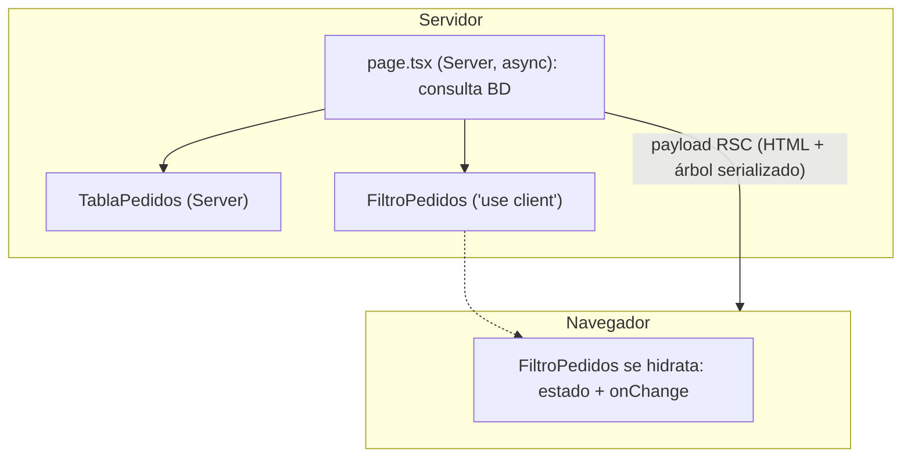

# Server Components

Parte de: [[05-React/_Índice React|React]]

> [!info] Cómo avanzar
> `progreso`: **pendiente** → **viendo** (estudiando) → **visto** (contestaste la autoevaluación sin abrir las respuestas) → **dominado** (hiciste el laboratorio o lo aplicaste de verdad).

## Contenido

### Qué es
Un **React Server Component** (RSC) es un componente que **se ejecuta solo en el servidor** (o en tiempo de compilación) y nunca en el navegador. Puede ser `async`, leer directamente una base de datos, archivos o secretos, y su código **no se envía al cliente**: lo que viaja es el **resultado** serializado (una representación del árbol de UI que React sabe reconstruir). No tiene estado, ni efectos, ni handlers de eventos, porque no "vive" en el navegador. Los componentes de toda la vida, los que sí se ejecutan en el navegador, se llaman **Client Components**.

RSC es una característica de React, pero necesita un framework o bundler que la implemente. En la práctica se usa con el App Router de Next.js (ver [[App Router de Next.js]]); una SPA con React + Vite como Itzamna.Clio no usa Server Components.

### Cómo funciona
En un proyecto con RSC, **todo componente es de servidor por defecto**. La directiva `'use client'` al inicio de un archivo marca una **frontera**: ese módulo y todo lo que importa se incluye en el bundle del navegador.



1. Llega una petición; el framework ejecuta los Server Components (pueden `await` consultas).
2. Produce el árbol resultante. Donde aparece un Client Component, deja una referencia ("aquí va `FiltroPedidos` con estas props") en vez de su código.
3. El navegador recibe HTML inicial y el *payload* RSC; descarga solo el JS de los Client Components y los **hidrata** (les conecta eventos y estado).
4. En navegaciones posteriores, el servidor manda el payload RSC de la nueva ruta sin recargar la página.

#### Cuándo necesitas `'use client'`
Cuando el componente usa algo que solo existe en el navegador o en el ciclo de vida interactivo:

- Estado y hooks de interacción: `useState`, `useReducer`, `useEffect`, `useRef`, `useContext` (como consumidor de un contexto de cliente).
- Handlers de eventos: `onClick`, `onChange`, `onSubmit` con lógica en el cliente.
- APIs del navegador: `window`, `localStorage`, `matchMedia`, geolocalización.
- Librerías que dependen de lo anterior (la mayoría de componentes de UI interactivos, [[TanStack Query]], [[zustand]], [[dnd-kit]]).

Recomendación: pon la frontera **lo más abajo posible** (en las hojas interactivas) para que la mayor parte del árbol siga en el servidor y el JS enviado sea mínimo. Un Server Component puede renderizar Client Components; un Client Component **no puede importar** un Server Component, pero sí puede recibirlo como `children` o como prop JSX.

#### Props que cruzan la frontera deben ser serializables
Lo que un Server Component pasa a un Client Component viaja por la red, así que debe poder serializarse: cadenas, números, booleanos, `null`, arreglos y objetos planos, `Date`, `Map`, `Set`, promesas y **JSX**. Una **función normal no es serializable**: si haces `<Boton onClick={() => borrar(id)} />` desde un Server Component hacia un Client Component, falla con un error del tipo "Functions cannot be passed directly to Client Components". La excepción son las **Server Actions**: funciones marcadas con `'use server'` que el framework convierte en una referencia invocable por red (como un endpoint POST generado).

### Ejemplo (Next.js App Router)
```tsx
// app/pedidos/page.tsx — Server Component (por defecto)
import { obtenerPedidos } from '@/features/pedidos/datos'; // consulta con secretos del servidor
import { FiltroEstado } from './FiltroEstado';
import { cancelarPedido } from './acciones';

export default async function PedidosPage() {
  const pedidos = await obtenerPedidos(); // corre en el servidor; la cadena de conexión nunca llega al navegador
  return (
    <main>
      <FiltroEstado />
      <ul>
        {pedidos.map(p => (
          <li key={p.id}>
            {p.folio} — {p.estado}
            <form action={cancelarPedido.bind(null, p.id)}>
              <button>Cancelar</button>
            </form>
          </li>
        ))}
      </ul>
    </main>
  );
}
```

```tsx
// app/pedidos/acciones.ts — Server Action
'use server';
export async function cancelarPedido(id: number) {
  // Verifica sesión y permisos aquí: una Server Action es un endpoint público
  await fetch(`${process.env.API_URL}/pedidos/${id}/cancelar`, { method: 'POST' });
}
```

```tsx
// app/pedidos/FiltroEstado.tsx — Client Component
'use client';
import { useRouter, useSearchParams } from 'next/navigation';
export function FiltroEstado() {
  const router = useRouter();
  const params = useSearchParams();
  return (
    <select defaultValue={params.get('estado') ?? ''} onChange={e => router.push(`?estado=${e.target.value}`)}>
      <option value="">Todos</option><option value="pendiente">Pendiente</option>
    </select>
  );
}
```

### Cuándo usarlo y cuándo no
Útil cuando hay mucho contenido que se arma con datos y poca interacción (catálogos, blogs, tableros de solo lectura), cuando quieres enviar menos JavaScript o acceder a datos sin exponer una API pública. No aplica si tu front es una SPA servida como estáticos frente a una API .NET separada (tu arquitectura actual): ahí la frontera natural ya es HTTP entre React y ASP.NET Core.

### Errores comunes
- **Pasar funciones como props** de Server a Client Component: no son serializables; usa Server Actions o mueve la lógica al cliente.
- **`'use client'` en la raíz** "para que funcione": todo se vuelve cliente y pierdes el beneficio.
- **Usar hooks en un Server Component**: error de compilación; extrae la parte interactiva.
- **Creer que una Server Action es privada**: se puede invocar por red; valida autenticación y autorización dentro.
- **Importar código de servidor en el cliente** (cliente de BD, secretos): usa el paquete `server-only` para que falle la compilación.

### Para profundizar
- [Server Components (react.dev)](https://react.dev/reference/rsc/server-components)
- ['use client' (react.dev)](https://react.dev/reference/rsc/use-client)
- [Server Functions y 'use server' (react.dev)](https://react.dev/reference/rsc/server-functions)
- [Server y Client Components en Next.js](https://nextjs.org/docs/app/getting-started/server-and-client-components)

## Autoevaluación

Contesta primero en voz alta o en papel; luego despliega la respuesta.

> [!question]- ¿Qué es un React Server Component?
> Un componente que se ejecuta solo en el servidor: puede leer la BD o archivos, su código no se envía al navegador y no tiene estado ni efectos. Envía al cliente el resultado serializado.

> [!question]- ¿Cuándo necesitas `'use client'`?
> Cuando el componente usa estado, efectos, handlers de eventos o APIs del navegador. Esa directiva marca el límite: ese archivo y lo que importa se envían al cliente.

> [!question]- Error común: pasar una función como prop de un Server Component a un Client Component. ¿Qué pasa?
> Falla: las props que cruzan al cliente deben ser serializables (datos, JSX). La excepción son las Server Actions.

