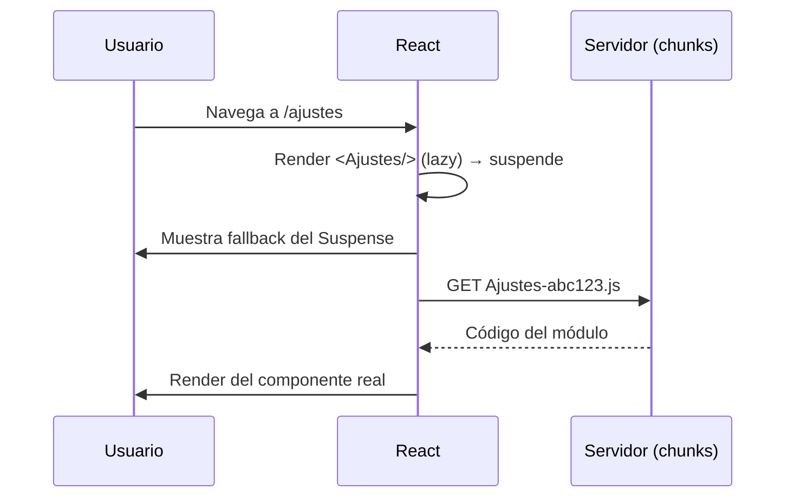

# Suspense y lazy loading

Parte de: [[05-React/_Índice React|React]]

> [!info] Cómo avanzar
> `progreso`: **pendiente** → **viendo** (estudiando) → **visto** (contestaste la autoevaluación sin abrir las respuestas) → **dominado** (hiciste el laboratorio o lo aplicaste de verdad).

## Contenido

### Qué es
**Lazy loading** (carga diferida) es descargar el código de una parte de la app **solo cuando se necesita**, en vez de mandar todo en un único archivo JavaScript al inicio. En React se hace con `React.lazy`, que envuelve un `import()` dinámico. **Suspense** es el componente que define **qué mostrar mientras algo no está listo**: `<Suspense fallback={<Spinner />}>`. Juntos permiten que la primera pantalla cargue rápido y que el resto llegue bajo demanda, con un estado de carga declarativo.

### Cómo funciona
1. `const Ajustes = lazy(() => import('./Ajustes'))` no descarga nada todavía. Vite ve el `import()` dinámico y, al compilar, genera un **chunk** separado (`Ajustes-abc123.js`).
2. La primera vez que React intenta renderizar `<Ajustes />`, el componente "suspende": le avisa a React que aún no está listo (internamente lanza una promesa).
3. React busca hacia arriba el `<Suspense>` más cercano y muestra su `fallback` en lugar de todo lo que está dentro de ese Suspense.
4. Cuando la promesa se resuelve (el chunk se descargó), React vuelve a intentar el render y muestra el contenido real. Las siguientes veces ya está en caché y no suspende.
5. Si la descarga falla, el error se propaga al [[Error boundaries|error boundary]] más cercano.



#### Qué puede suspender
- Componentes creados con `lazy`.
- Lectura de datos con fuentes **compatibles con Suspense**: `useSuspenseQuery` de [[TanStack Query]], el hook `use(promesa)` de React 19 con una promesa estable (creada fuera del render o cacheada), y frameworks como Next.js (ver [[Server Components]]).
- Un `fetch` dentro de un `useEffect` **no** suspende: ahí manejas tú el estado de carga.

#### Granularidad de los límites
Puedes anidar varios `Suspense`. Cada uno es un "límite de carga": lo que está dentro aparece junto cuando todo está listo. Un único Suspense arriba produce una pantalla de carga completa; varios límites pequeños permiten mostrar partes de la página conforme llegan (el encabezado ya, la gráfica después).

### Ejemplo: división por rutas
```tsx
import { lazy, Suspense } from 'react';
import { createBrowserRouter, RouterProvider } from 'react-router';

const Tablero = lazy(() => import('./features/tablero/Tablero'));
const Reportes = lazy(() => import('./features/reportes/Reportes')); // pesado: gráficas
const Ajustes = lazy(() => import('./features/ajustes/Ajustes'));

function Cargando() {
  return <div role="status" aria-live="polite">Cargando…</div>;
}

const router = createBrowserRouter([
  { path: '/', element: <Suspense fallback={<Cargando />}><Tablero /></Suspense> },
  { path: '/reportes', element: <Suspense fallback={<Cargando />}><Reportes /></Suspense> },
  { path: '/ajustes', element: <Suspense fallback={<Cargando />}><Ajustes /></Suspense> },
]);

export function App() {
  return <RouterProvider router={router} />;
}
```

`lazy` espera un módulo con **export default**. Si tu componente usa export con nombre, adapta: `lazy(() => import('./Reportes').then(m => ({ default: m.Reportes })))`. El data router de [[React Router]] también ofrece la propiedad `lazy` en la definición de la ruta para cargar componente y `loader` juntos.

#### Precarga
Para que el usuario no vea el fallback, puedes **precargar** el chunk antes de que lo necesite, por ejemplo al pasar el mouse sobre el enlace:

```tsx
const cargarReportes = () => import('./features/reportes/Reportes');
const Reportes = lazy(cargarReportes);
<Link to="/reportes" onMouseEnter={cargarReportes}>Reportes</Link>
```

### Dónde conviene dividir
- **Por ruta**: es el corte natural; cada pantalla es un chunk. En una app como Itzamna.Clio, el login no necesita descargar el editor ni los reportes.
- **Por componentes pesados que no se ven al inicio**: editores de texto enriquecido, gráficas, mapas, el recortador de imágenes ([[react-easy-crop]]), un modal grande de configuración, exportación a Excel.
- **No** dividas componentes pequeños (botones, tarjetas): cada chunk es una petición HTTP extra y un posible parpadeo; el ahorro es mínimo.

Revisa el resultado con el analizador de bundle (por ejemplo `rollup-plugin-visualizer` en Vite) para saber qué pesa de verdad antes de dividir.

### Cuándo usarlo y cuándo no
Úsalo cuando el bundle inicial es grande y hay partes que muchos usuarios nunca abren. No lo necesitas en apps pequeñas: un solo bundle bien comprimido puede ser más rápido que varios chunks. Para transiciones entre pantallas sin que el contenido actual desaparezca por el fallback, React usa transiciones (`startTransition`): mantiene la UI vieja visible mientras la nueva se prepara.

### Errores comunes
- **Declarar `lazy` dentro de un componente**: se crea un componente nuevo en cada render y se pierde estado. Decláralo a nivel de módulo.
- **Sin `Suspense` arriba**: React lanza un error porque no hay dónde mostrar el fallback.
- **Sin error boundary**: tras un deploy, los chunks viejos pueden no existir; atrapa el error y ofrece recargar.
- **Fallbacks que saltan**: un spinner que aparece 50 ms es peor que nada; usa esqueletos con el tamaño final o precarga.
- **Dividir demasiado fino**: cascadas de peticiones.

### Para profundizar
- [lazy (react.dev)](https://react.dev/reference/react/lazy)
- [Suspense (react.dev)](https://react.dev/reference/react/Suspense)
- [Importaciones dinámicas y code splitting en Vite](https://vite.dev/guide/features#dynamic-import)

## Autoevaluación

Contesta primero en voz alta o en papel; luego despliega la respuesta.

> [!question]- ¿Qué hace `React.lazy`?
> Carga un componente con `import()` dinámico solo cuando se necesita, generando un *chunk* aparte: `const Ajustes = lazy(() => import('./Ajustes'))`.

> [!question]- ¿Qué papel juega `<Suspense fallback>`?
> Muestra el `fallback` mientras algo dentro "suspende" (un componente lazy cargando o datos con una fuente compatible, como `useSuspenseQuery`).

> [!question]- ¿Dónde conviene dividir el código?
> Por rutas o por partes pesadas que no se ven al inicio (editores, gráficas, modales grandes). Dividir componentes pequeños genera más peticiones que beneficio.

## Práctica

- [[Lab 2 - TanStack Query con caché e invalidación]]

