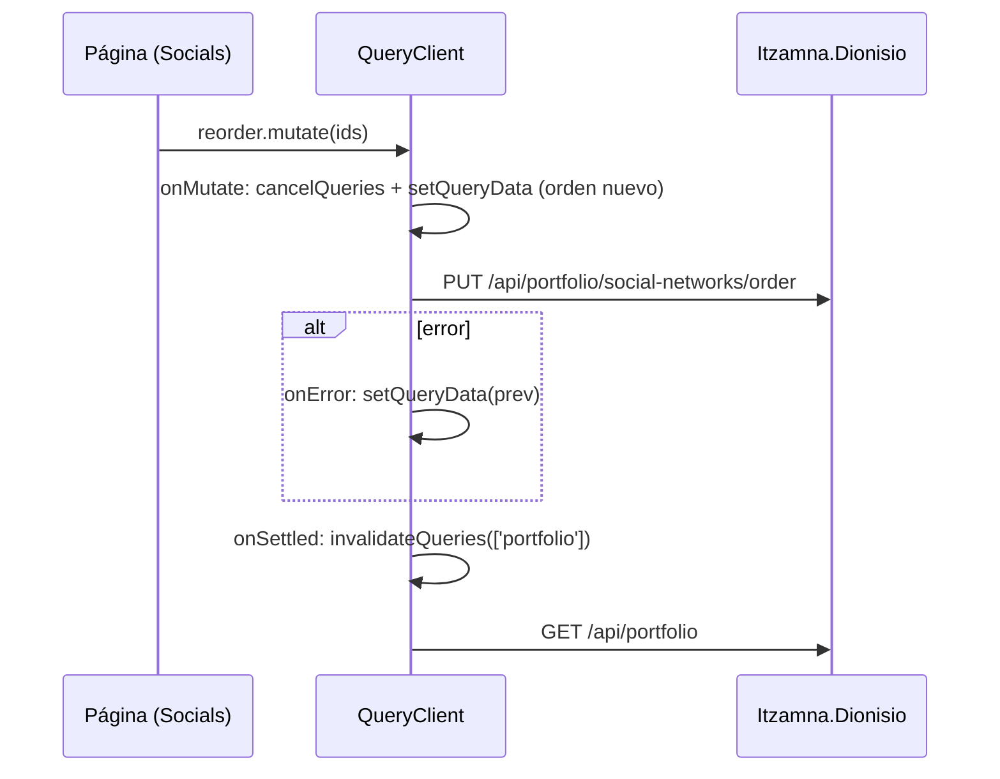

# TanStack Query

> Caché de estado del servidor para [[React]]: pide, guarda, comparte y refresca datos de la API, y maneja escrituras (mutaciones) con invalidación y actualizaciones optimistas.

## Qué es y qué problema resuelve
Los datos de la API no son "estado de la app": tienen dueño (el servidor), se vuelven viejos y varias pantallas los necesitan a la vez. Hacerlo con `useEffect` + `useState` en cada componente lleva a peticiones duplicadas, estados de carga repetidos y datos desincronizados. TanStack Query centraliza eso:
- **Queries** (`useQuery`): leer con una *query key*; deduplica, cachea y reintenta.
- **Mutations** (`useMutation`): escribir; al terminar, **invalidas** las keys afectadas y se vuelven a pedir.
- **Optimistic updates**: cambiar la caché antes de que responda el servidor y revertir si falla.

Versión usada en [[Itzamna.Clio]]: `@tanstack/react-query ^5.81` (solo en el Studio).

## Cómo funciona por dentro
- `QueryClient` guarda un mapa `queryKey → { data, status, dataUpdatedAt }`.
- `staleTime`: cuánto tiempo un dato se considera fresco (no se vuelve a pedir al montar).
- `invalidateQueries({ queryKey })`: marca como viejo y vuelve a pedir lo que esté en uso.
- `setQueryData` / `getQueryData`: leer o escribir la caché a mano.
- `cancelQueries`: cancela peticiones en vuelo (para que no pisen un cambio optimista).



## Cuándo usarla y cuándo no
### Ventajas
- Una sola fuente para datos del servidor; todas las pantallas leen la misma caché.
- Estados `isLoading`, `isError`, `isPending` listos.
- Invalidación declarativa tras guardar.
- Reintentos y cancelación integrados.
### Desventajas
- Otra capa que aprender (keys, staleTime, invalidación).
- No sustituye al estado de UI: para eso [[zustand]] o `useState`.
- Elegir mal las keys provoca datos viejos o recargas de más.

## Alternativas
| Alternativa | En qué se diferencia |
|---|---|
| `useEffect` + `fetch` | Sin dependencias; todo a mano (lo usa `apps/web/PortfolioPage`, que pide un solo recurso). |
| SWR | Idea similar, API más pequeña. |
| RTK Query | Integrado con Redux Toolkit. |
| Loaders de [[React Router]] | Cargan datos por ruta, sin caché compartida rica. |

## Cómo se usó en Itzamna
**Cliente** (`apps/studio/src/main.tsx`): `staleTime: 30_000`, `refetchOnWindowFocus: false` y reintentos solo si el error **no** es 4xx (un 400/404 no se arregla reintentando):
```tsx
const queryClient = new QueryClient({
  defaultOptions: {
    queries: {
      staleTime: 30_000,
      refetchOnWindowFocus: false,
      retry: (count, e) => !(e instanceof ApiError && e.status >= 400 && e.status < 500) && count < 2,
    },
  },
});
```
Al cerrar sesión se hace `queryClient.clear()` (suscripción al store de auth) para que no quede nada del creador anterior ([[Autenticación y acceso]]).

**Hooks** en `apps/studio/src/api/hooks.ts`:

| Hook | Endpoint | Notas |
|---|---|---|
| `useMe` | GET `/api/me` | `staleTime: Infinity` |
| `usePortfolio` | GET `/api/portfolio` | Key `['portfolio']`: el borrador completo; casi todo lo invalida |
| `useTemplates` | GET `/api/templates` | `staleTime: Infinity` |
| `useVersions` | GET `/api/portfolio/versions` | Se invalida al publicar/restaurar |
| `useMedia(kind, q)` | GET `/api/media?kind&q` | Key `['media', kind, q]` |
| `useModule` → `useSaveHero`, `useSaveAbout`, `useSaveSeo`… | PUT `/api/portfolio/{módulo}` | Invalida `['portfolio']` |
| `useCollection` → `useSocials`, `useMetrics`, `useContent`… | POST/PUT/DELETE `/api/portfolio/{colección}` y PUT `…/order` | `save`, `remove`, `reorder` (optimista) |
| `useUploadMedia`, `useUpdateMedia`, `useDeleteMedia` | `/api/media` | Invalida `['media']` |
| `usePublish`, `useUnpublish`, `useRestoreVersion` | POST `/api/portfolio/{publish,unpublish,versions/{v}/restore}` | Invalida portfolio y versiones |

- Las mutaciones se pasan a `useDraftForm` / `useEntityForm`, que llaman `mutateAsync` y convierten el `ApiError` en errores por campo ([[Módulos del portfolio - Front]]).
- `PreviewPane` usa `dataUpdatedAt` de `usePortfolio` para volver a pedir la vista previa tras guardar ([[Vista previa en vivo]]).
- `SectionCopyCard` (`components/Editor.tsx`) lee `qc.getQueryData(keys.portfolio)` para mandar los textos más recientes de las demás secciones.

> [!tip] Reutilizable
> `useModule(path)` y `useCollection(path)` (CRUD + orden optimista con rollback) son genéricos: sirven para cualquier API REST con recursos "1:1" y colecciones ordenables.

> [!note] Pendiente de confirmar
> Todo depende de una sola key `['portfolio']`: cualquier guardado vuelve a pedir el portfolio completo. Es simple y correcto, pero con portfolios grandes podría pesar; no hay medición.

## Errores comunes y buenas prácticas
- Guardar datos del servidor en `useState`/stores y además en la caché: dos fuentes de verdad.
- En updates optimistas: `cancelQueries` antes de `setQueryData`, guardar `prev` y revertir en `onError`, e invalidar en `onSettled`.
- Reintentar errores 4xx: solo gasta peticiones (Clio lo evita).
- Keys como arreglos estables y centralizados (`keys` en `hooks.ts`).
- Limpiar la caché al cambiar de usuario.

## Qué estudiar después
- Prefetching e `initialData`
- `useInfiniteQuery` (paginación de la biblioteca de medios)
- React Query Devtools
- [[Idempotencia]] en mutaciones que se reintentan

## Documentación oficial
- https://tanstack.com/query/latest/docs/framework/react/overview
- https://tanstack.com/query/latest/docs/framework/react/guides/optimistic-updates
- https://tanstack.com/query/latest/docs/framework/react/guides/query-invalidation

## Autoevaluación

Contesta primero en voz alta o en papel; luego despliega la respuesta.

> [!question]- ¿Qué problema resuelve TanStack Query?
> Manejar **estado del servidor**: caché por clave, deduplicar peticiones, reintentos, estados de carga/error, refetch al volver a la pestaña e invalidación tras mutaciones.

> [!question]- ¿Qué diferencia hay entre `staleTime` y `gcTime`?
> `staleTime`: cuánto tiempo un dato se considera fresco (no se vuelve a pedir); por defecto 0. `gcTime`: cuánto se conserva en caché un dato sin observadores antes de borrarse; por defecto 5 minutos.

> [!question]- ¿Cómo actualizas la lista después de crear un elemento?
> En `onSuccess` (o `onSettled`) de `useMutation`: `queryClient.invalidateQueries({ queryKey: ['items'] })`. Invalida todas las consultas cuya clave empieza con `['items']`.

> [!question]- Error común con `queryKey`.
> No incluir en la clave las variables que usa `queryFn` (`['usuario']` en vez de `['usuario', id]`): distintos ids comparten caché y ves datos de otro.

## Práctica

- [[Lab 2 - TanStack Query con caché e invalidación]]

