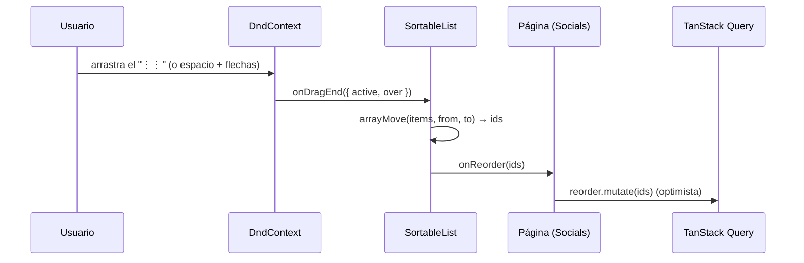

# dnd-kit

> Kit de arrastrar y soltar para [[React]], modular y accesible (mouse, táctil y teclado), con un preset para listas reordenables.

## Qué es y qué problema resuelve
La API nativa de drag & drop de HTML5 no funciona bien en táctil, no es accesible con teclado y es difícil de animar. dnd-kit implementa el arrastre con eventos de puntero y teclado, y expone hooks:
- `@dnd-kit/core`: `DndContext`, sensores (`PointerSensor`, `KeyboardSensor`), detección de colisiones.
- `@dnd-kit/sortable`: `SortableContext`, `useSortable`, `arrayMove` y estrategias (`verticalListSortingStrategy`, `rectSortingStrategy`).
- `@dnd-kit/utilities`: `CSS.Transform.toString(transform)`.

Versiones en [[Itzamna.Clio]]: core `^6.3.1`, sortable `^10.0.0`, utilities `^3.2.2`.

## Cómo funciona por dentro
- **Sensores** detectan el inicio del arrastre. `activationConstraint: { distance: 6 }` exige mover 6 px antes de arrastrar (los clics siguen funcionando).
- `KeyboardSensor` + `sortableKeyboardCoordinates`: espacio para tomar, flechas para mover, espacio para soltar.
- Durante el arrastre el DOM **no se reordena**: cada elemento recibe un `transform` (traslación) y una `transition`.
- Al soltar, `onDragEnd({ active, over })` da los ids; tú calculas el nuevo orden (`arrayMove`) y actualizas el estado.



## Cuándo usarla y cuándo no
### Ventajas
- Accesible con teclado y lectores de pantalla (anuncios configurables).
- Funciona en táctil y con mouse.
- Modular: solo importas lo que usas.
### Desventajas
- Más código que una librería "todo en uno".
- El orden lo maneja tu estado: hay que calcularlo y persistirlo.
- Versiones de `core` y `sortable` deben ser compatibles entre sí.

## Alternativas
| Alternativa | En qué se diferencia |
|---|---|
| HTML5 Drag and Drop nativo | Sin dependencias; mal soporte táctil y de teclado. |
| @hello-pangea/dnd (fork de react-beautiful-dnd) | Listas muy pulidas; menos flexible para grillas. |
| SortableJS / react-sortablejs | Manipula el DOM directamente; choca con el modelo de React. |
| Botones "subir/bajar" | Simple y accesible; incómodo con listas largas. |

## Cómo se usó en Itzamna
Un solo componente genérico, `SortableList<T extends { id: string }>` en `apps/studio/src/components/Sortable.tsx`, con modo lista o grilla (`grid` → `rectSortingStrategy`). Recibe `items`, `onReorder(ids)` y `render(item, handle, index)`: la página decide cómo se ve la fila y dónde va el asa de arrastre.

`Itzamna.Clio/apps/studio/src/components/Sortable.tsx`:
```tsx
const sensors = useSensors(
  useSensor(PointerSensor, { activationConstraint: { distance: 6 } }),
  useSensor(KeyboardSensor, { coordinateGetter: sortableKeyboardCoordinates }),
);
const onDragEnd = ({ active, over }: DragEndEvent) => {
  if (!over || active.id === over.id) return;
  const from = items.findIndex((i) => i.id === active.id);
  const to = items.findIndex((i) => i.id === over.id);
  onReorder(arrayMove(items, from, to).map((i) => i.id));
};
```

El asa es un `<button aria-label="Arrastra para reordenar">` con `{...attributes} {...listeners}`; en CSS lleva `touch-action: none` para que el arrastre táctil no haga scroll.

Dónde se usa:

| Página | Qué se ordena | Cómo se guarda |
|---|---|---|
| `Socials.tsx` | Redes | `reorder.mutate(ids)` → PUT `/api/portfolio/social-networks/order` ([[Redes sociales y métricas]]) |
| `Results.tsx` | Métricas | PUT `/api/portfolio/metrics/order` |
| `Services.tsx` | Servicios | PUT `/api/portfolio/services/order` ([[Servicios]]) |
| `Collaborations.tsx` | Marcas | PUT `/api/portfolio/collaborations/order` ([[Colaboraciones]]) |
| `Design.tsx` | Secciones del portfolio | En el borrador local (`useDraftForm`); el hero queda fijo al inicio y se guarda con PUT `/api/portfolio/sections` ([[Plantillas y diseño]], [[Módulos del portfolio]]) |

En las colecciones el orden es **optimista** ([[TanStack Query]], `useCollection.reorder`): se ve al instante y se revierte si la API falla.

> [!tip] Reutilizable
> `SortableList` con *render prop* y asa explícita es portable a cualquier proyecto React: solo pide objetos con `id`.

> [!note] Pendiente de confirmar
> No se configuraron `accessibility.announcements` en `DndContext`, así que los anuncios para lector de pantalla son los predeterminados de dnd-kit (en inglés).

## Errores comunes y buenas prácticas
- Poner `listeners` en toda la fila: los botones internos dejan de recibir clics. Usa un asa o `activationConstraint`.
- Olvidar `touch-action: none` en el asa: en móvil la página hace scroll en vez de arrastrar.
- Usar el índice como id: al reordenar se confunden los elementos.
- Persistir solo los ids en orden (no el objeto entero) simplifica la API.

## Qué estudiar después
- `DragOverlay` para arrastrar una copia flotante
- Anuncios de accesibilidad personalizados (en español)
- Listas múltiples (mover entre contenedores)

## Documentación oficial
- https://docs.dndkit.com/
- https://docs.dndkit.com/presets/sortable
- https://github.com/clauderic/dnd-kit

## Autoevaluación

Contesta primero en voz alta o en papel; luego despliega la respuesta.

> [!question]- ¿Qué piezas básicas usa dnd-kit para una lista ordenable?
> `DndContext` (con sensores y `onDragEnd`), `SortableContext` con los ids en orden, y `useSortable` en cada elemento para obtener `attributes`, `listeners`, `setNodeRef`, `transform` y `transition`. Al soltar, reordenas con `arrayMove`.

> [!question]- ¿Cómo haces que la lista sea usable con teclado?
> Agrega `KeyboardSensor` con `sortableKeyboardCoordinates`; dnd-kit también anuncia los movimientos a lectores de pantalla.

