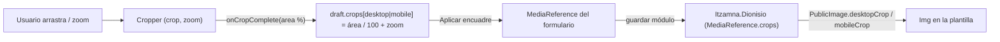

# react-easy-crop

> Componente de [[React]] para elegir un recorte de imagen con arrastre y zoom, con una proporción fija; devuelve el área elegida en porcentaje y en píxeles.

## Qué es y qué problema resuelve
Cuando una foto se muestra en marcos con proporciones distintas (4:5 en computadora, 1:1 en celular), el usuario necesita decir qué parte se ve. `react-easy-crop` pinta la imagen dentro de un marco con la proporción indicada (`aspect`) y deja moverla y hacer zoom. **No recorta la imagen**: solo calcula el área; qué hacer con ella (recortar en servidor, en canvas o con CSS) lo decides tú.

Versión usada en [[Itzamna.Clio]]: `react-easy-crop ^5.4.2`.

## Cómo funciona por dentro
- Props controladas: `crop` (`{ x, y }`, desplazamiento) y `zoom`, con `onCropChange` y `onZoomChange` (ver [[Componentes controlados]]).
- `aspect`: proporción del marco (`4 / 5`, `1`).
- `onCropComplete(areaEnPorcentaje, areaEnPixeles)`: se llama al soltar; da `{ x, y, width, height }`.
- `initialCroppedAreaPercentages`: para reabrir con un recorte guardado.



## Cuándo usarla y cuándo no
### Ventajas
- Muy simple de integrar; táctil y con rueda del mouse.
- Proporción fija: el usuario ve exactamente el marco final.
- No toca el archivo: el original se conserva.
### Desventajas
- Solo da coordenadas: aplicar el recorte es trabajo aparte.
- Un recorte por marco: con varias proporciones hay que guardar uno por cada una.
- Sin rotación libre ni filtros (no es un editor de fotos).

## Alternativas
| Alternativa | En qué se diferencia |
|---|---|
| react-image-crop | Recuadro redimensionable sobre la imagen fija; proporción opcional. |
| Cropper.js | Librería vanilla con más opciones (rotar, voltear). |
| Punto focal solamente | Un punto (x, y) y `object-position`; sin zoom, sirve para cualquier proporción. |
| Recorte en servidor | Se generan archivos recortados (p. ej. con [[ImageSharp]]); más pesado, píxeles exactos. |

## Cómo se usó en Itzamna
En `apps/studio/src/components/media.tsx`, `FrameDialog` ("Encuadre de la imagen") tiene tres modos:
1. **Punto focal**: clic sobre la foto → `focal: { x, y }` entre 0 y 1, con vistas previas Desktop/Mobile/Cuadrado usando `object-position`.
2. **Desktop** y 3. **Mobile**: `Cropper` con la proporción que pide cada campo (`aspects`, p. ej. Hero `{ desktop: '4:5', mobile: '1:1' }`).

El área se guarda como fracción 0–1 junto con el zoom (`Itzamna.Clio/apps/studio/src/components/media.tsx`):
```tsx
const onCropComplete = (area: Area) => {
  if (mode === 'focal') return;
  const rect: CropRect = { x: area.x / 100, y: area.y / 100, width: area.width / 100, height: area.height / 100, zoom };
  setDraft((d) => ({ ...d, crops: { ...(d.crops ?? {}), [mode]: rect } }));
};
```

- El resultado vive en `MediaReference` (`{ assetId, alt, focal, crops: { desktop, mobile } }`, en `packages/contracts`), que viaja dentro del DTO del módulo (Hero, Sobre mí, etc.) y Dionisio guarda en columnas JSON ([[Biblioteca de medios]], [[Módulos del portfolio]]).
- Al reabrir se usa `initialCroppedAreaPercentages` con el recorte guardado ×100.
- "Restablecer" vuelve a `focal: { x: 0.5, y: 0.5 }` y `crops: null`.
- En el sitio, `Img` (`packages/templates/src/shared/Img.tsx`) elige `mobileCrop` o `desktopCrop` según `useIsMobile()` y lo aplica con CSS (ver [[Imágenes responsive]]).

> [!note] Pendiente de confirmar
> `Img` usa el **centro** del recorte como `object-position`; no aplica el zoom ni el área exacta. `packages/portfolio-core/src/image.ts` tiene `cropStyle()` (escala y desplaza para mostrar el área exacta), pero no se usa en ningún componente. No está claro si el encuadre exacto está pendiente o si la aproximación es intencional.

## Errores comunes y buenas prácticas
- Guardar el área en píxeles de la vista: depende del tamaño de pantalla. Guarda porcentajes/fracciones (como Clio).
- No resetear `crop`/`zoom` al cambiar de proporción: el área queda fuera de lugar (Clio lo hace en `switchMode`).
- Olvidar que el recorte es por proporción: si cambia el marco de la plantilla, el recorte guardado ya no corresponde.
- Ofrecer punto focal como opción por defecto: cubre la mayoría de casos con menos esfuerzo para el usuario.

## Qué estudiar después
- [[Imágenes responsive]] (`object-fit`, `object-position`, `srcset`)
- Recorte en canvas en el cliente (`drawImage`) o en servidor ([[ImageSharp]])
- `aspect-ratio` en CSS

## Documentación oficial
- https://github.com/ValentinH/react-easy-crop

## Autoevaluación

Contesta primero en voz alta o en papel; luego despliega la respuesta.

> [!question]- ¿Qué te da react-easy-crop y qué no?
> Un componente para elegir el área de recorte con arrastre y zoom; en `onCropComplete` te da `croppedAreaPixels`. **No recorta**: tú dibujas esa área en un `<canvas>` y exportas con `canvas.toBlob`.

> [!question]- ¿Qué props controlan el recorte?
> `crop`/`onCropChange` (posición), `zoom`/`onZoomChange` y `aspect` (proporción, p. ej. `1` para avatar o `16 / 9`).

