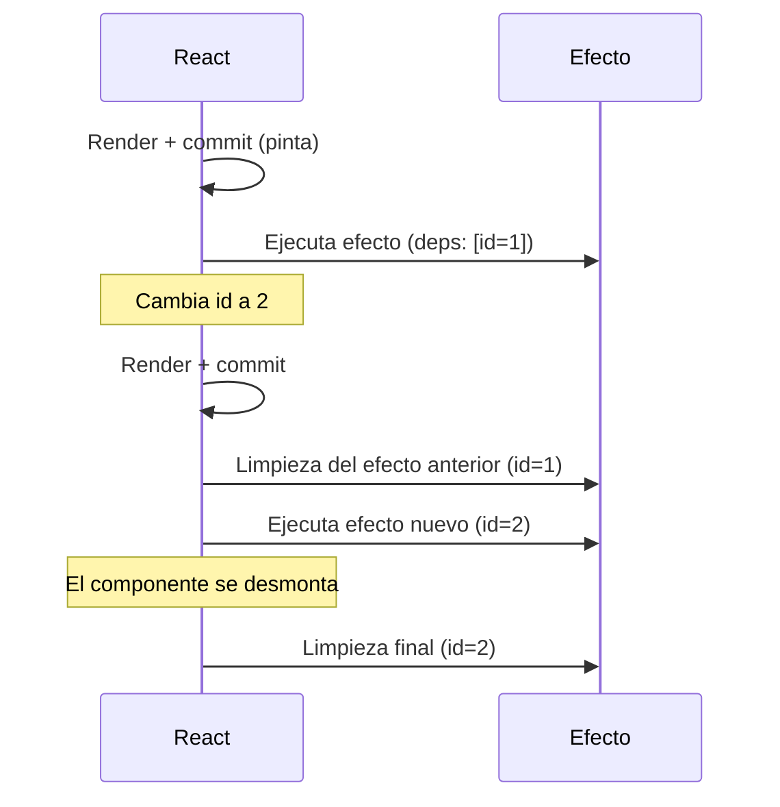

# useEffect

Parte de: [[05-React/_Índice React|React]]

> [!info] Cómo avanzar
> `progreso`: **pendiente** → **viendo** (estudiando) → **visto** (contestaste la autoevaluación sin abrir las respuestas) → **dominado** (hiciste el laboratorio o lo aplicaste de verdad).

## Contenido

### Qué es
`useEffect` es el hook para **sincronizar un componente con algo que está fuera de React**: una suscripción a un WebSocket, un intervalo, un listener de `window`, una API del navegador, un widget de terceros o una conexión. Recibe una función (el efecto) y un arreglo de dependencias; React ejecuta el efecto **después de pintar** la pantalla y, si el efecto devuelve una función, la usa como **limpieza**. No es un "ciclo de vida" para meter cualquier lógica: no sirve para calcular datos a partir del estado ni para responder a clics.

### Cómo funciona


#### El arreglo de dependencias
| Forma | Cuándo corre |
|---|---|
| `useEffect(fn)` | Después de **cada** render |
| `useEffect(fn, [])` | Solo al montar; la limpieza corre al desmontar |
| `useEffect(fn, [a, b])` | Al montar y cada vez que `a` o `b` cambien (comparados con `Object.is`) |

Las dependencias no son algo que eliges: deben incluir **todo valor reactivo** (props, estado, variables derivadas de ellos) que el efecto lee. El plugin `eslint-plugin-react-hooks` lo verifica. Si "mientes" quitando una dependencia, el efecto se queda con un valor viejo (closure viejo).

#### La limpieza
La función que devuelves corre **antes del siguiente efecto** y **al desmontar**. Sirve para deshacer lo que hizo el efecto: `clearInterval`, `removeEventListener`, cerrar una conexión o abortar una petición con `AbortController`. Sin limpieza aparecen fugas de memoria, listeners duplicados y respuestas viejas que pisan a las nuevas (condiciones de carrera).

#### Por qué corre dos veces en desarrollo
Con `<StrictMode>`, en desarrollo React monta el componente, ejecuta el efecto, **simula un desmontaje** (corre la limpieza) y lo vuelve a montar. Es intencional: si tu efecto está bien escrito, el usuario no nota la diferencia; si falta la limpieza, el bug se vuelve visible (dos suscripciones, dos peticiones aplicadas). En producción no ocurre. La solución nunca es "quitar StrictMode", sino escribir la limpieza.

### Ejemplos
#### Suscripción con limpieza
```tsx
useEffect(() => {
  function onResize() { setAncho(window.innerWidth); }
  window.addEventListener('resize', onResize);
  return () => window.removeEventListener('resize', onResize);
}, []);
```

#### Intervalo sin closure viejo
```tsx
useEffect(() => {
  // La forma funcional no depende del n capturado
  const id = setInterval(() => setN(x => x + 1), 1000);
  return () => clearInterval(id);
}, []);
```

Si escribieras `setN(n + 1)`, el callback capturaría el `n` del primer render (0) para siempre: el contador llegaría a 1 y se quedaría ahí.

#### Petición que ignora respuestas viejas
Si `id` cambia rápido (1 → 2), la respuesta de 1 podría llegar después que la de 2 y mostrar datos equivocados. Abortar en la limpieza lo evita:

```tsx
useEffect(() => {
  const control = new AbortController();
  fetch(`/api/clientes/${id}`, { signal: control.signal })
    .then(r => r.json())
    .then(setCliente)
    .catch(e => { if (e.name !== 'AbortError') setError(e); });
  return () => control.abort();
}, [id]);
```

Ver también [[AbortController]]. En una app real como Itzamna.Clio, las peticiones a la API van con [[TanStack Query]], que resuelve caché, reintentos y cancelación sin escribir efectos.

### Quizás no necesitas un efecto
Muchos efectos sobran y solo agregan renders extra:

- **Datos derivados**: si `total` sale de `items`, calcúlalo en el render: `const total = items.reduce((s, i) => s + i.precio, 0)`. Un efecto con `setTotal` produce un render intermedio con el total viejo y duplica estado. Si el cálculo es costoso, `useMemo`.
- **Responder a eventos**: enviar el formulario al hacer clic va en el handler, no en un efecto que observa `enviado === true`.
- **Reiniciar estado cuando cambia una prop**: usa `key` (ver [[Listas y keys]]).
- **Bucle infinito**: `useEffect(() => setDatos({...datos}), [datos])` crea un objeto nuevo, cambia la dependencia, el efecto vuelve a correr… para siempre. Si el efecto escribe lo mismo que lee, replantea el diseño.

### Cuándo usarlo y cuándo no
Úsalo para conectar con sistemas externos: APIs del navegador, librerías imperativas (mapas, gráficas), suscripciones, `document.title`. Para medir el DOM antes de pintar, `useLayoutEffect`. Para leer el último valor dentro de un efecto sin volverlo dependencia, React 19.2 trae `useEffectEvent`. Para datos del servidor, TanStack Query; para lógica de efectos repetida, un [[Custom hooks|custom hook]].

### Errores comunes
- **Dependencias incompletas** para "que no se dispare tanto": closures viejos. Arregla la causa (forma funcional, mover la función dentro del efecto).
- **Objetos o funciones nuevas como dependencia** en cada render: el efecto corre siempre. Créalos dentro del efecto o memorízalos.
- **Sin limpieza**: listeners duplicados, intervalos acumulados, respuestas viejas.
- **`async` directo**: `useEffect(async () => …)` devuelve una promesa, no una limpieza. Declara una función async adentro y llámala.
- **Estado derivado en efectos**: un render de más y datos duplicados.

### Para profundizar
- [useEffect (react.dev)](https://react.dev/reference/react/useEffect)
- [Sincronizar con efectos (react.dev)](https://react.dev/learn/synchronizing-with-effects)
- [Quizás no necesites un efecto (react.dev)](https://react.dev/learn/you-might-not-need-an-effect)
- [Ciclo de vida de los efectos reactivos (react.dev)](https://react.dev/learn/lifecycle-of-reactive-effects)

## Ejercicios

Resuélvelos en papel o en la herramienta; la solución está plegada.

> [!question]- ¿Qué bug tiene?
> ```jsx
> useEffect(() => {
>   const id = setInterval(() => setN(n + 1), 1000);
>   return () => clearInterval(id);
> }, []);
> ```
>
> > [!success]- Respuesta
> > `n` queda congelado en el valor del primer render (closure viejo): el contador llega a 1 y se queda. Usa `setN(x => x + 1)`.

> [!question]- Escribe un efecto que pida `/api/usuarios/${id}` y no aplique respuestas viejas si `id` cambia.
> ```jsx
> useEffect(() => {
>   const c = new AbortController();
>   fetch(`/api/usuarios/${id}`, { signal: c.signal })
>     .then(r => r.json())
>     .then(setUsuario)
>     .catch(e => { if (e.name !== 'AbortError') setError(e); });
>   return () => c.abort();
> }, [id]);
> ```
> (En tu app real esto lo hace TanStack Query.)

> [!question]- `useEffect(() => { setDatos({...}) }, [datos])`. ¿Qué pasa?
> Bucle infinito: cada `setDatos` crea un objeto nuevo, cambia la dependencia y el efecto vuelve a correr.

## Autoevaluación

Contesta primero en voz alta o en papel; luego despliega la respuesta.

> [!question]- ¿Para qué sirve `useEffect`?
> Para **sincronizar** el componente con algo externo a React (suscripciones, timers, APIs del navegador, conexiones) después de pintar. No es para derivar datos del estado ni para responder a eventos del usuario.

> [!question]- ¿Qué hace el arreglo de dependencias?
> Sin arreglo: corre tras cada render. `[]`: solo al montar (y limpia al desmontar). `[a, b]`: cuando cambian `a` o `b`. Debe incluir todo valor reactivo que el efecto usa.

> [!question]- ¿Para qué sirve la función de limpieza?
> Se ejecuta antes del siguiente efecto y al desmontar: quitar listeners, limpiar intervalos, abortar peticiones (`AbortController`) para evitar fugas y respuestas viejas.

> [!question]- ¿Por qué en desarrollo el efecto corre dos veces?
> `StrictMode` monta, desmonta y vuelve a montar a propósito para revelar efectos sin limpieza correcta. En producción no pasa.

> [!question]- Caso: calculas `total` de `items` en un efecto con `setTotal`. ¿Qué es mejor?
> Calcularlo durante el render: `const total = items.reduce(...)` (con `useMemo` si es costoso). El efecto provoca un render extra y estado duplicado.

## Práctica

- [[Lab 1 - App de notas con estado y efectos]]

