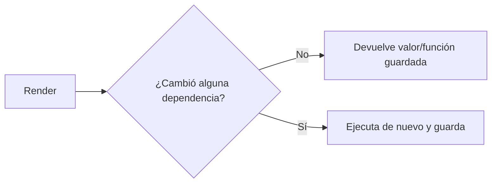

# useMemo y useCallback

Parte de: [[05-React/_Índice React|React]]

> [!info] Cómo avanzar
> `progreso`: **pendiente** → **viendo** (estudiando) → **visto** (contestaste la autoevaluación sin abrir las respuestas) → **dominado** (hiciste el laboratorio o lo aplicaste de verdad).

## Contenido

### Qué es
`useMemo` y `useCallback` son hooks de **memoización**: guardan el resultado de un render para reutilizarlo en el siguiente mientras sus dependencias no cambien.

- `useMemo(() => calcular(a, b), [a, b])` memoriza un **valor** (el resultado de llamar la función).
- `useCallback(fn, [deps])` memoriza una **función** (la misma referencia). Es equivalente a `useMemo(() => fn, [deps])`.

No hacen que el código sea "más rápido" por sí solos: evitan **recalcular** algo costoso y evitan **crear referencias nuevas** cuando la identidad importa.

### Cómo funciona
En cada render, React compara cada dependencia con la del render anterior usando `Object.is`. Si todas son iguales, devuelve lo guardado; si alguna cambió, ejecuta de nuevo y guarda el resultado nuevo.



#### Por qué importa la referencia
En JavaScript, `{}` y `() => {}` crean un objeto nuevo cada vez. Si un componente hace `const opciones = { orden: 'asc' }` en su cuerpo, cada render produce una referencia distinta aunque el contenido sea igual. Esto afecta a:

1. **Hijos con `React.memo`**: `memo` salta el render del hijo si sus props son iguales por referencia. Una función o un objeto nuevo en cada render anula esa optimización.
2. **Dependencias de efectos**: `useEffect(..., [opciones])` correría en cada render.
3. **Dependencias de otros hooks** (`useMemo` encadenados, custom hooks).

### Ejemplo
```tsx
import { memo, useCallback, useMemo, useState } from 'react';

type Producto = { id: number; nombre: string; precio: number };

const Fila = memo(function Fila({ p, onQuitar }: { p: Producto; onQuitar: (id: number) => void }) {
  return <li>{p.nombre} <button onClick={() => onQuitar(p.id)}>Quitar</button></li>;
});

export function Catalogo({ productos }: { productos: Producto[] }) {
  const [filtro, setFiltro] = useState('');
  const [quitados, setQuitados] = useState<number[]>([]);

  // Cálculo potencialmente costoso con miles de productos
  const visibles = useMemo(
    () => productos
      .filter(p => !quitados.includes(p.id))
      .filter(p => p.nombre.toLowerCase().includes(filtro.toLowerCase()))
      .toSorted((a, b) => a.precio - b.precio),
    [productos, quitados, filtro]
  );

  // Referencia estable para que memo(Fila) funcione
  const quitar = useCallback((id: number) => setQuitados(q => [...q, id]), []);

  return (
    <>
      <input value={filtro} onChange={e => setFiltro(e.target.value)} />
      <ul>{visibles.map(p => <Fila key={p.id} p={p} onQuitar={quitar} />)}</ul>
    </>
  );
}
```

Nota que `quitar` usa la forma funcional de `setQuitados`, así no depende de `quitados` y puede tener `[]` como dependencias.

### Cuándo valen la pena
- **Cálculos costosos** con datos grandes: filtrar, ordenar o agrupar miles de elementos, transformar datos para una gráfica. Mide antes: si el cálculo tarda menos de 1 ms, no lo notarás.
- **Cuando la referencia importa**: props de hijos envueltos en `React.memo`, dependencias de `useEffect`, valores de un `Context.Provider` (para no re-renderizar a todos los consumidores).
- **Funciones que devuelve un custom hook**, para que quien lo use pueda ponerlas como dependencia sin problemas.

Cuándo **no**: cálculos triviales (`a + b`, un `map` de 20 elementos), funciones que se pasan a elementos nativos (`<button onClick>` no se beneficia), o "por si acaso" en todo el componente. Cada memo tiene costo: comparar dependencias, guardar memoria y, sobre todo, ruido en el código. Antes de memoizar considera opciones más simples: mover el estado hacia abajo, pasar JSX como `children`, o calcular fuera del componente si no depende de props.

### El React Compiler
El **React Compiler** es una herramienta de compilación (plugin de Babel, integrable con Vite) que analiza tus componentes y agrega memoización **automáticamente** a nivel de valores, funciones y JSX, respetando las reglas de React. En proyectos que lo activan, la mayoría de los `useMemo`, `useCallback` y `React.memo` manuales dejan de ser necesarios; se conservan solo en casos puntuales, por ejemplo cuando necesitas una referencia estable como dependencia de un efecto por razones de corrección y no de rendimiento. Requiere que el código siga las reglas de hooks y pureza; el linter de hooks avisa de patrones que el compilador no puede optimizar. Verifica en la documentación oficial la versión y el soporte para tu configuración de Vite antes de activarlo (Pendiente de confirmar para tu proyecto).

### Errores comunes
- **Dependencias faltantes**: devuelve un valor viejo. Usa el linter.
- **Dependencias que cambian siempre** (un objeto creado en el render): la memoización nunca acierta.
- **Memoizar todo**: código más difícil de leer sin mejora medible.
- **`useCallback` sin `memo` en el hijo**: la referencia estable no sirve de nada si el hijo se re-renderiza igual.
- **Usar `useMemo` para efectos secundarios**: debe ser puro; React puede descartar lo memorizado.

### Para profundizar
- [useMemo (react.dev)](https://react.dev/reference/react/useMemo)
- [useCallback (react.dev)](https://react.dev/reference/react/useCallback)
- [memo (react.dev)](https://react.dev/reference/react/memo)
- [React Compiler (react.dev)](https://react.dev/learn/react-compiler)

## Autoevaluación

Contesta primero en voz alta o en papel; luego despliega la respuesta.

> [!question]- ¿Qué hacen `useMemo` y `useCallback`?
> `useMemo(() => calcular(a), [a])` memoriza un **valor**; `useCallback(fn, [deps])` memoriza una **función**. Devuelven el mismo resultado/referencia mientras las dependencias no cambien.

> [!question]- ¿Cuándo valen la pena?
> Cálculos costosos, o cuando la referencia importa: props de un hijo con `React.memo`, dependencias de un efecto o de otro hook. Para cálculos baratos, solo agregan ruido.

> [!question]- ¿Qué cambia el React Compiler respecto a estos hooks?
> Memoriza automáticamente componentes y valores al compilar, por lo que en proyectos que lo usan se necesitan muchos menos `useMemo`/`useCallback` manuales.

