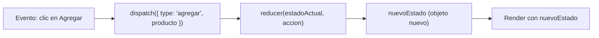

# useReducer

Parte de: [[05-React/_Índice React|React]]

> [!info] Cómo avanzar
> `progreso`: **pendiente** → **viendo** (estudiando) → **visto** (contestaste la autoevaluación sin abrir las respuestas) → **dominado** (hiciste el laboratorio o lo aplicaste de verdad).

## Contenido

### Qué es
`useReducer` es un hook para manejar estado cuya lógica de actualización es compleja o tiene varias reglas. En lugar de llamar setters sueltos, **despachas acciones** que describen *qué pasó* (`{ type: 'agregar', producto }`), y una función pura llamada **reducer** decide *cómo cambia* el estado: `(estado, accion) => nuevoEstado`. Se usa así: `const [estado, dispatch] = useReducer(reducer, estadoInicial)`. Es el mismo patrón de Redux, pero local al componente y sin biblioteca.

Si vienes de C#, piensa en un `switch` sobre un tipo de comando que devuelve un `record` nuevo con `with`: el reducer es una función de transición de estado sin efectos secundarios.

### Cómo funciona


1. El componente llama `dispatch(accion)` desde un handler.
2. React ejecuta `reducer(estadoActual, accion)` y obtiene el nuevo estado.
3. Si el nuevo estado es distinto (por referencia) del anterior, re-renderiza.
4. `dispatch` es **estable**: su referencia no cambia entre renders, así que se puede pasar a hijos o meter en dependencias sin problema.

El reducer debe ser **puro**: sin `fetch`, sin `localStorage`, sin `Date.now()` ni `crypto.randomUUID()` adentro (genera esos valores en el handler y mándalos en la acción). Y debe devolver un estado **nuevo** en vez de mutar el actual.

### Ejemplo: carrito con TypeScript
```tsx
import { useReducer } from 'react';

type Producto = { id: number; nombre: string; precio: number };
type Linea = Producto & { cantidad: number };
type Estado = { lineas: Linea[] };

type Accion =
  | { type: 'agregar'; producto: Producto }
  | { type: 'quitar'; id: number }
  | { type: 'vaciar' };

function carritoReducer(estado: Estado, accion: Accion): Estado {
  switch (accion.type) {
    case 'agregar': {
      const existe = estado.lineas.some(l => l.id === accion.producto.id);
      return {
        lineas: existe
          ? estado.lineas.map(l => l.id === accion.producto.id ? { ...l, cantidad: l.cantidad + 1 } : l)
          : [...estado.lineas, { ...accion.producto, cantidad: 1 }],
      };
    }
    case 'quitar':
      return { lineas: estado.lineas.filter(l => l.id !== accion.id) };
    case 'vaciar':
      return { lineas: [] };
    default: {
      // Si agregas una acción y no la manejas, TypeScript marca error aquí
      const _exhaustivo: never = accion;
      return estado;
    }
  }
}

export function Carrito({ catalogo }: { catalogo: Producto[] }) {
  const [estado, dispatch] = useReducer(carritoReducer, { lineas: [] });
  const total = estado.lineas.reduce((s, l) => s + l.precio * l.cantidad, 0); // derivado

  return (
    <div>
      {catalogo.map(p => (
        <button key={p.id} onClick={() => dispatch({ type: 'agregar', producto: p })}>{p.nombre}</button>
      ))}
      <ul>
        {estado.lineas.map(l => (
          <li key={l.id}>
            {l.nombre} × {l.cantidad}
            <button onClick={() => dispatch({ type: 'quitar', id: l.id })}>Quitar</button>
          </li>
        ))}
      </ul>
      <p>Total: {total.toFixed(2)}</p>
      <button onClick={() => dispatch({ type: 'vaciar' })}>Vaciar</button>
    </div>
  );
}
```

Ventajas visibles: el componente se lee como "qué pasa" (agregar, quitar, vaciar), la lógica está en una función que puedes **probar sin React** (`expect(carritoReducer(e, a)).toEqual(...)`) y el tipo `Accion` como unión discriminada documenta todos los cambios posibles.

### Cuándo preferirlo sobre useState
- **Varios valores que cambian juntos** con reglas (estado de un asistente: paso, datos, errores).
- **El siguiente estado depende del anterior** de formas no triviales (sumar cantidad si existe, si no agregar).
- **Muchos handlers** que hacen variaciones del mismo cambio: centralizar evita duplicación.
- **Quieres probar la lógica** de estado aislada.
- **Pasar una sola función** (`dispatch`) a hijos profundos, por ejemplo combinado con [[Context]].

Quédate con [[Estado con useState]] para valores independientes y simples (un booleano, el texto de un input). Si el estado tiene **estados mutuamente excluyentes** con transiciones permitidas y prohibidas (inactivo → enviando → éxito/error) y la complejidad crece, considera modelarlo como máquina de estados: ver [[Máquinas de estado en UI (XState)]]. Si el estado se comparte entre muchas pantallas, un store como [[zustand]] puede ser mejor.

### Errores comunes en reducers
- **Mutar el estado**: `estado.lineas.push(...)` y `return estado`. Misma referencia, no hay render, y además rompe la previsibilidad. Devuelve siempre objetos nuevos.
- **Efectos secundarios dentro del reducer**: llamadas a la API, `localStorage`, generar ids o fechas. En StrictMode el reducer se ejecuta dos veces en desarrollo para detectarlo. Haz el efecto en el handler o en un efecto y despacha el resultado.
- **Olvidar el `return` en un `case`**: el `switch` cae al siguiente caso o devuelve `undefined` y el estado desaparece.
- **No manejar acciones desconocidas**: usa el `default` con `never` para que TypeScript avise.
- **Guardar datos derivados** (`total`) en el estado del reducer: se desincronizan; calcúlalos en el render.

### Para profundizar
- [useReducer (react.dev)](https://react.dev/reference/react/useReducer)
- [Extraer la lógica de estado en un reducer (react.dev)](https://react.dev/learn/extracting-state-logic-into-a-reducer)
- [Escalar con reducer y context (react.dev)](https://react.dev/learn/scaling-up-with-reducer-and-context)

## Ejercicios

Resuélvelos en papel o en la herramienta; la solución está plegada.

> [!question]- Escribe un reducer de carrito con acciones `agregar` (suma cantidad si existe), `quitar` y `vaciar`.
> ```js
> function carrito(estado, a) {
>   switch (a.type) {
>     case 'agregar': {
>       const ya = estado.find(l => l.id === a.id);
>       return ya
>         ? estado.map(l => l.id === a.id ? { ...l, cant: l.cant + 1 } : l)
>         : [...estado, { id: a.id, cant: 1 }];
>     }
>     case 'quitar': return estado.filter(l => l.id !== a.id);
>     case 'vaciar': return [];
>     default: throw new Error('acción desconocida: ' + a.type);
>   }
> }
> ```

## Autoevaluación

Contesta primero en voz alta o en papel; luego despliega la respuesta.

> [!question]- ¿Qué es `useReducer`?
> Alternativa a `useState` para estado con varias transiciones: `const [estado, dispatch] = useReducer(reducer, inicial)`, donde `reducer(estado, accion)` devuelve el nuevo estado sin mutar.

> [!question]- ¿Cuándo preferirlo sobre `useState`?
> Cuando varias piezas de estado cambian juntas, cuando el siguiente estado depende de reglas (máquina simple), o para probar la lógica como función pura fuera del componente.

> [!question]- Error común en reducers.
> Mutar el estado (`estado.items.push`) y devolverlo: React no detecta el cambio. Devuelve objetos nuevos y lanza error en acciones desconocidas.

## Práctica

- [[Lab 3 - Formulario controlado con validación]]

