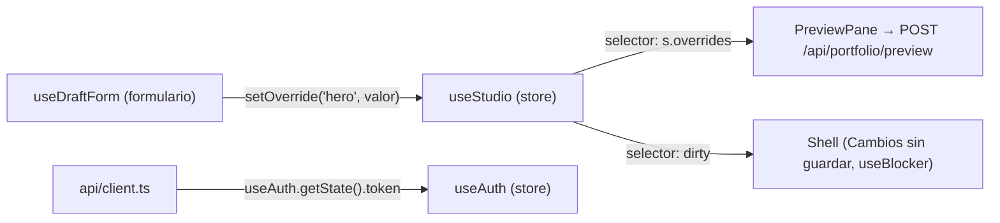

# zustand

> Store global mínimo para [[React]]: un hook creado con `create()` que guarda estado y acciones, y re-renderiza solo a quien usa la parte que cambió.

## Qué es y qué problema resuelve
Cuando varios componentes lejanos comparten estado de UI (no del servidor), pasarlo por props es incómodo y `Context` re-renderiza a todos los consumidores. zustand crea un store fuera del árbol de React:
- `create((set, get) => ({ ...estado, ...acciones }))` devuelve un hook.
- `useStore((s) => s.campo)` suscribe el componente solo a ese campo (selector).
- `useStore.getState()` / `setState()` / `subscribe()` funcionan **fuera** de React (en un cliente HTTP, por ejemplo).

Versión usada en [[Itzamna.Clio]]: `zustand ^5`.

## Cómo funciona por dentro
- El store es un objeto con listeners. `set(parcial)` mezcla el cambio y avisa.
- Cada `useStore(selector)` compara el resultado del selector con `Object.is`; si no cambió, no re-renderiza.
- Si `set` devuelve el **mismo** objeto de estado, no hay cambio y nadie se entera.



## Cuándo usarla y cuándo no
### Ventajas
- Muy poca ceremonia: sin providers, reducers ni acciones tipadas por separado.
- Selectores finos: re-renders mínimos.
- Accesible fuera de React (`getState`), ideal para el token en el cliente HTTP.
### Desventajas
- Libertad total: sin convenciones, el store puede crecer sin orden.
- Selectores que devuelven objetos nuevos en cada llamada provocan renders de más.
- No es caché de servidor: para datos de la API usa [[TanStack Query]].

## Alternativas
| Alternativa | En qué se diferencia |
|---|---|
| `useState` + Context | Integrado; re-renderiza a todos los consumidores del contexto. |
| Redux Toolkit | Más estructura (slices, devtools, middleware), más código. |
| Jotai | Estado atómico; cada átomo es independiente. |
| Estado a nivel de módulo (como `let Estado` en [[Ocelotl.Iris]], ver [[Molde Service-View-Handlers-Events]]) | Sin librería; hay que avisar los repintados a mano. |

## Cómo se usó en Itzamna
Tres stores en el Studio:

| Store | Archivo | Qué guarda |
|---|---|---|
| `useAuth` | `apps/studio/src/api/auth.ts` | `token` (en `sessionStorage`), `setToken`, `logout`. Lo leen el cliente HTTP y las guardas de ruta ([[Autenticación y acceso]]). |
| `useStudio` | `apps/studio/src/state/studio.ts` | `overrides` (cambios sin guardar que ve la vista previa), `focus` (sección resaltada), `device` (desktop/tablet/mobile), `dirty` por formulario, `previewTick`. |
| `useToasts` | `apps/studio/src/components/toast.tsx` | Lista de avisos; la función `toast()` usa `setState` sin hooks. |

Evitar cambios falsos para no pedir otra vista previa (`Itzamna.Clio/apps/studio/src/state/studio.ts`):
```ts
setOverride: (key, value) =>
  set((s) => {
    // Sin cambios reales no se crea un objeto nuevo (evita pedir otra vista previa).
    if (value === undefined && !(key in s.overrides)) return s;
    if (value !== undefined && JSON.stringify(s.overrides[key]) === JSON.stringify(value)) return s;
    const overrides = { ...s.overrides };
    if (value === undefined) delete overrides[key];
    else overrides[key] = value;
    return { overrides };
  }),
```

- `useDraftForm` llama `useStudio.getState()` para obtener `setOverride`/`setDirty` sin suscribirse ([[Módulos del portfolio - Front]]).
- `Shell` deriva `dirty` con un selector que devuelve un booleano (`Object.values(s.dirty).some(Boolean)`), así solo re-renderiza cuando cambia el sí/no.
- `main.tsx` usa `useAuth.subscribe((s, prev) => …)` para limpiar la caché de [[TanStack Query]] al cerrar sesión.
- `PreviewPane` lee `overrides`, `device`, `previewTick` y `focus` ([[Vista previa en vivo]]).

> [!tip] Reutilizable
> El patrón "overrides sin guardar en un store + vista previa que los observa" sirve para cualquier editor con previsualización.

## Errores comunes y buenas prácticas
- Selector que arma un objeto nuevo (`(s) => ({ a: s.a, b: s.b })`): re-render en cada cambio del store. Selecciona primitivos o usa `useShallow`.
- Guardar datos de la API en el store además de la caché.
- Devolver `s` (el estado actual) cuando no hay cambio real: evita notificaciones inútiles.
- Usar `getState()` en handlers/efectos cuando no necesitas re-render.

## Qué estudiar después
- Middleware `persist` y `devtools` de zustand
- `useShallow` para selectores con varios campos
- [[TanStack Query]] (estado del servidor) vs zustand (estado de UI)

## Documentación oficial
- https://zustand.docs.pmnd.rs/getting-started/introduction
- https://github.com/pmndrs/zustand

## Autoevaluación

Contesta primero en voz alta o en papel; luego despliega la respuesta.

> [!question]- ¿Cómo se compara zustand con Redux (Redux Toolkit)?
> Los dos son stores fuera del árbol con selectores. zustand: un hook creado con `create`, sin provider, acciones dentro del store, muy poco código. Redux Toolkit: más estructura (slices, acciones serializables, middleware, DevTools con *time travel*), más convenciones para equipos grandes y más código.

> [!question]- ¿Cuándo elegirías Redux Toolkit en vez de zustand?
> Equipo grande que necesita convenciones estrictas, mucha lógica compartida con middleware, depuración con historial de acciones, o un proyecto que ya lo usa. Para apps pequeñas/medianas, zustand suele bastar.

> [!question]- ¿Qué estado NO debería ir en zustand?
> Datos del servidor (van en TanStack Query) y estado local de un solo componente (va en `useState`).

## Práctica

- [[Lab 4 - Rutas protegidas con React Router (data router)]]

