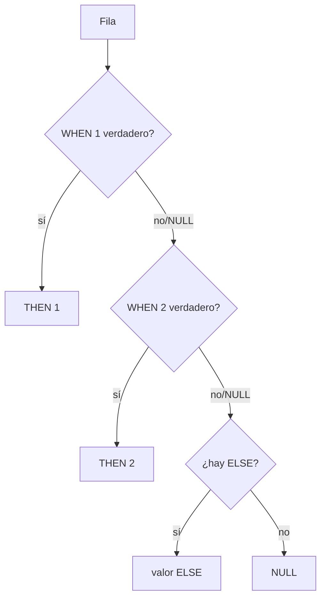

# CASE

Parte de: [[06-SQL-Server/01 Básico/_Índice Básico|Básico]]

> [!info] Cómo avanzar
> `progreso`: **pendiente** → **viendo** (estudiando) → **visto** (contestaste la autoevaluación sin abrir las respuestas) → **dominado** (hiciste el laboratorio o lo aplicaste de verdad).

## Contenido

### Qué es
`CASE` es la expresión condicional de T-SQL: evalúa una o varias condiciones y **devuelve un valor**. No es una instrucción de control de flujo (para eso está `IF ... ELSE`), sino una expresión, así que puede ir en cualquier lugar donde se espera un valor: una columna calculada, un filtro, un criterio de orden o el argumento de una función de agregación. Sirve para clasificar, traducir códigos a texto, contar condicionalmente y ordenar según reglas de negocio.

### Cómo funciona
Hay dos formas:

- **CASE simple**: compara *una* expresión contra una lista de valores con igualdad.
  `CASE Estado WHEN 'Enviado' THEN 1 WHEN 'Entregado' THEN 2 ELSE 0 END`
- **CASE buscado**: cada `WHEN` es una condición booleana independiente, así que admite rangos, `IS NULL`, `LIKE`, varias columnas, etc.
  `CASE WHEN Precio < 500 THEN 'Bajo' WHEN Ciudad IS NULL THEN '?' ELSE 'Otro' END`

Reglas que importan:

1. Las ramas se evalúan **en orden** y gana la primera que resulte verdadera; por eso en rangos escribes de menor a mayor (`< 500`, luego `< 5000`) sin repetir el límite inferior.
2. Si ninguna rama aplica y no hay `ELSE`, el resultado es `NULL`.
3. El CASE simple usa `=`, así que `CASE Ciudad WHEN NULL THEN ...` nunca entra (ver [[NULL y lógica de tres valores]]). Para `NULL` usa la forma buscada con `IS NULL`.
4. El **tipo del resultado** es el de mayor precedencia entre todos los `THEN` y el `ELSE`. Si mezclas `int` y texto, SQL Server intenta convertir el texto a `int` y falla en tiempo de ejecución (error 245). Mantén todas las ramas del mismo tipo o conviértelas tú con `CAST`.
5. Se pueden anidar hasta 10 niveles, pero si llegas ahí probablemente te conviene una tabla de catálogo y un JOIN.



### Ejemplo
Dónde puede ir `CASE` (todas son expresiones):

```sql
-- 1) En el SELECT: traducir un código a texto para un reporte
SELECT p.PedidoId,
       CASE p.Estado
            WHEN 'Pendiente' THEN N'En espera de pago'
            WHEN 'Enviado'   THEN N'En camino'
            WHEN 'Entregado' THEN N'Completado'
            ELSE N'Cancelado'
       END AS EstadoTexto
FROM   ventas.Pedidos AS p;

-- 2) Dentro de un agregado: conteo condicional (pivote manual)
SELECT COUNT(*)                                              AS Total,
       SUM(CASE WHEN Estado = 'Cancelado' THEN 1 ELSE 0 END)  AS Cancelados,
       COUNT(CASE WHEN Estado = 'Enviado' THEN 1 END)         AS Enviados -- sin ELSE: NULL no se cuenta
FROM   ventas.Pedidos;

-- 3) En UPDATE ... SET: ajuste de precio por categoría en un solo paso
UPDATE ventas.Productos
SET    Precio = CASE Categoria
                    WHEN N'Accesorios' THEN Precio * 1.05
                    WHEN N'Monitores'  THEN Precio * 0.95
                    ELSE Precio
                END;

-- 4) En GROUP BY: agrupar por un rango calculado
SELECT CASE WHEN Precio >= 5000 THEN N'Alto' ELSE N'Normal' END AS Rango, COUNT(*) AS Productos
FROM   ventas.Productos
GROUP  BY CASE WHEN Precio >= 5000 THEN N'Alto' ELSE N'Normal' END;
```

El truco de `SUM(CASE ...)` es muy útil en reportes de Wee.Reporteria: obtienes varias métricas en una sola pasada sobre la tabla en lugar de varias consultas.

Si el parámetro es opcional y lo mandas desde Dapper, evita `CASE` en el `WHERE` para "apagar" filtros (`WHERE Estado = CASE WHEN @Estado IS NULL THEN Estado ELSE @Estado END`): funciona, pero impide usar índices de forma eficiente. Mejor `WHERE (@Estado IS NULL OR Estado = @Estado)` con `OPTION (RECOMPILE)` o SQL dinámico parametrizado.

### Cuándo usarlo y cuándo no
- **Úsalo** para lógica de presentación sencilla, conteos condicionales, órdenes personalizados (`ORDER BY CASE ...`) y reglas de negocio pequeñas y estables.
- **No lo uses** como catálogo escondido: si la traducción de códigos cambia o se usa en muchas consultas, crea una tabla (`ventas.EstadosPedido`) y únela; así la regla vive en un solo lugar.
- `IIF(cond, a, b)` es un atajo para un CASE de dos ramas y `CHOOSE(i, a, b, c)` elige por posición; internamente se convierten en CASE.
- `CASE` no puede elegir *qué tabla o columna* consultar; eso requiere SQL dinámico.

### Errores comunes
1. **Mezclar tipos en las ramas** (`THEN 'uno' ELSE 0`): la conversión implícita al tipo de mayor precedencia revienta. Usa el mismo tipo en todas.
2. **Olvidar el `ELSE`** y recibir `NULL` inesperados que luego rompen sumas o comparaciones en la aplicación.
3. **Rangos mal ordenados**: poner `WHEN Precio < 5000` antes que `WHEN Precio < 500` hace que la segunda rama nunca se alcance.
4. **Comparar con NULL en CASE simple** (`WHEN NULL`): nunca es verdadero; usa `CASE WHEN col IS NULL`.
5. **Confiar en el corto circuito para evitar errores**: SQL Server normalmente evalúa en orden, pero con agregados puede evaluar expresiones antes; no dependas de CASE para proteger una división entre cero dentro de un agregado, usa `NULLIF(divisor, 0)`.

### Para profundizar
- [CASE (Transact-SQL) en Microsoft Learn](https://learn.microsoft.com/sql/t-sql/language-elements/case-transact-sql)
- [IIF (Transact-SQL)](https://learn.microsoft.com/sql/t-sql/functions/logical-functions-iif-transact-sql)
- [Precedencia de tipos de datos](https://learn.microsoft.com/sql/t-sql/data-types/data-type-precedence-transact-sql)

## Ejercicios

Resuélvelos en papel o en la herramienta; la solución está plegada.

> [!question]- Con la base Tienda ([[Lab 1 - Base de práctica Tienda en SQL Server]]): clasifica los productos en Económico (< 500), Medio (< 5000) y Premium.
> ```sql
> SELECT Nombre, Precio,
>        CASE WHEN Precio < 500  THEN N'Económico'
>             WHEN Precio < 5000 THEN N'Medio'
>             ELSE N'Premium' END AS Rango
> FROM   ventas.Productos;
> ```
> Económico: Mouse, Cable. Medio: Teclado, Webcam. Premium: Monitor, Laptop.

> [!question]- En una sola fila: cuántos pedidos están entregados y cuántos no.
> ```sql
> SELECT SUM(CASE WHEN Estado = 'Entregado' THEN 1 ELSE 0 END) AS Entregados,
>        SUM(CASE WHEN Estado <> 'Entregado' THEN 1 ELSE 0 END) AS Otros
> FROM   ventas.Pedidos;
> ```
> 5 y 3.

> [!question]- Ordena los pedidos por estado en el orden de negocio: Pendiente, Enviado, Entregado, Cancelado.
> ```sql
> SELECT PedidoId, Estado FROM ventas.Pedidos
> ORDER BY CASE Estado WHEN 'Pendiente' THEN 1 WHEN 'Enviado' THEN 2
>                      WHEN 'Entregado' THEN 3 ELSE 4 END, PedidoId;
> ```
> 7, 6, 1, 2, 3, 5, 8, 4.

## Autoevaluación

Contesta primero en voz alta o en papel; luego despliega la respuesta.

> [!question]- ¿Qué diferencia hay entre `CASE` simple y `CASE` buscado?
> Simple: compara una expresión con valores (`CASE Estado WHEN 'Enviado' THEN ...`). Buscado: evalúa condiciones (`CASE WHEN Precio < 500 THEN ...`). Ambos devuelven el primer `THEN` cuya condición sea verdadera; si ninguna, el `ELSE` o `NULL`.

> [!question]- ¿En qué cláusulas puedes usar `CASE`?
> En cualquier lugar donde va una expresión: `SELECT`, `WHERE`, `ORDER BY`, `GROUP BY`, dentro de agregados (`SUM(CASE ...)`) y en `UPDATE ... SET`. No sirve para elegir tablas o columnas dinámicamente (eso es SQL dinámico).

> [!question]- Error común: `CASE WHEN x = 1 THEN 'uno' ELSE 0 END`. ¿Qué pasa?
> Todos los resultados se convierten al tipo de mayor precedencia (`int`), así que `'uno'` intenta convertirse a número y falla. Todos los `THEN`/`ELSE` deben ser del mismo tipo.

## Práctica

- [[Lab 2 - Consultas de agregación y JOINs en Tienda]]

