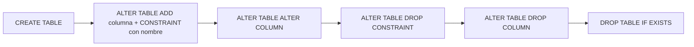

# CREATE, ALTER y DROP (DDL)

Parte de: [[06-SQL-Server/01 Básico/_Índice Básico|Básico]]

> [!info] Cómo avanzar
> `progreso`: **pendiente** → **viendo** (estudiando) → **visto** (contestaste la autoevaluación sin abrir las respuestas) → **dominado** (hiciste el laboratorio o lo aplicaste de verdad).

## Contenido

### Qué es
**DDL** (*Data Definition Language*) es la parte de SQL que define la **estructura** de la base: crea, modifica y elimina objetos como bases, esquemas, tablas, índices, vistas y procedimientos. Sus comandos principales son `CREATE`, `ALTER` y `DROP` (y `TRUNCATE`, que técnicamente se clasifica como DDL porque desasigna páginas en lugar de borrar fila por fila). Se distingue del DML ([[INSERT, UPDATE y DELETE (DML)]]), que trabaja sobre los **datos**.

### Cómo funciona
- `CREATE objeto` crea algo nuevo. Falla si ya existe.
- `ALTER objeto` cambia uno existente: agregar/quitar columnas, cambiar tipo o nulabilidad, agregar restricciones.
- `DROP objeto` lo elimina con sus datos. Desde **SQL Server 2016** existe `DROP ... IF EXISTS`, que no falla si el objeto no existe; útil en scripts que se ejecutan varias veces.
- En SQL Server el DDL es **transaccional**: puedes hacer `BEGIN TRAN; ALTER TABLE ...; ROLLBACK;` y el cambio se revierte. Pero toma un bloqueo de esquema `Sch-M` que bloquea a todos los que usan la tabla mientras dura.

Puntos finos de `ALTER TABLE`:

1. **Agregar una columna `NOT NULL` a una tabla con filas** exige un `DEFAULT`; si no, ¿qué valor tendrían las filas existentes? El comando falla. Con `DEFAULT` las filas existentes reciben ese valor (en Enterprise y Azure SQL esto es una operación solo de metadatos, casi instantánea).
2. **`ALTER COLUMN` reescribe la definición completa**: si no repites `NULL` o `NOT NULL`, la nulabilidad puede cambiar según la configuración `ANSI_NULL_DFLT`. Siempre escríbela explícita.
3. **No puedes borrar una columna con dependencias** (una restricción `DEFAULT`, `CHECK`, índice o FK). Primero quitas la restricción por nombre y luego la columna.
4. **Nombra tus restricciones**. Si no, SQL Server genera nombres como `DF__Producto__Activ__3B75D760`, distintos en cada ambiente; tus scripts de migración no podrán referenciarlas de forma fija.



### Ejemplo
Script de migración para el proyecto Itzamna.Dionisio que agrega auditoría a una tabla, escrito para poder ejecutarse más de una vez:

```sql
-- 001_tabla_categorias.sql
IF SCHEMA_ID(N'catalogo') IS NULL
    EXEC (N'CREATE SCHEMA catalogo');
GO

IF OBJECT_ID(N'catalogo.Categorias', N'U') IS NULL
BEGIN
    CREATE TABLE catalogo.Categorias (
        CategoriaId  int IDENTITY(1,1) NOT NULL CONSTRAINT PK_Categorias PRIMARY KEY,
        Nombre       nvarchar(60)  NOT NULL CONSTRAINT UQ_Categorias_Nombre UNIQUE,
        FechaAltaUtc datetime2(0)  NOT NULL CONSTRAINT DF_Categorias_FechaAlta DEFAULT (SYSUTCDATETIME())
    );
END;
GO

-- Agregar una columna NOT NULL a una tabla con datos: requiere DEFAULT
IF COL_LENGTH(N'catalogo.Categorias', N'Visible') IS NULL
    ALTER TABLE catalogo.Categorias
        ADD Visible bit NOT NULL CONSTRAINT DF_Categorias_Visible DEFAULT (1);
GO

-- Ampliar una columna conservando la nulabilidad de forma explícita
ALTER TABLE catalogo.Categorias ALTER COLUMN Nombre nvarchar(80) NOT NULL;
-- Ojo: si Nombre tiene un índice o UNIQUE, ampliar el tamaño sí se permite;
-- cambiar el tipo (p. ej. a varchar) obliga a quitar el índice primero.
GO

-- Quitar la columna: primero su DEFAULT (por eso le pusimos nombre)
ALTER TABLE catalogo.Categorias DROP CONSTRAINT IF EXISTS DF_Categorias_Visible;
ALTER TABLE catalogo.Categorias DROP COLUMN IF EXISTS Visible;
GO

DROP TABLE IF EXISTS catalogo.Temporal;  -- no falla si no existe (2016+)
```

Para procedimientos, vistas y funciones usa `CREATE OR ALTER` (2016 SP1), que se explica en [[CREATE OR ALTER y scripts idempotentes]]. Las tablas no admiten `CREATE OR ALTER`: se versionan con scripts como el anterior.

### Cuándo usarlo y cuándo no
- **Usa scripts DDL versionados** en el repositorio (Azure DevOps) y ejecútalos en orden; nunca cambies la estructura de producción a mano desde SSMS.
- **No uses `DROP` + `CREATE`** para modificar una tabla con datos: pierdes los datos, permisos y dependencias. Usa `ALTER`.
- En tablas muy grandes, un `ALTER COLUMN` que cambia de tipo reescribe todas las filas y bloquea la tabla; planea una migración por fases (columna nueva, copia, cambio) como en [[Migraciones sin caídas (expand y contract)]].

### Errores comunes
1. **Restricciones sin nombre**: imposibles de quitar con un script fijo. Usa prefijos `PK_`, `FK_`, `UQ_`, `CK_`, `DF_`.
2. **Olvidar `NULL`/`NOT NULL` en `ALTER COLUMN`**: la columna puede quedar distinta a lo que esperabas.
3. **`ADD ... NOT NULL` sin `DEFAULT`** en una tabla poblada: error 4901.
4. **Ejecutar DDL en horario pico**: el bloqueo `Sch-M` detiene todas las consultas a esa tabla, incluso lecturas.
5. **Crear objetos sin esquema** (`CREATE TABLE Productos`): terminan en el esquema predeterminado del usuario, no donde esperabas. Ver [[Esquemas (schemas) en SQL Server]].

### Para profundizar
- [CREATE TABLE (Transact-SQL)](https://learn.microsoft.com/sql/t-sql/statements/create-table-transact-sql)
- [ALTER TABLE (Transact-SQL)](https://learn.microsoft.com/sql/t-sql/statements/alter-table-transact-sql)
- [DROP TABLE (Transact-SQL)](https://learn.microsoft.com/sql/t-sql/statements/drop-table-transact-sql)

## Ejercicios

Resuélvelos en papel o en la herramienta; la solución está plegada.

> [!question]- Con la base Tienda ([[Lab 1 - Base de práctica Tienda en SQL Server]]): agrega a `ventas.Productos` una columna `Activo bit NOT NULL` con valor por defecto 1 y restricción con nombre.
> ```sql
> ALTER TABLE ventas.Productos
>   ADD Activo bit NOT NULL CONSTRAINT DF_Productos_Activo DEFAULT (1);
> ```
> Las filas existentes quedan con `1`.

> [!question]- Elimina la columna `Activo` que creaste. ¿Por qué falla `ALTER TABLE ventas.Productos DROP COLUMN Activo;` y cómo se arregla?
> Falla porque la restricción `DEFAULT` depende de la columna. Primero quita la restricción:
> ```sql
> ALTER TABLE ventas.Productos DROP CONSTRAINT DF_Productos_Activo;
> ALTER TABLE ventas.Productos DROP COLUMN Activo;
> ```

> [!question]- Cambia `ventas.Clientes.Ciudad` de `nvarchar(60)` a `nvarchar(80)` conservando que acepte `NULL`.
> ```sql
> ALTER TABLE ventas.Clientes ALTER COLUMN Ciudad nvarchar(80) NULL;
> ```
> En `ALTER COLUMN` repite siempre `NULL`/`NOT NULL`: si lo omites, la columna puede cambiar de nulabilidad según la configuración `ANSI_NULL_DFLT`.

## Autoevaluación

Contesta primero en voz alta o en papel; luego despliega la respuesta.

> [!question]- ¿Qué es DDL y qué comandos incluye?
> *Data Definition Language*: define la estructura. `CREATE` (crear), `ALTER` (modificar), `DROP` (eliminar) y también `TRUNCATE TABLE`. En SQL Server el DDL es transaccional: puedes hacer `ROLLBACK` de un `CREATE TABLE` dentro de una transacción.

> [!question]- ¿Qué pasa si agregas una columna `NOT NULL` sin `DEFAULT` a una tabla con filas?
> Falla: las filas existentes no tendrían valor. Agrega un `DEFAULT` (con nombre) o créala `NULL`, llénala y después cámbiala a `NOT NULL`.

> [!question]- ¿Por qué conviene nombrar las restricciones (`CONSTRAINT DF_Productos_Activo DEFAULT 1`)?
> Si no, SQL Server genera nombres como `DF__Productos__Activ__3B75D760`, distintos en cada ambiente; tus scripts de `DROP CONSTRAINT` no funcionarían igual en desarrollo y producción.

> [!question]- ¿Qué hace `DROP TABLE IF EXISTS ventas.Temporal;` y desde qué versión existe?
> Elimina la tabla solo si existe, sin error si no. Existe desde SQL Server 2016; antes se usaba `IF OBJECT_ID('ventas.Temporal','U') IS NOT NULL DROP TABLE ...`.

## Práctica

- [[Lab 1 - Base de práctica Tienda en SQL Server]]

