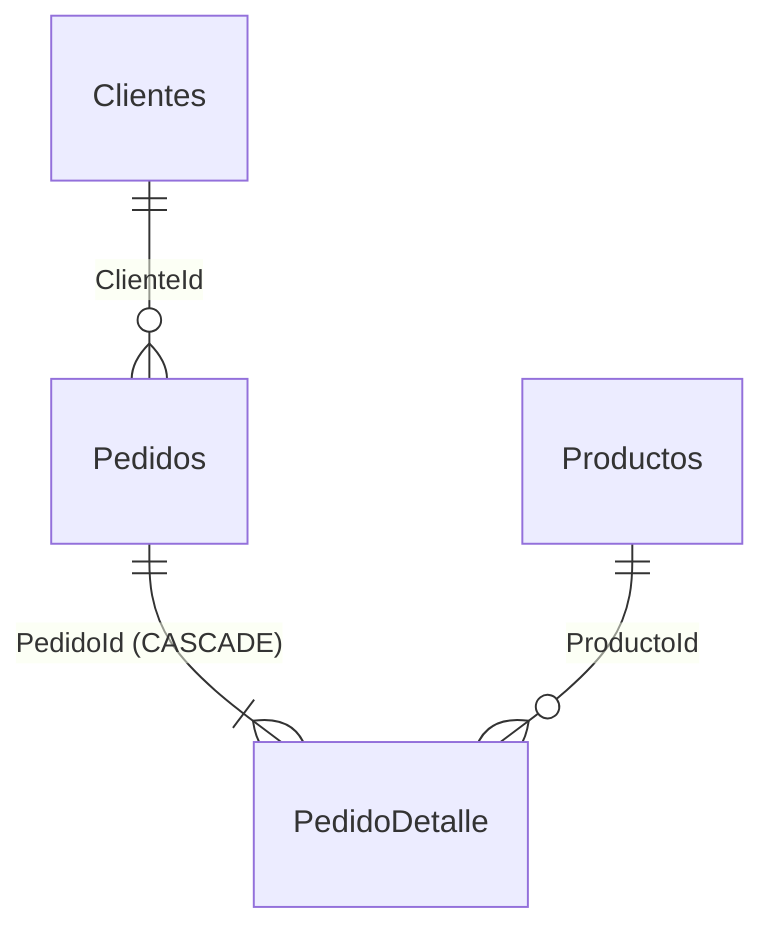

# Claves primarias y foráneas

Parte de: [[06-SQL-Server/01 Básico/_Índice Básico|Básico]]

> [!info] Cómo avanzar
> `progreso`: **pendiente** → **viendo** (estudiando) → **visto** (contestaste la autoevaluación sin abrir las respuestas) → **dominado** (hiciste el laboratorio o lo aplicaste de verdad).

## Contenido

### Qué es
La **clave primaria** (PK) identifica de forma única cada fila de una tabla: no admite duplicados ni `NULL`. La **clave foránea** (FK) es una columna (o conjunto) cuyos valores deben existir en la PK o en una clave única de otra tabla; así la base garantiza la **integridad referencial**: no puede haber un pedido de un cliente inexistente. Juntas son la forma de expresar relaciones del [[Modelo relacional]] dentro del motor, no solo en el código de la aplicación.

### Cómo funciona
**Clave primaria**

- Al declarar `PRIMARY KEY`, SQL Server crea un **índice único** para hacerla cumplir. Por defecto ese índice es **clustered** (si la tabla aún no tiene uno), es decir, define el orden físico de la tabla. Puedes pedir `PRIMARY KEY NONCLUSTERED` si quieres el clustered en otra columna.
- Puede ser simple (`ClienteId`) o compuesta (`PedidoId, ProductoId`).
- Elige claves **estables, pequeñas y crecientes** (un `int IDENTITY` es ideal para el clustered); ver [[IDENTITY vs SEQUENCE]] y [[uniqueidentifier]].

**Clave foránea**

- `CONSTRAINT FK_Pedidos_Clientes FOREIGN KEY (ClienteId) REFERENCES ventas.Clientes (ClienteId)`.
- Al insertar o actualizar el hijo, el motor busca el valor en el padre; al borrar o cambiar el padre, busca hijos. Si se rompe la regla, error **547**.
- **SQL Server NO crea un índice en las columnas de la FK.** Debes crearlo tú; sin él, cada `DELETE` del padre recorre toda la tabla hija y los JOIN por esa columna son lentos.
- Una FK acepta `NULL` (si la columna lo permite): un `NULL` significa "sin relación" y no se valida.
- **Acciones referenciales**: `ON DELETE / ON UPDATE` con `NO ACTION` (predeterminado, rechaza), `CASCADE` (propaga), `SET NULL` o `SET DEFAULT`.

**Confianza de la FK**: si creas o reactivas una FK con `WITH NOCHECK`, el motor no revisa los datos existentes y marca la FK como **no confiable** (`sys.foreign_keys.is_not_trusted = 1`). El optimizador ya no puede usarla para simplificar planes (por ejemplo, eliminar un JOIN innecesario) y además podrían existir huérfanos. Se arregla con `ALTER TABLE ... WITH CHECK CHECK CONSTRAINT FK_...`.



### Ejemplo
```sql
CREATE TABLE ventas.Facturas (
    FacturaId  int IDENTITY(1,1) NOT NULL
               CONSTRAINT PK_Facturas PRIMARY KEY CLUSTERED,
    PedidoId   int NOT NULL
               CONSTRAINT FK_Facturas_Pedidos REFERENCES ventas.Pedidos (PedidoId),
    Folio      varchar(20) NOT NULL CONSTRAINT UQ_Facturas_Folio UNIQUE,
    Total      decimal(12,2) NOT NULL
);
-- La FK no trae índice: créalo tú
CREATE INDEX IX_Facturas_PedidoId ON ventas.Facturas (PedidoId);

-- Revisar FK no confiables y FK sin índice de soporte
SELECT fk.name, fk.is_not_trusted, fk.is_disabled
FROM   sys.foreign_keys AS fk;

-- Volver confiable una FK creada con NOCHECK (revisa todas las filas)
ALTER TABLE ventas.Facturas WITH CHECK CHECK CONSTRAINT FK_Facturas_Pedidos;
```

En la API (Dapper), el error 547 conviene traducirlo a un `ProblemDetails` con `codigo` claro en lugar de un 500:

```csharp
catch (SqlException ex) when (ex.Number == 547)
{
    // FK o CHECK violado: el pedido no existe o hay facturas que dependen de él
    return Problem(statusCode: 409, title: "Referencia inválida",
        extensions: new Dictionary<string, object?> { ["codigo"] = "FACTURA_PEDIDO_INEXISTENTE" });
}
```

### Cuándo usarlo y cuándo no
- **Toda tabla debe tener PK.** Sin ella no hay forma confiable de actualizar una fila concreta, y muchas herramientas (replicación, CDC, ORMs) la exigen.
- **Declara FK siempre que exista la relación**, aunque la aplicación "ya valide": la base es la última línea de defensa y las FK confiables ayudan al optimizador.
- **`ON DELETE CASCADE`** solo cuando el hijo no tiene sentido sin el padre (renglones de un pedido). Evítalo en relaciones de negocio importantes: un `DELETE` de un cliente podría borrar en cadena pedidos, facturas y pagos sin que nadie lo note, generar muchos bloqueos y disparar triggers. Para datos que no se deben perder, usa [[Borrado lógico y auditoría]].
- En cargas masivas puedes deshabilitar FK temporalmente, pero al final reactívalas `WITH CHECK`.

### Errores comunes
1. **Asumir que la FK tiene índice**: causa escaneos en JOIN y bloqueos largos en `DELETE` del padre.
2. **Usar claves naturales cambiantes** (RFC, correo) como PK: cuando cambian, hay que propagar a todas las tablas hijas.
3. **Cascadas en cadena** que borran más de lo previsto, o el error de "ciclos o múltiples rutas de cascada" al diseñar.
4. **Dejar FK `WITH NOCHECK`** después de una carga y olvidarlas como no confiables.
5. **PK con GUID aleatorio clustered**: fragmentación e inserciones lentas (ver [[uniqueidentifier]]).

### Para profundizar
- [Restricciones de clave principal y externa](https://learn.microsoft.com/sql/relational-databases/tables/primary-and-foreign-key-constraints)
- [Crear relaciones de clave externa](https://learn.microsoft.com/sql/relational-databases/tables/create-foreign-key-relationships)
- [sys.foreign_keys](https://learn.microsoft.com/sql/relational-databases/system-catalog-views/sys-foreign-keys-transact-sql)

## Autoevaluación

Contesta primero en voz alta o en papel; luego despliega la respuesta.

> [!question]- ¿Qué garantiza una clave primaria y qué crea SQL Server por defecto?
> Unicidad y `NOT NULL`. Si la tabla no tiene ya un índice clustered, la PK se crea como **índice clustered**; puedes cambiarlo con `PRIMARY KEY NONCLUSTERED`.

> [!question]- ¿SQL Server crea un índice en las columnas de una FK?
> No. Debes crearlo tú (`CREATE INDEX IX_PedidoDetalle_ProductoId ON ventas.PedidoDetalle(ProductoId)`); si no, los joins y los `DELETE` en la tabla padre recorren toda la hija.

> [!question]- ¿Qué riesgos tiene `ON DELETE CASCADE`?
> Un `DELETE` pequeño puede borrar miles de filas en cadena sin que el desarrollador lo note, y SQL Server no permite rutas de cascada múltiples o ciclos (error 1785). Úsalo solo para hijos que no tienen sentido sin el padre (renglones de pedido).

> [!question]- ¿Qué significa que una FK sea «no confiable» (`is_not_trusted = 1`)?
> Que se habilitó con `WITH NOCHECK` y SQL Server no verificó las filas existentes; el optimizador no puede usarla para simplificar planes. Se corrige con `ALTER TABLE ... WITH CHECK CHECK CONSTRAINT FK_...`.

## Práctica

- [[Lab 1 - Base de práctica Tienda en SQL Server]]

