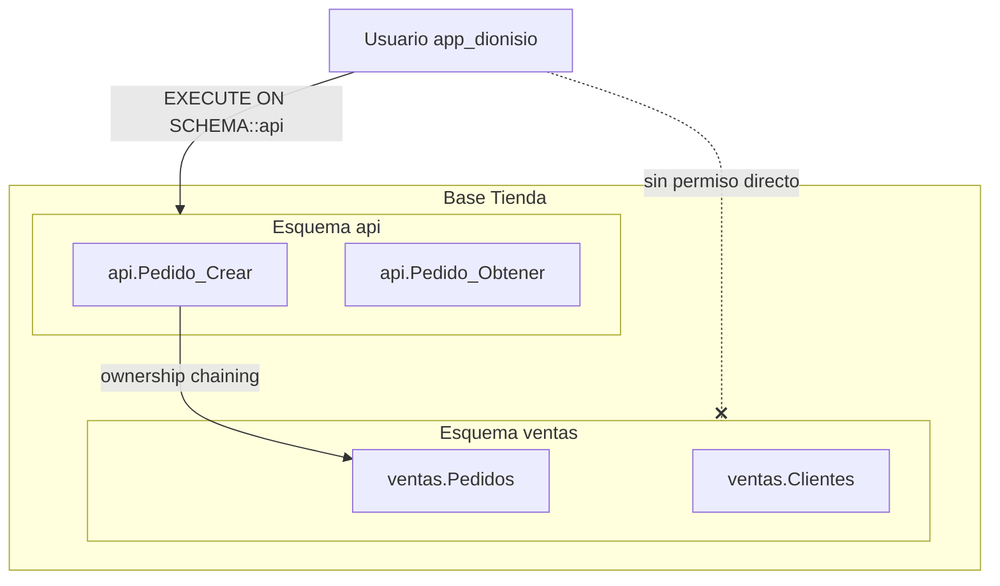

# Esquemas (schemas) en SQL Server

Parte de: [[06-SQL-Server/01 Básico/_Índice Básico|Básico]]

> [!info] Cómo avanzar
> `progreso`: **pendiente** → **viendo** (estudiando) → **visto** (contestaste la autoevaluación sin abrir las respuestas) → **dominado** (hiciste el laboratorio o lo aplicaste de verdad).

## Contenido

### Qué es
Un **esquema** es un contenedor lógico dentro de una base de datos que agrupa tablas, vistas, procedimientos y funciones. El nombre completo de un objeto es `base.esquema.objeto` (por ejemplo `Tienda.ventas.Pedidos`). Sirve para **organizar** por área o módulo (`ventas`, `rh`, `seguridad`) y, sobre todo, para **dar permisos por bloque**: un esquema es la unidad natural para decir "esta aplicación puede ejecutar todo lo de `api` y nada más". El esquema predeterminado es **`dbo`**.

### Cómo funciona
- Desde SQL Server 2005 el esquema está **separado del usuario**: un esquema tiene un dueño (un usuario o rol), pero si ese usuario se elimina, el esquema y sus objetos permanecen al cambiar de dueño.
- Cada usuario tiene un **esquema predeterminado** (normalmente `dbo`). Cuando escribes un nombre sin esquema (`SELECT * FROM Pedidos`), SQL Server busca primero en el esquema predeterminado del usuario y luego en `dbo`. Por eso dos usuarios pueden resolver el mismo texto a objetos distintos.
- **Permisos a nivel esquema**: `GRANT EXECUTE ON SCHEMA::api TO RolApp` da ejecutar sobre todos los procedimientos y funciones del esquema, **incluidos los que se creen después**. Lo mismo con `SELECT`, `INSERT`, etc.
- **Encadenamiento de propiedad** (*ownership chaining*): si un procedimiento de `api` (dueño `dbo`) lee una tabla de `ventas` (dueño también `dbo`), quien tenga `EXECUTE` sobre el procedimiento no necesita permiso sobre la tabla. Así la app solo ejecuta procedimientos y no toca tablas directamente.
- **Mover objetos**: `ALTER SCHEMA destino TRANSFER origen.Objeto;`. Conserva los datos, pero los permisos explícitos sobre el objeto se pierden y el código que lo referencie con el esquema viejo deja de funcionar.



### Ejemplo
Configuración típica para Itzamna.Dionisio: tablas en esquemas de dominio y procedimientos en un esquema `api` que es lo único que ve la aplicación.

```sql
CREATE SCHEMA api AUTHORIZATION dbo;
GO
CREATE ROLE rol_api;
GRANT EXECUTE ON SCHEMA::api TO rol_api;   -- todos los SP actuales y futuros de api

-- Usuario de la aplicación (en Azure SQL podría ser una identidad administrada)
CREATE USER app_dionisio WITHOUT LOGIN;    -- para pruebas locales
ALTER ROLE rol_api ADD MEMBER app_dionisio;
GO

CREATE OR ALTER PROCEDURE api.Pedido_Obtener @PedidoId int
AS
SET NOCOUNT ON;
SELECT p.PedidoId, p.Fecha, p.Estado, c.Nombre
FROM   ventas.Pedidos  AS p                       -- siempre con esquema
JOIN   ventas.Clientes AS c ON c.ClienteId = p.ClienteId
WHERE  p.PedidoId = @PedidoId;
GO

-- Mover una tabla de dbo a un esquema propio
CREATE SCHEMA portfolio;
GO
ALTER SCHEMA portfolio TRANSFER dbo.Activos;

-- ¿Qué hay en cada esquema?
SELECT s.name AS Esquema, o.name AS Objeto, o.type_desc
FROM   sys.objects o JOIN sys.schemas s ON s.schema_id = o.schema_id
WHERE  o.is_ms_shipped = 0
ORDER  BY s.name, o.name;
```

Desde Dapper llamas siempre con el nombre calificado:

```csharp
var pedido = await conexion.QuerySingleOrDefaultAsync<PedidoDto>(
    "api.Pedido_Obtener", new { PedidoId = id }, commandType: CommandType.StoredProcedure);
```

El laboratorio [[Lab 10 - Usuario de aplicación con permisos mínimos por esquema]] lo practica de punta a punta, y [[Roles y permisos]] profundiza en la seguridad.

### Cuándo usarlo y cuándo no
- **Úsalos** para separar dominios (`ventas`, `inventario`), capas (`api` para procedimientos, `stg` para cargas ETL) o datos sensibles (`seguridad`), y para asignar permisos por bloque.
- **No abuses**: un esquema por tabla o nombres crípticos complican más de lo que ayudan. Tampoco son un mecanismo de aislamiento entre clientes (multi-tenant); para eso hay [[Row-level security]] o bases separadas.
- En PostgreSQL (Pochteca.Nomisma) el concepto es parecido, pero la resolución de nombres usa `search_path`; ver [[PostgreSQL]].

### Errores comunes
1. **Omitir el esquema** al crear o consultar: el objeto puede terminar en otro esquema, y la resolución de nombres agrega una búsqueda extra y puede impedir reutilizar planes en caché entre usuarios con distinto esquema predeterminado.
2. **Dar permisos tabla por tabla** en lugar de por esquema: se olvidan las tablas nuevas.
3. **Dar `db_owner` a la aplicación** "para que funcione": anula toda la separación.
4. **Romper el ownership chaining** con dueños distintos: el SP deja de poder leer la tabla sin permisos directos.
5. **Mover con `TRANSFER`** sin actualizar procedimientos y sin volver a conceder permisos explícitos.

### Para profundizar
- [CREATE SCHEMA (Transact-SQL)](https://learn.microsoft.com/sql/t-sql/statements/create-schema-transact-sql)
- [ALTER SCHEMA (Transact-SQL)](https://learn.microsoft.com/sql/t-sql/statements/alter-schema-transact-sql)
- [GRANT - permisos de esquema](https://learn.microsoft.com/sql/t-sql/statements/grant-schema-permissions-transact-sql)

## Autoevaluación

Contesta primero en voz alta o en papel; luego despliega la respuesta.

> [!question]- ¿Para qué sirve un esquema y cuál es el predeterminado?
> Es un espacio de nombres dentro de la base para agrupar objetos (`portfolio.Portfolios`, `ventas.Pedidos`) y asignar permisos por grupo. El predeterminado es `dbo`.

> [!question]- ¿Cómo das a una app permiso de ejecutar todos los procedimientos de un esquema y nada más?
> Con un rol: 
> ```sql
> CREATE ROLE rol_app;
> GRANT EXECUTE ON SCHEMA::portfolio TO rol_app;
> ALTER ROLE rol_app ADD MEMBER app_usuario;
> ```
> Los procedimientos nuevos del esquema quedan cubiertos sin otro `GRANT`.

> [!question]- ¿Cómo mueves una tabla de `dbo` a `portfolio`?
> `ALTER SCHEMA portfolio TRANSFER dbo.Portfolios;` Ojo: los permisos asignados directamente al objeto se pierden y el código que usaba `dbo.Portfolios` deja de funcionar.

> [!question]- Error común: crear y consultar objetos sin el esquema (`SELECT * FROM Pedidos`). ¿Por qué es mala idea?
> SQL Server busca primero en el esquema predeterminado del usuario y luego en `dbo`; puede resolver a otro objeto, y los planes de consultas sin calificar se reutilizan peor entre usuarios. Siempre `esquema.objeto`.

## Práctica

- [[Lab 1 - Base de práctica Tienda en SQL Server]]
- [[Lab 9 - Script de migración idempotente con tabla de versiones]]
- [[Lab 10 - Usuario de aplicación con permisos mínimos por esquema]]

