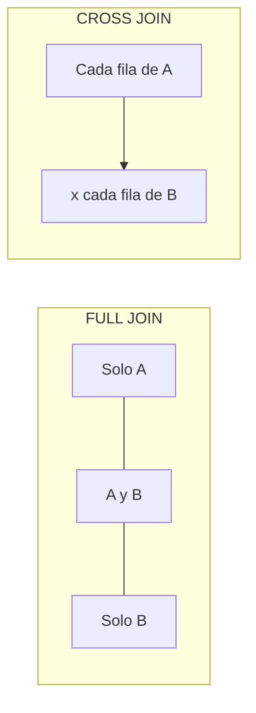

# FULL JOIN y CROSS JOIN

Parte de: [[06-SQL-Server/01 Básico/_Índice Básico|Básico]]

> [!info] Cómo avanzar
> `progreso`: **pendiente** → **viendo** (estudiando) → **visto** (contestaste la autoevaluación sin abrir las respuestas) → **dominado** (hiciste el laboratorio o lo aplicaste de verdad).

## Contenido

### Qué es
Son los dos JOIN menos frecuentes, pero muy útiles en casos concretos:

- **`FULL OUTER JOIN`** devuelve todas las filas de ambas tablas: las que tienen pareja salen combinadas, y las que no, salen con `NULL` en las columnas del otro lado. Es la herramienta natural para **conciliar** dos fuentes.
- **`CROSS JOIN`** devuelve el **producto cartesiano**: cada fila de A combinada con cada fila de B (filas(A) × filas(B)). No lleva `ON`. Sirve para **generar combinaciones** (calendarios, matrices de reporte).

Ambos complementan a [[INNER JOIN]] y [[LEFT y RIGHT JOIN]]; el panorama está en [[JOINs]].

### Cómo funciona
**FULL JOIN** equivale a un `LEFT JOIN` unido con las filas "huérfanas" del `RIGHT JOIN`. En el resultado distingues tres casos según qué lado es `NULL`:

| Lado A | Lado B | Significado |
|---|---|---|
| valor | valor | existe en ambos |
| valor | `NULL` | solo en A |
| `NULL` | valor | solo en B |

Como cualquiera de los dos lados puede venir vacío, la clave común se arma con `COALESCE(a.Clave, b.Clave)`.

**CROSS JOIN** no compara nada: si A tiene 6 filas y B tiene 4, salen 24. Es igual a escribir `FROM A, B` sin `WHERE`. Su riesgo es el tamaño: dos tablas de 100 mil filas generan 10 mil millones.



### Ejemplo
**Conciliación** entre el inventario del sistema y un conteo físico cargado desde Excel (caso típico de Wee.Reporteria):

```sql
CREATE TABLE #Conteo (Sku varchar(20) PRIMARY KEY, Piezas int NOT NULL);
INSERT INTO #Conteo VALUES ('TEC-01', 10), ('MON-27', 3), ('BOC-BT', 5);

CREATE TABLE #Sistema (Sku varchar(20) PRIMARY KEY, Piezas int NOT NULL);
INSERT INTO #Sistema VALUES ('TEC-01', 10), ('MON-27', 4), ('CAB-HD', 20);

SELECT COALESCE(s.Sku, c.Sku) AS Sku,
       s.Piezas AS EnSistema,
       c.Piezas AS EnConteo,
       CASE WHEN s.Sku IS NULL THEN N'Solo en conteo'
            WHEN c.Sku IS NULL THEN N'Solo en sistema'
            WHEN s.Piezas <> c.Piezas THEN N'Diferencia'
            ELSE N'OK' END AS Resultado
FROM   #Sistema AS s
FULL   JOIN #Conteo AS c ON c.Sku = s.Sku
ORDER  BY Sku;
-- BOC-BT solo en conteo, CAB-HD solo en sistema, MON-27 con diferencia, TEC-01 OK
```

**Matriz completa** con `CROSS JOIN` + `LEFT JOIN`: ventas por mes y categoría, mostrando 0 donde no hubo ventas (un reporte sin huecos):

```sql
WITH Meses AS (
    SELECT DATEFROMPARTS(2025, m, 1) AS Mes
    FROM (VALUES (1),(2),(3),(4)) AS v(m)
), Categorias AS (
    SELECT DISTINCT Categoria FROM ventas.Productos
), Ventas AS (
    SELECT DATEFROMPARTS(YEAR(p.Fecha), MONTH(p.Fecha), 1) AS Mes, pr.Categoria,
           SUM(d.Cantidad * d.PrecioUnitario) AS Importe
    FROM   ventas.Pedidos p
    JOIN   ventas.PedidoDetalle d ON d.PedidoId = p.PedidoId
    JOIN   ventas.Productos pr    ON pr.ProductoId = d.ProductoId
    WHERE  p.Estado <> 'Cancelado'
    GROUP  BY DATEFROMPARTS(YEAR(p.Fecha), MONTH(p.Fecha), 1), pr.Categoria
)
SELECT m.Mes, c.Categoria, COALESCE(v.Importe, 0) AS Importe
FROM   Meses m
CROSS  JOIN Categorias c                 -- todas las combinaciones mes x categoría
LEFT   JOIN Ventas v ON v.Mes = m.Mes AND v.Categoria = c.Categoria
ORDER  BY m.Mes, c.Categoria;
```

### Cuándo usarlo y cuándo no
- **FULL JOIN**: conciliaciones, comparar dos versiones de un catálogo, detectar altas/bajas entre una carga y la tabla destino. Si solo te interesan las diferencias, `EXCEPT` en ambos sentidos puede ser más simple (ver [[UNION, UNION ALL, INTERSECT y EXCEPT]]). Para sincronizar, [[MERGE]].
- **CROSS JOIN**: generar combinaciones a propósito (tallas × colores, días × sucursales), o aplicar un parámetro de una fila a todas (`CROSS JOIN (SELECT @TipoCambio AS TC) t`).
- **No uses** `CROSS JOIN` con tablas grandes sin pensar en el tamaño, ni `FULL JOIN` cuando un `LEFT JOIN` basta: el FULL es más costoso y no admite algunos algoritmos (no puede resolverse con *Nested Loops*).

### Errores comunes
1. **Olvidar el `ON` con la sintaxis de comas** (`FROM Clientes, Pedidos` sin `WHERE`): producto cartesiano accidental que puede tumbar el servidor o la red. Usa siempre la sintaxis explícita `JOIN ... ON`; un `JOIN` sin `ON` da error de sintaxis y te protege.
2. **Filtrar en el `WHERE` una columna de un lado del FULL JOIN** (`WHERE s.Piezas > 0`): elimina las filas donde ese lado es `NULL` y el FULL se convierte en LEFT o INNER.
3. **No usar `COALESCE`** para la clave: las filas "solo en B" salen con la clave en `NULL`.
4. **Comparar valores que pueden ser `NULL`** con `<>`: `NULL <> 5` no es verdadero; usa `IS DISTINCT FROM` (SQL Server 2022) o maneja el `NULL` explícito.

### Para profundizar
- [Combinaciones (Joins) en SQL Server](https://learn.microsoft.com/sql/relational-databases/performance/joins)
- [FROM con JOIN, APPLY, PIVOT](https://learn.microsoft.com/sql/t-sql/queries/from-transact-sql)
- [IS [NOT] DISTINCT FROM](https://learn.microsoft.com/sql/t-sql/queries/is-distinct-from-transact-sql)

## Ejercicios

Resuélvelos en papel o en la herramienta; la solución está plegada.

> [!question]- Con la base Tienda ([[Lab 1 - Base de práctica Tienda en SQL Server]]): ¿cuántas filas devuelve `SELECT * FROM ventas.Clientes CROSS JOIN ventas.Productos`?
> 36 (6 clientes × 6 productos).

> [!question]- Conciliación: crea una tabla temporal `#Proveedor(Nombre nvarchar(100), Precio decimal(10,2))` con Teclado mecánico 1200, Monitor 27 5100 y Bocina BT 700, y compárala con el catálogo con un `FULL JOIN`.
> ```sql
> CREATE TABLE #Proveedor (Nombre nvarchar(100), Precio decimal(10,2));
> INSERT INTO #Proveedor VALUES (N'Teclado mecánico', 1200), (N'Monitor 27', 5100), (N'Bocina BT', 700);
>
> SELECT COALESCE(p.Nombre, v.Nombre) AS Producto, p.Precio AS Catalogo, v.Precio AS Proveedor,
>        CASE WHEN p.Nombre IS NULL THEN 'Solo proveedor'
>             WHEN v.Nombre IS NULL THEN 'Solo catálogo'
>             WHEN p.Precio <> v.Precio THEN 'Precio distinto'
>             ELSE 'Igual' END AS Resultado
> FROM   ventas.Productos p
> FULL   JOIN #Proveedor v ON v.Nombre = p.Nombre;
> ```
> Teclado: Igual; Monitor: Precio distinto; Bocina BT: Solo proveedor; los otros 4: Solo catálogo.

> [!question]- Matriz de ventas por cliente y categoría (sin cancelados) que muestre 0 donde no hubo compra (pista: `CROSS JOIN` + `LEFT JOIN` a una subconsulta). ¿Cuántas filas tiene y cuánto suma Ana en Monitores?
> ```sql
> SELECT c.Nombre, cat.Categoria, ISNULL(SUM(v.Importe), 0) AS Importe
> FROM   ventas.Clientes c
> CROSS  JOIN (SELECT DISTINCT Categoria FROM ventas.Productos) AS cat
> LEFT   JOIN (SELECT p.ClienteId, pr.Categoria, d.Cantidad * d.PrecioUnitario AS Importe
>              FROM   ventas.Pedidos p
>              JOIN   ventas.PedidoDetalle d ON d.PedidoId = p.PedidoId
>              JOIN   ventas.Productos pr    ON pr.ProductoId = d.ProductoId
>              WHERE  p.Estado <> 'Cancelado') AS v
>        ON v.ClienteId = c.ClienteId AND v.Categoria = cat.Categoria
> GROUP  BY c.Nombre, cat.Categoria
> ORDER  BY c.Nombre, cat.Categoria;
> ```
> 24 filas (6 clientes × 4 categorías). Ana en Monitores: 5200. Unir y filtrar el detalle **dentro** de la subconsulta evita que el `LEFT JOIN` mezcle importes de otras categorías.

## Autoevaluación

Contesta primero en voz alta o en papel; luego despliega la respuesta.

> [!question]- ¿Para qué sirve un `FULL OUTER JOIN`?
> Para comparar dos conjuntos y ver qué hay solo en uno, solo en el otro y en ambos; típico en conciliaciones (catálogo vs. archivo del proveedor, sistema A vs. sistema B).

> [!question]- ¿Qué devuelve un `CROSS JOIN` y cuándo es útil?
> El producto cartesiano: cada fila de A con cada fila de B (n × m filas). Útil para generar combinaciones (todos los productos × todos los meses) y luego hacer `LEFT JOIN` contra los datos reales para mostrar ceros.

> [!question]- ¿Qué pasa si olvidas el `ON` en un join de dos tablas grandes con sintaxis de comas?
> Obtienes un `CROSS JOIN` accidental: millones de filas, consumo de tempdb y una consulta que no termina. Con `JOIN ... ON` el parser te obliga a poner la condición.

