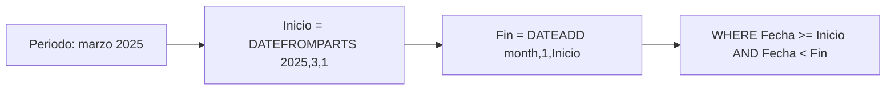

# Funciones de fecha

Parte de: [[06-SQL-Server/01 Básico/_Índice Básico|Básico]]

> [!info] Cómo avanzar
> `progreso`: **pendiente** → **viendo** (estudiando) → **visto** (contestaste la autoevaluación sin abrir las respuestas) → **dominado** (hiciste el laboratorio o lo aplicaste de verdad).

## Contenido

### Qué es
Las **funciones de fecha** de T-SQL obtienen la fecha actual, extraen partes (año, mes, día), suman intervalos, calculan diferencias y construyen fechas. Son indispensables para reportes por periodo, vencimientos y filtros por rango. Complementan los tipos explicados en [[datetime2 y fechas en SQL Server]].

### Cómo funciona
Las más usadas, agrupadas por propósito:

| Propósito | Funciones |
|---|---|
| Fecha actual | `SYSUTCDATETIME()`, `SYSDATETIME()`, `GETDATE()`, `SYSDATETIMEOFFSET()` |
| Extraer partes | `YEAR`, `MONTH`, `DAY`, `DATEPART(parte, f)`, `DATENAME(parte, f)` |
| Sumar intervalos | `DATEADD(parte, n, f)` |
| Diferencias | `DATEDIFF(parte, inicio, fin)`, `DATEDIFF_BIG` |
| Construir | `DATEFROMPARTS(a, m, d)`, `DATETIME2FROMPARTS(...)`, `EOMONTH(f, [meses])` |
| Truncar (2022+) | `DATETRUNC(parte, f)`, `DATE_BUCKET(parte, n, f)` |
| Texto | `CONVERT(varchar, f, estilo)`, `FORMAT(f, 'patrón', 'cultura')` |

Tres comportamientos que hay que entender:

1. **`DATEDIFF` cuenta fronteras cruzadas**, no tiempo transcurrido. `DATEDIFF(year, '2025-12-31', '2026-01-01')` devuelve **1** aunque pasó un día, porque se cruzó el límite de año. Para edades o antigüedades exactas compara con `DATEADD` o calcula en días.
2. **`DATENAME` y `DATEPART(weekday)` dependen de la sesión**: el idioma (`SET LANGUAGE`, normalmente heredado del idioma predeterminado del login) decide si sale "Monday" o "lunes", y `SET DATEFIRST` decide qué día es el 1. Por eso dos servidores devuelven cosas distintas. Para la app, devuelve números o fechas y traduce en C#/React.
3. **Aplicar una función a la columna en el `WHERE` impide usar el índice** (consulta no *SARGable*). `WHERE YEAR(Fecha) = 2025` obliga a calcular `YEAR` en cada fila y escanear; `WHERE Fecha >= '2025-01-01' AND Fecha < '2026-01-01'` permite un *Index Seek*. Ver [[SARGability]].

El patrón correcto para periodos es el **rango semiabierto**: `>= inicio AND < inicio del siguiente periodo`. Funciona igual para `date` y para `datetime2` con horas, sin preocuparte por el último milisegundo del día.



### Ejemplo
```sql
DECLARE @Anio int = 2025, @Mes int = 3;
DECLARE @Inicio date = DATEFROMPARTS(@Anio, @Mes, 1);
DECLARE @Fin    date = DATEADD(month, 1, @Inicio);

-- Pedidos del mes con rango semiabierto (usa índice sobre Fecha)
SELECT PedidoId, Fecha,
       DATEADD(day, 7, Fecha)      AS VenceRevision,   -- +7 días
       EOMONTH(Fecha)              AS CierreMes,       -- último día del mes
       EOMONTH(Fecha, -1)          AS CierreMesAnterior,
       DATEDIFF(day, Fecha, @Fin)  AS DiasAlCierre
FROM   ventas.Pedidos
WHERE  Fecha >= @Inicio AND Fecha < @Fin;

-- Agrupar por mes sin FORMAT (FORMAT es lento y devuelve texto)
SELECT DATEFROMPARTS(YEAR(Fecha), MONTH(Fecha), 1) AS Mes, COUNT(*) AS Pedidos
FROM   ventas.Pedidos
GROUP  BY DATEFROMPARTS(YEAR(Fecha), MONTH(Fecha), 1)
ORDER  BY Mes;
-- En SQL Server 2022+ también: GROUP BY DATETRUNC(month, Fecha)

-- La trampa de DATEDIFF
SELECT DATEDIFF(year,  '2025-12-31', '2026-01-01') AS Anios,   -- 1
       DATEDIFF(month, '2025-01-31', '2025-02-01') AS Meses,   -- 1
       DATEDIFF(day,   '2025-12-31', '2026-01-01') AS Dias;    -- 1
```

Desde Dapper pasa los límites del rango como parámetros `DateOnly`/`DateTime` calculados en C# o en el propio SQL, nunca concatenando texto:

```csharp
var desde = new DateOnly(2025, 3, 1);
var pedidos = await conexion.QueryAsync<PedidoDto>(sqlPorRango,
    new { Inicio = desde.ToDateTime(TimeOnly.MinValue), Fin = desde.AddMonths(1).ToDateTime(TimeOnly.MinValue) });
```

### Cuándo usarlo y cuándo no
- **Usa `SYSUTCDATETIME()`** para registrar momentos (auditoría, creación) y convierte a hora de México en la presentación; evita depender de la zona del servidor (en Azure SQL es UTC).
- **Usa rangos semiabiertos** en filtros; deja `YEAR()`/`MONTH()` para el `SELECT` o el `GROUP BY`.
- **Evita `FORMAT`** en consultas con muchas filas: usa .NET por debajo y es notablemente más lento que `CONVERT`. Mejor aún, formatea en el front.
- Si necesitas calendarios laborales o días festivos, crea una **tabla calendario** en lugar de cálculos complicados.

### Errores comunes
1. **`BETWEEN '2025-03-01' AND '2025-03-31'`** sobre columnas con hora: pierde todo lo del día 31 después de las 00:00.
2. **Funciones sobre la columna en el `WHERE`**: escaneos en tablas grandes.
3. **Leer `DATEDIFF` como "tiempo transcurrido"**: cuenta límites, no duración.
4. **Literales ambiguos** como `'03/04/2025'`: según `SET DATEFORMAT`/idioma es 3 de abril o 4 de marzo. Usa `'20250403'` o `'2025-04-03'` (ISO).
5. **Depender de `DATENAME`** para lógica de negocio: cambia con el idioma de la sesión.

### Para profundizar
- [Tipos de datos y funciones de fecha y hora](https://learn.microsoft.com/sql/t-sql/functions/date-and-time-data-types-and-functions-transact-sql)
- [DATEDIFF (Transact-SQL)](https://learn.microsoft.com/sql/t-sql/functions/datediff-transact-sql)
- [DATETRUNC (Transact-SQL)](https://learn.microsoft.com/sql/t-sql/functions/datetrunc-transact-sql)
- [EOMONTH (Transact-SQL)](https://learn.microsoft.com/sql/t-sql/functions/eomonth-transact-sql)

## Ejercicios

Resuélvelos en papel o en la herramienta; la solución está plegada.

> [!question]- Con la base Tienda ([[Lab 1 - Base de práctica Tienda en SQL Server]]): pedidos de marzo de 2025 con un rango semiabierto.
> ```sql
> SELECT PedidoId, Fecha FROM ventas.Pedidos
> WHERE  Fecha >= '2025-03-01' AND Fecha < '2025-04-01';
> ```
> Pedidos 5, 6 y 7.

> [!question]- Clientes dados de alta antes de 2025 y cuántos días llevan registrados al 1 de enero de 2026.
> ```sql
> SELECT Nombre, FechaAlta, DATEDIFF(day, FechaAlta, '2026-01-01') AS Dias
> FROM   ventas.Clientes
> WHERE  FechaAlta < '2025-01-01';
> ```
> Ana López (2024-01-15, 717 días), Bruno Díaz (2024-03-02, 670), Carla Méndez (2024-06-20, 560).

> [!question]- Para cada pedido, la fecha límite de entrega (fecha + 5 días) y el último día de su mes.
> ```sql
> SELECT PedidoId, Fecha,
>        DATEADD(day, 5, Fecha) AS Limite,
>        EOMONTH(Fecha)         AS FinDeMes
> FROM   ventas.Pedidos;
> ```
> Pedido 4: 2025-02-14 → límite 2025-02-19, fin de mes 2025-02-28.

> [!question]- Agrupa los pedidos por el primer día de su mes sin usar `FORMAT`.
> ```sql
> SELECT DATEFROMPARTS(YEAR(Fecha), MONTH(Fecha), 1) AS Mes, COUNT(*) AS Pedidos
> FROM   ventas.Pedidos
> GROUP  BY DATEFROMPARTS(YEAR(Fecha), MONTH(Fecha), 1)
> ORDER  BY Mes;
> ```
> 2025-01: 2, 2025-02: 2, 2025-03: 3, 2025-04: 1. En SQL Server 2022+ también sirve `DATETRUNC(month, Fecha)`.

## Autoevaluación

Contesta primero en voz alta o en papel; luego despliega la respuesta.

> [!question]- ¿Qué devuelve `DATEDIFF(year, '2025-12-31', '2026-01-01')` y por qué?
> `1`: `DATEDIFF` cuenta **fronteras cruzadas** de la unidad, no años completos. Para edades exactas compara también mes y día.

> [!question]- ¿Para qué sirven `EOMONTH` y `DATEFROMPARTS`?
> `EOMONTH(fecha)` da el último día del mes (`EOMONTH('2024-02-10')` = `2024-02-29`); `DATEFROMPARTS(2025, 3, 1)` construye una fecha. Útiles para calcular rangos de mes.

> [!question]- ¿Por qué `WHERE YEAR(Fecha) = 2025` es peor que `WHERE Fecha >= '2025-01-01' AND Fecha < '2026-01-01'`?
> La función sobre la columna impide buscar en el índice de `Fecha` (no es SARGable): hay que calcular `YEAR` en cada fila. El rango sí permite *seek*. Ver [[SARGability]].

> [!question]- ¿Por qué `DATENAME(weekday, Fecha)` puede devolver «Monday» en un servidor y «lunes» en otro?
> Depende del idioma de la sesión (`SET LANGUAGE`). Para lógica usa números (`DATEPART(weekday, ...)`, que además depende de `SET DATEFIRST`) y formatea el texto en la aplicación.

## Práctica

- [[Lab 2 - Consultas de agregación y JOINs en Tienda]]

