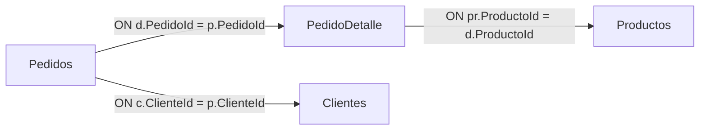

# INNER JOIN

Parte de: [[06-SQL-Server/01 Básico/_Índice Básico|Básico]]

> [!info] Cómo avanzar
> `progreso`: **pendiente** → **viendo** (estudiando) → **visto** (contestaste la autoevaluación sin abrir las respuestas) → **dominado** (hiciste el laboratorio o lo aplicaste de verdad).

## Contenido

### Qué es
`INNER JOIN` combina filas de dos tablas y devuelve **solo los pares que cumplen la condición del `ON`**. Si una fila de cualquiera de las dos tablas no tiene pareja, no aparece en el resultado. Es el JOIN más común: "cada pedido con el nombre de su cliente", "cada renglón con su producto". El panorama de todos los tipos está en [[JOINs]].

### Cómo funciona
Conceptualmente, el motor toma cada fila de la tabla izquierda, busca en la derecha las filas cuyo `ON` sea **verdadero** y produce una fila combinada por cada coincidencia:

- Si una fila tiene **0** coincidencias, desaparece.
- Si tiene **1**, sale una vez.
- Si tiene **n**, sale **n veces** (una por pareja). Esto es normal en relaciones uno a muchos: un pedido con 3 renglones aparece 3 veces al unirlo con `PedidoDetalle`.
- Una condición que da `NULL` (por ejemplo, la columna de unión vale `NULL`) se trata como falsa: esas filas no se emparejan.

`INNER JOIN` y `JOIN` son lo mismo. La sintaxis antigua `FROM a, b WHERE a.id = b.id` produce **el mismo resultado y el mismo plan**, pero mezcla las condiciones de unión con los filtros, y si olvidas una condición obtienes un producto cartesiano sin aviso. La sintaxis ANSI `JOIN ... ON` es la recomendada: separa "cómo se relacionan" (`ON`) de "qué filas quiero" (`WHERE`). En un INNER JOIN da igual poner un filtro en el `ON` o en el `WHERE`; en un LEFT JOIN no (ver [[LEFT y RIGHT JOIN]]).

Físicamente, el optimizador elige un algoritmo: *Nested Loops* (pocas filas por fuera e índice por dentro), *Hash Match* (muchas filas sin orden) o *Merge Join* (ambos lados ordenados por la clave). Ver [[Operadores de join (Nested Loops, Hash Match y Merge Join)]]. Para que *Nested Loops* sea barato, la columna de la tabla interna debe estar **indexada**; como SQL Server **no indexa automáticamente las FK**, crear esos índices es parte del diseño (ver [[Claves primarias y foráneas]]).



### Ejemplo
```sql
-- Renglones de pedidos con cliente y producto (cuatro tablas)
SELECT p.PedidoId, p.Fecha, c.Nombre AS Cliente,
       pr.Nombre AS Producto, d.Cantidad, d.PrecioUnitario,
       d.Cantidad * d.PrecioUnitario AS Importe
FROM   ventas.Pedidos       AS p
JOIN   ventas.Clientes      AS c  ON c.ClienteId  = p.ClienteId
JOIN   ventas.PedidoDetalle AS d  ON d.PedidoId   = p.PedidoId
JOIN   ventas.Productos     AS pr ON pr.ProductoId = d.ProductoId
WHERE  p.Estado = 'Entregado'
ORDER  BY p.Fecha, p.PedidoId;

-- JOIN con condición compuesta: precio cobrado distinto del de lista
SELECT d.PedidoId, pr.Nombre, d.PrecioUnitario, pr.Precio AS PrecioLista
FROM   ventas.PedidoDetalle d
JOIN   ventas.Productos pr ON pr.ProductoId = d.ProductoId
                          AND pr.Precio <> d.PrecioUnitario;
```

Con Dapper puedes mapear un JOIN a objetos anidados con *multi-mapping* (`splitOn` indica dónde empieza el segundo objeto):

```csharp
const string sql = """
    SELECT p.PedidoId, p.Fecha, p.Estado, c.ClienteId, c.Nombre
    FROM ventas.Pedidos p JOIN ventas.Clientes c ON c.ClienteId = p.ClienteId
    """;
var pedidos = await conexion.QueryAsync<PedidoDto, ClienteDto, PedidoDto>(
    sql, (pedido, cliente) => pedido with { Cliente = cliente }, splitOn: "ClienteId");
```

En el proyecto, ese SQL vive en su archivo `.sql` dentro del slice de la consulta.

### Cuándo usarlo y cuándo no
- **Úsalo** cuando la fila solo tiene sentido si existe la relación: renglón con su producto, pedido con su cliente.
- **Usa `LEFT JOIN`** si quieres conservar filas aunque no tengan pareja (clientes sin pedidos).
- **Usa `EXISTS`** si solo quieres filtrar ("clientes que compraron Periféricos") y no necesitas columnas de la otra tabla: evita duplicados y el `DISTINCT` posterior.
- Siempre usa **alias cortos y califica cada columna** (`p.Fecha`): evita ambigüedad (error 209) y documenta de dónde sale cada dato.

### Errores comunes
1. **Condición de JOIN incompleta** en claves compuestas (unir `PedidoDetalle` solo por `PedidoId` con otra tabla que también tiene `ProductoId`): filas multiplicadas.
2. **Esperar que aparezcan filas sin pareja**: el INNER las descarta; un cliente sin pedidos no sale.
3. **Corregir duplicados con `DISTINCT`** en lugar de entender por qué el JOIN multiplica.
4. **JOIN entre tipos distintos** (`int` con `varchar`, `varchar` con `nvarchar`): conversión implícita que puede impedir el uso del índice.
5. **No indexar las FK** usadas en JOIN frecuentes: escaneos y planes con *Hash Match* costosos.

### Para profundizar
- [Combinaciones (Joins)](https://learn.microsoft.com/sql/relational-databases/performance/joins)
- [FROM más JOIN, APPLY, PIVOT (Transact-SQL)](https://learn.microsoft.com/sql/t-sql/queries/from-transact-sql)
- [Dapper en GitHub (multi-mapping)](https://github.com/DapperLib/Dapper)

## Ejercicios

Resuélvelos en papel o en la herramienta; la solución está plegada.

> [!question]- Con la base Tienda ([[Lab 1 - Base de práctica Tienda en SQL Server]]): lista cada pedido con el nombre del cliente y su estado, ordenado por fecha.
> ```sql
> SELECT p.PedidoId, p.Fecha, c.Nombre AS Cliente, p.Estado
> FROM   ventas.Pedidos p
> INNER  JOIN ventas.Clientes c ON c.ClienteId = p.ClienteId
> ORDER  BY p.Fecha;
> ```
> 8 filas; la primera, pedido 1 de Ana López (2025-01-05).

> [!question]- Renglones vendidos a un precio distinto del precio de lista actual.
> ```sql
> SELECT d.PedidoId, pr.Nombre, pr.Precio AS PrecioLista, d.PrecioUnitario
> FROM   ventas.PedidoDetalle d
> JOIN   ventas.Productos pr ON pr.ProductoId = d.ProductoId
> WHERE  d.PrecioUnitario <> pr.Precio;
> ```
> Pedido 5 Laptop (18000 vs 18500), pedido 6 Teclado (1150 vs 1200), pedido 8 Monitor (5000 vs 5200).

> [!question]- Nombres de los clientes que compraron algún producto de Periféricos (sin repetir).
> ```sql
> SELECT DISTINCT c.Nombre
> FROM   ventas.Clientes c
> JOIN   ventas.Pedidos p       ON p.ClienteId = c.ClienteId
> JOIN   ventas.PedidoDetalle d ON d.PedidoId  = p.PedidoId
> JOIN   ventas.Productos pr    ON pr.ProductoId = d.ProductoId
> WHERE  pr.Categoria = N'Periféricos';
> ```
> Ana, Bruno, Carla y Diego. Aquí `DISTINCT` es razonable; con `EXISTS` evitarías generar duplicados.

## Autoevaluación

Contesta primero en voz alta o en papel; luego despliega la respuesta.

> [!question]- ¿Qué devuelve un `INNER JOIN`?
> Solo las combinaciones de filas que cumplen la condición del `ON`. Si un cliente no tiene pedidos, no aparece.

> [!question]- ¿Es lo mismo `FROM a INNER JOIN b ON a.id = b.id` que `FROM a, b WHERE a.id = b.id`?
> Da el mismo resultado y el mismo plan, pero la sintaxis con comas es antigua: si olvidas la condición obtienes un producto cartesiano sin aviso. Usa siempre `JOIN ... ON`.

> [!question]- ¿Por qué conviene indexar las columnas de FK que usas en joins?
> SQL Server **no** crea índices automáticamente en las FK. Sin índice en `PedidoDetalle.ProductoId`, unir desde `Productos` o borrar un producto obliga a recorrer toda la tabla de detalle.

## Práctica

- [[Lab 2 - Consultas de agregación y JOINs en Tienda]]

