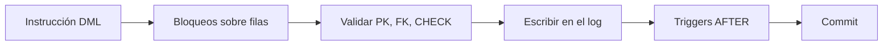

# INSERT, UPDATE y DELETE (DML)

Parte de: [[06-SQL-Server/01 Básico/_Índice Básico|Básico]]

> [!info] Cómo avanzar
> `progreso`: **pendiente** → **viendo** (estudiando) → **visto** (contestaste la autoevaluación sin abrir las respuestas) → **dominado** (hiciste el laboratorio o lo aplicaste de verdad).

## Contenido

### Qué es
**DML** (*Data Manipulation Language*) son las instrucciones que **cambian datos**: `INSERT` agrega filas, `UPDATE` modifica valores y `DELETE` elimina filas (también `MERGE`, que combina las tres; ver [[MERGE]]). Mientras el DDL cambia la estructura ([[CREATE, ALTER y DROP (DDL)]]), el DML trabaja sobre el contenido y siempre pasa por las restricciones (PK, FK, CHECK) y los triggers.

### Cómo funciona
**INSERT**

- `INSERT INTO t (col1, col2) VALUES (...), (...);` — siempre lista las columnas; así el script no se rompe si se agrega una columna. Un solo `VALUES` admite hasta **1,000 filas**; para más, usa `INSERT ... SELECT`, `BULK INSERT`, `SqlBulkCopy` o un [[Table-valued parameters]].
- `INSERT INTO t (...) SELECT ... FROM ...` copia datos desde una consulta.
- Las columnas omitidas toman su `DEFAULT`, su `IDENTITY` o `NULL`.
- Para obtener el id generado usa `OUTPUT INSERTED.Id` o `SCOPE_IDENTITY()` (ver [[IDENTITY vs SEQUENCE]]).

**UPDATE**

- `UPDATE t SET col = expr WHERE ...;`. Todas las expresiones del `SET` ven los valores **anteriores** de la fila (puedes intercambiar dos columnas en un `SET`).
- T-SQL permite **actualizar con datos de otra tabla** con un `FROM` y un JOIN: `UPDATE alias SET ... FROM tabla AS alias JOIN otra ON ...`. Cuida que el JOIN dé **una sola** fila por fila destino; si da varias, SQL Server toma una cualquiera sin avisar.

**DELETE**

- `DELETE FROM t WHERE ...;` borra fila por fila, registrando cada una en el log; dispara triggers y respeta FK (falla con error 547 si hay hijos, o los borra si la FK tiene `ON DELETE CASCADE`).
- `DELETE` con JOIN: `DELETE d FROM ventas.PedidoDetalle d JOIN ...`.

**`DELETE` vs `TRUNCATE TABLE`**

| | `DELETE FROM t` | `TRUNCATE TABLE t` |
|---|---|---|
| Filtro `WHERE` | Sí | No, vacía todo |
| Registro en log | Cada fila | Solo desasignación de páginas (mucho más rápido) |
| Reinicia `IDENTITY` | No | Sí |
| Triggers | Se disparan | No |
| Tabla referenciada por FK | Permitido si no hay hijos | No permitido |
| Dentro de transacción | Reversible | También reversible en SQL Server |
| Permiso | `DELETE` | `ALTER` sobre la tabla |



### Ejemplo
```sql
SET XACT_ABORT ON;
BEGIN TRAN;

-- INSERT con varias filas y captura de ids
DECLARE @Nuevos TABLE (ProductoId int, Nombre nvarchar(100));
INSERT INTO ventas.Productos (Nombre, Categoria, Precio)
OUTPUT INSERTED.ProductoId, INSERTED.Nombre INTO @Nuevos
VALUES (N'Audífonos USB', N'Periféricos', 650.00),
       (N'Hub USB-C',     N'Accesorios',  480.00);

-- UPDATE simple con expresión sobre el valor anterior
UPDATE ventas.Productos
SET    Precio = ROUND(Precio * 1.10, 2)
WHERE  Categoria = N'Accesorios';

-- UPDATE con datos de otra tabla (precio de lista desde una tabla de staging)
UPDATE pr
SET    pr.Precio = s.PrecioNuevo
FROM   ventas.Productos AS pr
JOIN   stg.PreciosProveedor AS s ON s.Nombre = pr.Nombre;

-- DELETE con condición sobre otra tabla
DELETE d
FROM   ventas.PedidoDetalle AS d
JOIN   ventas.Pedidos AS p ON p.PedidoId = d.PedidoId
WHERE  p.Estado = 'Cancelado';

SELECT @@ROWCOUNT AS RenglonesBorrados;   -- filas afectadas por la última instrucción
COMMIT;
```

Con Dapper, `ExecuteAsync` devuelve las filas afectadas, útil para detectar "no se encontró" o un conflicto de concurrencia:

```csharp
int filas = await conexion.ExecuteAsync(sqlActualizarPrecio, new { ProductoId = id, Precio = precio });
if (filas == 0) return NotFound();   // nada que actualizar
```

### Cuándo usarlo y cuándo no
- **Agrupa cambios relacionados en una transacción** (ver [[Transacciones (BEGIN, COMMIT y ROLLBACK)]]).
- **Para volúmenes grandes**, divide en lotes (`DELETE TOP (5000) ... ` en un ciclo) para no llenar el log ni escalar bloqueos.
- **`TRUNCATE`** para vaciar tablas de staging; nunca en tablas de negocio con FK.
- Si el negocio requiere historial, en lugar de `DELETE` usa [[Borrado lógico y auditoría]].

### Errores comunes
1. **`UPDATE` o `DELETE` sin `WHERE`** en producción. Protégete: escribe primero el `SELECT` con el mismo `WHERE`, ejecuta dentro de `BEGIN TRAN` y revisa `@@ROWCOUNT` antes del `COMMIT`, y no des a las cuentas de aplicación permisos de DML directo sobre tablas (solo procedimientos).
2. **`INSERT` sin lista de columnas**: se rompe o inserta en columnas equivocadas cuando cambia la tabla.
3. **`UPDATE ... FROM` con JOIN que no es único**: resultado no determinista.
4. **Borrar un padre con `ON DELETE CASCADE`** sin saberlo: se van también los hijos (en Tienda, borrar un pedido borra sus renglones).
5. **Ignorar las filas afectadas** en la API y responder 200 aunque no se haya cambiado nada.

### Para profundizar
- [INSERT (Transact-SQL)](https://learn.microsoft.com/sql/t-sql/statements/insert-transact-sql)
- [UPDATE (Transact-SQL)](https://learn.microsoft.com/sql/t-sql/queries/update-transact-sql)
- [DELETE (Transact-SQL)](https://learn.microsoft.com/sql/t-sql/statements/delete-transact-sql)
- [TRUNCATE TABLE (Transact-SQL)](https://learn.microsoft.com/sql/t-sql/statements/truncate-table-transact-sql)

## Ejercicios

Resuélvelos en papel o en la herramienta; la solución está plegada.

> [!question]- Con la base Tienda ([[Lab 1 - Base de práctica Tienda en SQL Server]]): sube 10 % el precio de los productos de la categoría Periféricos.
> ```sql
> UPDATE ventas.Productos
> SET    Precio = Precio * 1.10
> WHERE  Categoria = N'Periféricos';
> ```
> Afecta 3 filas (Teclado 1320.00, Mouse 495.00, Webcam 990.00).

> [!question]- Inserta el cliente `Gabriela Paz` de Puebla y obtén el `ClienteId` generado.
> ```sql
> INSERT INTO ventas.Clientes (Nombre, Ciudad, FechaAlta)
> VALUES (N'Gabriela Paz', N'Puebla', '2025-06-01');
> SELECT SCOPE_IDENTITY() AS NuevoId;  -- 7 si no habías insertado otros
> ```
> Alternativa en una sola instrucción: `INSERT ... OUTPUT inserted.ClienteId VALUES (...)`.

> [!question]- Borra los pedidos cancelados. ¿Qué pasa con sus renglones de `PedidoDetalle`?
> ```sql
> DELETE FROM ventas.Pedidos WHERE Estado = 'Cancelado';
> ```
> Borra el pedido 4 y, como la FK de `PedidoDetalle` tiene `ON DELETE CASCADE`, también su renglón. Sin cascada, el `DELETE` fallaría con el error 547.

## Autoevaluación

Contesta primero en voz alta o en papel; luego despliega la respuesta.

> [!question]- ¿Qué diferencia hay entre `DELETE FROM t` y `TRUNCATE TABLE t`?
> `DELETE` borra fila por fila (registra cada una en el log), respeta `WHERE`, dispara triggers y no reinicia `IDENTITY`. `TRUNCATE` libera páginas completas (mínimo log), no acepta `WHERE`, reinicia `IDENTITY`, no dispara triggers y falla si otra tabla tiene FK hacia ella.

> [!question]- ¿Cómo escribes un `UPDATE` que use datos de otra tabla en T-SQL?
> ```sql
> UPDATE p
> SET    p.Estado = 'Enviado'
> FROM   ventas.Pedidos AS p
> JOIN   ventas.Clientes AS c ON c.ClienteId = p.ClienteId
> WHERE  c.Ciudad = N'CDMX' AND p.Estado = 'Pendiente';
> ```
> Primero ejecuta la misma consulta como `SELECT` para ver qué filas cambiarían.

> [!question]- ¿Cuántas filas puedes insertar con un solo `INSERT ... VALUES (...), (...)`?
> Hasta 1000 filas por instrucción. Para más, usa `INSERT ... SELECT`, `BULK INSERT`, `SqlBulkCopy` o TVP.

> [!question]- Error común: ejecutar un `DELETE` o `UPDATE` sin `WHERE` en producción. ¿Cómo te proteges?
> Escribe primero el `WHERE` (o el `SELECT` equivalente), trabaja dentro de `BEGIN TRAN` y revisa `@@ROWCOUNT` antes de `COMMIT`, y usa permisos mínimos para que la cuenta de la app no pueda borrar tablas enteras.

## Práctica

- [[Lab 1 - Base de práctica Tienda en SQL Server]]

