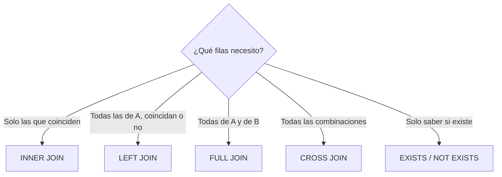

# JOINs

Parte de: [[06-SQL-Server/01 Básico/_Índice Básico|Básico]]

> [!info] Cómo avanzar
> `progreso`: **pendiente** → **viendo** (estudiando) → **visto** (contestaste la autoevaluación sin abrir las respuestas) → **dominado** (hiciste el laboratorio o lo aplicaste de verdad).

## Contenido

### Qué es
Un **JOIN** combina filas de dos o más tablas según una condición, normalmente la relación entre una clave foránea y una primaria. Es la operación que "rearma" la información que la [[Normalización]] separó en tablas: el pedido está en una tabla, el cliente en otra y los renglones en una tercera. Esta nota da el panorama; cada tipo tiene su nota con detalle.

### Cómo funciona
Los tipos de JOIN en SQL Server:

| Tipo | Devuelve | Nota |
|---|---|---|
| `INNER JOIN` | Solo los pares que cumplen el `ON` | [[INNER JOIN]] |
| `LEFT [OUTER] JOIN` | Todas las filas de la izquierda; `NULL` a la derecha si no hay pareja | [[LEFT y RIGHT JOIN]] |
| `RIGHT [OUTER] JOIN` | Espejo del LEFT | [[LEFT y RIGHT JOIN]] |
| `FULL [OUTER] JOIN` | Todas las filas de ambos lados | [[FULL JOIN y CROSS JOIN]] |
| `CROSS JOIN` | Producto cartesiano, sin `ON` | [[FULL JOIN y CROSS JOIN]] |
| Self join | Una tabla unida consigo misma | [[Self join]] |
| `CROSS/OUTER APPLY` | JOIN contra una expresión que depende de cada fila | [[CROSS APPLY y OUTER APPLY]] |



**Cardinalidad**: el número de filas del resultado depende de la relación. Unir padre con hijo (1 a muchos) repite al padre una vez por hijo. Esto lleva al problema más importante de los JOIN:

**Fan-out**: si unes un padre con **dos tablas hijas distintas** a la vez, cada hijo de una se combina con cada hijo de la otra. Un cliente con 3 pedidos y 2 pagos produce 3 × 2 = 6 filas, y si sumas importes de pedidos sobre esas filas, el total sale **duplicado**. La solución es agregar cada hija por separado (en subconsultas o CTE) y luego unir los resultados ya agregados, que tienen una fila por cliente.

**Filtro en `ON` vs `WHERE`** en un `LEFT JOIN`:

- En el `ON`: decide **qué filas de la derecha se emparejan**; todas las de la izquierda siguen saliendo (con `NULL` si no hubo pareja que cumpla).
- En el `WHERE`: se aplica **después** del JOIN; si filtras una columna de la derecha, las filas con `NULL` se eliminan y el LEFT se comporta como INNER.

En un INNER JOIN ambas posiciones dan el mismo resultado.

### Ejemplo
Totales por cliente, incluyendo a todos los clientes y evitando el fan-out entre pedidos y renglones:

```sql
WITH ImportePorPedido AS (            -- 1) agregar el hijo primero
    SELECT d.PedidoId, SUM(d.Cantidad * d.PrecioUnitario) AS Importe
    FROM   ventas.PedidoDetalle d
    GROUP  BY d.PedidoId
)
SELECT c.ClienteId, c.Nombre,
       COUNT(p.PedidoId)          AS Pedidos,        -- COUNT(col) no cuenta los NULL del LEFT
       COALESCE(SUM(i.Importe), 0) AS Importe
FROM   ventas.Clientes c
LEFT   JOIN ventas.Pedidos p
       ON  p.ClienteId = c.ClienteId
       AND p.Estado <> 'Cancelado'                   -- 2) filtro en el ON: conserva clientes sin pedidos
LEFT   JOIN ImportePorPedido i ON i.PedidoId = p.PedidoId
GROUP  BY c.ClienteId, c.Nombre
ORDER  BY Importe DESC;
```

Si el filtro `p.Estado <> 'Cancelado'` se moviera al `WHERE`, desaparecerían los clientes sin pedidos (su `p.Estado` es `NULL`, y `NULL <> 'Cancelado'` no es verdadero).

Fan-out en acción (lo que **no** hay que hacer):

```sql
-- Cliente con pedidos Y pagos en el mismo JOIN: SUM inflado
SELECT c.ClienteId, SUM(p.Total) AS TotalPedidos, SUM(g.Monto) AS TotalPagos
FROM   ventas.Clientes c
JOIN   ventas.Pedidos p ON p.ClienteId = c.ClienteId
JOIN   ventas.Pagos   g ON g.ClienteId = c.ClienteId   -- cada pago se cruza con cada pedido
GROUP  BY c.ClienteId;
```

### Cuándo usarlo y cuándo no
- **JOIN** cuando necesitas columnas de varias tablas en el resultado.
- **`EXISTS` / `NOT EXISTS`** cuando solo filtras por la existencia de filas relacionadas (ver [[EXISTS vs IN]]).
- **Agrega antes de unir** cuando combines varias tablas hijas.
- En la API, una consulta con muchos JOIN para llenar un objeto complejo puede sustituirse por varias consultas con `QueryMultiple` de Dapper o por `FOR JSON` (ver [[JSON en SQL Server (OPENJSON y FOR JSON)]]).

### Errores comunes
1. **Fan-out** con dos hijas: totales multiplicados.
2. **Filtro de la tabla derecha en el `WHERE`** de un LEFT JOIN: lo convierte en INNER.
3. **`COUNT(*)` en un LEFT JOIN**: cuenta 1 para el cliente sin pedidos; usa `COUNT(p.PedidoId)`.
4. **Sintaxis de comas** sin condición: producto cartesiano accidental.
5. **Columnas sin alias** que se vuelven ambiguas cuando alguien agrega una columna con el mismo nombre a otra tabla.

### Para profundizar
- [Combinaciones (Joins) en SQL Server](https://learn.microsoft.com/sql/relational-databases/performance/joins)
- [FROM más JOIN, APPLY, PIVOT](https://learn.microsoft.com/sql/t-sql/queries/from-transact-sql)

## Ejercicios

Resuélvelos en papel o en la herramienta; la solución está plegada.

> [!question]- Con la base Tienda ([[Lab 1 - Base de práctica Tienda en SQL Server]]): total de cada pedido.
> ```sql
> SELECT p.PedidoId, SUM(d.Cantidad * d.PrecioUnitario) AS Total
> FROM   ventas.Pedidos p
> JOIN   ventas.PedidoDetalle d ON d.PedidoId = p.PedidoId
> GROUP  BY p.PedidoId
> ORDER  BY p.PedidoId;
> ```
> 1: 2100, 2: 18500, 3: 5650, 4: 1200, 5: 18450, 6: 2600, 7: 450, 8: 10000.

> [!question]- Por cliente: número de pedidos no cancelados e importe, de mayor a menor importe.
> ```sql
> SELECT c.Nombre,
>        COUNT(DISTINCT p.PedidoId)         AS Pedidos,
>        SUM(d.Cantidad * d.PrecioUnitario) AS Importe
> FROM   ventas.Clientes c
> JOIN   ventas.Pedidos p       ON p.ClienteId = c.ClienteId
> JOIN   ventas.PedidoDetalle d ON d.PedidoId  = p.PedidoId
> WHERE  p.Estado <> 'Cancelado'
> GROUP  BY c.ClienteId, c.Nombre
> ORDER  BY Importe DESC;
> ```
> Bruno 2 / 21100, Diego 1 / 18450, Elena 1 / 10000, Ana 3 / 8200.

> [!question]- Lo mismo, pero incluyendo a todos los clientes (con 0 si no tienen pedidos no cancelados).
> ```sql
> SELECT c.Nombre,
>        COUNT(DISTINCT p.PedidoId)                    AS Pedidos,
>        ISNULL(SUM(d.Cantidad * d.PrecioUnitario), 0) AS Importe
> FROM   ventas.Clientes c
> LEFT   JOIN ventas.Pedidos p
>        ON p.ClienteId = c.ClienteId AND p.Estado <> 'Cancelado'
> LEFT   JOIN ventas.PedidoDetalle d ON d.PedidoId = p.PedidoId
> GROUP  BY c.ClienteId, c.Nombre
> ORDER  BY Importe DESC;
> ```
> Carla y Fernando salen con 0. El filtro de estado va en el `ON`; en el `WHERE` los perderías.

## Autoevaluación

Contesta primero en voz alta o en papel; luego despliega la respuesta.

> [!question]- ¿Qué tipos de JOIN hay y qué devuelve cada uno?
> `INNER`: solo coincidencias. `LEFT`/`RIGHT`: todo un lado más coincidencias (con `NULL` donde no hay). `FULL`: todo de ambos lados. `CROSS`: producto cartesiano. *Self join*: una tabla consigo misma. Detalle en [[INNER JOIN]], [[LEFT y RIGHT JOIN]], [[FULL JOIN y CROSS JOIN]] y [[Self join]].

> [!question]- ¿Qué es el «fan-out» al unir una tabla padre con dos tablas hijas?
> Si unes `Pedidos` con `PedidoDetalle` (n renglones) y con `Pagos` (m pagos), cada pedido sale n × m veces y los `SUM` se inflan. Solución: agregar cada hija por separado (subconsulta o CTE) y luego unir.

> [!question]- En un `LEFT JOIN`, ¿qué diferencia hay entre poner un filtro de la tabla derecha en el `ON` o en el `WHERE`?
> En el `ON` solo limita qué filas de la derecha coinciden (la izquierda se conserva). En el `WHERE` descarta las filas donde la derecha es `NULL`, y el `LEFT JOIN` se vuelve en la práctica un `INNER JOIN`.

## Práctica

- [[Lab 2 - Consultas de agregación y JOINs en Tienda]]

