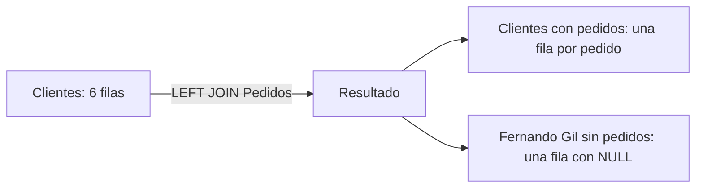

# LEFT y RIGHT JOIN

Parte de: [[06-SQL-Server/01 Básico/_Índice Básico|Básico]]

> [!info] Cómo avanzar
> `progreso`: **pendiente** → **viendo** (estudiando) → **visto** (contestaste la autoevaluación sin abrir las respuestas) → **dominado** (hiciste el laboratorio o lo aplicaste de verdad).

## Contenido

### Qué es
`LEFT [OUTER] JOIN` devuelve **todas las filas de la tabla izquierda** y, para cada una, las filas de la derecha que cumplan el `ON`; si no hay ninguna, la fila sale igual con **`NULL`** en todas las columnas de la derecha. `RIGHT JOIN` es el espejo: conserva todas las de la derecha. Sirven para listados completos ("todos los clientes, tengan o no pedidos") y para encontrar **lo que falta** ("productos que nunca se vendieron").

### Cómo funciona
1. Se toma cada fila de la izquierda.
2. Se buscan las filas de la derecha donde el `ON` sea verdadero.
3. Si hay coincidencias, sale una fila por cada una (como en [[INNER JOIN]]).
4. Si no hay, sale **una** fila con las columnas de la derecha en `NULL`.
5. Después se aplica el `WHERE`.

El paso 5 es la fuente del error más común: si el `WHERE` filtra una columna de la tabla derecha (`WHERE p.Estado = 'Entregado'`), las filas sin pareja tienen `p.Estado = NULL`, la condición no es verdadera y se eliminan. El LEFT JOIN se convierte en un INNER JOIN de facto. Las condiciones sobre la tabla derecha que solo deben limitar **qué se empareja** van en el `ON`.

**Anti join** (filas de A sin pareja en B): `LEFT JOIN B ... WHERE B.Clave IS NULL`. Hay que probar una columna de B que **nunca** sea `NULL` cuando sí hay pareja (su PK o la columna del `ON`). La alternativa equivalente y a menudo más clara es `NOT EXISTS`; ambas suelen generar el mismo plan (*Left Anti Semi Join*). Evita `NOT IN` con subconsultas que puedan devolver `NULL` (ver [[NULL y lógica de tres valores]]).

**RIGHT JOIN**: `A RIGHT JOIN B` es igual a `B LEFT JOIN A`. Casi nadie lo usa porque leer de izquierda a derecha "tabla principal primero" es más natural; reescríbelo como LEFT.



### Ejemplo
```sql
-- 1) Todos los productos con su total vendido (0 si no se ha vendido)
SELECT pr.ProductoId, pr.Nombre,
       COALESCE(SUM(d.Cantidad), 0) AS UnidadesVendidas
FROM   ventas.Productos pr
LEFT   JOIN ventas.PedidoDetalle d ON d.ProductoId = pr.ProductoId
GROUP  BY pr.ProductoId, pr.Nombre;

-- 2) Anti join: clientes sin ningún pedido entregado
SELECT c.ClienteId, c.Nombre
FROM   ventas.Clientes c
LEFT   JOIN ventas.Pedidos p
       ON  p.ClienteId = c.ClienteId
       AND p.Estado = 'Entregado'          -- el filtro va en el ON
WHERE  p.PedidoId IS NULL;                  -- sin pareja

-- Lo mismo con NOT EXISTS (misma intención, a menudo más legible)
SELECT c.ClienteId, c.Nombre
FROM   ventas.Clientes c
WHERE  NOT EXISTS (SELECT 1 FROM ventas.Pedidos p
                   WHERE p.ClienteId = c.ClienteId AND p.Estado = 'Entregado');

-- 3) El error: filtro de la derecha en el WHERE elimina a los clientes sin pedidos
SELECT c.Nombre, p.PedidoId
FROM   ventas.Clientes c
LEFT   JOIN ventas.Pedidos p ON p.ClienteId = c.ClienteId
WHERE  p.Estado = 'Entregado';             -- ahora es un INNER JOIN
```

En C#, las columnas que vienen del lado derecho de un LEFT JOIN deben mapearse a tipos **anulables** (`int?`, `DateOnly?`, `string?`), porque Dapper recibirá `NULL` para los clientes sin pedidos:

```csharp
public sealed record ClienteUltimoPedido(int ClienteId, string Nombre, DateTime? UltimoPedido);
```

### Cuándo usarlo y cuándo no
- **LEFT JOIN** para catálogos completos con datos opcionales, reportes que deben mostrar ceros y para detectar faltantes.
- **INNER JOIN** si la fila no tiene sentido sin la relación; un LEFT innecesario puede limitar al optimizador.
- **`NOT EXISTS`** para anti joins cuando no necesitas columnas de la derecha.
- **OUTER APPLY** cuando quieres "el último pedido de cada cliente" con varias columnas de ese pedido (ver [[CROSS APPLY y OUTER APPLY]]).

### Errores comunes
1. **Filtro de la derecha en el `WHERE`**: convierte el LEFT en INNER. Muévelo al `ON`.
2. **Probar `IS NULL` en una columna anulable** de la derecha en un anti join: confundes "sin pareja" con "pareja con valor NULL". Usa la PK.
3. **`COUNT(*)` tras un LEFT JOIN**: cuenta 1 en vez de 0 para las filas sin pareja; usa `COUNT(columna_derecha)`.
4. **Encadenar un `INNER JOIN` después de un LEFT** sobre la tabla opcional (`LEFT JOIN Pedidos p ... JOIN Detalle d ON d.PedidoId = p.PedidoId`): elimina otra vez las filas sin pareja. Usa LEFT también en la segunda o agrupa con paréntesis.
5. **Mapear a tipos no anulables** en C# y recibir excepciones de conversión.

### Para profundizar
- [Combinaciones (Joins): combinaciones externas](https://learn.microsoft.com/sql/relational-databases/performance/joins)
- [FROM más JOIN (Transact-SQL)](https://learn.microsoft.com/sql/t-sql/queries/from-transact-sql)
- [EXISTS (Transact-SQL)](https://learn.microsoft.com/sql/t-sql/language-elements/exists-transact-sql)

## Ejercicios

Resuélvelos en papel o en la herramienta; la solución está plegada.

> [!question]- Con la base Tienda ([[Lab 1 - Base de práctica Tienda en SQL Server]]): clientes que nunca han hecho un pedido.
> ```sql
> SELECT c.Nombre
> FROM   ventas.Clientes c
> LEFT   JOIN ventas.Pedidos p ON p.ClienteId = c.ClienteId
> WHERE  p.PedidoId IS NULL;
> ```
> Fernando Gil.

> [!question]- Productos que nunca se han vendido.
> ```sql
> SELECT pr.Nombre
> FROM   ventas.Productos pr
> LEFT   JOIN ventas.PedidoDetalle d ON d.ProductoId = pr.ProductoId
> WHERE  d.PedidoId IS NULL;
> ```
> Webcam HD.

> [!question]- Cada cliente con la fecha de su último pedido (o `NULL`).
> ```sql
> SELECT c.Nombre, MAX(p.Fecha) AS UltimoPedido
> FROM   ventas.Clientes c
> LEFT   JOIN ventas.Pedidos p ON p.ClienteId = c.ClienteId
> GROUP  BY c.ClienteId, c.Nombre;
> ```
> Ana 2025-03-20, Bruno 2025-03-15, Carla 2025-02-14, Diego 2025-03-01, Elena 2025-04-02, Fernando `NULL`.

## Autoevaluación

Contesta primero en voz alta o en papel; luego despliega la respuesta.

> [!question]- ¿Qué devuelve `A LEFT JOIN B`?
> Todas las filas de `A`; las columnas de `B` vienen con valores si hay coincidencia o `NULL` si no. `A RIGHT JOIN B` es lo mismo con los lados invertidos; por legibilidad casi siempre se reescribe como `LEFT`.

> [!question]- ¿Cómo encuentras filas de A que **no** tienen pareja en B con un `LEFT JOIN`?
> `LEFT JOIN B ON ... WHERE B.Clave IS NULL` (usa una columna de B que no admita `NULL`, como la PK). Alternativa equivalente y a menudo más clara: `NOT EXISTS`.

> [!question]- Error común: `LEFT JOIN ventas.Pedidos p ON ... WHERE p.Estado = 'Entregado'`. ¿Qué pasa con los clientes sin pedidos?
> Desaparecen: para ellos `p.Estado` es `NULL` y el `WHERE` los descarta. Mueve la condición al `ON` si quieres conservarlos.

## Práctica

- [[Lab 2 - Consultas de agregación y JOINs en Tienda]]

