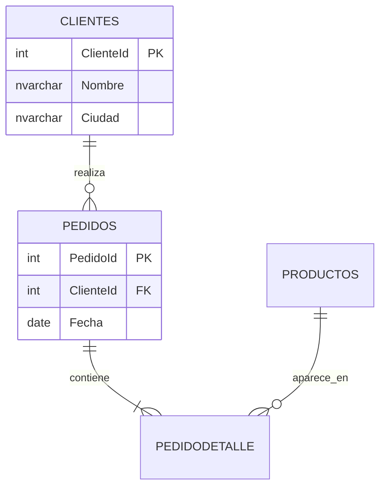

# Modelo relacional

Parte de: [[06-SQL-Server/01 Básico/_Índice Básico|Básico]]

> [!info] Cómo avanzar
> `progreso`: **pendiente** → **viendo** (estudiando) → **visto** (contestaste la autoevaluación sin abrir las respuestas) → **dominado** (hiciste el laboratorio o lo aplicaste de verdad).

## Contenido

### Qué es
El **modelo relacional**, propuesto por Edgar F. Codd en 1970, organiza los datos en **relaciones** (tablas) formadas por **tuplas** (filas) y **atributos** (columnas), y define cómo consultarlas con operaciones de álgebra de conjuntos. SQL Server, PostgreSQL y casi todas las bases transaccionales se basan en él. Entenderlo explica por qué SQL se comporta como se comporta: sin orden implícito, con claves, con operaciones sobre conjuntos completos.

### Cómo funciona
**Conceptos**:

- **Relación (tabla)**: un conjunto de tuplas con la misma estructura. Matemáticamente es un *conjunto*, así que no tiene orden y no debería tener tuplas repetidas.
- **Tupla (fila)**: un hecho concreto: "el cliente 1 se llama Ana López y vive en Guadalajara".
- **Atributo (columna)**: una propiedad con nombre y **dominio** (el tipo y los valores válidos, como `decimal(10,2) >= 0`).
- **Grado y cardinalidad**: número de atributos y número de tuplas.

**Claves**:

- **Superclave**: cualquier conjunto de atributos que identifica una tupla de forma única.
- **Clave candidata**: una superclave **mínima** (si quitas un atributo, ya no es única). Una tabla puede tener varias: `ClienteId`, `Rfc`, `Correo`.
- **Clave primaria**: la candidata **elegida** como identificador principal. Las demás candidatas se protegen con `UNIQUE` (ver [[UNIQUE, CHECK y DEFAULT]]).
- **Clave foránea**: atributos de una relación que hacen referencia a una clave de otra; expresan las relaciones entre tablas (ver [[Claves primarias y foráneas]]).

**Integridad**: de entidad (la PK no es nula ni repetida), referencial (toda FK apunta a algo que existe) y de dominio (los valores respetan tipo y reglas).

**Operaciones** (álgebra relacional) y su equivalente en SQL:

| Operación | SQL |
|---|---|
| Selección (filtrar tuplas) | `WHERE` |
| Proyección (elegir atributos) | lista del `SELECT` |
| Producto cartesiano | `CROSS JOIN` |
| Join | `JOIN ... ON` |
| Unión, intersección, diferencia | `UNION`, `INTERSECT`, `EXCEPT` |

Cada operación toma relaciones y devuelve una relación; por eso puedes anidar consultas.

**Declarativo**: en SQL describes **qué** resultado quieres, no **cómo** obtenerlo. El optimizador decide el orden de los JOIN, qué índices usar y qué algoritmo aplicar. Esa separación permite que la misma consulta siga siendo correcta cuando agregas un índice o crecen los datos: solo cambia el plan. Ver [[Planes de ejecución]].



### Ejemplo
**El orden no está garantizado**: como una tabla es un conjunto, `SELECT * FROM ventas.Clientes` sin `ORDER BY` puede devolver las filas en cualquier orden. Hoy salen por `ClienteId` porque el motor recorre el índice clustered, pero con paralelismo, otro índice o páginas en caché pueden salir distinto. La única garantía es un `ORDER BY` explícito y determinista.

```sql
-- No garantizado: el orden depende del plan
SELECT ClienteId, Nombre FROM ventas.Clientes;

-- Garantizado
SELECT ClienteId, Nombre FROM ventas.Clientes ORDER BY Nombre, ClienteId;

-- Pensar en conjuntos: un UPDATE para todas las filas en vez de un ciclo fila por fila
UPDATE ventas.Productos SET Precio = Precio * 1.05 WHERE Categoria = N'Accesorios';
```

Pensar en conjuntos también aplica a la API: en lugar de llamar a la base una vez por cada renglón de un pedido desde C#, envía todos los renglones juntos (TVP o JSON) y deja que una sola instrucción los procese. Ver [[Cursores y por qué evitarlos]].

### Cuándo usarlo y cuándo no
- **El modelo relacional es la opción por defecto** para datos transaccionales con relaciones, reglas de integridad y consultas variadas (lo que hacen Dionisio, Hecate y Nomisma).
- **Otros modelos** (documentos, clave-valor, grafos) encajan mejor cuando el acceso es siempre por una clave, la estructura cambia mucho o las relaciones son el dato principal. Ver [[Modelado en NoSQL]].
- SQL no es 100 % relacional: permite duplicados (sin PK o con `SELECT` sin `DISTINCT`), `NULL` y orden con `ORDER BY`. Conocer el modelo te ayuda a usarlo como si lo fuera.

### Errores comunes
1. **Asumir orden** sin `ORDER BY` (paginación, "el primero que salga").
2. **Tablas sin clave**: permiten duplicados y no hay forma confiable de referirse a una fila.
3. **Pensar fila por fila** (cursores, ciclos en C# con una consulta por elemento) en lugar de en conjuntos.
4. **Confundir clave candidata con primaria**: el correo puede ser único (candidata con `UNIQUE`) sin ser el identificador que usan las FK.
5. **Atributos con varios valores** (listas separadas por comas): rompen el concepto de dominio atómico; ver [[Normalización]].

### Para profundizar
- [Codd, "A Relational Model of Data for Large Shared Data Banks" (ACM, 1970)](https://dl.acm.org/doi/10.1145/362384.362685)
- [Tablas en SQL Server (Microsoft Learn)](https://learn.microsoft.com/sql/relational-databases/tables/tables)
- [SELECT - ORDER BY: orden no garantizado sin ORDER BY](https://learn.microsoft.com/sql/t-sql/queries/select-order-by-clause-transact-sql)

## Autoevaluación

Contesta primero en voz alta o en papel; luego despliega la respuesta.

> [!question]- ¿Qué es una relación (tabla), una tupla (fila) y un atributo (columna) en el modelo relacional?
> Una **relación** es un conjunto de tuplas con los mismos atributos; cada **tupla** es un hecho (un cliente) y cada **atributo** tiene un dominio (tipo y reglas). En SQL: tabla, fila y columna.

> [!question]- ¿Qué diferencia hay entre clave candidata, clave primaria y clave foránea?
> **Candidata**: cualquier conjunto mínimo de columnas que identifica una fila (p. ej. `ClienteId` y también `Email`). **Primaria**: la candidata que eliges como identificador oficial. **Foránea**: columna que apunta a la clave de otra tabla y garantiza integridad referencial.

> [!question]- Si haces `SELECT * FROM ventas.Clientes` dos veces sin `ORDER BY`, ¿está garantizado el orden?
> No. En el modelo relacional una tabla es un conjunto sin orden. SQL Server suele devolver el orden del índice que lea, pero puede cambiar con otro plan, paralelismo o datos nuevos. Si te importa el orden, usa `ORDER BY`.

> [!question]- ¿Por qué se dice que el modelo relacional separa el *qué* del *cómo*?
> Escribes **qué** datos quieres (consulta declarativa) y el optimizador decide **cómo** obtenerlos (índices, orden de joins, algoritmos). Por eso la misma consulta puede mejorar solo con agregar un índice.

## Práctica

- [[Lab 1 - Base de práctica Tienda en SQL Server]]

