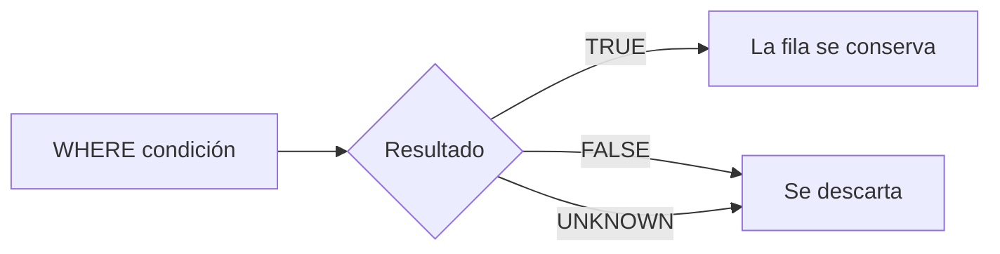

# NULL y lógica de tres valores

Parte de: [[06-SQL-Server/01 Básico/_Índice Básico|Básico]]

> [!info] Cómo avanzar
> `progreso`: **pendiente** → **viendo** (estudiando) → **visto** (contestaste la autoevaluación sin abrir las respuestas) → **dominado** (hiciste el laboratorio o lo aplicaste de verdad).

## Contenido

### Qué es
`NULL` representa un valor **desconocido o inexistente** (un cliente sin ciudad registrada). No es cero, ni cadena vacía, ni falso. Como no se sabe qué es, comparar cualquier cosa con `NULL` no da verdadero ni falso, sino **UNKNOWN** (desconocido). Por eso SQL usa una **lógica de tres valores**: TRUE, FALSE y UNKNOWN. Entenderla evita algunos de los errores más silenciosos de SQL.

### Cómo funciona
**Comparaciones**: `NULL = NULL`, `NULL <> 5`, `Ciudad = NULL` dan UNKNOWN. Para preguntar por `NULL` se usa `IS NULL` / `IS NOT NULL`. En SQL Server 2022 existe `a IS [NOT] DISTINCT FROM b`, que trata dos `NULL` como iguales.

**Filtros**: `WHERE`, `HAVING` y el `ON` de un JOIN solo conservan filas donde la condición es **TRUE**; UNKNOWN se descarta igual que FALSE. En cambio, una restricción `CHECK` **rechaza solo FALSE**: UNKNOWN pasa (por eso `CHECK (Precio >= 0)` acepta `NULL`).

**Tablas de verdad**:

| AND | TRUE | FALSE | UNKNOWN |
|---|---|---|---|
| TRUE | TRUE | FALSE | UNKNOWN |
| FALSE | FALSE | FALSE | FALSE |
| UNKNOWN | UNKNOWN | FALSE | UNKNOWN |

`TRUE OR UNKNOWN` es TRUE; `FALSE OR UNKNOWN` es UNKNOWN; `NOT UNKNOWN` sigue siendo UNKNOWN.

**Consecuencias prácticas**:

- `WHERE Ciudad <> N'CDMX'` **no** devuelve a quienes tienen `Ciudad = NULL`. Si los quieres, agrega `OR Ciudad IS NULL`.
- **La trampa de `NOT IN`**: `x NOT IN (1, 2, NULL)` equivale a `x <> 1 AND x <> 2 AND x <> NULL`; el último término es UNKNOWN, así que la condición completa nunca es TRUE y la consulta devuelve **cero filas**. Si la subconsulta de un `NOT IN` puede traer un `NULL`, todo se vacía. Usa `NOT EXISTS`, que no tiene este problema.
- **Agregados**: `COUNT(*)` cuenta filas; `COUNT(col)`, `SUM`, `AVG`, `MIN`, `MAX` ignoran `NULL`.
- **Agrupar y ordenar**: `GROUP BY` y `DISTINCT` juntan todos los `NULL` en un grupo; en `ORDER BY ASC`, SQL Server pone los `NULL` primero.
- **Aritmética y concatenación**: `NULL + 1` y `N'a' + NULL` dan `NULL`.

**Sustituir `NULL`**:

- `ISNULL(expr, reemplazo)`: propietaria de T-SQL, **dos** argumentos, el resultado toma el **tipo del primero** (si el primero es `varchar(5)`, un reemplazo más largo se trunca).
- `COALESCE(a, b, c, ...)`: estándar ANSI, **varios** argumentos, devuelve el primero no nulo y el tipo se decide por precedencia entre todos. Internamente es un `CASE`.
- `NULLIF(a, b)`: devuelve `NULL` si son iguales; útil para evitar división entre cero: `x / NULLIF(y, 0)`.



### Ejemplo
```sql
-- Conteos: filas, valores no nulos, valores distintos
SELECT COUNT(*) AS Filas, COUNT(Ciudad) AS ConCiudad, COUNT(DISTINCT Ciudad) AS CiudadesDistintas
FROM   ventas.Clientes;

-- Desigualdad que sí incluye los NULL
SELECT Nombre, Ciudad
FROM   ventas.Clientes
WHERE  Ciudad <> N'Guadalajara' OR Ciudad IS NULL;
-- SQL Server 2022: WHERE Ciudad IS DISTINCT FROM N'Guadalajara'

-- NOT IN vs NOT EXISTS con una lista que contiene NULL
DECLARE @Excluir TABLE (Ciudad nvarchar(60) NULL);
INSERT INTO @Excluir VALUES (N'CDMX'), (NULL);

SELECT Nombre FROM ventas.Clientes
WHERE  Ciudad NOT IN (SELECT Ciudad FROM @Excluir);     -- 0 filas

SELECT c.Nombre FROM ventas.Clientes c
WHERE  NOT EXISTS (SELECT 1 FROM @Excluir e WHERE e.Ciudad = c.Ciudad);  -- incluye a Elena Soto

-- ISNULL trunca al tipo del primer argumento; COALESCE no
DECLARE @corto varchar(3) = NULL;
SELECT ISNULL(@corto, 'desconocido') AS ConIsNull,   -- 'des'
       COALESCE(@corto, 'desconocido') AS ConCoalesce; -- 'desconocido'
```

En C#, una columna que admite `NULL` se mapea con Dapper a un tipo anulable (`string?`, `int?`). Con *nullable reference types* activados, el compilador te obliga a manejarlo, y así el `NULL` de la base no se convierte en un `NullReferenceException` en la API.

### Cuándo usarlo y cuándo no
- **Permite `NULL`** solo cuando "no se sabe" o "no aplica" es un estado real (fecha de baja de un empleado activo).
- **Prefiere `NOT NULL` con `DEFAULT`** para banderas, contadores e importes: simplifica consultas y evita la lógica de tres valores.
- **No uses valores mágicos** (`'1900-01-01'`, `-1`) para representar "desconocido"; confunden agregados y reportes.

### Errores comunes
1. **`WHERE col = NULL`**: nunca devuelve filas. Usa `IS NULL`.
2. **`NOT IN` con subconsulta que trae `NULL`**: resultado vacío. Usa `NOT EXISTS`.
3. **Olvidar los `NULL` en `<>`**: desaparecen filas de los reportes de "todo menos X".
4. **`ISNULL` con tipos distintos**: truncamiento silencioso.
5. **Sumar o concatenar sin `COALESCE`** y obtener totales o textos en `NULL`.

### Para profundizar
- [NULL y UNKNOWN (Transact-SQL)](https://learn.microsoft.com/sql/t-sql/language-elements/null-and-unknown-transact-sql)
- [COALESCE (Transact-SQL)](https://learn.microsoft.com/sql/t-sql/language-elements/coalesce-transact-sql)
- [ISNULL (Transact-SQL)](https://learn.microsoft.com/sql/t-sql/functions/isnull-transact-sql)
- [IS [NOT] DISTINCT FROM](https://learn.microsoft.com/sql/t-sql/queries/is-distinct-from-transact-sql)

## Ejercicios

Resuélvelos en papel o en la herramienta; la solución está plegada.

> [!question]- Con la base Tienda ([[Lab 1 - Base de práctica Tienda en SQL Server]]): ¿qué devuelve `SELECT COUNT(*), COUNT(Ciudad), COUNT(DISTINCT Ciudad) FROM ventas.Clientes`?
> `6, 5, 3`: 6 clientes, 5 con ciudad (Elena no tiene) y 3 ciudades distintas.

> [!question]- ¿Qué clientes devuelve `WHERE Ciudad NOT IN (N'CDMX')`? ¿Aparece Elena Soto? Corrige la consulta para que sí aparezca.
> Devuelve Ana, Bruno y Carla. Elena **no** aparece: `NULL <> 'CDMX'` es UNKNOWN.
> ```sql
> SELECT Nombre FROM ventas.Clientes
> WHERE  Ciudad NOT IN (N'CDMX') OR Ciudad IS NULL;
> ```

> [!question]- Muestra cada cliente con su ciudad, o el texto `(sin ciudad)` si es `NULL`.
> ```sql
> SELECT Nombre, COALESCE(Ciudad, N'(sin ciudad)') AS Ciudad
> FROM   ventas.Clientes;
> ```

## Autoevaluación

Contesta primero en voz alta o en papel; luego despliega la respuesta.

> [!question]- ¿Qué devuelve `WHERE Ciudad = NULL`?
> Ninguna fila: cualquier comparación con `NULL` da **UNKNOWN**, y el `WHERE` solo deja pasar TRUE. Usa `IS NULL` / `IS NOT NULL`.

> [!question]- ¿Por qué `WHERE ProductoId NOT IN (SELECT ProductoId FROM t)` puede devolver cero filas aunque haya productos que no están en `t`?
> Si la subconsulta contiene un `NULL`, `x NOT IN (1, 2, NULL)` equivale a `x<>1 AND x<>2 AND x<>NULL`, y lo último es UNKNOWN: nada pasa. Usa `NOT EXISTS`, que no tiene esa trampa.

> [!question]- ¿Qué diferencia hay entre `ISNULL` y `COALESCE`?
> `ISNULL(a, b)` acepta dos argumentos y devuelve el tipo de `a` (puede truncar `b`). `COALESCE(a, b, c...)` es estándar, acepta varios y usa la precedencia de tipos. Ej.: `ISNULL(CAST(NULL AS varchar(2)), 'abc')` devuelve `'ab'`.

> [!question]- `COUNT(*)` vs `COUNT(Ciudad)`: ¿cuál cuenta los `NULL`?
> `COUNT(*)` cuenta filas (incluye `NULL`); `COUNT(columna)` ignora los `NULL`. Lo mismo para `SUM`, `AVG`, `MIN` y `MAX`: ignoran `NULL`.

## Práctica

- [[Lab 2 - Consultas de agregación y JOINs en Tienda]]

