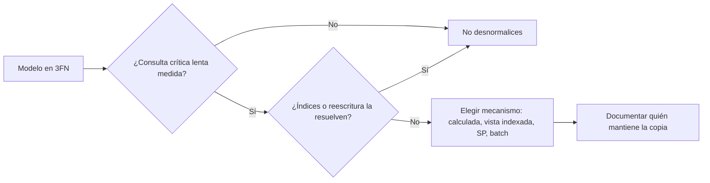

# Desnormalización deliberada

Parte de: [[Normalización]]

> [!info] Cómo avanzar
> `progreso`: **pendiente** → **viendo** (estudiando) → **visto** (contestaste la autoevaluación sin abrir las respuestas) → **dominado** (hiciste el laboratorio o lo aplicaste de verdad).

## Contenido

### Qué es
**Desnormalizar deliberadamente** es introducir redundancia **a propósito y de forma controlada** en un modelo que ya está normalizado, para ganar rendimiento de lectura o simplificar consultas críticas. La palabra clave es *deliberada*: se parte de un diseño en 3FN (ver [[Normalización]]), se mide un problema concreto y se acepta un costo conocido (mantener copias sincronizadas) a cambio de un beneficio medido.

### Cómo funciona
Formas comunes de desnormalizar:

1. **Columnas derivadas**: guardar un total o un contador (`Pedidos.Total`, `Clientes.NumeroPedidos`) en lugar de calcularlo con un `SUM` o `COUNT` cada vez.
2. **Columnas copiadas**: llevar el nombre del cliente al pedido para evitar un JOIN en un listado muy consultado.
3. **Tablas de resumen**: ventas por día y producto precalculadas para dashboards.
4. **Modelos de lectura**: tablas o documentos diseñados para una pantalla específica (patrón CQRS).

Lo importante es **quién mantiene la copia consistente**. De mejor a peor:

| Mecanismo | Quién lo mantiene | Consistencia |
|---|---|---|
| **Columna calculada** (`AS expr`, opcionalmente `PERSISTED`) | El motor, al escribir | Siempre correcta; solo usa columnas de la misma fila |
| **Vista indexada** (`WITH SCHEMABINDING` + índice clustered único) | El motor, en cada `INSERT/UPDATE/DELETE` de las tablas base | Siempre correcta; agrega costo a las escrituras |
| **FK compuesta sobre la copia** | El motor valida que la copia coincida | Correcta, pero hay que actualizar ambos lados |
| **Lógica en el procedimiento** dentro de la misma transacción | Tu código | Correcta si todo cambio pasa por ese procedimiento |
| **Trigger** | Código oculto en la tabla | Correcta, pero difícil de seguir y depurar |
| **Proceso batch** (job nocturno, ETL) | Un proceso externo | Eventualmente consistente; datos "con retraso" |

Una **vista indexada** materializa el resultado de una consulta con agregados y el optimizador puede usarla automáticamente en Enterprise/Azure SQL (en otras ediciones, con `WITH (NOEXPAND)`). Requiere `COUNT_BIG(*)` si hay `GROUP BY` y no admite `LEFT JOIN`, `DISTINCT` ni varias otras construcciones.



### Ejemplo
Dashboard de Itzamna.Clio que muestra ventas por producto y se consulta cientos de veces por minuto:

```sql
-- Vista indexada: el motor mantiene el resumen al día
CREATE OR ALTER VIEW ventas.vVentasPorProducto
WITH SCHEMABINDING
AS
SELECT d.ProductoId,
       SUM(d.Cantidad)                    AS Unidades,
       SUM(d.Cantidad * d.PrecioUnitario) AS Importe,
       COUNT_BIG(*)                       AS Renglones   -- obligatorio con GROUP BY
FROM   ventas.PedidoDetalle AS d
GROUP  BY d.ProductoId;
GO
CREATE UNIQUE CLUSTERED INDEX IXV_VentasPorProducto ON ventas.vVentasPorProducto (ProductoId);
GO
-- Lectura barata (NOEXPAND fuerza usar el índice en ediciones distintas de Enterprise)
SELECT ProductoId, Unidades, Importe
FROM   ventas.vVentasPorProducto WITH (NOEXPAND);

-- Copia mantenida por el procedimiento en la misma transacción
-- (Pedidos.Total actualizado cada vez que cambia un renglón)
UPDATE p
SET    p.Total = x.Total
FROM   ventas.Pedidos p
CROSS  APPLY (SELECT SUM(Cantidad * PrecioUnitario) AS Total
              FROM ventas.PedidoDetalle d WHERE d.PedidoId = p.PedidoId) x
WHERE  p.PedidoId = @PedidoId;
```

El costo: cada `INSERT` en `PedidoDetalle` ahora también actualiza la vista indexada, así que las escrituras son algo más lentas y pueden generar más bloqueos sobre la fila del resumen de ese producto.

### Cuándo usarlo y cuándo no
**Sí**, cuando:

- Una lectura crítica y frecuente sigue lenta después de índices y reescritura.
- El dato es mayormente de lectura y cambia poco.
- Es **historia inmutable** (no es realmente redundancia; ver [[Snapshot inmutable versionado]]).
- Es un modelo analítico (Power BI, data mart).

**No**, cuando:

- No has medido el problema con planes de ejecución y Query Store (ver [[Planes de ejecución]]).
- La tabla tiene muchas escrituras concurrentes: la copia se vuelve un punto de contención.
- No hay un mecanismo claro que mantenga la copia: tarde o temprano habrá datos contradictorios.
- Solo te ahorra un JOIN sencillo con buenos índices.

### Errores comunes
1. **Desnormalizar por intuición** sin evidencia de rendimiento.
2. **Copias sin dueño**: nadie recuerda actualizar `Clientes.NumeroPedidos` en un nuevo flujo.
3. **Contadores calientes**: una sola fila de resumen que actualizan todas las transacciones, causando bloqueos.
4. **Triggers escondidos** que hacen lenta cada escritura y sorprenden en depuración.
5. **No documentar** en el script de migración qué es copia y de dónde viene.

### Para profundizar
- [Crear vistas indexadas](https://learn.microsoft.com/sql/relational-databases/views/create-indexed-views)
- [Columnas calculadas](https://learn.microsoft.com/sql/relational-databases/tables/specify-computed-columns-in-a-table)

## Autoevaluación

Contesta primero en voz alta o en papel; luego despliega la respuesta.

> [!question]- ¿Qué es desnormalizar deliberadamente?
> Duplicar o precalcular datos **a propósito** para acelerar lecturas o simplificar consultas, aceptando el costo de mantenerlos consistentes. Ejemplos: totales precalculados, tablas de reporte, un documento JSON publicado ([[Snapshot inmutable versionado]]).

> [!question]- ¿Qué mecanismos de SQL Server te ayudan a desnormalizar sin perder consistencia?
> Columnas calculadas `PERSISTED`, vistas indexadas (el motor mantiene el resultado), índices cubrientes y tablas de reporte llenadas por un proceso ETL o por la misma transacción que escribe.

> [!question]- ¿Cuándo **no** deberías desnormalizar?
> Cuando no has medido un problema de rendimiento real, cuando un índice resuelve lo mismo, o cuando no tienes un mecanismo claro para mantener la copia sincronizada (acabarías con datos contradictorios).

