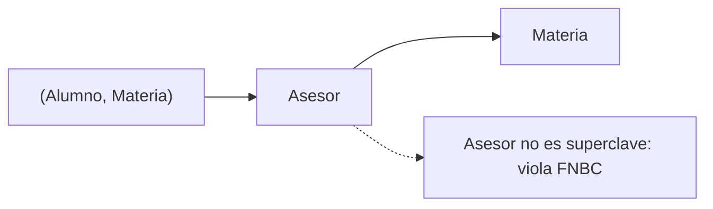

# Forma normal de Boyce-Codd (FNBC)

Parte de: [[Normalización]]

> [!info] Cómo avanzar
> `progreso`: **pendiente** → **viendo** (estudiando) → **visto** (contestaste la autoevaluación sin abrir las respuestas) → **dominado** (hiciste el laboratorio o lo aplicaste de verdad).

## Contenido

### Qué es
La **forma normal de Boyce-Codd (FNBC o BCNF)** es una versión más estricta de la [[Tercera forma normal (3FN)]]. Exige que, para **toda** dependencia funcional `X → Y` no trivial de la tabla, `X` sea una **superclave** (es decir, que identifique filas de forma única). En palabras simples: *cualquier cosa que determine a otra debe ser una clave*.

### Cómo funciona
**Qué agrega sobre la 3FN**: la 3FN permite una excepción: una dependencia `X → Y` está bien si `Y` forma parte de alguna clave candidata, aunque `X` no sea clave. Esa excepción solo importa cuando la tabla tiene **varias claves candidatas compuestas que se traslapan** (comparten columnas). La FNBC elimina la excepción: el determinante tiene que ser clave, sin importar qué determina. En tablas con una sola clave candidata, 3FN y FNBC son lo mismo, por eso casi nunca se notan diferencias.

**Ejemplo clásico: asesorías**.

Reglas del negocio:

- Un alumno toma una materia con **un solo** asesor: `(Alumno, Materia) → Asesor`.
- Cada asesor imparte **una sola** materia: `Asesor → Materia`.
- Una materia tiene varios asesores.

Tabla: `Asesorias(Alumno, Materia, Asesor)`.

Claves candidatas: `(Alumno, Materia)` y `(Alumno, Asesor)`. Todos los atributos son parte de alguna clave (atributos primos), así que la tabla **está en 3FN**. Pero la dependencia `Asesor → Materia` tiene como determinante a `Asesor`, que **no es superclave** (un asesor tiene muchos alumnos). La tabla **no está en FNBC**.

Anomalías: la materia que imparte cada asesor se repite en cada alumno; si un asesor cambia de materia hay que actualizar muchas filas; y no puedes registrar un asesor nuevo sin alumnos.

**Descomposición a FNBC**:

- `AsesorMateria(Asesor PK, Materia)`
- `AlumnoAsesor(Alumno, Asesor)` con PK `(Alumno, Asesor)`

**El costo**: la regla original "un alumno tiene un solo asesor por materia" ya no se puede expresar con una simple restricción `UNIQUE` en una tabla, porque `Materia` y `Alumno` quedaron en tablas distintas. Hay que validarla con un trigger, una vista indexada o en la lógica del procedimiento. Esto se llama perder la **preservación de dependencias**, y es la razón por la que la FNBC no siempre conviene.



### Ejemplo
```sql
-- En 3FN pero no en FNBC
CREATE TABLE escuela.Asesorias (
    Alumno  int NOT NULL,
    Materia varchar(20) NOT NULL,
    Asesor  int NOT NULL,
    CONSTRAINT PK_Asesorias PRIMARY KEY (Alumno, Materia),
    CONSTRAINT UQ_Asesorias_AlumnoAsesor UNIQUE (Alumno, Asesor)
);

-- Descomposición en FNBC
CREATE TABLE escuela.AsesorMateria (
    Asesor  int NOT NULL CONSTRAINT PK_AsesorMateria PRIMARY KEY,
    Materia varchar(20) NOT NULL,
    CONSTRAINT UQ_AsesorMateria UNIQUE (Asesor, Materia)      -- para poder referenciar la pareja
);
CREATE TABLE escuela.AlumnoAsesor (
    Alumno  int NOT NULL,
    Asesor  int NOT NULL,
    Materia varchar(20) NOT NULL,                              -- copia controlada por FK compuesta
    CONSTRAINT PK_AlumnoAsesor PRIMARY KEY (Alumno, Asesor),
    CONSTRAINT FK_AlumnoAsesor_AsesorMateria FOREIGN KEY (Asesor, Materia)
        REFERENCES escuela.AsesorMateria (Asesor, Materia),
    CONSTRAINT UQ_AlumnoAsesor_Materia UNIQUE (Alumno, Materia) -- recupera la regla original
);
```

La segunda versión muestra un truco práctico: repetir `Materia` en `AlumnoAsesor` **pero amarrada con una FK compuesta** a `(Asesor, Materia)`. La copia no puede contradecir al catálogo (la FK lo impide) y permite volver a declarar la regla con un `UNIQUE`. Es una desnormalización controlada por el motor.

### Cuándo usarlo y cuándo no
- **Busca FNBC** cuando detectes claves candidatas compuestas que se traslapan; es donde aparecen las anomalías que la 3FN no cubre.
- **Quédate en 3FN** si la descomposición a FNBC te obliga a perder una regla de negocio que antes era un simple `UNIQUE` y no hay una forma limpia de recuperarla.
- En la mayoría de los modelos de una API (tablas con clave sustituta `int` y pocas claves candidatas), 3FN ya es FNBC y no hay que hacer nada extra.

### Errores comunes
1. **Creer que 3FN y FNBC son siempre lo mismo**: difieren justo en las tablas con claves compuestas traslapadas.
2. **Descomponer sin revisar qué reglas se pierden**.
3. **No identificar todas las claves candidatas** antes de analizar dependencias.
4. **Usar un `Id` sustituto** y creer que eso resuelve la FNBC; las dependencias reales siguen existiendo.

### Para profundizar
- [Descripción de la normalización de bases de datos](https://learn.microsoft.com/office/troubleshoot/access/database-normalization-description)
- [Restricciones UNIQUE y CHECK](https://learn.microsoft.com/sql/relational-databases/tables/unique-constraints-and-check-constraints)

## Autoevaluación

Contesta primero en voz alta o en papel; luego despliega la respuesta.

> [!question]- ¿Qué agrega la FNBC sobre la 3FN?
> Exige que **todo determinante** sea una clave candidata. La 3FN permite excepciones cuando el atributo dependiente es parte de una clave candidata; la FNBC no.

> [!question]- Da un ejemplo de tabla en 3FN que no está en FNBC.
> `Asesorias(Alumno, Materia, Profesor)` con reglas «cada profesor da una sola materia» y «un alumno tiene un profesor por materia». Clave: `(Alumno, Materia)`. `Profesor → Materia`, pero `Profesor` no es clave. Se separa en `ProfesorMateria(Profesor, Materia)` y `AlumnoProfesor(Alumno, Profesor)`.

> [!question]- ¿Siempre conviene llegar a FNBC?
> No siempre: a veces la descomposición pierde la posibilidad de validar una regla con una sola restricción (no preserva dependencias). Es una decisión de diseño; en la mayoría de los modelos de negocio 3FN y FNBC coinciden.

