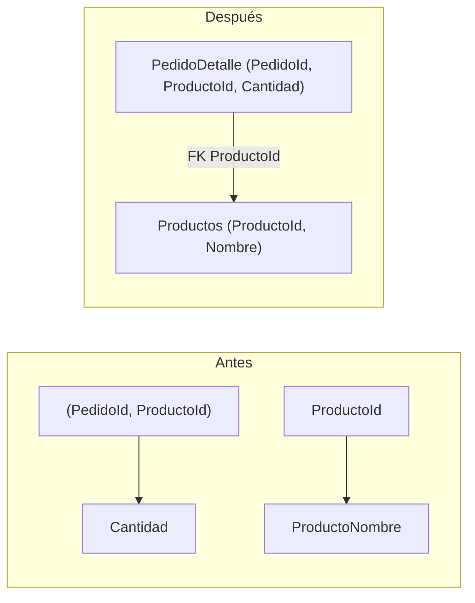

# Segunda forma normal (2FN)

Parte de: [[Normalización]]

> [!info] Cómo avanzar
> `progreso`: **pendiente** → **viendo** (estudiando) → **visto** (contestaste la autoevaluación sin abrir las respuestas) → **dominado** (hiciste el laboratorio o lo aplicaste de verdad).

## Contenido

### Qué es
Una tabla está en **segunda forma normal (2FN)** si está en [[Primera forma normal (1FN)]] y **ningún atributo que no sea parte de la clave depende solo de una parte de la clave**. Dicho de otro modo: con una clave compuesta, cada columna debe depender de la clave **completa**. Las violaciones se llaman **dependencias parciales**.

### Cómo funciona
Recuerda la dependencia funcional `A → B` ("conociendo A, conozco B"). Con una clave compuesta `(PedidoId, ProductoId)`:

- `Cantidad` depende de **ambas**: cuántas piezas de *este* producto en *este* pedido. Correcto.
- `ProductoNombre` depende **solo de `ProductoId`**: el nombre del teclado es el mismo en todos los pedidos. Dependencia parcial, viola 2FN.
- `FechaPedido` depende **solo de `PedidoId`**. También viola 2FN.

**Consecuencias**: el nombre del producto se repite en cada renglón donde aparece; si se corrige un error de dedo en el nombre, hay que actualizar miles de filas; y no hay dónde guardar un producto que aún no se ha vendido.

**Cómo corregir**: mueve cada atributo con dependencia parcial a una tabla cuya clave sea **la parte de la que depende**, y deja en la tabla original solo la FK.

**Dato clave**: si la clave primaria es de **una sola columna**, la tabla **no puede violar la 2FN**, porque no existe "una parte" de la clave. Puede tener otros problemas (dependencias transitivas, que trata la [[Tercera forma normal (3FN)]]), pero no dependencias parciales. Ojo: si una tabla con `Id` sustituto tiene además una clave candidata compuesta (`UNIQUE (PedidoId, ProductoId)`), el análisis se hace sobre esa clave candidata; agregar un `Id` no "arregla" la 2FN, solo la esconde.



### Ejemplo
```sql
-- Viola 2FN: ProductoNombre y Categoria dependen solo de ProductoId; Fecha solo de PedidoId
CREATE TABLE dbo.DetalleMal (
    PedidoId       int NOT NULL,
    ProductoId     int NOT NULL,
    Fecha          date NOT NULL,
    ProductoNombre nvarchar(100) NOT NULL,
    Categoria      nvarchar(50) NOT NULL,
    Cantidad       int NOT NULL,
    PrecioUnitario decimal(10,2) NOT NULL,
    PRIMARY KEY (PedidoId, ProductoId)
);

-- Corrección: cada atributo con la clave de la que depende
CREATE TABLE ventas.Productos (
    ProductoId int PRIMARY KEY,
    Nombre     nvarchar(100) NOT NULL UNIQUE,
    Categoria  nvarchar(50) NOT NULL
);
CREATE TABLE ventas.Pedidos (
    PedidoId int PRIMARY KEY,
    Fecha    date NOT NULL
);
CREATE TABLE ventas.PedidoDetalle (
    PedidoId       int NOT NULL REFERENCES ventas.Pedidos (PedidoId),
    ProductoId     int NOT NULL REFERENCES ventas.Productos (ProductoId),
    Cantidad       int NOT NULL,
    PrecioUnitario decimal(10,2) NOT NULL,   -- depende de la clave completa: precio de esa venta
    PRIMARY KEY (PedidoId, ProductoId)
);

-- Migrar datos desde la tabla mala
INSERT INTO ventas.Productos (ProductoId, Nombre, Categoria)
SELECT DISTINCT ProductoId, ProductoNombre, Categoria FROM dbo.DetalleMal;
```

El `SELECT DISTINCT` del final es una buena prueba: si un mismo `ProductoId` aparece con dos nombres distintos, el `INSERT` falla por la PK, y descubres exactamente la anomalía de actualización que la 2FN previene.

Observa que `PrecioUnitario` se queda en el detalle: no depende solo del producto, sino del producto *en ese pedido*.

### Cuándo usarlo y cuándo no
- **Revisa la 2FN en toda tabla con clave compuesta**: tablas de detalle, tablas puente de relaciones muchos a muchos (`UsuarioRol`), tablas de hechos por periodo.
- **Una tabla puente** (`UsuarioRol(UsuarioId, RolId, FechaAsignacion)`) con atributos que dependen de la pareja está bien; si aparece `NombreRol`, sobra.
- En reportes o exportaciones a Excel (Wee.Reporteria), una salida "aplanada" que repite nombres está bien: es el **resultado** de un JOIN, no la tabla donde se guardan los datos.

### Errores comunes
1. **Copiar el nombre o la descripción** del producto en el detalle "para no hacer JOIN".
2. **Creer que un `Id` sustituto resuelve la 2FN**: la dependencia sigue ahí respecto a la clave candidata real.
3. **Mover de más**: sacar `PrecioUnitario` al producto pensando que es dependencia parcial, perdiendo el precio histórico.
4. **No migrar con validación**: al separar tablas, no comprobar que los datos repetidos eran consistentes.

### Para profundizar
- [Descripción de la normalización de bases de datos](https://learn.microsoft.com/office/troubleshoot/access/database-normalization-description)
- [Restricciones de clave principal y externa](https://learn.microsoft.com/sql/relational-databases/tables/primary-and-foreign-key-constraints)

## Autoevaluación

Contesta primero en voz alta o en papel; luego despliega la respuesta.

> [!question]- ¿Qué exige la 2FN?
> Estar en 1FN y que ningún atributo no clave dependa de **solo una parte** de una clave compuesta (sin dependencias parciales).

> [!question]- Si una tabla tiene clave primaria de una sola columna, ¿puede violar la 2FN?
> No: las dependencias parciales solo existen con claves compuestas. Puede violar la 3FN, eso sí.

> [!question]- En `PedidoDetalle(PedidoId, ProductoId, Cantidad, ProductoNombre)`, ¿qué viola la 2FN y cómo se arregla?
> `ProductoNombre` depende solo de `ProductoId` (parte de la clave). Se elimina de la tabla y se obtiene con un join a `Productos`.

