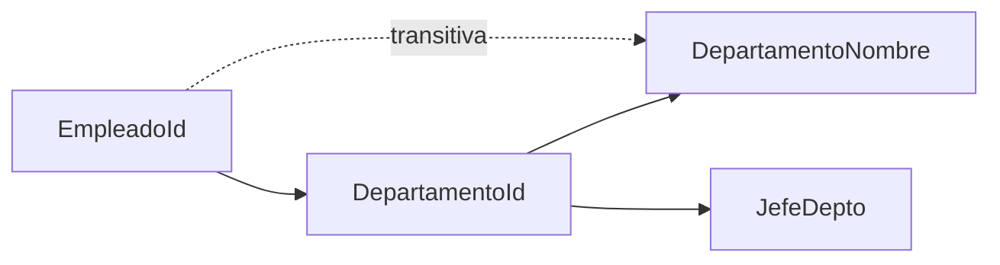

# Tercera forma normal (3FN)

Parte de: [[Normalización]]

> [!info] Cómo avanzar
> `progreso`: **pendiente** → **viendo** (estudiando) → **visto** (contestaste la autoevaluación sin abrir las respuestas) → **dominado** (hiciste el laboratorio o lo aplicaste de verdad).

## Contenido

### Qué es
Una tabla está en **tercera forma normal (3FN)** si está en [[Segunda forma normal (2FN)]] y **ningún atributo no clave depende de otro atributo no clave**. Las violaciones se llaman **dependencias transitivas**: `Clave → A → B`, donde B depende de la clave solo "a través" de A. La frase clásica que resume 1FN a 3FN: cada atributo depende *de la clave, de toda la clave y nada más que de la clave*.

### Cómo funciona
Ejemplo: `Empleados(EmpleadoId, Nombre, DepartamentoId, DepartamentoNombre, JefeDepto)`.

- `EmpleadoId → DepartamentoId` (cada empleado está en un departamento).
- `DepartamentoId → DepartamentoNombre, JefeDepto` (el departamento determina su nombre y su jefe).
- Por lo tanto `EmpleadoId → DepartamentoNombre` es **transitiva**.

Problemas: el nombre del departamento se repite en cada empleado; si cambia el jefe, hay que actualizar a todos sus empleados; si el último empleado se va, se pierde el departamento.

**Corrección**: mover los atributos que dependen de `DepartamentoId` a una tabla `Departamentos` con esa clave, y dejar solo la FK en `Empleados`.

**Casos que requieren criterio**:

- **Código postal y ciudad**: en `Clientes(ClienteId, Nombre, CodigoPostal, Ciudad)`, si el código postal determina la ciudad, hay una dependencia transitiva. Estrictamente viola 3FN. Muchos sistemas lo aceptan porque no tienen el catálogo de códigos postales, la ciudad se captura libremente o un código puede abarcar varias localidades. Si tienes el catálogo oficial (SEPOMEX en México), lo correcto es una tabla de códigos postales y una FK.
- **Columnas calculadas**: guardar `Total = Cantidad * PrecioUnitario` como columna normal es redundante (depende de otras columnas no clave) y puede quedar inconsistente si alguien actualiza la cantidad y no el total. En SQL Server puedes declararla como **columna calculada** (`Total AS (Cantidad * PrecioUnitario)`), opcionalmente `PERSISTED`: el motor la mantiene siempre correcta, así que no hay riesgo de anomalía. Es una redundancia controlada aceptable.



### Ejemplo
```sql
-- Corrección de la dependencia transitiva
CREATE TABLE rh.Departamentos (
    DepartamentoId int IDENTITY(1,1) CONSTRAINT PK_Departamentos PRIMARY KEY,
    Nombre         nvarchar(60) NOT NULL CONSTRAINT UQ_Departamentos_Nombre UNIQUE,
    JefeId         int NULL      -- FK a rh.Empleados, se agrega después para evitar el ciclo
);
CREATE TABLE rh.EmpleadosV2 (
    EmpleadoId     int CONSTRAINT PK_EmpleadosV2 PRIMARY KEY,
    Nombre         nvarchar(100) NOT NULL,
    DepartamentoId int NOT NULL CONSTRAINT FK_EmpleadosV2_Depto REFERENCES rh.Departamentos (DepartamentoId)
);
ALTER TABLE rh.Departamentos ADD CONSTRAINT FK_Departamentos_Jefe
    FOREIGN KEY (JefeId) REFERENCES rh.EmpleadosV2 (EmpleadoId);

-- Redundancia controlada: columna calculada persistida (siempre consistente)
ALTER TABLE ventas.PedidoDetalle
    ADD Importe AS (Cantidad * PrecioUnitario) PERSISTED;

SELECT PedidoId, ProductoId, Cantidad, PrecioUnitario, Importe
FROM   ventas.PedidoDetalle;
```

Una columna calculada persistida se puede indexar, lo que ayuda en reportes que filtran o agrupan por el importe, sin abrir la puerta a datos contradictorios.

### Cuándo usarlo y cuándo no
- **3FN es el objetivo habitual** de un modelo transaccional: es suficiente para eliminar la mayoría de las anomalías y, en la práctica, casi siempre coincide con la [[Forma normal de Boyce-Codd (FNBC)]].
- **Acepta dependencias transitivas** cuando el dato es una "foto" histórica (la ciudad de entrega de un pedido) o cuando no existe una fuente confiable para el catálogo; documenta la decisión.
- **Para valores derivados**, usa columnas calculadas, vistas o funciones; si guardas el valor físicamente, que sea por un motivo medido (ver [[Desnormalización deliberada]]).

### Errores comunes
1. **Copiar atributos del padre en el hijo** (nombre del departamento en cada empleado).
2. **Totales como columnas normales** que nadie recalcula cuando cambian sus componentes.
3. **Confundir una foto histórica con redundancia**: la dirección de envío de un pedido no debe cambiar si el cliente se muda.
4. **Crear catálogos para todo**: una tabla de "colores" con tres valores fijos puede ser un `CHECK`.
5. **Ciclos de FK** mal resueltos al separar tablas (jefe de departamento que es empleado): crea la FK en un segundo paso y permite `NULL` donde haga falta.

### Para profundizar
- [Descripción de la normalización de bases de datos](https://learn.microsoft.com/office/troubleshoot/access/database-normalization-description)
- [Columnas calculadas en tablas](https://learn.microsoft.com/sql/relational-databases/tables/specify-computed-columns-in-a-table)

## Autoevaluación

Contesta primero en voz alta o en papel; luego despliega la respuesta.

> [!question]- ¿Qué exige la 3FN?
> Estar en 2FN y que ningún atributo no clave dependa de otro atributo no clave (sin dependencias transitivas). Resumen clásico: «la clave, toda la clave y nada más que la clave».

> [!question]- En `Clientes(ClienteId, Nombre, CodigoPostal, Ciudad)`, ¿hay violación de 3FN?
> Sí, si `Ciudad` se determina por `CodigoPostal`: `ClienteId → CodigoPostal → Ciudad`. La corrección es una tabla de códigos postales; en la práctica muchos sistemas lo aceptan conscientemente por simplicidad.

> [!question]- ¿Es una violación de 3FN guardar una columna calculada como `Total = Cantidad * PrecioUnitario`?
> Es redundancia derivada. En SQL Server puedes usar una **columna calculada** (`Total AS Cantidad * PrecioUnitario`, opcionalmente `PERSISTED`), que el motor mantiene siempre correcta, en lugar de una columna normal que hay que actualizar a mano.

