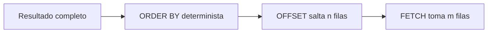

# ORDER BY, TOP y OFFSET FETCH

Parte de: [[06-SQL-Server/01 Básico/_Índice Básico|Básico]]

> [!info] Cómo avanzar
> `progreso`: **pendiente** → **viendo** (estudiando) → **visto** (contestaste la autoevaluación sin abrir las respuestas) → **dominado** (hiciste el laboratorio o lo aplicaste de verdad).

## Contenido

### Qué es
`ORDER BY` define el **orden** del resultado; es la única forma de garantizar un orden en SQL (sin él, el orden es el que le convenga al plan; ver [[Modelo relacional]]). `TOP (n)` limita cuántas filas se devuelven y `OFFSET ... FETCH` salta un número de filas y toma las siguientes, que es la base de la **paginación**. Los tres van juntos porque limitar filas sin orden no tiene sentido.

### Cómo funciona
**ORDER BY**

- Se evalúa casi al final ([[SELECT]]), por eso **sí** puede usar los alias del `SELECT`.
- `ASC` (predeterminado) o `DESC` por columna: `ORDER BY Fecha DESC, PedidoId DESC`.
- Los `NULL` van **primero** en `ASC` y al final en `DESC`. Para cambiarlo: `ORDER BY CASE WHEN Ciudad IS NULL THEN 1 ELSE 0 END, Ciudad`.
- Puede ordenar por expresiones (`ORDER BY CASE Estado WHEN ...`) y por columnas que no están en el `SELECT` (salvo con `DISTINCT`).
- El orden de textos depende de la collation (acentos, mayúsculas).

**TOP**

- `SELECT TOP (3) ... ORDER BY Precio DESC` devuelve los tres más caros. Escribe siempre los paréntesis; son obligatorios con variables (`TOP (@n)`).
- **Sin `ORDER BY`**, `TOP` devuelve *cualesquiera* n filas: el resultado puede cambiar de una ejecución a otra.
- `TOP (n) WITH TIES` incluye además las filas **empatadas** con la última según el `ORDER BY` (requiere `ORDER BY`). Si hay dos productos con el mismo precio mínimo, `TOP (1) WITH TIES` devuelve ambos.
- `TOP (10) PERCENT` existe, pero se usa poco.
- `TOP` también funciona en `UPDATE` y `DELETE` para procesar por lotes (sin orden garantizado).

**OFFSET ... FETCH** (SQL Server 2012+)

```sql
ORDER BY Fecha DESC, PedidoId DESC
OFFSET (@Pagina - 1) * @Tamano ROWS
FETCH NEXT @Tamano ROWS ONLY;
```

- Requiere `ORDER BY`.
- El `ORDER BY` debe ser **único (determinista)**: si ordenas solo por `Fecha` y varias filas tienen la misma fecha, su orden relativo puede variar entre la consulta de la página 1 y la de la página 2, y una fila puede aparecer en dos páginas o en ninguna. Agrega una columna de desempate única, normalmente la PK.
- El costo crece con el `OFFSET`: para la página 1,000 el motor lee y descarta todas las filas anteriores. Para listas muy largas existe la paginación por clave (*keyset*), explicada en [[Paginación eficiente]].



### Ejemplo
```sql
-- Los 3 productos más caros
SELECT TOP (3) ProductoId, Nombre, Precio
FROM   ventas.Productos
ORDER  BY Precio DESC, ProductoId;

-- TOP es global; para "los n primeros por grupo" usa ROW_NUMBER
-- Empates: todos los pedidos de la fecha más antigua
SELECT TOP (1) WITH TIES PedidoId, Fecha
FROM   ventas.Pedidos
ORDER  BY Fecha;

-- Paginación con total para el front
DECLARE @Pagina int = 2, @Tamano int = 3;
SELECT PedidoId, Fecha, Estado,
       COUNT(*) OVER () AS TotalFilas          -- total sin otra consulta
FROM   ventas.Pedidos
ORDER  BY Fecha DESC, PedidoId DESC            -- desempate único
OFFSET (@Pagina - 1) * @Tamano ROWS
FETCH NEXT @Tamano ROWS ONLY;
```

Con Dapper, la API de Itzamna.Dionisio recibe `pagina` y `tamano`, los valida con FluentValidation (por ejemplo, `tamano` entre 1 y 100) y los pasa como parámetros:

```csharp
public sealed class ListarPedidosValidator : AbstractValidator<ListarPedidosQuery>
{
    public ListarPedidosValidator()
    {
        RuleFor(x => x.Pagina).GreaterThanOrEqualTo(1);
        RuleFor(x => x.Tamano).InclusiveBetween(1, 100);
    }
}

var filas = await conexion.QueryAsync<PedidoFila>(sqlListarPedidos,
    new { query.Pagina, query.Tamano });
```

Nunca concatenes el orden o el tamaño como texto; si el usuario elige la columna de orden, mapea su elección a una lista blanca (`CASE` en el `ORDER BY` o SQL dinámico con `QUOTENAME`).

### Cuándo usarlo y cuándo no
- **`ORDER BY`** siempre que el orden importe a quien consume el resultado (pantallas, exportaciones, paginación). No lo pongas en subconsultas o vistas "por si acaso": ahí no garantiza nada y SQL Server lo rechaza salvo con `TOP`/`OFFSET`.
- **`TOP (n)`** para "los n primeros" con un orden claro.
- **`OFFSET/FETCH`** para paginación de listas moderadas; para "scroll infinito" o tablas enormes, *keyset pagination*.
- **"Los n primeros por grupo"** (los 2 pedidos más recientes de cada cliente) no se resuelve con `TOP`: usa `ROW_NUMBER()` o `CROSS APPLY` con `TOP` (ver [[ROW_NUMBER, RANK y DENSE_RANK]]).

### Errores comunes
1. **`TOP` sin `ORDER BY`**: resultados arbitrarios que "funcionaban" en desarrollo.
2. **Orden no determinista en la paginación**: filas repetidas o perdidas entre páginas.
3. **`ORDER BY` en una vista** esperando que las consultas sobre la vista salgan ordenadas.
4. **Páginas profundas con `OFFSET`** grande: cada vez más lentas.
5. **Ordenar por posición** (`ORDER BY 2`): se rompe en silencio cuando alguien cambia la lista del `SELECT`.

### Para profundizar
- [SELECT - ORDER BY (Transact-SQL)](https://learn.microsoft.com/sql/t-sql/queries/select-order-by-clause-transact-sql)
- [TOP (Transact-SQL)](https://learn.microsoft.com/sql/t-sql/queries/top-transact-sql)

## Ejercicios

Resuélvelos en papel o en la herramienta; la solución está plegada.

> [!question]- Con la base Tienda ([[Lab 1 - Base de práctica Tienda en SQL Server]]): los 3 productos más caros.
> ```sql
> SELECT TOP (3) Nombre, Precio
> FROM   ventas.Productos
> ORDER  BY Precio DESC;
> ```
> Laptop 14, Monitor 27, Teclado mecánico.

> [!question]- Página 2 de pedidos (3 por página), del más reciente al más antiguo.
> ```sql
> SELECT PedidoId, Fecha
> FROM   ventas.Pedidos
> ORDER  BY Fecha DESC, PedidoId DESC
> OFFSET 3 ROWS FETCH NEXT 3 ROWS ONLY;
> ```
> Pedidos 5, 4 y 3. Generalizado: `OFFSET (@Pagina - 1) * @Tam ROWS FETCH NEXT @Tam ROWS ONLY`.

> [!question]- El o los productos más baratos de Periféricos, incluyendo empates.
> ```sql
> SELECT TOP (1) WITH TIES Nombre, Precio
> FROM   ventas.Productos
> WHERE  Categoria = N'Periféricos'
> ORDER  BY Precio;
> ```
> Mouse inalámbrico (450). Si hubiera otro de 450, también saldría.

## Autoevaluación

Contesta primero en voz alta o en papel; luego despliega la respuesta.

> [!question]- ¿Qué devuelve `SELECT TOP (3) * FROM ventas.Productos` sin `ORDER BY`?
> Tres filas cualesquiera: sin `ORDER BY` el orden no está definido. `TOP` siempre debe ir con `ORDER BY` si quieres un resultado determinista.

> [!question]- ¿Para qué sirve `TOP (n) WITH TIES`?
> Incluye además las filas empatadas con la última según el `ORDER BY`. Ej.: `TOP (1) WITH TIES ... ORDER BY Precio` devuelve todos los productos con el precio mínimo.

> [!question]- ¿Por qué en `OFFSET/FETCH` el `ORDER BY` debe ser único?
> Si ordenas por una columna con empates (`Fecha`), las filas empatadas pueden cambiar de página entre consultas: duplicados o filas que nunca aparecen. Agrega un desempate único: `ORDER BY Fecha DESC, PedidoId DESC`.

## Práctica

- [[Lab 2 - Consultas de agregación y JOINs en Tienda]]

