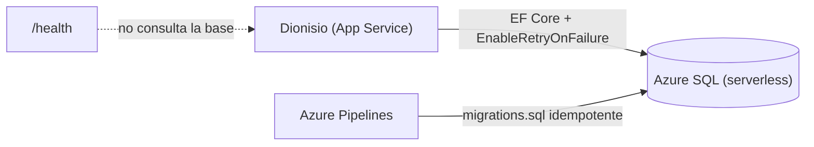

# SQL Server

> Motor relacional de Microsoft; [[Itzamna.Dionisio]] usa SQL Server local en desarrollo y Azure SQL Database en producción, siempre a través de [[Entity Framework Core]].

## Qué es y qué problema resuelve
SQL Server es una base de datos relacional con transacciones ACID, índices, esquemas (`portfolio.Tabla`), tipos como `rowversion` y `nvarchar(max)`, y funciones JSON. **Azure SQL Database** es el mismo motor como servicio administrado (copias, parches y alta disponibilidad incluidas), con un modo *serverless* que se pausa sin uso y cobra por cómputo consumido.

## Cómo funciona por dentro
- **Esquemas**: agrupan tablas dentro de una base (`portfolio.Portfolios`).
- **`rowversion`**: columna binaria de 8 bytes que el motor cambia solo en cada `UPDATE`; base de la [[Concurrencia optimista]].
- **Índices filtrados**: `CREATE INDEX ... WHERE [IsDeleted] = 0` indexan solo filas vivas; permiten unicidad "entre los no borrados".
- **`nvarchar(max)`**: texto Unicode grande; aquí guarda documentos JSON.
- **Serverless (Azure)**: tras un tiempo sin conexiones se pausa; la primera conexión lo "despierta" y tarda (de segundos a ~1 min). Las conexiones durante el arranque fallan con errores transitorios.



## Cuándo usarla y cuándo no
### Ventajas
- Proveedor de EF Core de primera clase (migraciones, `rowversion`, reintentos).
- Integración natural con Azure (App Service, pipelines, identidad).
- Índices filtrados y JSON útiles para modelos semiestructurados.
### Desventajas
- Licencia/costo mayor que PostgreSQL o SQLite fuera del plan serverless.
- Serverless: arranque en frío y errores transitorios que hay que tolerar.
- La tarea de despliegue de Azure SQL en Pipelines solo corre en agentes Windows.

## Alternativas
| Alternativa | En qué se diferencia |
|---|---|
| PostgreSQL | Open source, JSONB más potente; proveedor Npgsql para EF Core. |
| [[SQLite]] | Archivo local sin servidor; ideal para apps de escritorio (lo usa [[Ocelotl.Hermes]]). |
| Cosmos DB | Documental; sin joins ni transacciones relacionales clásicas. |
| MySQL / MariaDB | Relacional open source; menor integración con el ecosistema .NET/Azure. |

## Cómo se usó en Itzamna
- **Desarrollo**: `ConnectionStrings:Dionisio` = `Server=localhost;Database=ItzamnaDionisio;Trusted_Connection=True;TrustServerCertificate=True` (`appsettings.json`). En Development la API migra y siembra el demo al arrancar.
- **Producción**: Azure SQL (servidor `sql-itzamna-prod`, según `azure-pipelines.yml`); la cadena de conexión vive en App Service → Variables de entorno, nunca en Git.
- **Esquema** `portfolio` (`modelBuilder.HasDefaultSchema("portfolio")`), tablas `Creators`, `Portfolios`, `PortfolioSections`, `PortfolioThemeSettings`, `SocialProfiles`, `Metrics`, `ContentCategories`, `FeaturedContent`, `Services`, `Collaborations`, `Recommendations`, `MediaAssets`, `PortfolioSnapshots`, `SlugRedirects`.
- **Serverless en mente**: reintentos en EF Core y `/health` que no toca la base (`Itzamna.Dionisio/src/Itzamna.Dionisio.Infrastructure/DependencyInjection.cs` y `Program.cs`):
```csharp
services.AddDbContext<AppDbContext>(options => options.UseSqlServer(connection, sql =>
{
    sql.EnableRetryOnFailure(maxRetryCount: 5, maxRetryDelay: TimeSpan.FromSeconds(10), errorNumbersToAdd: null);
    sql.CommandTimeout(60);
}));
// Program.cs
// Salud del proceso para Azure y el pipeline. No consulta la base: así no despierta Azure SQL serverless.
app.MapHealthChecks("/health").AllowAnonymous();
```
- **Migraciones en CD**: `SqlAzureDacpacDeployment@1` con `-ConnectionTimeout 120` ("si la base está en pausa, la conexión espera hasta 2 min") en un agente `windows-2025`. Ver [[Azure Pipelines]].

> [!note] Pendiente de confirmar
> El pipeline apunta a la base `dbSeshatProd` (nombre de otro proyecto, "Seshat"). No está claro si la base se comparte con otro sistema o solo se reutilizó el nombre. Tampoco se ve en el repo el tier exacto (serverless) más allá de los comentarios.

## Errores comunes y buenas prácticas
- Health checks que consultan la base: mantienen despierta (y cobrando) una base serverless.
- No configurar reintentos: el primer request tras la pausa falla.
- Credenciales en `appsettings.json`: usar variables del App Service o grupos secretos del pipeline (como aquí).
- Índice único sin filtro con borrado lógico: impide recrear un registro "borrado" con el mismo slug.

## Qué estudiar después
- [[Entity Framework Core]], [[Concurrencia optimista]], [[Borrado lógico y auditoría]]
- Planes de ejecución, índices cubrientes, niveles de aislamiento.
- Azure SQL serverless: auto-pausa y costos.

## Documentación oficial
- https://learn.microsoft.com/sql/sql-server/
- https://learn.microsoft.com/azure/azure-sql/database/serverless-tier-overview
- https://learn.microsoft.com/ef/core/providers/sql-server/
- https://learn.microsoft.com/ef/core/miscellaneous/connection-resiliency

## Autoevaluación

Contesta primero en voz alta o en papel; luego despliega la respuesta.

> [!question]- ¿Qué diferencia hay entre instancia, base de datos y esquema en SQL Server?
> La **instancia** es el servicio instalado (p. ej. `localhost` o `localhost\SQLEXPRESS`); contiene varias **bases de datos**; cada base agrupa sus objetos en **esquemas** (`dbo`, `portfolio`). El nombre completo de una tabla es `base.esquema.tabla`.

> [!question]- ¿Cuándo usarías SQL Server Developer y cuándo Express?
> **Developer**: gratis, con todas las funciones de Enterprise, pero solo para desarrollo y pruebas. **Express**: gratis también en producción, con límites (bases de hasta 10 GB y sin SQL Server Agent). Para estudiar en tu PC, Developer es lo más completo.

> [!question]- ¿Qué herramientas cliente sirven para trabajar con SQL Server y Azure SQL?
> SSMS (la más completa, solo Windows), VS Code con la extensión MSSQL y la línea de comandos `sqlcmd`. Azure Data Studio fue retirado por Microsoft; la alternativa que recomiendan es VS Code con la extensión MSSQL (Pendiente de confirmar la fecha exacta del retiro).

> [!question]- Error común: un health check de la API hace `SELECT 1` contra Azure SQL serverless. ¿Qué problema causa?
> Mantiene la base despierta: nunca llega a la auto-pausa y sigue cobrando cómputo. El health check de proceso no debe tocar la base (o debe ir en un endpoint aparte que no consulte cada pocos segundos).

## Práctica

- [[Lab 1 - Base de práctica Tienda en SQL Server]]

