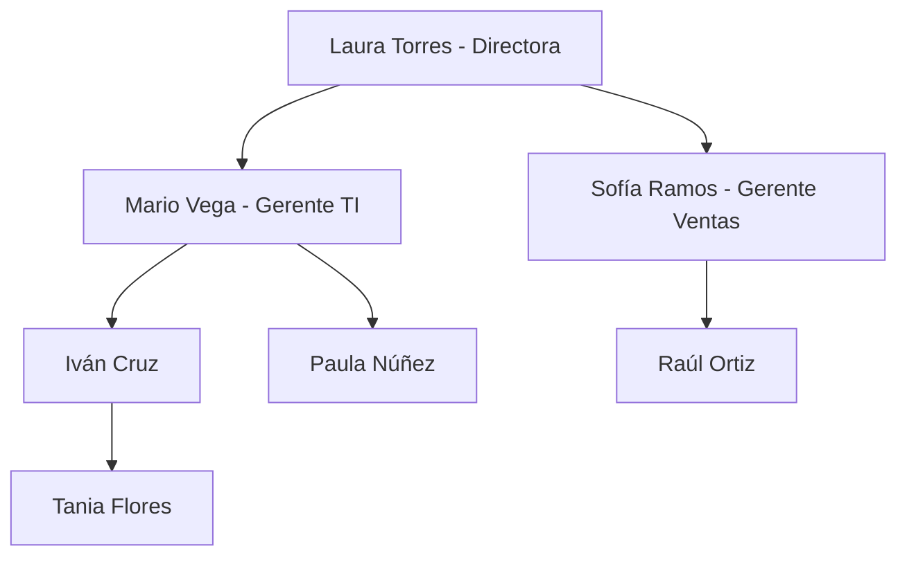

# Self join

Parte de: [[06-SQL-Server/01 Básico/_Índice Básico|Básico]]

> [!info] Cómo avanzar
> `progreso`: **pendiente** → **viendo** (estudiando) → **visto** (contestaste la autoevaluación sin abrir las respuestas) → **dominado** (hiciste el laboratorio o lo aplicaste de verdad).

## Contenido

### Qué es
Un **self join** es un JOIN de una tabla **consigo misma**, usando dos alias distintos como si fueran dos tablas. Se usa cuando las filas de una tabla se relacionan con otras filas de la **misma** tabla: empleado y jefe (una FK que apunta a la propia tabla), productos sustitutos, o para comparar filas entre sí (pares, duplicados, filas consecutivas).

### Cómo funciona
No hay sintaxis especial: es un `INNER` o `LEFT JOIN` normal donde ambos lados son la misma tabla. Los **alias** son obligatorios para distinguir los papeles: `e` (empleado) y `j` (jefe).

**Jerarquías con FK a sí misma**: en `rh.Empleados(EmpleadoId, Nombre, JefeId)`, `JefeId` referencia a `EmpleadoId`. Para mostrar cada empleado con su jefe:

- `INNER JOIN` excluye a quien no tiene jefe (la directora, con `JefeId = NULL`).
- `LEFT JOIN` la incluye con el jefe en `NULL`.

**Comparar filas entre sí (pares)**: unir la tabla consigo misma con una condición como "mismo jefe". Aquí aparece un detalle:

- Con `a.Id <> b.Id` obtienes cada par **dos veces** (Iván–Paula y Paula–Iván).
- Con `a.Id < b.Id` cada par sale **una sola vez** y además excluyes que una fila se empareje consigo misma.

**Limitación en jerarquías**: cada self join sube **un nivel**. Para "jefe del jefe" necesitas otro JOIN, y para una profundidad desconocida necesitarías un número indeterminado de JOIN. Eso se resuelve con una **CTE recursiva** (ver [[CTE recursivas]]) o con el tipo `hierarchyid`.



### Ejemplo
```sql
-- Empleado, jefe y jefe del jefe (dos niveles con dos self joins)
SELECT e.Nombre  AS Empleado,
       j.Nombre  AS Jefe,
       jj.Nombre AS JefeDelJefe
FROM   rh.Empleados AS e
LEFT   JOIN rh.Empleados AS j  ON j.EmpleadoId  = e.JefeId
LEFT   JOIN rh.Empleados AS jj ON jj.EmpleadoId = j.JefeId
ORDER  BY e.EmpleadoId;

-- Comparar con el jefe: quién gana más de la mitad que su jefe
SELECT e.Nombre, e.Salario, j.Nombre AS Jefe, j.Salario AS SalarioJefe,
       CAST(e.Salario * 100.0 / j.Salario AS decimal(5,1)) AS PorcentajeDelJefe
FROM   rh.Empleados e
JOIN   rh.Empleados j ON j.EmpleadoId = e.JefeId
WHERE  e.Salario >= j.Salario * 0.5;

-- Pares sin repetir: productos de la misma categoría con diferencia de precio menor a 1,000
SELECT a.Nombre AS ProductoA, b.Nombre AS ProductoB, a.Categoria
FROM   ventas.Productos a
JOIN   ventas.Productos b
       ON  b.Categoria  = a.Categoria
       AND a.ProductoId < b.ProductoId            -- cada par una vez
WHERE  ABS(a.Precio - b.Precio) < 1000;

-- Detectar posibles duplicados de clientes (mismo nombre, ids distintos)
SELECT a.ClienteId, b.ClienteId AS PosibleDuplicado, a.Nombre
FROM   ventas.Clientes a
JOIN   ventas.Clientes b ON b.Nombre = a.Nombre AND a.ClienteId < b.ClienteId;
```

Para comparar una fila con la **anterior** en el tiempo (pedido actual vs pedido previo del mismo cliente) antes se usaba un self join con subconsulta; hoy es más simple y eficiente con `LAG` (ver [[LAG y LEAD]]).

En Ocelotl o cualquier pantalla de organigrama en React, suele convenir que la base devuelva la lista plana `(EmpleadoId, Nombre, JefeId)` y que el front arme el árbol; el self join se usa cuando el reporte necesita columnas "Jefe" ya resueltas.

### Cuándo usarlo y cuándo no
- **Úsalo** para relaciones de un nivel (empleado–jefe, categoría–categoría padre), para buscar pares o duplicados, y para comparar filas con una condición propia.
- **CTE recursiva** para jerarquías de profundidad variable (todo el organigrama bajo un gerente).
- **`LAG`/`LEAD`** para comparar con la fila anterior o siguiente en un orden.
- Cuidado con el tamaño: un self join con una condición poco selectiva sobre una tabla grande crece de forma cuadrática.

### Errores comunes
1. **`INNER JOIN` en jerarquías**: desaparece la raíz (quien no tiene jefe).
2. **`<>` en lugar de `<`** para pares: resultados duplicados en espejo.
3. **Confundir los alias** y mostrar el salario del jefe como si fuera del empleado. Nombra los alias por su papel (`e`, `jefe`).
4. **Encadenar self joins** para "todos los niveles": se rompe cuando la jerarquía crece. Usa recursión.
5. **No indexar `JefeId`**: cada búsqueda de subordinados escanea la tabla.

### Para profundizar
- [Combinaciones (Joins): self join](https://learn.microsoft.com/sql/relational-databases/performance/joins)
- [WITH common_table_expression (recursivas)](https://learn.microsoft.com/sql/t-sql/queries/with-common-table-expression-transact-sql)
- [hierarchyid](https://learn.microsoft.com/sql/t-sql/data-types/hierarchyid-data-type-method-reference)

## Ejercicios

Resuélvelos en papel o en la herramienta; la solución está plegada.

> [!question]- Con la base Tienda ([[Lab 1 - Base de práctica Tienda en SQL Server]]): cada empleado de `rh.Empleados` con el nombre de su jefe (la directora sin jefe también debe salir).
> ```sql
> SELECT e.Nombre AS Empleado, j.Nombre AS Jefe
> FROM   rh.Empleados e
> LEFT   JOIN rh.Empleados j ON j.EmpleadoId = e.JefeId
> ORDER  BY e.EmpleadoId;
> ```
> Laura Torres → `NULL`; Mario y Sofía → Laura; Iván y Paula → Mario; Raúl → Sofía; Tania → Iván.

> [!question]- Empleados que ganan al menos el 70 % de lo que gana su jefe.
> ```sql
> SELECT e.Nombre, e.Salario, j.Nombre AS Jefe, j.Salario AS SalarioJefe
> FROM   rh.Empleados e
> JOIN   rh.Empleados j ON j.EmpleadoId = e.JefeId
> WHERE  e.Salario >= j.Salario * 0.7;
> ```
> Paula Núñez (42000 vs 60000 de Mario).

> [!question]- Pares de compañeros que tienen el mismo jefe, sin repetir el par.
> ```sql
> SELECT a.Nombre AS Empleado1, b.Nombre AS Empleado2, a.JefeId
> FROM   rh.Empleados a
> JOIN   rh.Empleados b ON b.JefeId = a.JefeId AND a.EmpleadoId < b.EmpleadoId;
> ```
> Mario Vega – Sofía Ramos (jefa 1) e Iván Cruz – Paula Núñez (jefe 2).

## Autoevaluación

Contesta primero en voz alta o en papel; luego despliega la respuesta.

> [!question]- ¿Qué es un *self join* y cuándo se usa?
> Unir una tabla consigo misma con dos alias. Típico en jerarquías (empleado → jefe), comparar filas de la misma tabla (productos de la misma categoría) o detectar duplicados.

> [!question]- ¿Por qué en un self join para «pares» se usa `a.Id < b.Id` en lugar de `a.Id <> b.Id`?
> Con `<>` cada par aparece dos veces (A-B y B-A). Con `<` aparece una sola vez y se excluye el par de una fila consigo misma.

> [!question]- ¿Qué limita al self join en jerarquías y qué lo resuelve?
> Cada join sube un solo nivel; para profundidad variable necesitas una [[CTE recursivas|CTE recursiva]] (o `hierarchyid`).

