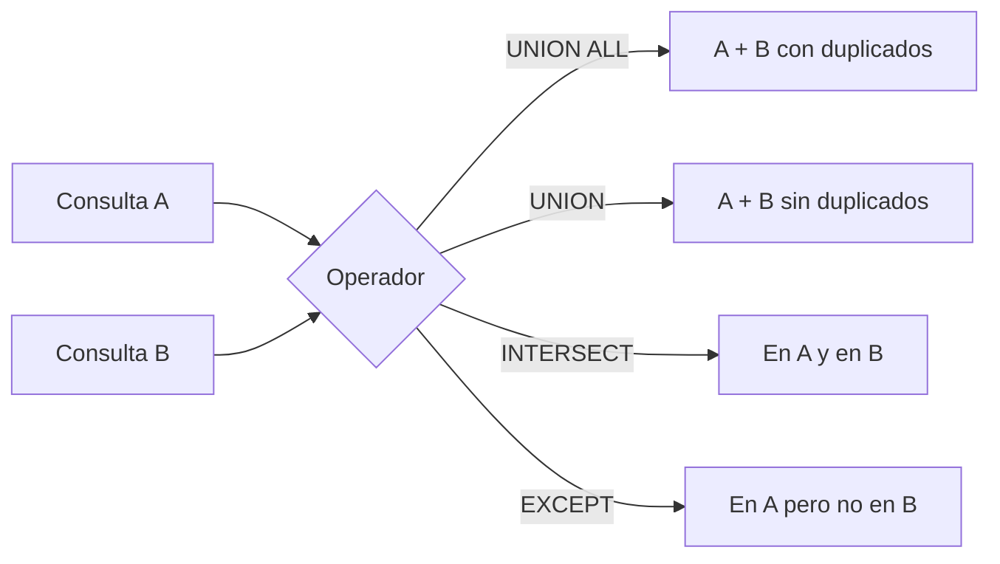

# UNION, UNION ALL, INTERSECT y EXCEPT

Parte de: [[06-SQL-Server/01 Básico/_Índice Básico|Básico]]

> [!info] Cómo avanzar
> `progreso`: **pendiente** → **viendo** (estudiando) → **visto** (contestaste la autoevaluación sin abrir las respuestas) → **dominado** (hiciste el laboratorio o lo aplicaste de verdad).

## Contenido

### Qué es
Son los **operadores de conjuntos** de SQL: combinan los resultados de dos o más consultas **verticalmente** (fila sobre fila), a diferencia de los JOIN, que combinan columnas lado a lado.

- `UNION ALL`: todas las filas de ambas consultas, con duplicados.
- `UNION`: todas las filas, **sin duplicados**.
- `INTERSECT`: filas que están en **ambas** consultas.
- `EXCEPT`: filas de la primera que **no** están en la segunda.

### Cómo funciona
**Reglas para combinar consultas**:

1. Mismo **número de columnas** en cada consulta.
2. **Tipos compatibles** en cada posición; el resultado toma el tipo de mayor precedencia (combinar `int` con `varchar` que no sea numérico falla).
3. Los **nombres** de las columnas del resultado salen de la **primera** consulta.
4. Solo puede haber **un `ORDER BY`**, al final, y aplica al resultado combinado.
5. Se combinan por **posición**, no por nombre: si inviertes el orden de dos columnas en la segunda consulta, se mezclan datos sin error.

**`UNION` vs `UNION ALL`**: `UNION` tiene que eliminar duplicados, lo que implica ordenar o usar una tabla hash sobre todo el resultado. Si sabes que no puede haber duplicados (por ejemplo, porque cada parte filtra un año distinto) o no te importan, usa **`UNION ALL`**: es más barato y no altera los datos. Elegir `UNION` "por costumbre" es una fuente común de lentitud y de filas que desaparecen sin querer (dos renglones legítimamente iguales se colapsan en uno).

**`INTERSECT` y `EXCEPT`** devuelven filas **distintas** (sin duplicados) y comparan filas completas.

**Manejo de `NULL`**: a diferencia de `=` en un `WHERE` o un JOIN, los operadores de conjuntos **tratan dos `NULL` como iguales** (igual que `DISTINCT`). Así, una fila `(1, NULL)` en ambas consultas sí aparece en el `INTERSECT` y no aparece en el `EXCEPT`. Esto los hace muy útiles para comparar tablas que tienen columnas anulables, donde un JOIN con `=` fallaría.

**Precedencia**: `INTERSECT` se evalúa antes que `UNION` y `EXCEPT`; usa paréntesis para dejar clara la intención.



### Ejemplo
```sql
-- UNION ALL: movimientos de dos tablas en una sola lista (con columna que indica el origen)
SELECT 'Pedido' AS Tipo, PedidoId AS Id, Fecha FROM ventas.Pedidos WHERE Fecha >= '2025-03-01'
UNION ALL
SELECT 'Devolucion', DevolucionId, Fecha     FROM ventas.Devoluciones WHERE Fecha >= '2025-03-01'
ORDER BY Fecha, Tipo;                         -- un solo ORDER BY al final

-- UNION: lista única de ciudades, incluyendo una de otra fuente
SELECT Ciudad FROM ventas.Clientes WHERE Ciudad IS NOT NULL
UNION
SELECT N'Puebla';

-- EXCEPT: productos que nunca se han vendido
SELECT ProductoId FROM ventas.Productos
EXCEPT
SELECT ProductoId FROM ventas.PedidoDetalle;

-- INTERSECT: clientes que compraron en febrero y en marzo
SELECT ClienteId FROM ventas.Pedidos WHERE Fecha >= '2025-02-01' AND Fecha < '2025-03-01'
INTERSECT
SELECT ClienteId FROM ventas.Pedidos WHERE Fecha >= '2025-03-01' AND Fecha < '2025-04-01';

-- Comparar dos versiones de un catálogo (con NULL) en ambos sentidos
SELECT 'Solo en origen' AS Lado, * FROM (
    SELECT Nombre, Categoria, Precio FROM stg.ProductosCarga
    EXCEPT
    SELECT Nombre, Categoria, Precio FROM ventas.Productos) AS x
UNION ALL
SELECT 'Solo en destino', * FROM (
    SELECT Nombre, Categoria, Precio FROM ventas.Productos
    EXCEPT
    SELECT Nombre, Categoria, Precio FROM stg.ProductosCarga) AS y;
```

El último patrón es útil en pruebas de cargas de Excel (Wee.Reporteria) o en pruebas de integración: si las dos partes regresan cero filas, las tablas son idénticas, incluidos los `NULL`.

### Cuándo usarlo y cuándo no
- **`UNION ALL`** para concatenar resultados de tablas o rangos distintos; es la opción por defecto.
- **`UNION`** solo cuando realmente necesitas eliminar duplicados.
- **`EXCEPT` / `INTERSECT`** para comparar conjuntos de columnas completos, sobre todo con `NULL`. Si además necesitas columnas que no participan en la comparación, usa `NOT EXISTS` / `EXISTS`, que permiten devolver la fila completa.
- **No uses `UNION`** para "pivotear" o combinar columnas lado a lado: eso es un JOIN.
- Si unes muchas tablas con la misma estructura (por año), tal vez el diseño pide una sola tabla con una columna de año, o [[Particionamiento]].

### Errores comunes
1. **`UNION` en lugar de `UNION ALL`**: costo extra y filas legítimas perdidas.
2. **Columnas en distinto orden** entre las consultas: datos mezclados sin error.
3. **`ORDER BY` en cada parte**: error; solo al final (o dentro de una subconsulta con `TOP`).
4. **Tipos incompatibles** o de distinto tamaño que truncan o fallan al convertir.
5. **Olvidar que `EXCEPT` elimina duplicados**: no sirve para contar diferencias de cantidad entre dos listas.

### Para profundizar
- [Operadores de conjuntos - UNION](https://learn.microsoft.com/sql/t-sql/language-elements/set-operators-union-transact-sql)
- [Operadores de conjuntos - EXCEPT e INTERSECT](https://learn.microsoft.com/sql/t-sql/language-elements/set-operators-except-and-intersect-transact-sql)

## Ejercicios

Resuélvelos en papel o en la herramienta; la solución está plegada.

> [!question]- Con la base Tienda ([[Lab 1 - Base de práctica Tienda en SQL Server]]): lista única de ciudades de clientes más `Puebla` (que viene de otra fuente).
> ```sql
> SELECT Ciudad FROM ventas.Clientes WHERE Ciudad IS NOT NULL
> UNION
> SELECT N'Puebla'
> ORDER BY Ciudad;
> ```
> CDMX, Guadalajara, Monterrey, Puebla.

> [!question]- Ids de productos que nunca se han vendido, con `EXCEPT`.
> ```sql
> SELECT ProductoId FROM ventas.Productos
> EXCEPT
> SELECT ProductoId FROM ventas.PedidoDetalle;
> ```
> 6 (Webcam HD).

> [!question]- Clientes que pidieron tanto en enero como en marzo de 2025, con `INTERSECT`.
> ```sql
> SELECT ClienteId FROM ventas.Pedidos WHERE Fecha >= '2025-01-01' AND Fecha < '2025-02-01'
> INTERSECT
> SELECT ClienteId FROM ventas.Pedidos WHERE Fecha >= '2025-03-01' AND Fecha < '2025-04-01';
> ```
> 1 (Ana) y 2 (Bruno).

## Autoevaluación

Contesta primero en voz alta o en papel; luego despliega la respuesta.

> [!question]- ¿Qué diferencia hay entre `UNION` y `UNION ALL`?
> `UNION` elimina duplicados (cuesta un ordenamiento o hash); `UNION ALL` concatena todo. Si sabes que no hay duplicados o no te importan, usa `UNION ALL`.

> [!question]- ¿Qué reglas deben cumplir las consultas que combinas?
> Mismo número de columnas, tipos compatibles en cada posición; los nombres salen de la primera consulta y el `ORDER BY` va una sola vez al final.

> [!question]- ¿Cómo tratan `INTERSECT` y `EXCEPT` los `NULL`?
> Los consideran iguales entre sí (como `DISTINCT`). Por eso `EXCEPT` es una forma cómoda de comparar dos conjuntos con columnas nulas, que con `=` fallaría.

## Práctica

- [[Lab 2 - Consultas de agregación y JOINs en Tienda]]

