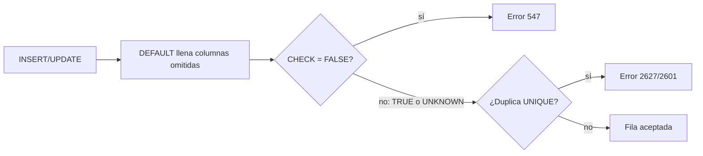

# UNIQUE, CHECK y DEFAULT

Parte de: [[06-SQL-Server/01 Básico/_Índice Básico|Básico]]

> [!info] Cómo avanzar
> `progreso`: **pendiente** → **viendo** (estudiando) → **visto** (contestaste la autoevaluación sin abrir las respuestas) → **dominado** (hiciste el laboratorio o lo aplicaste de verdad).

## Contenido

### Qué es
Son **restricciones** que la base hace cumplir en cada escritura, sin importar qué aplicación escriba:

- **`UNIQUE`**: no permite valores repetidos en una columna o combinación (claves candidatas como `Correo`, `Rfc`, `Slug`).
- **`CHECK`**: valida una condición sobre los valores de la fila (`Precio >= 0`, `Estado IN (...)`).
- **`DEFAULT`**: define el valor que toma una columna cuando el `INSERT` no la especifica.

Junto con las [[Claves primarias y foráneas]] forman la integridad declarativa: reglas que viven en la base y no se pueden saltar por un bug de la API.

### Cómo funciona
**UNIQUE**

- Crea por debajo un **índice único** (nonclustered por defecto), que además acelera las búsquedas por esa columna.
- Violarlo da el error **2627** (restricción) o **2601** (índice único).
- **En SQL Server, `UNIQUE` admite un solo `NULL`**: para la restricción, dos `NULL` cuentan como duplicados (a diferencia del estándar y de PostgreSQL, que permiten varios). Si necesitas varios `NULL` (por ejemplo, un `Rfc` opcional pero único cuando existe), usa un **índice único filtrado**: `CREATE UNIQUE INDEX ... WHERE Rfc IS NOT NULL`.

**CHECK**

- La condición se evalúa por fila; **rechaza solo si el resultado es FALSE**. Si es UNKNOWN (porque un valor es `NULL`), **la fila pasa**. Por eso `CHECK (Precio >= 0)` acepta `Precio = NULL`; si no quieres `NULL`, la columna debe ser `NOT NULL` (ver [[NULL y lógica de tres valores]]).
- Puede usar varias columnas de la misma fila: `CHECK (FechaFin IS NULL OR FechaFin >= FechaInicio)`.
- No puede consultar otras tablas directamente (se puede con una función escalar, pero es lento y poco confiable con concurrencia; mejor FK o lógica en el procedimiento).
- Violarlo da el error **547**, el mismo número que una FK; el mensaje dice el nombre de la restricción, otra razón para nombrarlas bien.

**DEFAULT**

- Se aplica cuando el `INSERT` **omite la columna** o usa la palabra `DEFAULT` (`VALUES (DEFAULT, ...)`).
- **No** se aplica si insertas `NULL` explícitamente: el `NULL` gana (y si la columna es `NOT NULL`, falla).
- No se aplica en `UPDATE` (salvo `SET col = DEFAULT`).
- Al agregar una columna `NOT NULL` con `DEFAULT` a una tabla existente, las filas actuales reciben el valor; con una columna anulable necesitas `WITH VALUES` para llenarlas.
- Ejemplos típicos: `DEFAULT (SYSUTCDATETIME())` para fechas de alta, `DEFAULT (0)` para banderas, `DEFAULT ('Pendiente')` para estados.



### Ejemplo
```sql
CREATE TABLE catalogo.Articulos (
    ArticuloId   int IDENTITY(1,1) CONSTRAINT PK_Articulos PRIMARY KEY,
    Slug         varchar(80)  NOT NULL,
    Titulo       nvarchar(150) NOT NULL,
    Precio       decimal(10,2) NOT NULL CONSTRAINT CK_Articulos_Precio CHECK (Precio >= 0),
    Descuento    decimal(5,2)  NOT NULL CONSTRAINT DF_Articulos_Descuento DEFAULT (0)
                               CONSTRAINT CK_Articulos_Descuento CHECK (Descuento BETWEEN 0 AND 100),
    VigenteDesde date NOT NULL,
    VigenteHasta date NULL,
    Borrado      bit  NOT NULL CONSTRAINT DF_Articulos_Borrado DEFAULT (0),
    FechaAltaUtc datetime2(0) NOT NULL CONSTRAINT DF_Articulos_FechaAlta DEFAULT (SYSUTCDATETIME()),
    CONSTRAINT CK_Articulos_Vigencia CHECK (VigenteHasta IS NULL OR VigenteHasta >= VigenteDesde)
);

-- Borrado lógico: el Slug debe ser único solo entre filas vivas
CREATE UNIQUE INDEX UX_Articulos_Slug_Vivos
    ON catalogo.Articulos (Slug)
    WHERE Borrado = 0;

-- DEFAULT en acción: Descuento, Borrado y FechaAltaUtc se llenan solos
INSERT INTO catalogo.Articulos (Slug, Titulo, Precio, VigenteDesde)
VALUES ('teclado-mecanico', N'Teclado mecánico', 1200, '2025-01-01');
```

Con un índice único filtrado puedes "borrar" un artículo (marcarlo `Borrado = 1`) y crear otro con el mismo `Slug`, algo imposible con un `UNIQUE` normal. Ver [[Borrado lógico y auditoría]] y [[Columnas incluidas y filtered indexes]].

En la API, valida primero con FluentValidation para dar mensajes amigables, pero **conserva** las restricciones en la base y traduce sus errores:

```csharp
catch (SqlException ex) when (ex.Number is 2627 or 2601)
{
    return Problem(statusCode: 409, title: "El slug ya existe",
        extensions: new Dictionary<string, object?> { ["codigo"] = "ARTICULO_SLUG_DUPLICADO" });
}
```

### Cuándo usarlo y cuándo no
- **`UNIQUE`** en toda clave candidata que no sea la PK (correo, RFC, folio).
- **`CHECK`** para reglas de dominio estables (rangos, listas cortas de valores, coherencia entre columnas). Para listas que cambian o crecen, mejor una tabla catálogo con FK.
- **`DEFAULT`** para valores de auditoría y estados iniciales; así la API no tiene que mandarlos.
- **No pongas reglas de negocio complejas** en `CHECK` con funciones que leen otras tablas.

### Errores comunes
1. **Esperar varios `NULL` en un `UNIQUE`**: SQL Server solo admite uno; usa un índice filtrado.
2. **Creer que `CHECK` bloquea `NULL`**: no lo hace; declara `NOT NULL`.
3. **Mandar `NULL` explícito** desde la API esperando el `DEFAULT`: no se aplica. Omite la columna en el `INSERT`.
4. **Restricciones sin nombre**: mensajes de error crípticos y migraciones imposibles de escribir de forma fija.
5. **Deshabilitar `CHECK`** en una carga y reactivarlo sin `WITH CHECK`: queda como no confiable.

### Para profundizar
- [Restricciones UNIQUE y CHECK](https://learn.microsoft.com/sql/relational-databases/tables/unique-constraints-and-check-constraints)
- [Especificar valores predeterminados para columnas](https://learn.microsoft.com/sql/relational-databases/tables/specify-default-values-for-columns)
- [Crear índices filtrados](https://learn.microsoft.com/sql/relational-databases/indexes/create-filtered-indexes)

## Autoevaluación

Contesta primero en voz alta o en papel; luego despliega la respuesta.

> [!question]- ¿Cuántos `NULL` admite una restricción `UNIQUE` en SQL Server?
> Uno solo (SQL Server trata los `NULL` como iguales para unicidad). Para permitir varios `NULL` usa un índice único filtrado: `CREATE UNIQUE INDEX UX_Clientes_Email ON ventas.Clientes(Email) WHERE Email IS NOT NULL;`.

> [!question]- Un `CHECK (Precio >= 0)`: ¿rechaza un `NULL`?
> No: el `CHECK` solo rechaza cuando la condición es FALSE; con `NULL` es UNKNOWN y pasa. Si no quieres `NULL`, declara la columna `NOT NULL`.

> [!question]- ¿Cuándo se aplica un `DEFAULT`?
> Cuando omites la columna en el `INSERT` o escribes `DEFAULT`. Si insertas `NULL` explícitamente, queda `NULL` (si la columna lo permite).

> [!question]- Caso de borrado lógico: necesitas que el `Slug` sea único solo entre filas no borradas. ¿Cómo?
> Índice único filtrado: `CREATE UNIQUE INDEX UX_Cat_Slug ON portfolio.ContentCategories(PortfolioId, Slug) WHERE IsDeleted = 0;` Ver [[Borrado lógico y auditoría]].

## Práctica

- [[Lab 1 - Base de práctica Tienda en SQL Server]]

