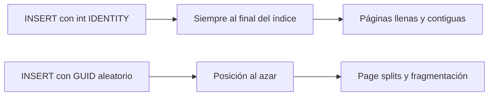

# uniqueidentifier

Parte de: [[06-SQL-Server/01 Básico/_Índice Básico|Básico]]

> [!info] Cómo avanzar
> `progreso`: **pendiente** → **viendo** (estudiando) → **visto** (contestaste la autoevaluación sin abrir las respuestas) → **dominado** (hiciste el laboratorio o lo aplicaste de verdad).

## Contenido

### Qué es
`uniqueidentifier` es el tipo de SQL Server para guardar un **GUID/UUID**: un identificador de **16 bytes** que se puede generar en cualquier lugar (base, API, cliente móvil) con probabilidad prácticamente nula de repetirse. Corresponde al `Guid` de .NET. Se usa como clave cuando los ids deben generarse fuera de la base, combinarse entre sistemas o no ser adivinables en una URL.

### Cómo funciona
- **Tamaño**: 16 bytes, frente a 4 de un `int` y 8 de un `bigint`. Como la clave del índice clustered se copia en **todos** los índices nonclustered, ese tamaño se multiplica.
- **Generación en la base**:
  - `NEWID()`: GUID **aleatorio** (versión 4).
  - `NEWSEQUENTIALID()`: GUID creciente en esa máquina desde el último reinicio de Windows; **solo** se puede usar como `DEFAULT` de una columna, no en consultas sueltas.
- **Generación en .NET**: `Guid.NewGuid()` (aleatorio) o, desde .NET 9, `Guid.CreateVersion7()` (UUID v7, con la marca de tiempo al inicio).

**El problema del GUID aleatorio como clave del índice clustered**: el índice clustered guarda las filas ordenadas por la clave. Con `int IDENTITY`, cada fila nueva va **al final**. Con GUID aleatorio, cada fila nueva cae en un punto **al azar** del índice: si esa página está llena, SQL Server la divide en dos (*page split*), mueve la mitad de las filas y registra todo en el log. Resultado: fragmentación, páginas medio vacías, más lecturas, más log y más presión en la memoria (las páginas "calientes" son todas). Ver [[Índice clustered]].

**¿GUID v7 es secuencial para SQL Server?** No necesariamente. SQL Server **no ordena** los `uniqueidentifier` byte por byte de izquierda a derecha: compara primero el **último grupo de 6 bytes**, luego los grupos anteriores en un orden particular. UUID v7 pone la marca de tiempo en los **primeros** bytes (pensado para un orden de izquierda a derecha, como el de PostgreSQL), y en SQL Server esos bytes son los **menos significativos** al ordenar. Por eso un v7 generado con `Guid.CreateVersion7()` llega casi tan desordenado como uno aleatorio. Hay bibliotecas que generan GUID "secuenciales para SQL Server" colocando la marca de tiempo en los últimos bytes, o puedes usar `NEWSEQUENTIALID()` en el `DEFAULT`. En PostgreSQL (Pochteca.Nomisma), con el tipo `uuid`, v7 sí es ordenado.



### Ejemplo
Patrón recomendado cuando necesitas exponer un id público no adivinable sin castigar el índice clustered:

```sql
CREATE TABLE ventas.Ordenes (
    OrdenId     int IDENTITY(1,1) NOT NULL
                CONSTRAINT PK_Ordenes PRIMARY KEY CLUSTERED,          -- clave interna, pequeña y creciente
    OrdenGuid   uniqueidentifier NOT NULL
                CONSTRAINT DF_Ordenes_Guid DEFAULT (NEWID())
                CONSTRAINT UQ_Ordenes_Guid UNIQUE NONCLUSTERED,       -- id público para la API
    ClienteId   int NOT NULL,
    FechaUtc    datetime2(0) NOT NULL CONSTRAINT DF_Ordenes_Fecha DEFAULT (SYSUTCDATETIME())
);

-- Si el GUID debe ser la clave clustered, al menos que sea secuencial
CREATE TABLE integracion.Eventos (
    EventoId uniqueidentifier NOT NULL
             CONSTRAINT DF_Eventos_Id DEFAULT (NEWSEQUENTIALID())
             CONSTRAINT PK_Eventos PRIMARY KEY CLUSTERED,
    Tipo     varchar(50) NOT NULL,
    Payload  nvarchar(max) NOT NULL
);
```

La API de Itzamna.Dionisio expone `/ordenes/{ordenGuid}` y usa `OrdenId` solo internamente para JOIN y FK:

```csharp
var orden = await conexion.QuerySingleOrDefaultAsync<OrdenDto>(
    "SELECT OrdenGuid, ClienteId, FechaUtc FROM ventas.Ordenes WHERE OrdenGuid = @OrdenGuid;",
    new { OrdenGuid = ordenGuid });   // Guid se envía como uniqueidentifier, sin conversión
```

### Cuándo usarlo y cuándo no
- **Úsalo** cuando el id se genera fuera de la base (clientes offline, microservicios, mensajes de Ocelotl.Hermes), cuando fusionas datos de varias bases, o como **id público** no adivinable.
- **Como clave clustered**, prefiere `int`/`bigint IDENTITY` y deja el GUID como columna única nonclustered; si el GUID tiene que ser la PK clustered, que sea `NEWSEQUENTIALID()` o un generador secuencial compatible con el orden de SQL Server.
- **No lo uses como seguridad**: un id no adivinable no sustituye la autorización (verifica que la orden pertenezca al usuario).
- No guardes GUID como `varchar(36)`/`nvarchar(36)`: ocupa más del doble y las comparaciones son más lentas.

### Errores comunes
1. **`NEWID()` como clave clustered** en tablas con muchas inserciones: fragmentación y log excesivo.
2. **Suponer que UUID v7 es ordenado en SQL Server** igual que en PostgreSQL.
3. **GUID como texto** en columnas o parámetros: más espacio y conversiones implícitas.
4. **Índices nonclustered enormes** porque arrastran una clave clustered de 16 bytes.
5. **Usar el GUID como única protección** de acceso a recursos.

### Para profundizar
- [uniqueidentifier (Transact-SQL)](https://learn.microsoft.com/sql/t-sql/data-types/uniqueidentifier-transact-sql)
- [NEWSEQUENTIALID (Transact-SQL)](https://learn.microsoft.com/sql/t-sql/functions/newsequentialid-transact-sql)
- [Comparación de valores GUID y uniqueidentifier (ADO.NET)](https://learn.microsoft.com/dotnet/framework/data/adonet/sql/comparing-guid-and-uniqueidentifier-values)
- [Guid.CreateVersion7 (.NET)](https://learn.microsoft.com/dotnet/api/system.guid.createversion7)

## Autoevaluación

Contesta primero en voz alta o en papel; luego despliega la respuesta.

> [!question]- ¿Qué es `uniqueidentifier` y cuánto ocupa?
> Un GUID de 16 bytes. Se genera con `NEWID()` (aleatorio), `NEWSEQUENTIALID()` (solo como `DEFAULT`, creciente por reinicio del servidor) o desde la aplicación (`Guid.NewGuid()`).

> [!question]- ¿Qué problema da un GUID aleatorio como clave del índice clustered?
> Cada inserción cae en una página al azar: *page splits*, fragmentación y más E/S. Alternativas: clave clustered `int`/`bigint` y el GUID como columna única, `NEWSEQUENTIALID()`, o un GUID secuencial generado de forma compatible con el orden de SQL Server.

> [!question]- ¿Un GUID v7 (`Guid.CreateVersion7()` de .NET) es secuencial para SQL Server?
> No del todo: el v7 pone la marca de tiempo en los primeros bytes, pero SQL Server compara `uniqueidentifier` empezando por el **último** grupo de 6 bytes. Por eso puede no insertarse en orden en un índice clustered de SQL Server (en PostgreSQL `uuid` sí ordena por los primeros bytes). Mídelo con la fragmentación del índice antes de asumirlo.

